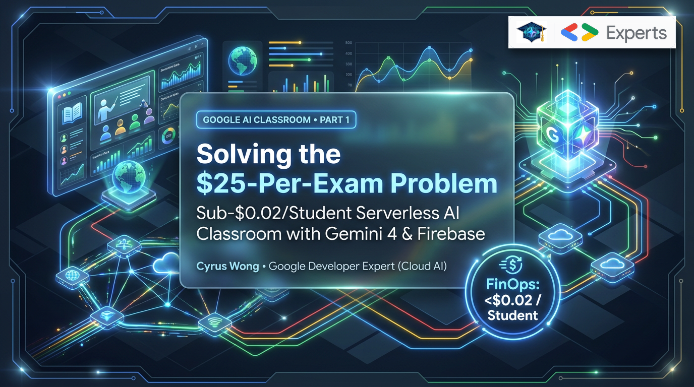
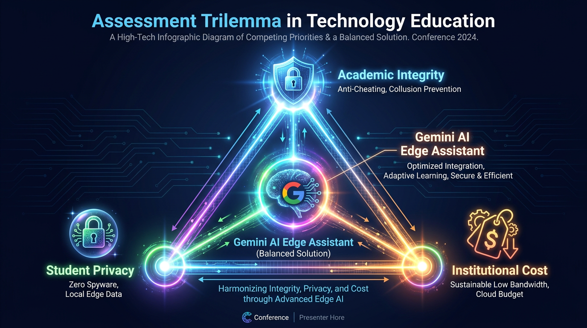
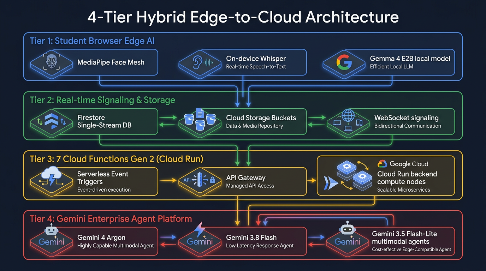
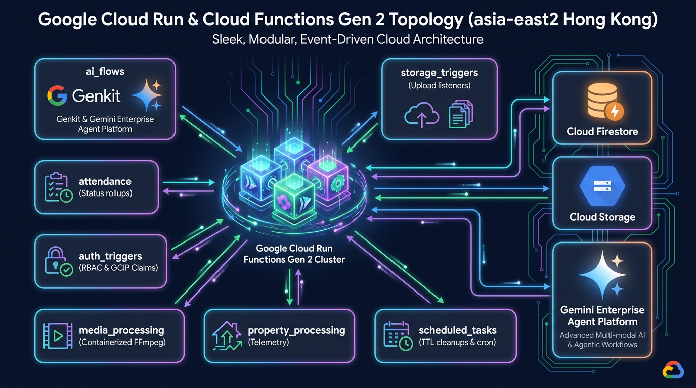
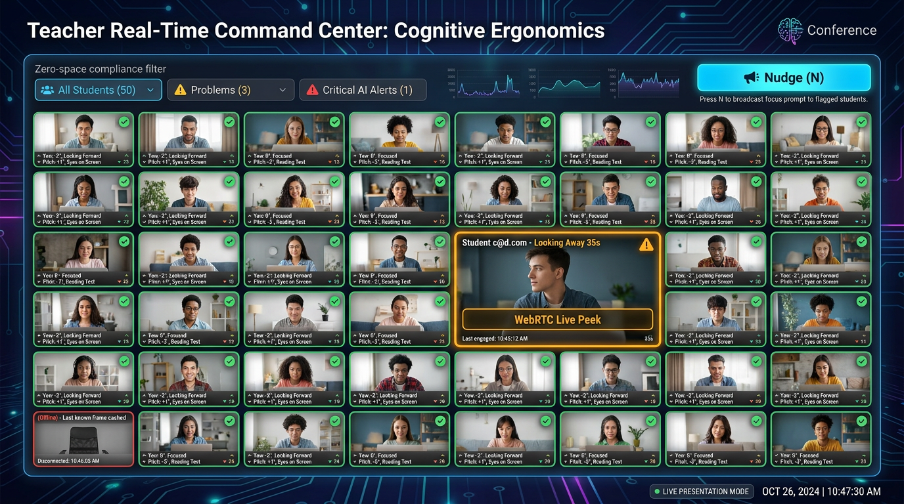
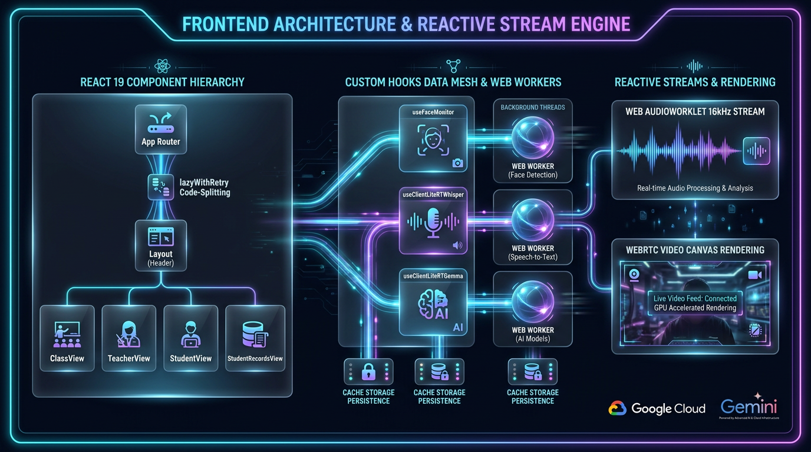
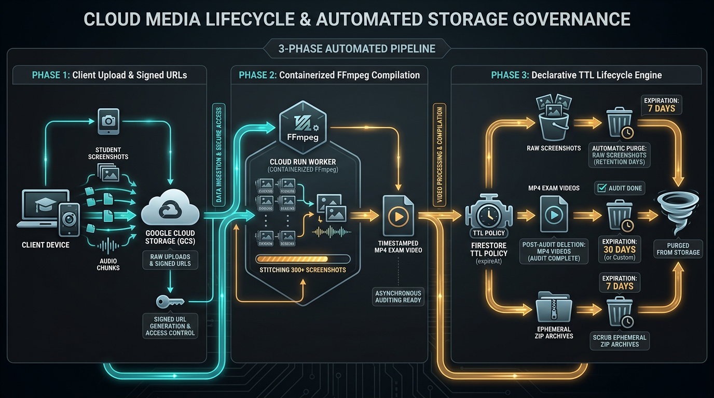

# Google AI Classroom Part 1: Architecting a Scale-to-Zero Serverless AI Classroom with Gemini 4, Gemma 4 E2B & Firebase

**Author:** [**Cyrus Wong (黃俊彥)**](https://www.linkedin.com/in/cyruswong/) — *Google Developer Expert - Cloud (AI), Senior Lecturer at HKIIT*

---



## 1. Problem Statement: Scaling Teaching, Student Performance Tracking & Proctored Assessments with Scale-to-Zero Serverless

In higher education computer laboratories, we run hundreds of hands-on Cloud Computing, Cybersecurity, and AI/ML lectures, practical labs, and examinations every semester. Across higher education globally, educators confront three fundamental challenges across **teaching, learning, student performance, and proctored assessments**:

1. **Visibility into Live Student Performance & Hands-On Learning**: During a 40-to-100+ student practical lab, a single lecturer cannot walk behind every desk simultaneously to see who is stuck on a Kubernetes YAML error, who has mastered the lab steps, or whether a capstone team's weekly logbook matches their actual working code.
2. **Real-Time Proctored Tests & Examinations Without Invigilator Overload**: In high-stakes practical tests and exams, screen captures, webcam frames, and audio evidence are recorded for the official exam audit trail—yet a human invigilator cannot watch 40+ screens, 40+ webcams, and listen to 40+ microphones at once to catch fleeting 3-second violations (glancing at a hidden phone, peeking at a neighbor's screen, or whispering answers).
3. **Institutional Cloud FinOps Sustainability**: Commercial exam-proctoring SaaS platforms charge **$15 to $25 USD per student per exam** ($750–$1,250 USD for a single 50-student test) and offer zero tools for daily lecture subtitles, live screen broadcasting, formative lab grading, or capstone project supervision.



When we engineered **Google AI Classroom** in `asia-east2` (Hong Kong), we unified **daily teaching, student performance analytics, and proctored examinations** on a single serverless architecture governed by three design principles:
- **On-Device Browser Edge AI Investigator for Proctored Exams**: Every student's browser runs **LiteRT-LM Gemma 4 E2B** (`gemma-4-E2B-it-web.litertlm`), **LiteRT Whisper-Tiny**, and **MediaPipe 3D Face Mesh** in Web Workers to continuously investigate 3D head pose, iris distance, and spoken semantic intent at 60 FPS with **$0.00 cloud AI inference cost**, immediately uploading synchronized dual screen + webcam + audio evidence whenever a confirmed exam irregularity occurs.
- **Right-Sized Frontier Cloud Reasoning for Teaching & Student Performance**: Reserve Google Cloud's frontier models—led by **Gemini 4 Argon (`gemini-4-argon`)**, **Gemini 3.8 Flash (`gemini-3.8-flash`)**, **Gemini 3.5 Flash-Lite (`gemini-3.5-flash-lite`)**, and **Gemini 3.5 Transcribe (`gemini-3.5-transcribe-preview`)**—for automated 1-FPS video rubric grading, live 9-language lecture subtitles, interactive Classroom Bingo comprehension checks, and multimodal capstone project supervision.
- **Scale-to-Zero Serverless FinOps**: Total cloud infrastructure cost stays **under $0.02 USD per student-hour** during active classes and exams, and drops to **$0.00 during weekends and semester breaks**.

---

## 2. Architectural Deep-Dive: The 4-Tier Hybrid Edge-to-Cloud Blueprint

To support both interactive daily teaching and high-integrity proctored examinations without saturating campus Wi-Fi or cloud API quotas, we decoupled high-frequency on-device investigation (**Tier 1 Browser Edge**) from real-time classroom signaling & evidence storage (**Tier 2 Firestore & Cloud Storage**), domain-isolated serverless compute (**Tier 3 Cloud Functions Gen 2 / Cloud Run**), and multimodal AI evaluation (**Tier 4 Vertex AI / Google Genkit**).



### How the 4 Tiers Work Together in Live Labs & Proctored Exams
1. **Tier 1 (Student Browser Edge Investigator)**: Every frame from the student's webcam is analyzed in a dedicated Web Worker via MediaPipe's 478-point 3D Face Landmarker (including iris rings `468..477`), while ambient microphone audio is gated by an RMS energy detector, transcribed locally by **LiteRT Whisper-Tiny**, and evaluated for exam collusion by **LiteRT-LM Gemma 4 E2B** (`gemma-4-E2B-it-web.litertlm`). When a sustained (>3.0s) visual or spoken exam irregularity is confirmed, synchronized dual screen + webcam + audio evidence is immediately captured and uploaded for the invigilator.
2. **Tier 2 (Firebase Real-Time Backbone & Evidence Archive)**: Periodic screen captures (every 15–30 seconds), webcam snapshots, audio segments, and irregularity evidence are uploaded directly to Google Cloud Storage (`asia-east2`) under strict Firebase Security Rules (`isExam` write-once locks during exams), while lightweight JSON telemetry updates the teacher's live monitoring grid in Firestore.
3. **Tier 3 (7 Cloud Functions Gen 2 Codebases)**: Event-driven Cloud Run microservices compile 1-FPS time-lapse MP4s via `ffmpeg`, enforce minute-by-minute attendance bitmasks, track 9-category storage quotas, and dispatch rate-limited AI grading tasks through Google Cloud Tasks.
4. **Tier 4 (Gemini 4 & 3 Model Matrix)**: Teachers can choose **Gemini 4 Argon (`gemini-4-argon`)**, **Gemini 3.8 Flash (`gemini-3.8-flash`)**, or **Gemini 3.5 Flash-Lite (`gemini-3.5-flash-lite`)** across every classroom workflow—from live IDE code inspection and practical task rubric synthesis to post-class cohort Map-Reduce video grading.

---

## 3. Domain-Driven Isolation Across 7 Cloud Functions Gen 2 Codebases

A classic architectural mistake in serverless Firebase applications is dumping every trigger and callable endpoint into a single monolithic `functions/index.js`. In a monolithic deployment, two architectural problems arise:
- **Cold-Start Contamination**: Packaging `fluent-ffmpeg`, `@ffmpeg-installer/ffmpeg`, `sharp`, and `@google-cloud/tasks` alongside lightweight Google Cloud Identity Platform (GCIP) blocking functions (`beforeUserCreated`, `beforeUserSignedIn`) inflates container cold starts and causes login delays for students scanning classroom QR codes.
- **Blast-Radius & Memory Over-Provisioning**: Video compilation (`compileVideo`) requires **2 vCPUs and 8 GiB of RAM** with a **540-second timeout**, whereas an attendance heartbeat or CSV property upload needs only **256 MiB of RAM**.

In [`firebase.json`](https://github.com/wongcyrus/Google-AI-Classroom/blob/main/firebase.json), we partitioned our backend into **7 isolated Cloud Functions Gen 2 micro-codebases** running on Node.js 22, each with its own independent `package.json`, dependency tree, memory profile, and CI/CD deployment guard:



### Production Code Listing 1: Multi-Codebase & Hosting Build Guard in [`firebase.json`](https://github.com/wongcyrus/Google-AI-Classroom/blob/main/firebase.json)

Notice how [`firebase.json`](https://github.com/wongcyrus/Google-AI-Classroom/blob/main/firebase.json) not only isolates the 7 `nodejs22` function codebases, but also enforces a **predeploy environment verification guard** on Firebase Hosting so a developer can never accidentally deploy a `dev`-configured React bundle to the production project (`it114115-2627`), while serving `.wasm` binaries with proper MIME headers for MediaPipe and LiteRT:

```json
{
  "functions": [
    {
      "source": "functions/ai_flows",
      "codebase": "ai-flows",
      "runtime": "nodejs22",
      "ignore": ["node_modules", ".git", "firebase-debug.log", "firebase-debug.*.log"]
    },
    {
      "source": "functions/media_processing",
      "codebase": "media-processing",
      "runtime": "nodejs22",
      "ignore": ["node_modules", ".git", "firebase-debug.log", "firebase-debug.*.log"]
    },
    {
      "source": "functions/property_processing",
      "codebase": "property-processing",
      "runtime": "nodejs22",
      "ignore": ["node_modules", ".git", "firebase-debug.log", "firebase-debug.*.log"]
    },
    {
      "source": "functions/scheduled_tasks",
      "codebase": "scheduled-tasks",
      "runtime": "nodejs22",
      "ignore": ["node_modules", ".git", "firebase-debug.log", "firebase-debug.*.log"]
    },
    {
      "source": "functions/auth_triggers",
      "codebase": "auth-triggers",
      "runtime": "nodejs22",
      "ignore": ["node_modules", ".git", "firebase-debug.log", "firebase-debug.*.log"]
    },
    {
      "source": "functions/storage_triggers",
      "codebase": "storage-triggers",
      "runtime": "nodejs22",
      "ignore": ["node_modules", ".git", "firebase-debug.log", "firebase-debug.*.log"]
    },
    {
      "source": "functions/attendance",
      "codebase": "attendance",
      "runtime": "nodejs22",
      "ignore": ["node_modules", ".git", "firebase-debug.log", "firebase-debug.*.log"]
    }
  ],
  "hosting": {
    "public": "web-app/dist",
    "predeploy": [
      "grep -q \"${GCLOUD_PROJECT}.firebaseapp.com\" web-app/dist/assets/index-*.js 2>/dev/null || (echo \"⚠️ [Hosting Guard] Rebuilding web-app/dist for ${GCLOUD_PROJECT}...\" && ./switch-env.sh \"${GCLOUD_PROJECT}\" && if [ \"${GCLOUD_PROJECT}\" = \"it114115-2627\" ]; then npm --prefix web-app run build:prod; else npm --prefix web-app run build:dev; fi)",
      "grep -q \"${GCLOUD_PROJECT}.firebaseapp.com\" web-app/dist/assets/index-*.js && echo \"✅ [Hosting Guard] Verified web-app/dist matches ${GCLOUD_PROJECT}.\""
    ],
    "headers": [
      {
        "source": "**/*.wasm",
        "headers": [{ "key": "Content-Type", "value": "application/wasm" }]
      },
      {
        "source": "/index.html",
        "headers": [{ "key": "Cache-Control", "value": "no-cache, no-store, must-revalidate" }]
      }
    ]
  }
}
```

---

## 4. Implementation Walkthrough: Defeating the Firestore $O(N^2)$ Read Explosion & Protecting Operational State

In a naive real-time classroom application, if 50 students write their telemetry every 5 seconds to individual documents (`classes/{classId}/students/{studentUid}`) and 3 instructors/TAs open the live monitoring dashboard, a single 3-hour practical exam can trigger **hundreds of thousands of Firestore document reads** and cause React state thrashing on the teacher's browser.



We solved this with a dual-path telemetry design connecting [`useFaceMonitor.js`](https://github.com/wongcyrus/Google-AI-Classroom/blob/main/web-app/src/hooks/useFaceMonitor.js), [`useClientLiteRTGemma.js`](https://github.com/wongcyrus/Google-AI-Classroom/blob/main/web-app/src/hooks/useClientLiteRTGemma.js), and [`functions/property_processing/index.mjs`](https://github.com/wongcyrus/Google-AI-Classroom/blob/main/functions/property_processing/index.mjs):



### Edge Case 1: Preventing Teacher CSV Uploads from Wiping Live Exam State

During live classes, teachers frequently upload a revised CSV spreadsheet (to assign lab seats, project group numbers, or GitHub usernames) into `classes/{classId}/studentProperties/{uid}` using **Sync Mode** (which deletes columns removed from the spreadsheet). Early on, we realized a critical hazard: `studentProperties/{uid}` also stores real-time operational state—such as `activeBingo`, `strikeNumber`, `passkey`, `examReadiness`, and `attention` telemetry!

If Sync Mode blindly deleted every field not present in the teacher's CSV headers, uploading a seat chart mid-exam would wipe out students' WebAuthn Passkey bindings and active Bingo challenges.

### Production Code Listing 2: Protected Internal Key Guard in [`functions/property_processing/index.mjs`](https://github.com/wongcyrus/Google-AI-Classroom/blob/main/functions/property_processing/index.mjs)

Here is how [`isInternalPropertyKey`](https://github.com/wongcyrus/Google-AI-Classroom/blob/main/functions/property_processing/index.mjs) and batched 450-document writes in [`functions/property_processing/index.mjs`](https://github.com/wongcyrus/Google-AI-Classroom/blob/main/functions/property_processing/index.mjs) guarantee that teacher spreadsheet syncs never clobber live telemetry or authentication state:

```javascript
/**
 * Identifies internal system/operational keys and profile metadata
 * that should never be overwritten or deleted by custom property uploads.
 */
export const isInternalPropertyKey = (key) => {
    if (!key || typeof key !== 'string') return true;
    const lower = key.toLowerCase().trim();
    const internalPrefixes = [
        'activebingo', 'pendingretry', 'priormissed', 'retrybingo',
        'retrydelay', 'lastretry', 'lastbingo', 'retrycancelled',
        'passkey', 'lastinattentive', 'inattentive', 'attention',
        'lastattention', 'lastactivity', 'lastseen', 'presence',
    ];
    if (internalPrefixes.some((prefix) => lower === prefix || lower.startsWith(prefix))) {
        return true;
    }
    const exactInternalKeys = new Set([
        'strikenumber', 'bingostats', 'examreadiness', 'retrycancelledreason',
        'passkeybypass', 'lastinattentiveat', 'status', 'updatedat',
        'createdat', 'studentname', 'nickname', 'programme', 'program',
        'studentclass', 'cohort', 'email', 'studentemail',
    ]);
    return exactInternalKeys.has(lower);
};
```

When `processPropertyUpload` runs in `sync` mode, it strips UTF-8 BOM markers from Excel-exported CSVs, resolves missing student UIDs in 100-user chunks via Firebase Auth (`auth.getUsers`), and selectively deletes only obsolete *custom* columns while leaving every internal operational key untouched:

```javascript
// In sync mode: if an existing custom property is NOT in the uploaded columns,
// delete it so that removing columns from the spreadsheet deletes them in Firestore.
if (isSyncMode) {
    for (const existingKey of currentKeys) {
        if (!uploadedPropertyKeys.includes(existingKey)) {
            updatePayload[existingKey] = FieldValue.delete();
        }
    }
}
const docRef = db.collection('classes').doc(classId).collection('studentProperties').doc(uid);
batch.set(docRef, updatePayload, { merge: true });
```

---

## 5. Edge Cases & Production Failure Modes We Solved: Zero-Orphan Cascading Storage Purge

Another silent cost killer in educational cloud platforms is **orphaned media storage**. Over a 15-week semester, a single class generates thousands of periodic WebP/JPEG screenshots, student audio clips, 1-FPS compiled MP4 videos, lecture recordings, `.vtt`/`.srt` subtitle tracks, and 720p capstone demo videos across 13 Cloud Storage prefixes and 27+ Firestore collections/subcollections.

If a teacher deletes an old class document (`classes/{classId}`) or shortens the class's data-retention window (`retentionDays` / `videoRetentionDays`), standard Firestore deletion leaves every subcollection document and gigabytes of Cloud Storage blobs behind—accumulating perpetual storage bills across semesters.



### Production Code Listing 3: 4-Stage Cascading Class Purge in [`functions/storage_triggers/cleanupTriggers.js`](https://github.com/wongcyrus/Google-AI-Classroom/blob/main/functions/storage_triggers/cleanupTriggers.js)

In [`functions/storage_triggers/cleanupTriggers.js`](https://github.com/wongcyrus/Google-AI-Classroom/blob/main/functions/storage_triggers/cleanupTriggers.js), we implemented `onClassDocDeleted` and `onClassRetentionUpdated`. Whenever a class document is deleted, `onClassDocDeleted` executes a 4-stage cascading cleanup across Cloud Storage and Firestore in 500-document batches:

```javascript
export const onClassDocDeleted = onDocumentDeleted({
  document: 'classes/{classId}',
  region: FUNCTION_REGION,
  timeoutSeconds: 540,
  memory: '512MiB',
}, async (event) => {
  const classId = event.params.classId;
  logger.info(`Class ${classId} was deleted. Commencing complete cascading purge...`);

  // Stage 1: Purge all 13 physical Cloud Storage prefixes for this class
  const bucket = storage.bucket();
  const prefixes = [
    `screenshots/${classId}/`, `videos/${classId}/`, `zips/${classId}/`,
    `audio/${classId}/`, `recordings/${classId}/`, `subtitles/${classId}/`,
    `irregularities/${classId}/`, `classes/${classId}/`, `tasks/${classId}/`,
    `submissions/${classId}/`, `reports/${classId}/`, `taskDemos/${classId}/`,
    `projectMeetings/${classId}/`
  ];
  for (const prefix of prefixes) {
    await bucket.deleteFiles({ prefix, force: true }).catch((err) =>
      logger.warn(`Could not purge prefix ${prefix}:`, err)
    );
  }

  // Stage 2: Purge 11 root Firestore collections matching classId in 500-doc batches
  const collectionsToClean = [
    'screenshots', 'audio', 'videoJobs', 'zipJobs', 'videoAnalysisJobs',
    'irregularities', 'progress', 'propertyUploadJobs',
    'lectureMergeJobs', 'lectureSubtitleJobs', 'aiJobs'
  ];
  for (const col of collectionsToClean) {
    await deleteCollectionByClassId(col, classId);
  }

  // Stage 3: Purge 19 class subcollections + nested task submissions
  const subcollectionsToPurge = [
    'projectMeetings', 'projectGroups', 'projectStudentProfiles',
    'activeMeetingCaptures', 'lectureRecordings', 'bingoSessions',
    'status', 'lessons', 'bingoRecords', 'attendanceAdjustments',
    'studentProperties', 'classProperties', 'passkeyBypassRequests',
    'screenBroadcastViewers', 'messages', 'audio_audits',
    'irregularities', 'questionBank'
  ];
  for (const subcol of subcollectionsToPurge) {
    await deleteSubcollectionByPath(`classes/${classId}/${subcol}`);
  }

  // Stage 4: Unlink deleted classId from teacherProfiles & studentProfiles arrays
  await removeClassFromProfiles('teacherProfiles', classId);
  await removeClassFromProfiles('studentProfiles', classId);
});
```

Furthermore, whenever an individual `screenshots/{id}`, `audio/{id}`, `videoJobs/{id}`, or `zipJobs/{id}` document expires via **Firestore Native TTL (`expireAt`)**, dedicated `onDocumentDeleted` triggers (`onScreenshotDocDeleted`, `onAudioDocDeleted`, `onVideoJobDocDeleted`) immediately delete the corresponding physical blob in Cloud Storage—guaranteeing **zero orphaned storage bytes**.

### Production Code Listing 4: 9-Category Real-Time Storage Quota Enforcement & Self-Healing Drift Guard in [`functions/storage_triggers/storageQuota.js`](https://github.com/wongcyrus/Google-AI-Classroom/blob/main/functions/storage_triggers/storageQuota.js)

In addition to cascading deletion, every physical blob uploaded to Cloud Storage is tracked in real time across **9 distinct storage categories** (`storageUsageScreenShots`, `storageUsageVideos`, `storageUsageRecordings`, `storageUsageAudio`, `storageUsageIrregularities`, `storageUsageZips`, `storageUsageTasks`, `storageUsageReports`, and `storageUsageProjectMeetings`). If an upload pushes a class over its configured `storageQuota`, `updateStorageUsageOnUpload` in [`functions/storage_triggers/storageQuota.js`](https://github.com/wongcyrus/Google-AI-Classroom/blob/main/functions/storage_triggers/storageQuota.js) automatically deletes the offending blob and rolls back the atomic `FieldValue.increment` counter:

```javascript
export function getStorageCategoryAndClass(filePath) {
  if (!filePath || typeof filePath !== 'string') return null;
  const parts = filePath.split('/');
  if (parts.length < 3) return null;

  if (parts[0] === 'classes') {
    return { classId: parts[1], usageField: 'storageUsageTasks' };
  }

  const classId = parts[1];
  if (parts[0] === 'screenshots') return { classId, usageField: 'storageUsageScreenShots' };
  if (parts[0] === 'videos') return { classId, usageField: 'storageUsageVideos' };
  if (parts[0] === 'recordings' || parts[0] === 'subtitles') return { classId, usageField: 'storageUsageRecordings' };
  if (parts[0] === 'audio') return { classId, usageField: 'storageUsageAudio' };
  if (parts[0] === 'irregularities') return { classId, usageField: 'storageUsageIrregularities' };
  if (parts[0] === 'zips') return { classId, usageField: 'storageUsageZips' };
  if (parts[0] === 'tasks' || parts[0] === 'submissions') return { classId, usageField: 'storageUsageTasks' };
  if (parts[0] === 'reports') return { classId, usageField: 'storageUsageReports' };
  if (parts[0] === 'projectMeetings') return { classId, usageField: 'storageUsageProjectMeetings' };
  return null;
}

// Inside updateStorageUsageOnUpload (onObjectFinalized):
if (quota > 0 && usage > quota) {
  console.log(`Quota exceeded for class ${classId}. Usage: ${usage}, Quota: ${quota}. Deleting file: ${filePath}`);
  await adminStorage.bucket(event.bucket).file(filePath).delete();
  await storageRef.update({
    storageUsage: FieldValue.increment(-fileSize),
    [usageField]: FieldValue.increment(-fileSize),
  });
}
```

---

## 6. Architectural FinOps Design: Why Edge AI + Scale-to-Zero Serverless Keeps Costs Minimal

By executing continuous biometric vision and speech-intent classification inside the student's browser (`Gemma 4 E2B` + `Whisper-Tiny` + `MediaPipe`) and invoking **Gemini 4 Argon (`gemini-4-argon`)**, **Gemini 3.8 Flash (`gemini-3.8-flash`)**, and **Gemini 3.5 Flash-Lite (`gemini-3.5-flash-lite`)** strictly on compact, event-driven artifacts, the platform eliminates continuous cloud media streaming and idle server billing:

| Architectural Component | Traditional Cloud Proctoring Approach | Google AI Classroom Design (`asia-east2`) | FinOps Architectural Advantage |
| :--- | :--- | :--- | :--- |
| **Live Biometric Face, Gaze & Phone Proctoring** | Continuous Cloud GPU Video Streaming | **On-Device MediaPipe Web Worker** | **$0.00 Cloud Inference Cost** |
| **Ambient Speech Intent Classification** | Continuous Cloud Audio Streaming | **On-Device Whisper + Gemma 4 E2B** | **$0.00 Cloud Inference Cost** |
| **Signaling & Classroom Telemetry** | Dedicated Always-On WebSockets Cluster | **Single-Document Firestore `studentProperties/{uid}`** | **Pay-Per-Write Serverless** |
| **Lab Recording Compilation** | Raw High-Bitrate Video Storage | **Cloud Run FFmpeg 1-FPS H.264 MP4 Compilation** | **Compact Storage & Token Footprint** |
| **Automated Rubric Video Grading** | Manual Grader Review | **Teacher-Selectable `gemini-3.5-flash-lite`, `gemini-3.8-flash`, or `gemini-4-argon`** | **On-Demand Per-Job Token Billing** |
| **Idle Cost Outside Scheduled Class Hours** | Annual Per-Seat License Lock-In | **100% Scale-to-Zero (`minInstances: 0`)** | **$0.00 Idle Infrastructure Cost** |

---

## 7. Key Takeaways for Google Cloud & EdTech Builders

1. **Run Real-Time Exam Investigation at the Browser Edge**: Use WebGPU and WebAssembly to run **LiteRT-LM Gemma 4 E2B**, **LiteRT Whisper**, and **MediaPipe 3D Face Mesh** locally in Web Workers—catching fleeting 3-second exam irregularities across 40+ seats at 60 FPS and $0.00 cloud inference cost while automatically uploading synchronized dual screen + webcam + audio evidence.
2. **Split Monolithic Cloud Functions by Resource Profile**: Isolating heavy `ffmpeg`/`sharp` workloads (`media-processing`, 8 GiB RAM) from authentication (`auth-triggers`, 256 MiB RAM) and Genkit AI orchestration (`ai-flows`, 1 GiB RAM) in [`firebase.json`](https://github.com/wongcyrus/Google-AI-Classroom/blob/main/firebase.json) eliminates cold-start latency and slashes container memory billing.
3. **Give Teachers Model Choice Across Every Teaching & Grading Workflow**: By exposing **Gemini 4 Argon (`gemini-4-argon`)**, **Gemini 3.8 Flash (`gemini-3.8-flash`)**, and **Gemini 3.5 Flash-Lite (`gemini-3.5-flash-lite`)** in every UI picker, educators can use `gemini-3.5-flash-lite` for sub-second live teaching interactions and switch to `gemini-4-argon` when evaluating student performance on complex multi-step code or synthesizing new rubrics.
4. **Automate Data Lifecycle & Cascading Storage Purges**: Pairing Firestore Native TTL (`expireAt`) with cascading `onDocumentDeleted` Storage triggers in [`cleanupTriggers.js`](https://github.com/wongcyrus/Google-AI-Classroom/blob/main/functions/storage_triggers/cleanupTriggers.js) prevents silent storage bill creep after exams and semesters conclude.
