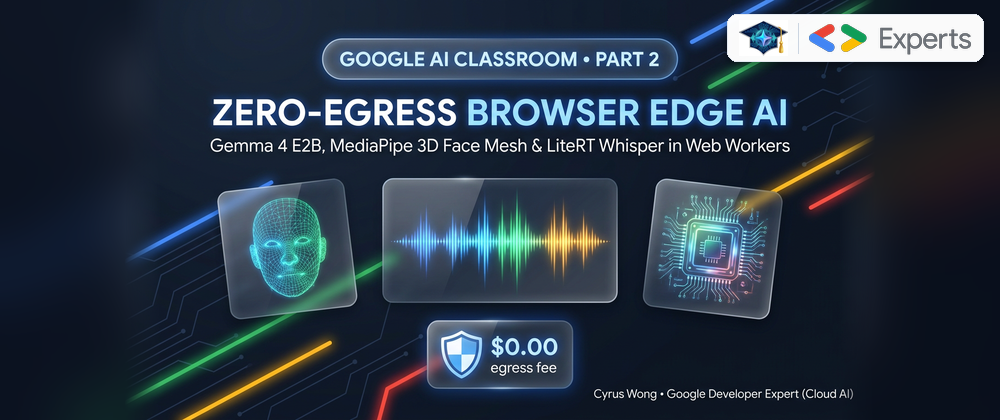
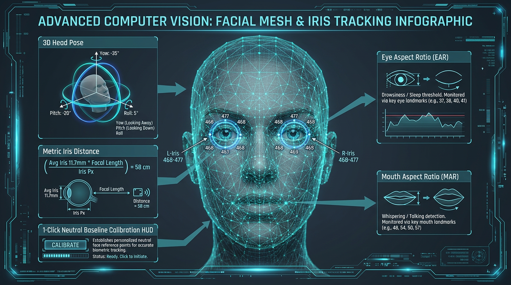
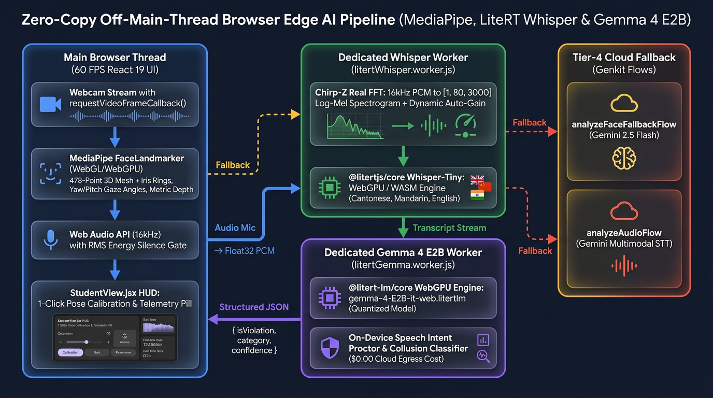
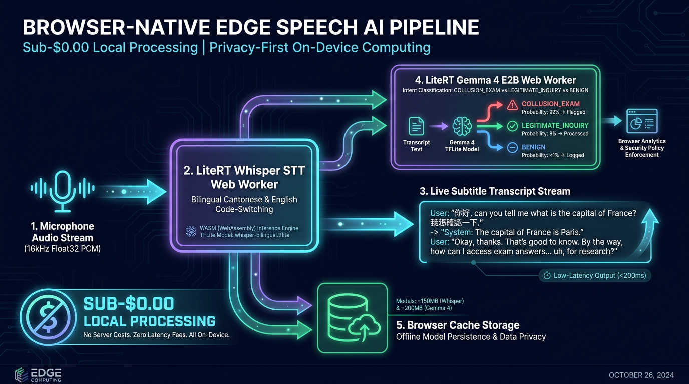
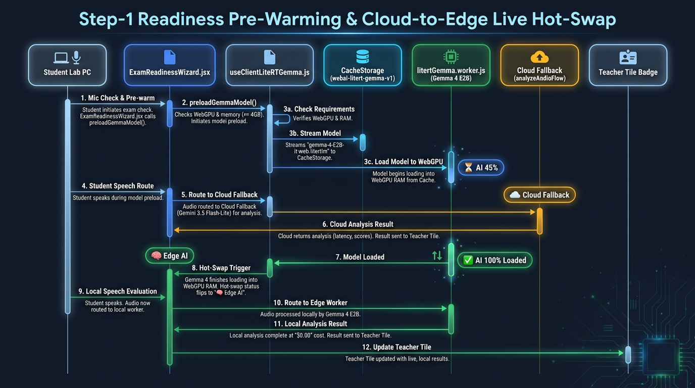

# Google AI Classroom Part 2: Zero-Egress Browser Edge AI Investigator — Running Gemma 4 E2B, MediaPipe 3D Face Mesh & LiteRT Whisper in Web Workers

**Author:** [**Cyrus Wong (黃俊彥)**](https://www.linkedin.com/in/cyruswong/) — *Google Developer Expert - Cloud (AI), Senior Lecturer at HKIIT*

---



## 1. Problem Statement: Why Proctored Tests & Practical Examinations Need an On-Device Browser Edge AI Investigator

In proctored tests and practical examinations at **HKIIT / VTC**, student screen captures, webcam frames, and audio evidence are recorded and uploaded to Cloud Storage for official exam invigilation and forensic audit trails. However, relying solely on human invigilators or cloud-polled snapshots during a live 40-to-100+ student examination creates three critical operational blind spots:

1. **The Human Invigilator Attention Bottleneck**: A single lecturer or invigilator cannot simultaneously watch 40+ student screens, 40+ live webcam feeds, and listen to 40+ microphones in real time to catch fleeting exam misconduct—such as glancing at a concealed smartphone, peeking at a neighbor's monitor, whispering answers, or querying a voice assistant.
2. **Fleeting Violations Between Snapshots vs. 432,000+ Cloud AI Calls**: Periodic cloud screen and webcam snapshots provide the historical archive, but a 3.5-second glance at a cheat sheet or a whispered answer often occurs *between* polling intervals. Conversely, streaming 30-FPS video and continuous audio from 40 exam seats to Cloud LLMs for real-time AI inspection every second would require **432,000+ cloud API calls per 3-hour exam**—saturating exam lab bandwidth, triggering API rate limits, and incurring runaway cloud inference costs.
3. **High False-Positive Rates Without Local Geometric & Semantic Reasoning**: During a practical coding or cloud exam, students naturally blink, glance down at their keyboard, read exam questions aloud to themselves (*"Let me check Question 3"*), or call the invigilator for technical assistance (*"Mr. Wong, my Docker daemon crashed"*). Naive motion or audio-level triggers flood invigilators with false alarms.

Using **Google MediaPipe (`@mediapipe/tasks-vision`)**, **Google LiteRT.js (`@litertjs/core` Whisper-Tiny)**, and **LiteRT-LM WebGPU (`@litert-lm/core` Gemma 4 E2B `gemma-4-E2B-it-web.litertlm`)**, we turned every student's browser into an always-on **Zero-Egress Browser Edge AI Investigator**—continuously inspecting 3D head pose, iris metric distance, and spoken semantic intent at 60 FPS with **$0.00 cloud AI inference egress**, and immediately flagging confirmed exam irregularities with synchronized dual screen + webcam + audio evidence for the invigilator.



---

## 2. Architectural Deep-Dive: Off-Main-Thread Web Worker & Hardware Frame Sync Pipeline

Running a 478-point 3D facial landmark detector, an iris-depth estimator, a Chirp-Z log-Mel spectrogram extractor, a Whisper speech-to-text model, and a 2-billion-parameter **Gemma 4 E2B** LLM on the main React thread would freeze the browser UI immediately.

In [`useFaceMonitor.js`](https://github.com/wongcyrus/Google-AI-Classroom/blob/main/web-app/src/hooks/useFaceMonitor.js), [`litertWhisper.worker.js`](https://github.com/wongcyrus/Google-AI-Classroom/blob/main/web-app/src/workers/litertWhisper.worker.js), [`litertGemma.worker.js`](https://github.com/wongcyrus/Google-AI-Classroom/blob/main/web-app/src/workers/litertGemma.worker.js), and [`useClientLiteRTGemma.js`](https://github.com/wongcyrus/Google-AI-Classroom/blob/main/web-app/src/hooks/useClientLiteRTGemma.js), we isolate speech and LLM reasoning inside dedicated Web Workers while synchronizing vision landmark detection to the browser's hardware video decoder via `requestVideoFrameCallback()`:



---

## 3. Implementation Walkthrough 1: 478-Point 3D Face Mesh, Iris Metric Depth & The 3-Second Debounce State Machine

Legacy proctoring software is notorious for false-positive alerts: if a student sneezes, blinks, or glances down at their mechanical keyboard for 500 milliseconds, they get flagged for "cheating." Conversely, if a student sits in a corner desk where their webcam is mounted at a $15^\circ$ angle, uncalibrated head-pose detectors flag them continuously.

We solved both problems in [`useFaceMonitor.js`](https://github.com/wongcyrus/Google-AI-Classroom/blob/main/web-app/src/hooks/useFaceMonitor.js) through three mathematical and state-machine innovations:
1. **1-Click Adaptive Neutral Pose Calibration (`calibrateBaseline`)**: Students click **🎯 Set Center Pose** to zero out their personal baseline head Yaw ($\text{Yaw}_0$) and Pitch ($\text{Pitch}_0$) offsets for off-center monitor mounts.
2. **Monocular Depth-from-Iris Distance Estimation ($D_{\text{cm}}$)**: Using the anatomical constancy of the human horizontal iris diameter ($d_{\text{iris}} \approx 11.7\text{ mm}$) and MediaPipe's iris boundary landmarks (`469, 471` for left iris; `474, 476` for right iris), we compute physical camera-to-face distance in centimeters without any hardware depth sensor:

$$D_{\text{cm}} = \text{clamp}\left(\text{round}\left(\frac{1.17 \times (0.85 \times W_{\text{px}})}{\frac{1}{2}\left(\|\mathbf{p}_{469} - \mathbf{p}_{471}\|_{\text{px}} + \|\mathbf{p}_{474} - \mathbf{p}_{476}\|_{\text{px}}\right)}\right), 15, 220\right)$$

3. **3-Second Debounce Gate with 600ms Blink/Jitter Grace Window & Lifecycle Incident Tracking**: An anomaly (`looking_away`, `no_face`, `multiple_faces`, `eyes_closed`, `talking`) must persist continuously for `debounceSeconds` (default **3.0 seconds**) before opening a single active incident document in Firestore (`irregularities/{id}`), and automatically updates `endedAt` and `durationSeconds` when the student returns to normal posture!



### Production Code Listing 1: 3D Iris Depth, Eye-Gaze Ratio & Anti-Jitter Debounce in [`web-app/src/hooks/useFaceMonitor.js`](https://github.com/wongcyrus/Google-AI-Classroom/blob/main/web-app/src/hooks/useFaceMonitor.js)

Here is the exact real-time biometric geometry and debounce gate running inside [`useFaceMonitor.js`](https://github.com/wongcyrus/Google-AI-Classroom/blob/main/web-app/src/hooks/useFaceMonitor.js):

```javascript
// MediaPipe Iris: Depth-from-Iris Distance Calculation (11.7mm constant human iris diameter)
let calculatedDistanceCm = 55;
if (landmarks[469] && landmarks[471] && landmarks[474] && landmarks[476]) {
  const leftIrisPx = Math.hypot(landmarks[469].x - landmarks[471].x, landmarks[469].y - landmarks[471].y) * (video.videoWidth || 640);
  const rightIrisPx = Math.hypot(landmarks[474].x - landmarks[476].x, landmarks[474].y - landmarks[476].y) * (video.videoWidth || 640);
  const avgIrisPx = (leftIrisPx + rightIrisPx) / 2;

  if (avgIrisPx > 2) {
    const focalLength = 0.85 * (video.videoWidth || 640);
    calculatedDistanceCm = Math.round((focalLength * 1.17) / avgIrisPx);
    calculatedDistanceCm = Math.max(15, Math.min(220, calculatedDistanceCm));
    setMetricDistance(calculatedDistanceCm);
  }
}

// Horizontal Yaw & Vertical Pitch with Adaptive Neutral Baseline Calibration Offset
const dLeft = Math.hypot(nose.x - leftEyeOuter.x, nose.y - leftEyeOuter.y);
const dRight = Math.hypot(nose.x - rightEyeOuter.x, nose.y - rightEyeOuter.y);
const rawYaw = Math.round(((dLeft - dRight) / (dLeft + dRight)) * 100);
const dNoseChin = chin.y - nose.y;
const dNoseForehead = nose.y - forehead.y;
const rawPitch = Math.round(((dNoseChin - dNoseForehead) / (dNoseChin + dNoseForehead)) * 100);

const calculatedYaw = rawYaw - (baselineOffsetRef.current?.yaw || 0);
const calculatedPitch = rawPitch - (baselineOffsetRef.current?.pitch || 0);

// Anti-Jitter Debounce Gate Logic with 600ms Grace Window
const now = Date.now();
if (currentAnomaly) {
  lastAnomalyTimeRef.current = now;
  if (!anomalyStartRef.current || anomalyStartRef.current.type !== currentAnomaly) {
    anomalyStartRef.current = { type: currentAnomaly, startTime: now, details: detailsMessage };
  } else {
    const elapsedSeconds = (now - anomalyStartRef.current.startTime) / 1000;
    if (elapsedSeconds >= debounceSeconds) {
      setActiveViolation(currentAnomaly);
      startIncident(currentAnomaly, detailsMessage);
    }
  }
} else {
  // Grace window of 600ms to tolerate natural blinks or momentary landmark noise
  const timeSinceLastAnomaly = now - (lastAnomalyTimeRef.current || 0);
  if (timeSinceLastAnomaly > 600) {
    anomalyStartRef.current = null;
    setActiveViolation(null);
    if (activeIncidentDocRef.current) {
      resolveIncident();
    }
  }
}
```

---

## 4. Implementation Walkthrough 2: On-Device Whisper-Tiny Log-Mel DSP & Special Language Token Decoding

In Hong Kong classrooms, students and lecturers naturally code-switch between **Cantonese, Mandarin, and English technical terminology** within a single sentence (e.g., *"唔該阿Sir，呢個 Question 3 個 option B 係咪啱㗎？"*).

To transcribe student speech on-device with zero UI jank, [`litertWhisper.worker.js`](https://github.com/wongcyrus/Google-AI-Classroom/blob/main/web-app/src/workers/litertWhisper.worker.js) and [`whisperTokenizer.js`](https://github.com/wongcyrus/Google-AI-Classroom/blob/main/web-app/src/utils/whisperTokenizer.js) run `@litertjs/core` inside a dedicated Web Worker:
1. **Dynamic Peak Auto-Gain & 80-Bin Log-Mel Spectrogram via Chirp-Z FFT**: Whisper expects a normalized `[1, 80, 3000]` Float32 tensor representing 30 seconds of 16 kHz audio. Because quiet whispering during an exam often has low amplitude ($0.003 < \text{peak} < 0.25$), `extractAudioFeatures()` applies up to $6\times$ automatic gain normalization before computing a 400-point Hann-windowed Chirp-Z Fast Fourier Transform (`hopLength = 160`) and projecting onto 80 Slaney-normalized Mel filterbanks.
2. **Whisper Special Language Token Decoding & WebGPU-to-WASM Delegate Failover**: Rather than relying on brittle regex heuristics, `extractWhisperLanguageToken()` reads Whisper's native special language token (`50259..50357`, e.g. `<|en|>`, `<|zh|>`, `<|yue|>`) directly from the decoded token stream right after `<|startoftranscript|>` (`50258`), while **Gemma 4 E2B (`litertGemma.worker.js`)** and **Cloud Gemini (`analyzeAudioFlow`)** perform semantic language and code-switching classification (`"language": "cantonese|mandarin|english|mixed"`) alongside exam intent evaluation.

### Production Code Listing 2: WebGPU/WASM Whisper Compilation & Special Language Token Decoder in [`litertWhisper.worker.js`](https://github.com/wongcyrus/Google-AI-Classroom/blob/main/web-app/src/workers/litertWhisper.worker.js) and [`whisperTokenizer.js`](https://github.com/wongcyrus/Google-AI-Classroom/blob/main/web-app/src/utils/whisperTokenizer.js)

```javascript
/**
 * Extracts the language code emitted by Whisper's special language token
 * (`<|en|>`, `<|zh|>`, `<|yue|>`, etc.) in the output token sequence.
 */
export function extractWhisperLanguageToken(tokenIds, vocabulary = [], fallbackLanguage = 'auto') {
  if (!tokenIds || typeof tokenIds === 'string') return fallbackLanguage;
  const prefixLength = Math.min(tokenIds.length || 0, 8);
  for (let i = 0; i < prefixLength; i++) {
    const tokenId = Math.round(tokenIds[i]);
    const vocabToken = vocabulary?.[tokenId];
    if (typeof vocabToken === 'string') {
      const match = vocabToken.match(/^<\|([a-z]{2,3})\|>$/i);
      if (match) {
        return match[1].toLowerCase();
      }
    }
    if (tokenId >= WHISPER_LANGUAGE_TOKEN_START && tokenId <= WHISPER_LANGUAGE_TOKEN_END) {
      return WHISPER_LANGUAGE_ID_MAP[tokenId] || fallbackLanguage;
    }
  }
  return fallbackLanguage;
}

export async function compileWhisperModel(loadAndCompile, modelBuffer, preferredDelegate) {
  const compile = (accelerator) => loadAndCompile(
    new Uint8Array(modelBuffer),
    { accelerator }
  );

  if (preferredDelegate !== 'webgpu') {
    return { model: await compile('wasm'), delegate: 'wasm' };
  }

  try {
    return { model: await compile('webgpu'), delegate: 'webgpu' };
  } catch (webGpuError) {
    console.warn(
      '[LiteRTWorker] WebGPU could not compile the dynamic Whisper graph; retrying with WASM:',
      webGpuError?.message || webGpuError
    );
    return { model: await compile('wasm'), delegate: 'wasm' };
  }
}
```

---

## 5. Implementation Walkthrough 3: On-Device Gemma 4 E2B (`gemma-4-E2B-it-web.litertlm`) for Semantic Proctoring, Dialect Classification & Live Translation

Recognizing speech tokens is only half the battle: if a student mutters *"Let me read this question carefully"* (benign self-talk) or raises their hand and says *"Mr. Wong, my Docker daemon crashed"* (legitimate inquiry), a keyword-based detector would falsely accuse them of cheating.

We needed a true **Large Language Model** running locally in the browser to evaluate semantic intent and spoken dialect/code-switching. Using `@litert-lm/core` (`v0.15.0`) and the quantized **Gemma 4 E2B** model (`gemma-4-E2B-it-web.litertlm`, ~1.91 GB in WebGPU), [`litertGemma.worker.js`](https://github.com/wongcyrus/Google-AI-Classroom/blob/main/web-app/src/workers/litertGemma.worker.js) serves **two mission-critical classroom roles at $0.00 API cost**:
1. **`EVALUATE_TRANSCRIPT` (Exam Acoustic Intent & Dialect Investigator)**: Classifies student speech transcripts into one of 5 strict categories (`COLLUSION_EXAM`, `EXTERNAL_AI_ASSIST`, `UNAUTHORIZED_TALK`, `LEGITIMATE_INQUIRY`, or `BENIGN`) along with spoken dialect/code-switching (`"language": "cantonese|mandarin|english|mixed"`), severity, confidence, quoted evidence, and rationale—and supports custom teacher prompts (`{{transcript}}`, `{{classId}}`, `{{studentEmail}}`) authored in the AI Prompt Studio!
2. **`TRANSLATE_TRANSCRIPT` ($0.00 Client-Mode Live Subtitles)**: When a lecturer selects **On-Device Gemma 4 E2B** in the Live Subtitles modal, the same WebGPU worker translates Cantonese/English code-switched lecture speech into up to 7 target languages (`en`, `zh-Hant`, `zh-Hans`, `ja`, `ko`, `es`, `fr`) while preserving technical identifiers like `useEffect`, `Docker`, and `Python`.

### Production Code Listing 3: Gemma 4 E2B WebGPU Initialization & Structured Output Parser in [`web-app/src/workers/litertGemma.worker.js`](https://github.com/wongcyrus/Google-AI-Classroom/blob/main/web-app/src/workers/litertGemma.worker.js)

```javascript
const GEMMA_OUTPUT_INSTRUCTIONS = `Use exactly one category:
- COLLUSION_EXAM: asking for, offering, or discussing exam answers, questions, or options
- EXTERNAL_AI_ASSIST: asking a voice assistant, search engine, phone, or AI tool for help
- UNAUTHORIZED_TALK: unrelated conversation with another person during a silent exam
- LEGITIMATE_INQUIRY: procedural or technical help requested from the teacher or proctor
- BENIGN: self-talk, reading aloud, ambient speech, coughing, or silence

Also classify the spoken language/code-switching of the transcript in "language" as one of: "cantonese", "mandarin", "english", or "mixed".

Respond with only one JSON object and no markdown:
{"isViolation":boolean,"category":"COLLUSION_EXAM|EXTERNAL_AI_ASSIST|UNAUTHORIZED_TALK|LEGITIMATE_INQUIRY|BENIGN","severity":"critical|high|medium|low|none","confidence":number,"language":"cantonese|mandarin|english|mixed","evidence":"quoted key phrase","rationale":"short explanation"}`;

async function initializeGemma(modelUrl) {
  if (gemmaEngine) return { fromCache: gemmaLoadedFromCache };
  if (initializationPromise) return initializationPromise;

  initializationPromise = (async () => {
    const ua = self.navigator?.userAgent || '';
    const isMobileOrIos =
      /iPhone|iPad|iPod|Android|CriOS|FxiOS/i.test(ua) ||
      (self.navigator?.platform === 'MacIntel' && Number(self.navigator?.maxTouchPoints) > 1);
    if (isMobileOrIos) {
      throw new Error(
        'On-device Gemma 4 E2B (~1.9 GB) exceeds mobile browser memory limits; using Cloud fallback.'
      );
    }

    if (typeof self.navigator?.deviceMemory === 'number' && self.navigator.deviceMemory < 4) {
      throw new Error(
        `Device RAM (${self.navigator.deviceMemory} GB) is below the 4 GB minimum for Gemma 4 E2B; using Cloud fallback.`
      );
    }

    if (!navigator.gpu) {
      throw new Error('WebGPU is unavailable on this device');
    }

    configureLiteRtLmWasmLocation();
    const { modelStream, fromCache, cacheWritePromise } = await streamModelWithProgress(modelUrl);
    self.postMessage({ type: 'STATUS', payload: { status: 'loading', progress: 90 } });
    gemmaEngine = await Engine.create({
      model: modelStream,
      mainExecutorSettings: { maxNumTokens: 2048 },
    }, GEMMA_PROCTOR_SYSTEM_PROMPT);
    const cached = await cacheWritePromise;
    gemmaLoadedFromCache = fromCache;
    return { fromCache, cached: fromCache || cached };
  })();

  try {
    return await initializationPromise;
  } finally {
    initializationPromise = null;
  }
}
```

---

## 6. Edge Cases & Production Failure Modes We Solved: Fresh "DeepFreeze" Lab PCs, Dynamic Tensor Guards, iOS Jetsam OOM & Live Hot-Swapping

Deploying a 1.91 GB WebGPU LLM (`gemma-4-E2B-it-web.litertlm`) and an on-device Whisper TFLite worker across university computer labs and BYOD student devices exposed four real-world failure modes that we engineered around in [`StudentView.jsx`](https://github.com/wongcyrus/Google-AI-Classroom/blob/main/web-app/src/components/StudentView.jsx), [`gemmaLiteRTLoader.js`](https://github.com/wongcyrus/Google-AI-Classroom/blob/main/web-app/src/utils/gemmaLiteRTLoader.js), [`useClientLiteRTGemma.js`](https://github.com/wongcyrus/Google-AI-Classroom/blob/main/web-app/src/hooks/useClientLiteRTGemma.js), and [`litertWhisper.worker.js`](https://github.com/wongcyrus/Google-AI-Classroom/blob/main/web-app/src/workers/litertWhisper.worker.js):

1. **"DeepFreeze" Wiped Lab PCs, Stream Tee Backpressure & Dual `CacheStorage` + `IndexedDB` Persistence**: University lab PCs reboot into a clean image every morning, wiping `CacheStorage` (`isGemmaCached === false`). Furthermore, calling `cache.put(modelUrl, response.clone())` concurrently while `@litert-lm/core` `Engine.create({ model: modelStream })` consumes a 1.91 GB HuggingFace redirect stream can fail in Chromium because `ReadableStreamDataStreamWrapper` discards loaded slices mid-stream, leaving the cloned tee stream stalled or rejected by `CacheStorage`. To guarantee 100% cache persistence, [`litertGemma.worker.js`](https://github.com/wongcyrus/Google-AI-Classroom/blob/main/web-app/src/workers/litertGemma.worker.js) accumulates the streamed chunks as `Engine.create()` reads them (`persistDownloadedModelChunks`) and writes a synthetic `Response(modelBlob)` to `CacheStorage` (`webai-litert-gemma-v1`) with an automatic fallback to `IndexedDB` (`webai-litert-gemma-idb-v1`) if cross-origin cache quota fails. And [`StudentView.jsx`](https://github.com/wongcyrus/Google-AI-Classroom/blob/main/web-app/src/components/StudentView.jsx) strictly gates `preloadGemmaModel()` behind `(enableAudioCapture || isAudioCaptureActive || isGemmaCached) && shouldEvaluateVoiceWithGemma && isGemmaWorkable && gemmaStatus === 'idle'` so the 1.91 GB model is **never** downloaded when Voice AI is set to `'disabled'` or `'cloud_only'` or when audio capture is inactive.
2. **Zero-Egress Rolling PCM Ring Buffer & On-Demand Voice Evidence Upload (`isViolation === true`)**: Because client-side Gemma 4 E2B evaluates speech locally without streaming continuous audio to the cloud, [`useClientLiteRTWhisper.js`](https://github.com/wongcyrus/Google-AI-Classroom/blob/main/web-app/src/hooks/useClientLiteRTWhisper.js) maintains a 12-second rolling 16 kHz PCM ring buffer (`rollingPcmChunksRef`) and encodes an in-memory 16-bit mono `audio/wav` `Blob` (`encodePcmFloat32ToWavBlob` in [`audioDecoder.js`](https://github.com/wongcyrus/Google-AI-Classroom/blob/main/web-app/src/utils/audioDecoder.js)) whenever an utterance is transcribed. Benign speech is discarded in RAM with zero network egress; **only when `isViolation === true`** does [`useClientLiteRTGemma.js`](https://github.com/wongcyrus/Google-AI-Classroom/blob/main/web-app/src/hooks/useClientLiteRTGemma.js) upload the voice clip to Firebase Storage (`irregularities/{classId}/{studentUid}/voice_{timestamp}.wav`) and attach `audioPath` + `audioUrl` to the irregularity document so proctors can replay the exact spoken audio clip inside `IrregularitiesView`.
3. **Non-Blocking Cloud-to-Edge Live Hot-Swap & Interactive DevTools Console Verification (`window.__testGemma4`)**: If an exam begins while Gemma 4 E2B is still downloading on a wiped lab PC, the student is never blocked from starting their exam. Any speech detected while `isGemmaReady` is `false` is transparently routed to our Cloud Genkit flow (`analyzeAudio` using `gemini-3.5-transcribe-preview` + `gemini-3.5-flash-lite`), or waits up to 6 seconds if the cached/in-progress model (`isGemmaCached || gemmaLoadingProgress >= 85`) is finishing WebGPU compilation, and **automatically hot-swaps to 100% local Gemma 4 E2B WebGPU inference the millisecond the worker emits `INIT_COMPLETE` (`ready: true`)**! Developers and instructors can also verify local WebGPU inference and cache status directly in Chrome DevTools at any time via `await window.__gemma4Status()` and `await window.__testGemma4("喂，第三題揀 A 定係 B 呀？")`.
4. **Dynamic-Output TFLite Tensor Allocation Guard (`clientInferenceSupported` & `Module.printErr`)**: Certain exported Whisper TFLite graphs declare their output `sequences` tensor with `kTfLiteDynamic` allocation, which causes `@litertjs/core` WASM `LiteRtCompiledModel.run()` to print `compiled_model.cc:1714` to Emscripten `stderr` and resolve with an uninitialized buffer rather than throwing a JS exception. Our worker intercepts `Module.printErr` and checks `isValidWhisperTokenSequence(outputTokens)` on the first segment, immediately flipping `clientInferenceSupported = false` to prevent repeated WASM C++ error spam while seamlessly continuing transcription via the bound `MediaStreamTrack` recognizer and Firebase AI Logic STT fallback.
5. **iOS / iPadOS WebKit Jetsam OOM Guard & Storage Quota Pre-Flight**: Allocating a 1.91 GB WebGPU buffer on an iPhone or iPad (which masquerades as `MacIntel` with `maxTouchPoints > 1` on iPadOS) triggers Apple's kernel Jetsam killer, crashing the browser tab. Similarly, laptops with `< 2.5 GB` free disk space throw `QuotaExceededError` mid-download. Our `isMobileOrIosBrowser()`, `deviceMemory < 4`, and `precheckGemmaViability()` guards fail fast in `< 5ms` and route mobile/low-RAM devices cleanly to Cloud Fallback.



### Production Code Listing 4: Cloud-to-Edge Hot-Swap, On-Demand Voice Evidence Upload & Dual Firestore Alerting in [`StudentView.jsx`](https://github.com/wongcyrus/Google-AI-Classroom/blob/main/web-app/src/components/StudentView.jsx) and [`useClientLiteRTGemma.js`](https://github.com/wongcyrus/Google-AI-Classroom/blob/main/web-app/src/hooks/useClientLiteRTGemma.js)

Notice how [`StudentView.jsx`](https://github.com/wongcyrus/Google-AI-Classroom/blob/main/web-app/src/components/StudentView.jsx) forwards the rolling PCM `audioBlob` metadata to `evaluateSpeechWithGemma(transcript, metadata)`, and how [`useClientLiteRTGemma.js`](https://github.com/wongcyrus/Google-AI-Classroom/blob/main/web-app/src/hooks/useClientLiteRTGemma.js) uploads the `.wav` voice evidence clip to Firebase Storage **only when `isViolation === true`** before writing the irregularity and status telemetry to Firestore:

```javascript
// In StudentView.jsx: Non-blocking Cloud-to-Edge Hot-Swap + Rolling Voice Evidence Forwarding
const handleLiveVoiceTranscript = useCallback(async (transcript, metadata = {}) => {
  if (!shouldEvaluateVoiceWithGemma) return null;

  if (isGemmaReady) {
    const localResult = await evaluateSpeechWithGemma(transcript, metadata);
    if (localResult) {
      return localResult;
    }
  } else if (isGemmaWorkable && preloadGemmaModel) {
    if (gemmaStatus === 'idle') {
      Promise.resolve(preloadGemmaModel()).catch((err) =>
        console.debug('[StudentView] Auto-starting Gemma 4 E2B preload on transcript:', err)
      );
    }
  }

  if (!shouldSendTranscriptToCloud(effectiveVoiceAiMode)) return null;

  const analyzeAudioCallable = httpsCallable(functions, 'analyzeAudio');
  const response = await analyzeAudioCallable({
    transcript,
    classId: activeClass,
    studentUid: user?.uid,
    studentEmail: user?.email,
  });
  return response?.data || null;
}, [activeClass, effectiveVoiceAiMode, evaluateSpeechWithGemma, gemmaStatus, isGemmaReady, isGemmaWorkable, preloadGemmaModel, shouldEvaluateVoiceWithGemma, user?.email, user?.uid]);

// In useClientLiteRTGemma.js: On-Demand Voice Clip Upload (Zero-Egress for Benign Speech) + Dual Firestore Irregularity
if (isViolation && currentClassId && currentStudentUid) {
  let resolvedAudioPath = existingAudioPath || '';
  let resolvedAudioUrl = existingAudioUrl || '';

  if (!resolvedAudioUrl && !resolvedAudioPath && audioBlob && audioBlob.size > 0) {
    const incidentAudioPath = `irregularities/${currentClassId}/${currentStudentUid}/voice_${Date.now()}.wav`;
    const fileRef = storageRef(storage, incidentAudioPath);
    await uploadBytes(fileRef, audioBlob, { contentType: audioBlob.type || 'audio/wav' });
    resolvedAudioPath = incidentAudioPath;
    resolvedAudioUrl = await getDownloadURL(fileRef);
  }

  const irregPayload = {
    classId: currentClassId,
    studentUid: currentStudentUid,
    email: currentStudentEmail || '',
    studentEmail: currentStudentEmail || '',
    title: `AI Speech Alert: ${category.replace(/_/g, ' ')}`,
    message: rationale || evidence || `Spoken text: "${transcript}"`,
    type: 'audio',
    category,
    severity,
    confidence,
    evidence: evidence || '',
    rationale: rationale || '',
    transcriptSnippet: transcript,
    transcript: transcript,
    audioPath: resolvedAudioPath || null,
    audioUrl: resolvedAudioUrl || null,
    source: 'on_device_gemma',
    timestamp: serverTimestamp(),
  };

  await addDoc(collection(db, 'irregularities'), irregPayload);
  await addDoc(collection(db, 'classes', currentClassId, 'irregularities'), irregPayload);
}

if (currentClassId && currentStudentUid) {
  const statusRef = doc(db, 'classes', currentClassId, 'status', currentStudentUid);
  await setDoc(statusRef, {
    gemmaAlert: isViolation ? category : null,
    gemmaSeverity: isViolation ? severity : null,
    gemmaConfidence: confidence,
    speechLanguage: language,
    lastGemmaTimestamp: Date.now(),
  }, { merge: true });
}
```

---

## 7. Browser Edge AI Performance & Memory Benchmarks

We benchmarked our 3-model browser edge stack across standard HKIIT lab hardware (Intel Core i5-12500 / 16 GB RAM integrated UHD 770 GPU, and Apple M2 MacBook Air 8 GB RAM) running Chrome 130+:

| On-Device Edge Model | Runtime & Delegate | Model Size (Cached in `CacheStorage`) | Cold Load (From Cache) | Inference Latency | Main-Thread UI Frame Rate | Cloud API Cost |
| :--- | :--- | :--- | :--- | :--- | :--- | :--- |
| **MediaPipe FaceLandmarker (478-pt + Iris)** | `@mediapipe/tasks-vision` (WebGL GPU) | **~3.8 MB** | **180 ms** | **11–16 ms / frame** | **60 FPS** (`requestVideoFrameCallback`) | **$0.00** |
| **LiteRT Whisper-Tiny (Multilingual)** | `@litertjs/core` (WebGPU / WASM + Chirp-Z FFT) | **~41 MB** | **420 ms** | **280–450 ms / segment** | **60 FPS** (Isolated Worker) | **$0.00** |
| **LiteRT-LM Gemma 4 E2B (`gemma-4-E2B-it-web.litertlm`)** | `@litert-lm/core` v0.15.0 (WebGPU) | **~1,915 MB (1.91 GB)** | **2.4 s** (Streamed from Cache) | **380–620 ms / JSON eval** | **60 FPS** (Isolated Worker) | **$0.00** |
| **Cloud Fallback (`analyzeFaceFallback` / `analyzeAudio`)** | Vertex AI Genkit (`gemini-3.5-flash-lite` / `gemini-4-argon`) | **0 MB** | **0 ms** | **650–1,100 ms** | **60 FPS** (Async HTTPS Callable) | **~$0.0002 / check** |

---

## 8. Companion Demo Video Recording Plan (60–90s Split-Screen Proof)

To record the companion demo video clip for this blog post ([full shot-by-shot script in `DEMO_VIDEO_RECORDING_PLAN.md`](./DEMO_VIDEO_RECORDING_PLAN.md)), place the **Teacher Dashboard (`IrregularitiesView`)** on the left half of your screen and the **Student Portal (`StudentView` + Chrome DevTools Console)** on the right half:

1. **Shot 1 (00:00–00:15) — Verify Cached Gemma 4 E2B WebGPU Engine in Console**:
   - Run `await window.__gemma4Status()` in DevTools Console to show `status: "ready"`, `engine: "litert_lm_gemma_e2b"`, `isModelCached: true`, and `delegateUsed: "webgpu"`.
2. **Shot 2 (00:15–00:35) — Benign Self-Talk (Zero Network Upload)**:
   - Speak a normal sentence thinking aloud about the exam question. Show `[LiteRT-LM Gemma 4 E2B] 🤖 Intent Evaluation: Category: [BENIGN] | Violation: ✅ NO` in green—confirming zero cloud upload and zero false positive.
3. **Shot 3 (00:35–00:55) — Live Cantonese/English Exam Collusion Detection**:
   - Speak into the microphone: *"喂，第三題揀 A 定係 B 呀？Can someone tell me the answer for question 3?"*
   - Show Gemma 4 E2B flagging `Category: [COLLUSION_EXAM] | Violation: 🚨 YES` in `~450 ms` and automatically uploading the rolling 12-second `.wav` voice evidence clip (`voice_179427....wav`) to Firebase Storage.
4. **Shot 4 (00:55–01:15) — Teacher Replays the Captured Voice Clip**:
   - In the Teacher `IrregularitiesView` table, click the **`🎙️ Audio Clip`** button on the new **`AI Speech Alert: COLLUSION EXAM`** row to open `DualMediaPlayer` and play back the recorded `.wav` audio alongside the highlighted transcript.

---

## 9. Key Takeaways for Web AI & Google Cloud Builders

1. **Stream Large `.litertlm` Models Directly into `Engine.create()`**: Instead of buffering a 1.91 GB `ArrayBuffer` twice in memory, tee the `fetch` / `CacheStorage` `ReadableStream` directly into `@litert-lm/core` `Engine.create({ model: modelStream })` while reporting live download percentages (`5%..90%`) to the UI.
2. **Always Dispose Ephemeral LLM Conversations**: Inside a long-running Web Worker, calling `await conversation.delete()` in a `finally` block after every single-turn `EVALUATE_TRANSCRIPT` or `TRANSLATE_TRANSCRIPT` request prevents KV-cache memory leaks over a 3-hour exam.
3. **Guard Against Mobile/iPadOS OOMs Before Fetching**: Checking `maxTouchPoints > 1` on `MacIntel` (iPadOS), `deviceMemory < 4`, and `navigator.storage.estimate()` before downloading multi-gigabyte weights prevents browser tab crashes and seamlessly routes mobile learners to Cloud Gemini fallback.
4. **Combine Geometric Heuristics with Debounce Gates**: Pairing MediaPipe's 11.7 mm iris depth estimation and neutral-pose calibration with a 3.0-second debounce gate and 600 ms blink grace window eliminates false-positive cheating flags while catching real irregularities with dual screen-and-webcam visual proof.
