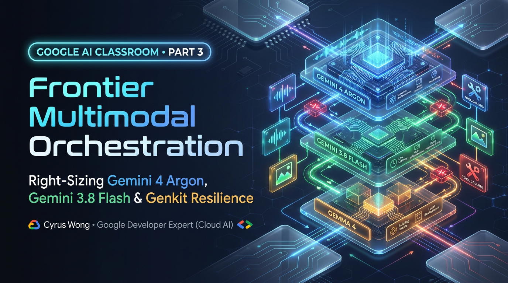
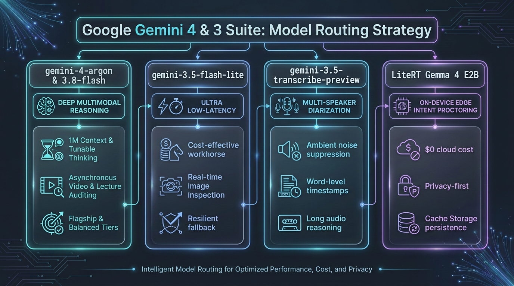
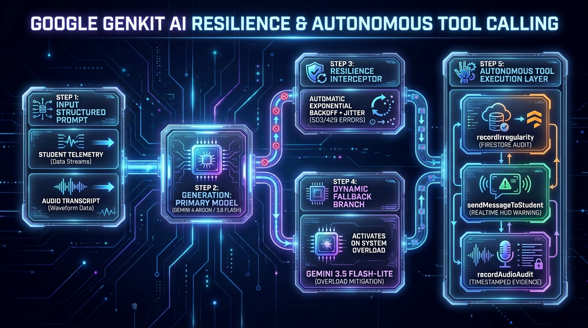
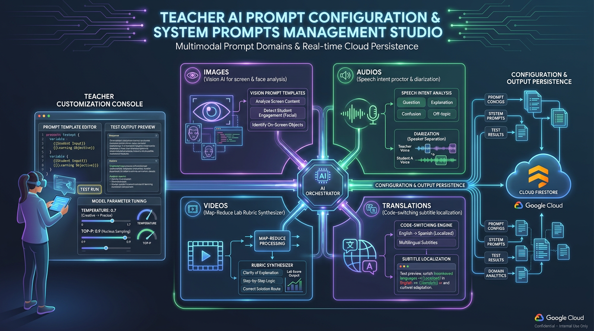
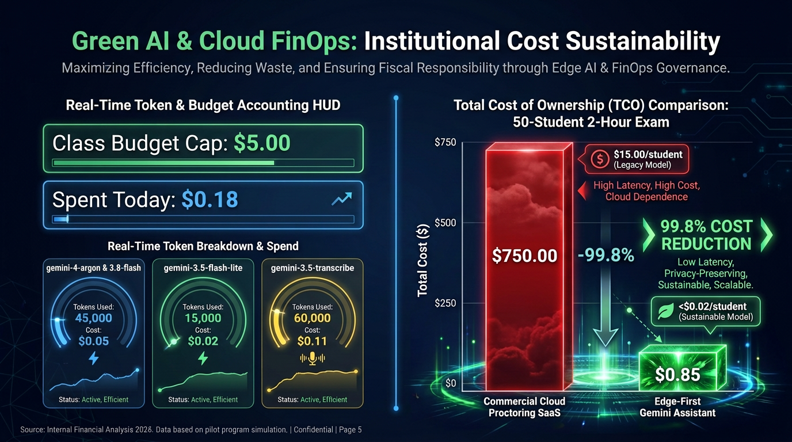

# Google AI Classroom Part 3: Frontier Multimodal Orchestration — Right-Sizing Gemini 4 Argon (`gemini-4-argon`), Gemini 3.8 Flash & On-Device Gemma 4 E2B with Google Genkit

**Author:** [**Cyrus Wong (黃俊彥)**](https://www.linkedin.com/in/cyruswong/) — *Google Developer Expert - Cloud (AI), Senior Lecturer at HKIIT*  
[⏮️ Previous: Part 2 — Browser Edge AI Investigator](https://github.com/wongcyrus/Google-AI-Classroom/blob/main/docs/blogs/02-browser-edge-ai-gemma-4-mediapipe-whisper.md) | [📚 Series Index](https://github.com/wongcyrus/Google-AI-Classroom/blob/main/docs/blogs/README.md) | [⏭️ Next: Part 4 — WebAuthn Passkeys & Rotating HMAC QRs](https://github.com/wongcyrus/Google-AI-Classroom/blob/main/docs/blogs/04-webauthn-passkeys-rotating-hmac-qr-auth.md)

---



## 1. Problem Statement: The Multimodal Classroom Paradox — Why Teaching, Student Performance & Proctoring Need 5 Different Models

When we run an AI-powered computer science or engineering classroom for 40 to 100+ concurrent students at **HKIIT / VTC Hong Kong**, supporting **live teaching, inclusive learning, student performance evaluation, and proctored exams** requires radically different latency, context-window, and FinOps profiles:

1. **Every 16ms–3s on the Student's Laptop (Real-Time Proctored Exam Investigation)**: During a practical test or examination, a human invigilator cannot watch 40+ screens and webcams simultaneously, and calling cloud APIs every second for 40 seats would require 432,000+ cloud calls per exam. High-frequency posture, gaze, and speech-intent investigation **must** run locally in the browser via **MediaPipe**, **LiteRT Whisper-Tiny**, and **LiteRT-LM Gemma 4 E2B (`gemma-4-E2B-it-web.litertlm`)** at **$0.00 API cost**, immediately uploading synchronized screen + webcam + audio evidence when an irregularity is confirmed.
2. **Every 4 Seconds at the Lecture Podium (Inclusive Teaching & Live Comprehension Checks)**: When a lecturer speaks Cantonese mixed with English Kubernetes/React jargon (*"呢個 Pod 個 Readiness Probe fail 咗"*), students need 9-language subtitles on their screens in under 800 milliseconds—making **Gemini 3.5 Flash-Lite (`gemini-3.5-flash-lite`)** ($0.25 In / $1.50 Out per 1M tokens) or on-device **Gemma 4 E2B** ideal.
3. **Standard Student Performance Video Grading & Whole-Lecture CC Generation**: Evaluating a 45-minute 1-FPS student lab recording against a practical task rubric or generating bilingual subtitles and YouTube study chapters from a 3-hour Opus lecture audio stream requires balanced multimodal throughput—where **Gemini 3.8 Flash (`gemini-3.8-flash`)** ($0.50 In / $3.00 Out per 1M tokens) shines.
4. **Complex Rubric Synthesis, Multi-Step Code Evaluation & Capstone Supervision (Frontier Reasoning)**: When a teacher wants to watch an instructor demonstration video and synthesize a partial-credit grading rubric, evaluate complex student coding performance, audit 60 weekly capstone logs against live 720p mobile hardware demos, or meta-optimize a JSON-schema prompt, the workload demands **Gemini 4 Argon (`gemini-4-argon`)** ($2.00 In / $10.00 Out per 1M tokens) with its 1-million-token shared multimodal context window and deep reasoning capabilities.

With the arrival of **Gemini 4 (`gemini-4-argon`)** in Vertex AI alongside **Gemma 4 E2B (`gemma-4-E2B-it-web.litertlm`)** in the browser via LiteRT-LM WebGPU, we engineered our **Google Genkit** orchestration layer in `functions/ai_flows/` so teachers can pick **`gemini-4-argon`** across every single classroom workflow—while automatically enforcing parameter sanitization, exponential backoff with jitter, cross-model failover, and real-time FinOps quota governance.

---

## 2. Architectural Deep-Dive: The 5-Model Edge-to-Cloud Right-Sizing Matrix

Rather than hardcoding a single model ID across our backend, we built a **5-Model Right-Sizing Architecture** spanning Tier-1 Browser WebGPU Workers and Tier-4 Google Genkit Cloud Functions. Teachers can configure a class-wide default model in [`ClassManagement.jsx`](https://github.com/wongcyrus/Google-AI-Classroom/blob/main/web-app/src/components/ClassManagement.jsx) and override it on the fly inside any feature studio:



### Complete Matrix of Teacher-Selectable Gemini 4 Surfaces

Every AI-powered workflow in the repository exposes **Gemini 4 Argon (`gemini-4-argon`)**, **Gemini 3.8 Flash (`gemini-3.8-flash`)**, and **Gemini 3.5 Flash-Lite (`gemini-3.5-flash-lite`)**:

| Classroom Workflow | Frontend Selector Component | Backend Cloud Function / Genkit Flow | Recommended Model Strategy |
| :--- | :--- | :--- | :--- |
| **1. Class-Wide Default & Live Vision Monitor** | [`ClassManagement.jsx`](https://github.com/wongcyrus/Google-AI-Classroom/blob/main/web-app/src/components/ClassManagement.jsx) & [`ControlsPanel.jsx`](https://github.com/wongcyrus/Google-AI-Classroom/blob/main/web-app/src/components/monitor/ControlsPanel.jsx) | [`analyzeImageFlow`](https://github.com/wongcyrus/Google-AI-Classroom/blob/main/functions/ai_flows/analysisFlows.js) / [`analyzeAllImagesFlow`](https://github.com/wongcyrus/Google-AI-Classroom/blob/main/functions/ai_flows/analysisFlows.js) | `gemini-3.5-flash-lite` for instant classroom peeks; switch to **`gemini-4-argon`** for deep code inspection on a student's IDE screenshot. |
| **2. Practical Task Rubric Synthesis** | [`TaskEditorModal.jsx`](https://github.com/wongcyrus/Google-AI-Classroom/blob/main/web-app/src/components/tasks/TaskEditorModal.jsx) (`#task-ai-model-select`) | [`extractTaskDemoSteps`](https://github.com/wongcyrus/Google-AI-Classroom/blob/main/functions/ai_flows/extractTaskDemoSteps.js) | Use **`gemini-4-argon`** to watch your reference demo video and synthesize nuanced partial-credit marking criteria and visual proof requirements. |
| **3. Practical Task Video Auto-Grading** | [`TaskGradingMatrixView.jsx`](https://github.com/wongcyrus/Google-AI-Classroom/blob/main/web-app/src/components/tasks/TaskGradingMatrixView.jsx) (`Grading AI Model`) | [`evaluateTaskSubmission`](https://github.com/wongcyrus/Google-AI-Classroom/blob/main/functions/ai_flows/evaluateTaskSubmission.js) | Defaults to `taskData.model`; override with **`gemini-4-argon`** in the Grading Matrix toolbar for complex multi-step debugging labs or exam appeals. |
| **4. After-Class Cohort Video Map-Reduce** | [`VideoLibrary.jsx`](https://github.com/wongcyrus/Google-AI-Classroom/blob/main/web-app/src/components/VideoLibrary.jsx) & [`VideoAnalysisJobs.jsx`](https://github.com/wongcyrus/Google-AI-Classroom/blob/main/web-app/src/components/VideoAnalysisJobs.jsx) | [`analyzeSingleVideoFlow`](https://github.com/wongcyrus/Google-AI-Classroom/blob/main/functions/ai_flows/analysisFlows.js) & [`generateLabTaskPrompt`](https://github.com/wongcyrus/Google-AI-Classroom/blob/main/functions/ai_flows/generateLabTaskPrompt.js) | Use `gemini-3.8-flash` for Stage-1 per-student video logs and **`gemini-4-argon`** for Stage-2 cohort rubric discovery. |
| **5. Whole-Lecture Subtitles (CC) & YouTube Chapters** | [`ClassManagement.jsx`](https://github.com/wongcyrus/Google-AI-Classroom/blob/main/web-app/src/components/ClassManagement.jsx) & [`LectureRecordingsView.jsx`](https://github.com/wongcyrus/Google-AI-Classroom/blob/main/web-app/src/components/LectureRecordingsView.jsx) | [`processLectureSubtitles`](https://github.com/wongcyrus/Google-AI-Classroom/blob/main/functions/ai_flows/processLectureSubtitles.js) | Single-pass pure Opus audio ingestion (`thinkingBudget: 0`, `maxOutputTokens: 65536`) with `gemini-3.8-flash` or **`gemini-4-argon`**. |
| **6. Capstone Project Meeting Supervision** | [`ProjectMeetingsView.jsx`](https://github.com/wongcyrus/Google-AI-Classroom/blob/main/web-app/src/components/meetings/ProjectMeetingsView.jsx) | [`analyzeProjectMeeting`](https://github.com/wongcyrus/Google-AI-Classroom/blob/main/functions/ai_flows/projectMeetingFlows.js) | Stage 1 diarizes audio via `gemini-3.5-transcribe-preview`; Stage 2 uses **`gemini-4-argon`** or `gemini-3.8-flash` to cross-examine weekly logs against 720p mobile demo videos and photos. |
| **7. Bingo Question Bank AI Generator** | [`BingoQuestionBankModal.jsx`](https://github.com/wongcyrus/Google-AI-Classroom/blob/main/web-app/src/components/BingoQuestionBankModal.jsx) (`Bingo AI Model`) | [`generateBingoQuestionBank`](https://github.com/wongcyrus/Google-AI-Classroom/blob/main/functions/ai_flows/bingoFlows.js) | Use `gemini-3.5-flash-lite` for fast recall MCQs or **`gemini-4-argon`** for scenario-based architecture diagnostic questions. |
| **8. AI Prompt Studio Meta-Optimizer (`✨ Optimize`)** | [`PromptForm.jsx`](https://github.com/wongcyrus/Google-AI-Classroom/blob/main/web-app/src/components/prompt/PromptForm.jsx) & [`PromptManagement.jsx`](https://github.com/wongcyrus/Google-AI-Classroom/blob/main/web-app/src/components/PromptManagement.jsx) | [`analysisFlows.js`](https://github.com/wongcyrus/Google-AI-Classroom/blob/main/functions/ai_flows/analysisFlows.js) | Select **`gemini-4-argon`** next to `Optimize` to rewrite rough instructor grading notes into schema-safe system prompts while locking `{{variable}}` tags. |
| **9. Live Subtitles & Multilingual Captions** | [`TeacherSubtitleControlModal.jsx`](https://github.com/wongcyrus/Google-AI-Classroom/blob/main/web-app/src/components/subtitles/TeacherSubtitleControlModal.jsx) | [`translateTeacherSpeech`](https://github.com/wongcyrus/Google-AI-Classroom/blob/main/functions/ai_flows/subtitleFlows.js) & [`litertGemma.worker.js`](https://github.com/wongcyrus/Google-AI-Classroom/blob/main/web-app/src/workers/litertGemma.worker.js) | Toggle between $0.00 on-device **Gemma 4 E2B** (`client` mode) and Cloud Functions (`gemini-3.5-flash-lite` / `gemini-3.8-flash` / `gemini-4-argon`). |

---

## 3. Implementation Walkthrough 1: Inside `generateWithResilience` — Gemini 4 Parameter Sanitization & Self-Healing Failover

One of the most important engineering lessons when adopting **Gemini 4 (`gemini-4-argon`)** in production is that frontier reasoning models enforce stricter API parameter contracts than earlier generation models:
- **Strict Parameter Contract on `gemini-4-*`**: Passing legacy sampling parameters (`temperature`, `topP`, `top_p`, `topK`, `top_k`) inside `config` to `gemini-4-argon` throws an immediate `400 INVALID_ARGUMENT` error because Gemini 4 manages internal reasoning sampling natively.
- **Transient Overload & Quota Spikes in Live Labs**: When 40 students submit their practical exam videos simultaneously or a teacher triggers `analyzeAllImagesFlow` across 40 screens with up to `maxToolRoundtrips = numScreenshots * 3`, regional Vertex AI endpoints can return `429 RESOURCE_EXHAUSTED`, `503 UNAVAILABLE`, or `ECONNRESET`. The pipeline must never fail a student's submission—it must retry with exponential backoff + random jitter and seamlessly fail over to `gemini-3.5-flash-lite` if the primary model is exhausted.


Here is the exact sequence executed by [`generateWithResilience`](https://github.com/wongcyrus/Google-AI-Classroom/blob/main/functions/ai_flows/analysisFlows.js) for every Genkit invocation across our backend:



### Production Code Listing 1: `generateWithResilience` in [`functions/ai_flows/analysisFlows.js`](https://github.com/wongcyrus/Google-AI-Classroom/blob/main/functions/ai_flows/analysisFlows.js)

Here is the production implementation in [`functions/ai_flows/analysisFlows.js`](https://github.com/wongcyrus/Google-AI-Classroom/blob/main/functions/ai_flows/analysisFlows.js) showing how we strip unsupported sampling keys when `modelName.startsWith('gemini-4')` and handle network/quota retries before failing over:

```javascript
/**
 * Executes AI generation with automatic exponential backoff, jitter,
 * connection reset recovery, and fallback to flash-lite if the primary model is overloaded.
 */
export async function generateWithResilience(
  generateConfig,
  preferredModel,
  fallbackModel = 'gemini-3.5-flash-lite'
) {
  const modelsToTry = [preferredModel];
  if (fallbackModel && preferredModel !== fallbackModel) {
    modelsToTry.push(fallbackModel);
  }

  let lastError = null;

  for (const modelName of modelsToTry) {
    const maxAttempts = 3;
    for (let attempt = 1; attempt <= maxAttempts; attempt++) {
      try {
        let effectiveGenerateConfig = generateConfig;
        if (
          typeof modelName === 'string' &&
          modelName.startsWith('gemini-4') &&
          generateConfig?.config &&
          typeof generateConfig.config === 'object'
        ) {
          const {
            temperature: _t,
            topP: _p,
            top_p: _tp,
            topK: _k,
            top_k: _tk,
            ...restConfig
          } = generateConfig.config;
          effectiveGenerateConfig = {
            ...generateConfig,
            config: restConfig,
          };
        }
        const response = await ai.generate({
          ...effectiveGenerateConfig,
          model: vertexAI.model(modelName),
        });
        return { response, modelUsed: modelName };
      } catch (err) {
        lastError = err;
        const msg = String(err?.message || err);
        const isRetryable =
          msg.includes('overloaded') || msg.includes('connection reset') ||
          msg.includes('ECONNRESET') || msg.includes('ETIMEDOUT') ||
          msg.includes('fetch failed') || msg.includes('socket') ||
          msg.includes('timeout') || msg.includes('503') ||
          msg.includes('429') || msg.includes('504') ||
          msg.includes('RESOURCE_EXHAUSTED') || msg.includes('UNAVAILABLE') ||
          msg.includes('INTERNAL');

        console.warn(`[AI Resilience] Attempt ${attempt}/${maxAttempts} for model ${modelName} encountered: ${msg}`);
        if (!isRetryable && attempt === 1) break;

        if (attempt < maxAttempts) {
          const backoffMs = Math.min(800 * Math.pow(2, attempt - 1) + Math.random() * 400, 4000);
          await new Promise((res) => setTimeout(res, backoffMs));
        }
      }
    }
  }

  throw lastError;
}
```

---

## 4. Implementation Walkthrough 2: Two-Stage Audio Diarization & Multimodal Rubric Synthesis

Two of the best examples of **model right-sizing** in our codebase are **Two-Stage Audio Invigilation (`analyzeAudioFlow`)** and **Automated Demo Video Rubric Synthesis (`extractTaskDemoSteps`)**:

### Why Two-Stage Audio (`gemini-3.5-transcribe-preview` + Reasoning Model) Beats Single-Pass Audio Tool Calling
In [`analyzeAudioFlow`](https://github.com/wongcyrus/Google-AI-Classroom/blob/main/functions/ai_flows/analysisFlows.js), we discovered that passing complex Genkit tool definitions (`recordAudioIrregularity`, `recordAudioAudit`, `sendMessageToStudent`) directly to an acoustic Speech-to-Text model degrades transcription fidelity on Cantonese/English code-switching. Instead, we split the pipeline into two specialized stages—and if the student's browser already transcribed the audio via **LiteRT Whisper-Tiny**, Stage 1 is skipped altogether (`suppliedTranscript`), saving 100% of audio input tokens!

### Production Code Listing 2: Multimodal Reference Video Rubric Synthesis in [`functions/ai_flows/extractTaskDemoSteps.js`](https://github.com/wongcyrus/Google-AI-Classroom/blob/main/functions/ai_flows/extractTaskDemoSteps.js) & [`TaskEditorModal.jsx`](https://github.com/wongcyrus/Google-AI-Classroom/blob/main/web-app/src/components/tasks/TaskEditorModal.jsx)

When creating a hands-on practical assignment in [`TaskEditorModal.jsx`](https://github.com/wongcyrus/Google-AI-Classroom/blob/main/web-app/src/components/tasks/TaskEditorModal.jsx), an instructor can attach a YouTube URL, upload an MP4 demo, or select a recorded lecture, and choose **Gemini 4 Argon (`gemini-4-argon`)**, **Gemini 3.8 Flash (`gemini-3.8-flash`)**, or **Gemini 3.5 Flash-Lite (`gemini-3.5-flash-lite`)**:

```jsx
{/* web-app/src/components/tasks/TaskEditorModal.jsx */}
<div>
  <label htmlFor="task-ai-model-select" className="block text-xs font-semibold text-gray-700 mb-1">
    🤖 Gemini Model for Rubric Synthesis &amp; Grading:
  </label>
  <select
    id="task-ai-model-select"
    value={aiModel}
    onChange={(e) => setAiModel(e.target.value)}
    className="w-full px-3 py-2 border border-purple-300 rounded-lg bg-white text-gray-900 text-sm font-medium"
  >
    <option value="gemini-4-argon">🧠 Gemini 4 Argon (Flagship Reasoning &amp; 1M Context — $2.00 / $10.00 per 1M)</option>
    <option value="gemini-3.8-flash">✨ Gemini 3.8 Flash (Recommended Multimodal — $0.75 / $3.75 per 1M)</option>
    <option value="gemini-3.5-flash-lite">⚡ Gemini 3.5 Flash-Lite (Fastest &amp; Low Cost — $0.30 / $2.50 per 1M)</option>
  </select>
</div>
```

On the backend, [`extractTaskDemoSteps.js`](https://github.com/wongcyrus/Google-AI-Classroom/blob/main/functions/ai_flows/extractTaskDemoSteps.js) resolves Cloud Storage (`gs://`) or YouTube URIs, invokes `generateWithResilience` with `responseMimeType: 'application/json'`, and normalizes the extracted milestone steps, expected visual proof, and partial-credit marking criteria:

```javascript
// functions/ai_flows/extractTaskDemoSteps.js
const preferredModel = model || 'gemini-3.8-flash';
const promptParts = [{ text: metaPrompt }];
if (resolvedVideoUri) {
  promptParts.push({ media: { url: resolvedVideoUri, contentType: 'video/mp4' } });
}
const generateConfig = {
  prompt: promptParts,
  config: {
    temperature: 0.2, // Automatically stripped by generateWithResilience if preferredModel === 'gemini-4-argon'
    responseMimeType: 'application/json',
  },
};

const res = await generateWithResilience(generateConfig, preferredModel);
const usage = res.response?.usage || res.response?.usageMetadata || {};
const cost = calculateCost(usage, res.modelUsed || preferredModel);
```

---

## 5. Implementation Walkthrough 3: Three-Tier Prompt Governance & Modality-Specific Meta-Prompting (`✨ Optimize`)

Hardcoding system prompts inside backend code prevents lecturers from adapting AI grading to their specific syllabus (e.g., Cybersecurity Penetration Testing vs. Frontend React Development). At the same time, writing JSON-schema-safe prompts with required runtime template placeholders (`{{transcript}}`, `{{captureInterval}}`, `{{studentEmail}}`) is error-prone for busy educators.


We solved this in [`PromptForm.jsx`](https://github.com/wongcyrus/Google-AI-Classroom/blob/main/web-app/src/components/prompt/PromptForm.jsx) and `promptRegistry.js` with a **Three-Tier Prompt Governance Architecture** and an in-place **Gemini 4 Prompt Optimizer**:



### Production Code Listing 3: Optimizer Model Picker & Required Placeholder Validation in [`web-app/src/components/prompt/PromptForm.jsx`](https://github.com/wongcyrus/Google-AI-Classroom/blob/main/web-app/src/components/prompt/PromptForm.jsx)

In [`PromptForm.jsx`](https://github.com/wongcyrus/Google-AI-Classroom/blob/main/web-app/src/components/prompt/PromptForm.jsx), teachers can switch between **`gemini-4-argon`**, **`gemini-3.8-flash`**, and **`gemini-3.5-flash-lite`** right next to the **Optimize** button, while interactive placeholder chips (`ph.required`) warn the instructor if any mandatory runtime interpolation variable is missing before saving:

```jsx
{/* web-app/src/components/prompt/PromptForm.jsx */}
{setOptimizerModel && (
    <select
        aria-label="Prompt Optimizer Model"
        value={optimizerModel}
        onChange={(e) => setOptimizerModel(e.target.value)}
        disabled={isOptimizing || isReadOnly}
        className="optimizer-model-select"
        title="Select Gemini model for prompt optimization"
    >
        <option value="gemini-4-argon">🧠 Gemini 4 Argon</option>
        <option value="gemini-3.8-flash">✨ Gemini 3.8 Flash</option>
        <option value="gemini-3.5-flash-lite">⚡ Gemini 3.5 Flash-Lite</option>
    </select>
)}
<button 
    type="button" 
    onClick={handleOptimize} 
    disabled={isOptimizing || isReadOnly}
    title="Optimize prompt with Gemini"
>
    {isOptimizing ? 'Optimizing...' : 'Optimize'}
</button>
<button type="button" onClick={handleUndo} disabled={!originalPromptText || isReadOnly} className="secondary-btn">
    Undo
</button>
```

---

## 6. FinOps Governance: Dynamic Cloud Billing SKU Sync & Composite Pipeline Cost Accounting

When different teachers across a university department experiment with **`gemini-4-argon`**, **`gemini-3.8-flash`**, **`gemini-3.5-flash-lite`**, and two-stage composite pipelines (`gemini-3.5-transcribe-preview + gemini-3.5-flash-lite`), institutional cloud administrators need **micro-dollar cost attribution** and **hard per-class budget caps** (`aiQuota` vs. `aiUsedQuota`).



### Production Code Listing 4: Multi-SDK Token Normalization & Composite Pipeline Pricing in [`functions/ai_flows/cost.js`](https://github.com/wongcyrus/Google-AI-Classroom/blob/main/functions/ai_flows/cost.js)

In [`functions/ai_flows/cost.js`](https://github.com/wongcyrus/Google-AI-Classroom/blob/main/functions/ai_flows/cost.js), we maintain a warm 12-hour in-memory pricing cache synced from `system_config/pricing` (populated daily by our Cloud Billing Catalog API job `syncGeminiPricing`), normalize token property variations across Genkit, Google GenAI SDK, and Vertex AI (`promptTokenCount` vs. `inputTokens`), and compute exact USD costs down to `$0.000001`:

```javascript
// Default baseline pricing lookup table for Gemini models in USD per 1 million tokens (Input / Output)
export const MODEL_PRICING = {
  'gemini-4-argon': { input: 2.00, output: 10.00 },
  'gemini-3.5-flash-lite': { input: 0.30, output: 2.50 },
  'gemini-3.8-flash': { input: 0.75, output: 3.75 },
  'gemini-3.7-flash': { input: 0.75, output: 3.75 },
  'gemini-3.7-pro': { input: 3.00, output: 15.00 },
  'gemini-3.5-transcribe': { input: 0.50, output: 2.50 },
  'gemini-3.5-transcribe-preview': { input: 0.50, output: 2.50 },
  'gemini-3.5-transcribe-live': { input: 0.60, output: 3.00 },
  'gemini-3.1-flash-live-preview': { input: 0.60, output: 2.50 },
};

export function calculateCost(usageMetadata, model = DEFAULT_MODEL) {
  if (!usageMetadata || typeof usageMetadata !== 'object') return 0;
  const pricing = getModelPricing(model);
  const promptTokens = Math.max(
    0,
    Number(
      usageMetadata.promptTokenCount ??
      usageMetadata.inputTokens ??
      usageMetadata.promptTokens ??
      usageMetadata.inputTokenCount ?? 0
    )
  );
  const candidatesTokens = Math.max(
    0,
    Number(
      usageMetadata.candidatesTokenCount ??
      usageMetadata.outputTokens ??
      usageMetadata.completionTokens ??
      usageMetadata.candidatesTokens ??
      usageMetadata.outputTokenCount ?? 0
    )
  );
  const inputRate = pricing?.input ?? MODEL_PRICING[DEFAULT_MODEL].input;
  const outputRate = pricing?.output ?? MODEL_PRICING[DEFAULT_MODEL].output;
  const inputCost = (promptTokens / 1000000) * inputRate;
  const outputCost = (candidatesTokens / 1000000) * outputRate;
  return Number((inputCost + outputCost).toFixed(6)) || 0;
}
```

Before any Genkit flow invokes Vertex AI, `checkQuota(classId, estimatedCost)` verifies that the class's `aiUsedQuota` has not exceeded its allocated `aiQuota` budget. Once the call completes, `logJob()` writes an immutable audit record to `aiJobs/{jobId}` with the **actual** model used (`actualModel` returned by `generateWithResilience`), and an atomic Firestore trigger (`onAiJobCreated` in `quotaTriggers.js`) increments `classes/{classId}.aiUsedQuota` via `FieldValue.increment(cost)`.

---

## 7. FinOps & Latency Benchmark Table Across the 5-Model Constellation

Here is how our 5-model architecture performs in production across real HKIIT classroom workloads in `asia-east2`:

| Model Identifier | Execution Tier | Input / Output Rate (per 1M Tokens) | Median Latency | Typical Classroom Workload Cost | Best Pedagogical Use Case |
| :--- | :--- | :--- | :--- | :--- | :--- |
| **`gemma-4-E2B-it-web.litertlm`** | Tier 1: Browser WebGPU (`@litert-lm/core`) | **$0.00 / $0.00** | **420 ms** | **$0.0000** (Unlimited) | Continuous exam speech-intent proctoring & $0.00 client-mode live lecture subtitles. |
| **`gemini-3.5-flash-lite`** | Tier 4: Vertex AI Genkit | **$0.30 / $2.50** | **620 ms** | **~$0.00018 / call** | Sub-second 7-language live subtitles, Bingo screen verification & Cloud face fallback. |
| **`gemini-3.5-transcribe-preview`** | Tier 4: Vertex AI Genkit | **$0.50 / $2.50** | **1.1 s** | **~$0.00045 / min** | Stage-1 multi-speaker Cantonese/Mandarin/English capstone consultation diarization. |
| **`gemini-3.8-flash`** | Tier 4: Vertex AI Genkit | **$0.75 / $3.75** | **2.8 s** | **~$0.0104 / student video** | Default practical task video grading & single-pass 3-hour Opus lecture CC generation. |
| **`gemini-4-argon`** | Tier 4: Vertex AI Genkit | **$2.00 / $10.00** | **4.6 s** | **~$0.0370 / student video** | Reference video rubric synthesis, complex multi-step code grading, cohort Map-Reduce discovery & Prompt Studio meta-optimization. |

---

## 8. Key Takeaways for Google Cloud & Genkit Builders

1. **Sanitize Legacy Sampling Configs for `gemini-4-*`**: Wrap all Genkit `ai.generate()` calls in a central middleware (`generateWithResilience`) that automatically strips `temperature`, `topP`, and `topK` whenever `modelName.startsWith('gemini-4')`—allowing teachers to switch between Gemini 3.8 and Gemini 4 Argon without breaking shared flow code.
2. **Always Record `modelUsed` After Failover**: If a primary `gemini-4-argon` request fails over to `gemini-3.5-flash-lite` during a regional quota spike, pass the *actual* `modelUsed` returned by `generateWithResilience` into `calculateCost()` and `logJob()` so class FinOps quotas are billed at the true underlying model rate.
3. **Decouple Acoustic Diarization from Tool-Calling Reasoning**: Using `gemini-3.5-transcribe-preview` (without tools) for verbatim multi-speaker transcription and passing the resulting text to `gemini-3.5-flash-lite`, `gemini-3.8-flash`, or `gemini-4-argon` (with tools) eliminates tool-call hallucinations on bilingual audio.
4. **Empower Educators with Guardrailed Prompt Engineering**: Combining a 3-tier prompt resolution hierarchy with an in-app **Gemini 4 Argon (`✨ Optimize`)** meta-optimizer and required `{{placeholder}}` chip validation lets non-programmer faculty safely customize AI rubrics without breaking downstream JSON parsers.

---

[⏮️ Previous: Part 2 — Browser Edge AI with Gemma 4 E2B](https://github.com/wongcyrus/Google-AI-Classroom/blob/main/docs/blogs/02-browser-edge-ai-gemma-4-mediapipe-whisper.md) | [📚 Series Index](https://github.com/wongcyrus/Google-AI-Classroom/blob/main/docs/blogs/README.md) | [⏭️ Continue to Part 4: Defeating Proxy Attendance with WebAuthn Passkeys →](https://github.com/wongcyrus/Google-AI-Classroom/blob/main/docs/blogs/04-webauthn-passkeys-rotating-hmac-qr-auth.md)
