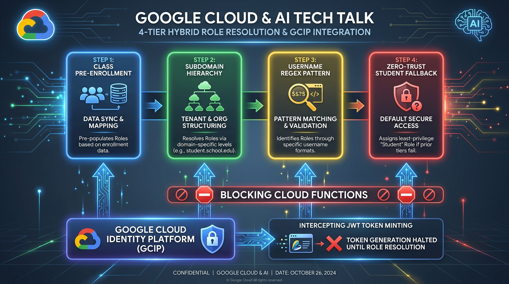
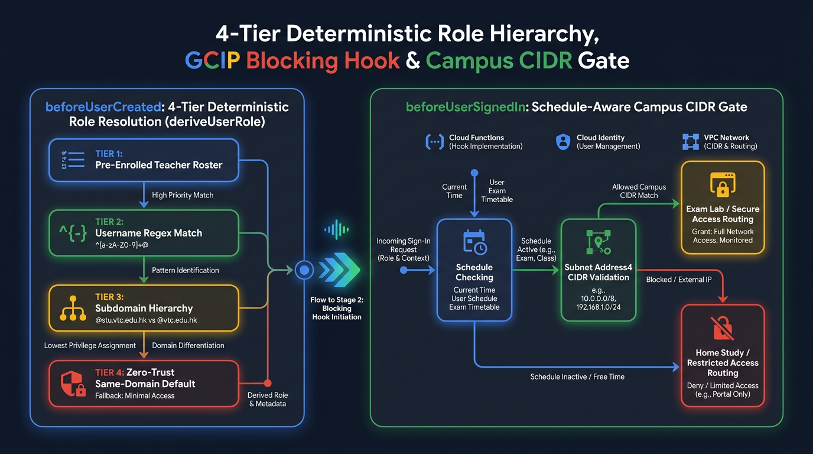
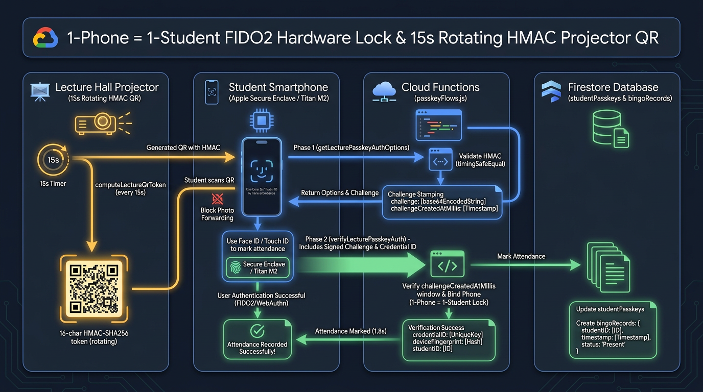
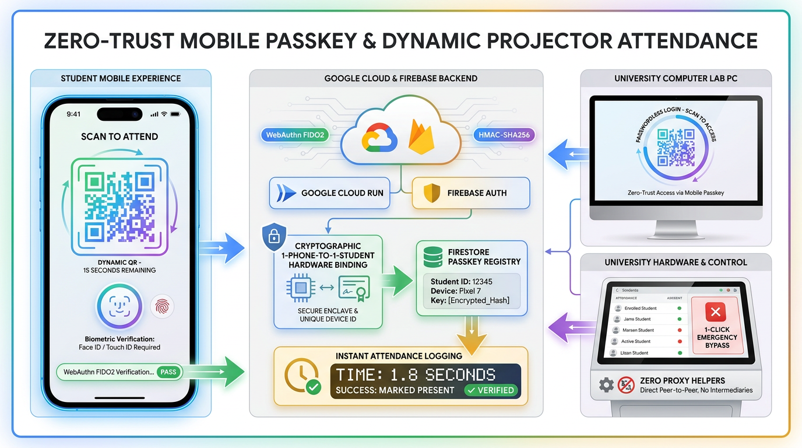

# Part 4: Defeating Proxy Attendance & Lab Keyloggers with WebAuthn Passkeys, Rotating HMAC QRs & GCIP Blocking Functions

**Author:** [**Cyrus Wong (黃俊彥)**](https://www.linkedin.com/in/cyruswong/) — *Google Developer Expert - Cloud (AI), Senior Lecturer at HKIIT*  
[⏮️ Previous: Part 3 — Gemini 4 Argon & Genkit Resilience](https://github.com/wongcyrus/Google-AI-Classroom/blob/main/docs/blogs/03-gemini-4-argon-genkit-multimodal-resilience.md) | [📚 Series Index](https://github.com/wongcyrus/Google-AI-Classroom/blob/main/docs/blogs/README.md) | [⏭️ Next: Part 5 — Real-Time Multilingual Live Subtitles](https://github.com/wongcyrus/Google-AI-Classroom/blob/main/docs/blogs/05-realtime-live-subtitles-code-switching-gemini-4-gemma-4.md)

---


## 1. Problem Statement: The Dual Security Crisis in University Computer Labs & 200-Seat Lecture Theatres

When running hands-on programming classes and invigilated practical assessments across physical computer labs and 200-seat lecture halls at the Hong Kong Institute of Information Technology (HKIIT / VTC), our engineering team encountered two persistent identity and physical-presence attacks that traditional username-and-password authentication cannot stop:

1. **The "WhatsApp Proxy Attendance" Attack**: When instructors project a static attendance QR code or 4-digit check-in code on the lecture screen, a student sitting in the front row snaps a photo and forwards it to a 150-member WhatsApp or Discord group. Within five seconds, absent students still in bed—or sitting in the campus cafeteria—mark themselves "present." Even worse, in computer lab sessions, a single student can open an incognito window on an adjacent workstation and log in using a friend's shared credentials.
2. **The Shared Lab PC Keylogger Risk**: Public university computer labs are high-turnover environments. Typing institutional passwords—especially an instructor's privileged account that can trigger high-quota **Gemini 4 Argon (`gemini-4-argon`)** cohort-wide video analysis or modify exam policies—on untrusted shared USB keyboards exposes faculty and students to both hardware inline keyloggers and resident TSR malware.

To solve both problems simultaneously without requiring dedicated biometric turnstiles or proprietary native mobile apps, we engineered a zero-trust, hardware-bound identity layer built on three pillars:
- **Google Cloud Identity Platform (GCIP) Blocking Functions** (`beforeUserCreated` & `beforeUserSignedIn`) enforcing a **4-Tier Deterministic Role Hierarchy** and schedule-aware **Campus Lab CIDR IP Gating**.
- **FIDO2 / WebAuthn Hardware-Bound Mobile Passkeys (`@simplewebauthn/server`)** enforcing a strict **1-Phone = 1-Student Hardware Lock** backed by Apple Secure Enclave (Face ID / Touch ID) and Android Titan M2 hardware keys.
- **15-Second Rotating HMAC-SHA256 QR Codes** for both **1.8-second Lecture Hall Biometric Roll Call** and **Zero-Keystroke Passwordless Lab PC Login**, paired with a **3-Tier Emergency Bypass & Audit System**.

---

## 2. Architectural Deep-Dive: 4-Tier Hybrid Role Resolution & Schedule-Aware CIDR Gating

On multi-campus educational domains, distinguishing faculty from students at the exact moment of registration is critical. In our platform, a user with `role: 'teacher'` can orchestrate **Gemini 4 Argon (`gemini-4-argon`)** multimodal grading jobs, inspect live student screen feeds, and reset hardware passkeys, whereas `role: 'student'` is strictly scoped to submitting their own telemetry and viewing authorized course materials. An accidental privilege escalation is both a data-privacy violation and a FinOps risk.



### Diagram 1: 4-Tier Deterministic Role Hierarchy & GCIP Blocking Gate

In [`functions/auth_triggers/userManagement.js`](https://github.com/wongcyrus/Google-AI-Classroom/blob/main/functions/auth_triggers/userManagement.js), [`functions/auth_triggers/ipRestriction.js`](https://github.com/wongcyrus/Google-AI-Classroom/blob/main/functions/auth_triggers/ipRestriction.js), and [`functions/auth_triggers/config.js`](https://github.com/wongcyrus/Google-AI-Classroom/blob/main/functions/auth_triggers/config.js), our GCIP blocking functions intercept every signup and sign-in request *before* a Firebase JWT is ever minted:



### Implementation Walkthrough: Multi-Domain Role Derivation & Pre-Enrolled Roster Linking

Why do we need four tiers instead of a simple `@vtc.edu.hk` suffix check? Because in real polytechnic and university environments:
1. Visiting industry lecturers or external examiners may be pre-enrolled by a course coordinator in `classes/{classId}.teacherEmails` before they ever log in for the first time (**Tier 1**).
2. Some institutions share a single apex domain (`@school.edu`) for both staff and students, distinguishing them only by username pattern (e.g., 9-digit student IDs vs. alphabetic staff handles—**Tier 2**).
3. In hierarchical domains (`@stu.vtc.edu.hk` vs. `@vtc.edu.hk`), a naive `.endsWith('vtc.edu.hk')` check would accidentally classify `@stu.vtc.edu.hk` as a teacher unless student subdomains take strict precedence (**Tier 3**).

Here is the production implementation from [`functions/ai_flows/config.js`](https://github.com/wongcyrus/Google-AI-Classroom/blob/main/functions/ai_flows/config.js) and [`functions/auth_triggers/userManagement.js`](https://github.com/wongcyrus/Google-AI-Classroom/blob/main/functions/auth_triggers/userManagement.js):

```javascript
// From functions/ai_flows/config.js
export function deriveUserRole(email) {
  if (!email || typeof email !== 'string' || !email.includes('@')) return null;
  const cleanEmail = email.trim().toLowerCase();
  const atIndex = cleanEmail.lastIndexOf('@');
  const username = cleanEmail.substring(0, atIndex);
  const domain = cleanEmail.substring(atIndex + 1);

  if (!username || !domain) return null;

  const matchesTarget = (targetDomain) =>
    targetDomain === '*' || domain === targetDomain || domain.endsWith('.' + targetDomain);

  const isStudentDomain = STUDENT_EMAIL_DOMAINS.some(matchesTarget);
  const isTeacherDomain = TEACHER_EMAIL_DOMAINS.some(matchesTarget);

  if (!isStudentDomain && !isTeacherDomain) return null;

  // Tier 2: Username Regex check takes precedence if configured
  if (STUDENT_USERNAME_REGEX && STUDENT_USERNAME_REGEX.test(username)) return 'student';
  if (TEACHER_USERNAME_REGEX && TEACHER_USERNAME_REGEX.test(username)) return 'teacher';

  // Tier 4 Guard: Check for same-domain or wildcard overlap
  const exactStudentDomain = STUDENT_EMAIL_DOMAINS.some((d) => d === '*' || domain === d);
  const exactTeacherDomain = TEACHER_EMAIL_DOMAINS.some((d) => d === '*' || domain === d);
  if (exactStudentDomain && exactTeacherDomain) {
    return DEFAULT_TO_STUDENT ? 'student' : null;
  }

  // Tier 3: Subdomain hierarchy (student subdomains win over parent teacher domains,
  // e.g., stu.vtc.edu.hk wins over vtc.edu.hk)
  if (isStudentDomain) return 'student';
  if (isTeacherDomain) return 'teacher';

  return DEFAULT_TO_STUDENT ? 'student' : null;
}
```

And during `beforeUserCreated`, we combine Tier 1 pre-enrollment checks with automatic profile hydration from the central `studentDirectory` in [`functions/auth_triggers/userManagement.js`](https://github.com/wongcyrus/Google-AI-Classroom/blob/main/functions/auth_triggers/userManagement.js):

```javascript
// From functions/auth_triggers/userManagement.js
export async function handleBeforeUserCreatedLogic(event, customDeps = {}) {
  const currentDb = customDeps.db || db;
  const currentDeriveRole = customDeps.deriveUserRole || deriveUserRole;
  const { uid, email } = event?.data || {};

  if (!email) {
    throw new HttpsError('invalid-argument', 'Email is required to sign up.');
  }

  const classesRef = currentDb.collection('classes');

  // Tier 1: Check if this email was pre-registered as a teacher in any existing class
  const teacherPreEnrollSnapshot = await classesRef
    .where('teacherEmails', 'array-contains', email)
    .limit(1)
    .get();
  const isPreEnrolledTeacher = !teacherPreEnrollSnapshot.empty;

  let derivedRole = isPreEnrolledTeacher ? 'teacher' : currentDeriveRole(email);
  if (!derivedRole) {
    throw new HttpsError('invalid-argument', 'Please use a valid institutional email address.');
  }

  // Return custom claims directly into the newly minted GCIP JWT
  return { customClaims: { role: derivedRole } };
}
```

### Schedule-Aware Campus Lab CIDR Gating (`checkipaddress`)

During scheduled practical exams, we want to prevent remote students from logging into a class session from outside the physical computer lab subnet, *without* blocking students from reviewing their course materials from home in the evening.

In [`functions/auth_triggers/ipRestriction.js`](https://github.com/wongcyrus/Google-AI-Classroom/blob/main/functions/auth_triggers/ipRestriction.js), `checkipaddress` (`beforeUserSignedIn`) evaluates the student's enrolled classes against their timezone-aware `schedule.timeSlots` using `date-fns-tz` and validates `event.ipAddress` against the class's IPv4 CIDR ranges (`ip-address` `Address4.isInSubnet()`):

```javascript
// From functions/auth_triggers/ipRestriction.js
export const checkipaddress = beforeUserSignedIn(
  { region: FUNCTION_REGION, memory: '512MiB', cpu: 1 },
  async (event) => {
    const user = event.data;
    const ipAddress = event.ipAddress;
    if (!user.email || !ipAddress) return;

    // Teachers are never blocked by student lab IP restrictions
    if (user.customClaims && user.customClaims.role === 'teacher') return;

    const studentProfileSnap = await db.collection('studentProfiles').doc(user.uid).get();
    if (!studentProfileSnap.exists || !studentProfileSnap.data().classes?.length) return;

    const classSnapshots = await Promise.all(
      studentProfileSnap.data().classes.map((id) => db.collection('classes').doc(id).get())
    );

    let allRestrictions = [];
    classSnapshots.filter((s) => s.exists).forEach((doc) => {
      const classData = doc.data();
      // Only enforce IP restrictions if the class is currently in an active scheduled time slot
      if (isDuringScheduledTime(classData.schedule) && classData.ipRestrictions?.length > 0) {
        allRestrictions = allRestrictions.concat(classData.ipRestrictions);
      }
    });

    if (allRestrictions.length === 0) return; // Outside class hours -> allow home study access!

    const uniqueRestrictions = [...new Set(allRestrictions)];
    const ipAllowed = uniqueRestrictions.some((restriction) => {
      if (restriction.includes('/')) {
        return new Address4(ipAddress).isInSubnet(new Address4(restriction));
      }
      return ipAddress === restriction;
    });

    if (!ipAllowed) {
      throw new HttpsError(
        'permission-denied',
        'Login is only permitted from a school network during scheduled class times.'
      );
    }
  }
);
```

---

## 3. FIDO2 WebAuthn Hardware Lock: Enforcing `1-Phone = 1-Student`

Even when IP restrictions keep traffic inside the campus Wi-Fi or lab subnet, how do we guarantee that Student A sitting in the lecture hall isn't checking in on behalf of Student B?

We implemented a strict **1-Phone = 1-Student Hardware Lock** in [`functions/ai_flows/passkeyFlows.js`](https://github.com/wongcyrus/Google-AI-Classroom/blob/main/functions/ai_flows/passkeyFlows.js) using `@simplewebauthn/server`. When a student pairs their smartphone:
1. We require `authenticatorAttachment: 'platform'`, forcing the mobile browser to generate an asymmetric ECDSA P-256 keypair inside the phone's hardware **Apple Secure Enclave** (iOS Face ID / Touch ID) or **Android Titan M2** module.
2. During `handleVerifyPasskeyRegistration`, we check two orthogonal hardware identifiers across the entire `studentPasskeys` collection:
   - The cryptographic WebAuthn `credentialID`.
   - The persistent hardware `deviceFingerprint` (protecting against a student creating two different browser profiles or clearing cookies on the same physical phone to register a classmate's account).
3. Once paired, students **cannot self-unlink** their smartphone. Unbinding a phone requires an instructor to invoke `handleResetStudentPasskey`, which records the previous `credentialID`, `deviceModel`, and teacher justification into an append-only `passkeyAuditLogs` collection.

### Production Code: Hardware Collision Detection in `passkeyFlows.js`

```javascript
// From functions/ai_flows/passkeyFlows.js
export async function handleVerifyPasskeyRegistration({
  pairingToken,
  attestationResponse,
  clientRpId,
  deviceModel,
  deviceFingerprint,
  auth,
}) {
  // ... [Challenge lookup & verifyRegistrationResponse via @simplewebauthn/server] ...
  const { credential } = verification.registrationInfo;
  const credentialID = credential.id;

  // =========================================================================
  // CRITICAL SECURITY ENFORCEMENT: 1 Phone = 1 Student Hardware Lock
  // 1. Check persistent deviceFingerprint: A phone cannot be shared across multiple students!
  //    EXCEPTION: Teachers and whitelisted testing accounts can share devices across roles.
  // 2. Check WebAuthn credentialID: Credential cannot be shared across multiple students!
  // =========================================================================
  const isIncomingWhitelisted =
    userRole === 'teacher' || isPasskeySharingWhitelisted(studentEmail);

  if (deviceFingerprint) {
    const existingDeviceSnap = await db
      .collection('studentPasskeys')
      .where('deviceFingerprint', '==', deviceFingerprint)
      .get();

    if (!existingDeviceSnap.empty) {
      for (const doc of existingDeviceSnap.docs) {
        if (doc.id !== studentUid) {
          const existingData = doc.data() || {};
          const boundEmail = existingData.studentEmail || doc.id;
          const existingRole = existingData.role || deriveUserRole(boundEmail) || 'student';
          const isExistingWhitelisted =
            existingRole === 'teacher' || isPasskeySharingWhitelisted(boundEmail);

          if (!isIncomingWhitelisted && !isExistingWhitelisted) {
            throw new HttpsError(
              'already-exists',
              `Hardware Lock: This physical phone is already bound to student account (${boundEmail}). Each mobile phone can only be used by one student.`
            );
          }
        }
      }
    }
  }

  const existingSnap = await db
    .collection('studentPasskeys')
    .where('credentialID', '==', credentialID)
    .get();

  if (!existingSnap.empty) {
    for (const doc of existingSnap.docs) {
      if (doc.id !== studentUid) {
        throw new HttpsError(
          'already-exists',
          'This physical mobile device is already registered to another user. Each phone can only be paired with one user account.'
        );
      }
    }
  }

  // Persist hardware public key, signature counter (replay protection), and fingerprint
  await db.doc(`studentPasskeys/${studentUid}`).set({
    studentUid,
    studentEmail,
    role: userRole,
    credentialID,
    credentialPublicKey: Buffer.from(credential.publicKey).toString('base64'),
    deviceFingerprint: deviceFingerprint || null,
    counter: credential.counter || 0,
    deviceModel: deviceModel || 'Mobile Device',
    transports: credential.transports || ['internal'],
    registeredAt: FieldValue.serverTimestamp(),
  });
}
```

---

## 4. Defeating WhatsApp Relay Attacks: 15-Second Rotating HMAC-SHA256 Projector QRs

In a 200-seat lecture hall where students do not sit at fixed lab desktops, how do we verify attendance in under 2 seconds while defeating photo-forwarding in WhatsApp group chats?

### Diagram 2: 15-Second Rotating HMAC Projector QR & Challenge Creation Tolerance



### Edge Case Solved: The "Mid-Biometric QR Rotation" Race Condition

When we first tested 15-second rotating QR codes with 150 students in a lecture theatre, we hit a subtle race condition:
1. A student scans the projector QR code at second `t = 14.2s` of window `W_1`.
2. `getLecturePasskeyAuthOptions` validates `W_1` and triggers the phone's Face ID / fingerprint prompt.
3. Because the student's hands are damp or they adjust their glasses, their biometric scan takes `4.5 seconds`—completing at `t = 18.7s` (now in window `W_2`).
4. If we shorten the grace window to block WhatsApp forwarding, a naive token check during `verifyLecturePasskeyAuth` rejects the legitimate in-room student because the projector QR rotated while Face ID was scanning!

We solved this in [`functions/ai_flows/passkeyFlows.js`](https://github.com/wongcyrus/Google-AI-Classroom/blob/main/functions/ai_flows/passkeyFlows.js) with **Two-Phase Challenge Creation Tolerance**:
- **Phase 1 (`handleGetLecturePasskeyAuthOptions`)**: When the camera scans the QR code, the server immediately validates the HMAC token using `crypto.timingSafeEqual` and writes a cryptographically random 2-minute WebAuthn challenge document (`bingoRecords/{bingoId}/challenges/{challengeId}`) stamped with `createdAt: FieldValue.serverTimestamp()`.
- **Phase 2 (`handleVerifyLecturePasskeyAuth`)**: When the phone submits the signed hardware assertion a few seconds later, we verify whether the token is currently valid **OR** was valid at `challengeCreatedAtMillis`:

```javascript
// From functions/ai_flows/passkeyFlows.js
export function computeLectureQrToken(sessionSecret, timeInterval) {
  if (!sessionSecret) return '';
  return crypto
    .createHmac('sha256', sessionSecret)
    .update(`lecture_qr_bingo_${timeInterval}`)
    .digest('hex')
    .substring(0, 16);
}

export function isValidLectureQrToken(
  sessionSecret,
  token,
  timestamp = Date.now(),
  rotationIntervalMs = DEFAULT_LECTURE_QR_ROTATION_INTERVAL_MS
) {
  if (!sessionSecret || !token || typeof token !== 'string' || token.length !== 16) {
    return false;
  }
  const intervalMs = Number(rotationIntervalMs) > 0 ? Number(rotationIntervalMs) : 15000;
  const currentInterval = Math.floor(timestamp / intervalMs);
  for (let i = 0; i <= LECTURE_QR_GRACE_INTERVALS; i++) {
    const expected = computeLectureQrToken(sessionSecret, currentInterval - i);
    if (
      expected.length === token.length &&
      crypto.timingSafeEqual(Buffer.from(token), Buffer.from(expected))
    ) {
      return true;
    }
  }
  return false;
}

// Inside handleVerifyLecturePasskeyAuth:
const challengeCreatedAtMillis =
  typeof challengeData.createdAt?.toMillis === 'function'
    ? challengeData.createdAt.toMillis()
    : Date.now();

const isTokenCurrentlyValid = isValidLectureQrToken(
  bingoData.sessionSecret,
  tokenToVerify,
  Date.now(),
  rotationIntervalMs
);
const isTokenValidAtChallengeCreation = isValidLectureQrToken(
  bingoData.sessionSecret,
  tokenToVerify,
  challengeCreatedAtMillis,
  rotationIntervalMs
);

if (!isTokenCurrentlyValid && !isTokenValidAtChallengeCreation) {
  throw new HttpsError(
    'invalid-argument',
    'The scanned QR token has expired. Please scan the current code on the screen.'
  );
}
```

This guarantees that an in-room student who scanned a live QR code never fails if the projector rotates while their biometric prompt is open, whereas a remote student receiving a forwarded WhatsApp screenshot after the grace window cannot even initiate Phase 1.

---

## 5. Keylogger-Proof Shared Lab PC Login & 3-Tier Emergency Bypass

How do teachers and students sign into untrusted shared lab workstations without touching the physical keyboard?

### Diagram 3: Zero-Keystroke Lab PC Login & 3-Tier Emergency Recovery



### Zero-Keystroke Custom Token Exchange (`handleVerifyDesktopLoginPasskey`)

When a teacher or student walks up to a lab PC and clicks **`📱 Scan QR Code`**, the workstation calls `initiateDesktopLoginSession`, creating an ephemeral document at `loginSessions/{sessionId}` with a 256-bit `sessionSecret` and listening to it via Firestore `onSnapshot`.

When the user scans the PC monitor with their paired phone and completes Face ID, `handleVerifyDesktopLoginPasskey`:
1. Verifies the rotating desktop QR HMAC token (`desktop_login_qr_${timeInterval}`).
2. Looks up the hardware `credentialID` in `studentPasskeys` and verifies the cryptographic signature and replay counter (`verification.authenticationInfo.newCounter`).
3. Dynamically resolves the user's role (`teacher` vs. `student`) and mints a short-lived Firebase Custom Token via `getAuth().createCustomToken(studentUid, { role: detectedRole })`.
4. Writes `{ status: 'authorized', customToken }` to `loginSessions/{sessionId}`. The desktop browser immediately calls `signInWithCustomToken(auth, customToken)`—signing the instructor into the **Gemini 4 Argon (`gemini-4-argon`)** command center with **zero keystrokes typed on the lab keyboard**.

### Solving Real-World Classroom Hardware Realities: The 3-Tier Emergency Bypass

In a cohort of 150 students, every single week at least two students will arrive with:
- A dead phone battery (`0%`),
- A cracked camera lens that cannot focus on a QR code, or
- A non-GMS Android handset (e.g., certain Huawei / HarmonyOS or custom ROM devices) that lacks Google Credential Manager support for WebAuthn passkeys.

If security blocks teaching, instructors will turn security off. We engineered three frictionless, fully audited recovery tiers in [`functions/ai_flows/passkeyFlows.js`](https://github.com/wongcyrus/Google-AI-Classroom/blob/main/functions/ai_flows/passkeyFlows.js):
- **Tier A — 1-Click Podium Bypass (`handleApproveTeacherPasskeyBypass`)**: The student clicks *"Request Teacher Bypass"* on their lab PC (`handleRequestTeacherPasskeyBypass`), entering their desk number. A live toast appears on the instructor's podium dashboard; one click grants a 180-minute lesson-scoped bypass in `classes/{classId}/studentProperties/{uid}.passkeyBypass`.
- **Tier B — Aisle Walk-Around 6-Digit PIN (`handleVerifyTeacherPasskeyBypassPin`)**: While walking the lab aisles, the instructor can type their daily 6-digit emergency PIN directly onto the student's screen to unlock attendance for that session.
- **Tier C — Non-GMS Device Exemption & Phone Replacement (`handleResetStudentPasskey`)**: For students who buy a new phone or use a non-GMS device, the teacher can reset their hardware binding or toggle a roster exemption—with every action permanently recorded in `passkeyAuditLogs`.

---

## 6. Security & Performance Benchmarks

| Authentication & Presence Flow | Median End-to-End Latency | Keystrokes on Shared Lab PC | WhatsApp Photo Relay Vulnerable? | Proxy Account Sharing Vulnerable? | Cloud Cost per 100 Verifications |
| :--- | :---: | :---: | :---: | :---: | :---: |
| **Legacy Static QR / Password Form** | ~12.4 s | 25–40 keys | ❌ **Yes** (Instant group forward) | ❌ **Yes** (Shared password) | ~$0.0001 |
| **In-Class Routine Passkey Bingo (`verifyPasskeyAuth`)** | **1.6 s** | **0 keys** | ✅ **No** (Per-student challenge) | ✅ **No** (`1-Phone = 1-Student` lock) | **~$0.0002** |
| **200-Seat Lecture Hall Rotating QR (`verifyLecturePasskeyAuth`)** | **1.8 s** | **0 keys** | ✅ **No** (15s HMAC + Challenge Tolerance) | ✅ **No** (`credentialID` + `deviceFingerprint`) | **~$0.0003** |
| **Shared Lab PC QR Login (`verifyDesktopLoginPasskey`)** | **2.1 s** | **0 keys** | ✅ **No** (15s HMAC + Physical monitor scan) | ✅ **No** (Hardware Secure Enclave) | **~$0.0003** |

---

## 7. Key Takeaways

1. **Never Trust Client-Side Role Claims**: Use GCIP `beforeUserCreated` blocking functions with a deterministic hierarchy (Pre-Enrolled Roster $\rightarrow$ Username Regex $\rightarrow$ Subdomain Priority $\rightarrow$ Zero-Trust Student Default) so unauthorized users can never access high-quota **Gemini 4 Argon (`gemini-4-argon`)** teacher flows.
2. **Enforce `1-Phone = 1-Student` at the Hardware Layer**: Combining WebAuthn platform authenticators (`credentialID`) with a persistent `deviceFingerprint` check in Firestore stops students from logging into a classmate's account on their own phone.
3. **Stamp Token Validity at Challenge Creation**: When pairing 15-second rotating HMAC QR codes with biometric prompts, validating the QR token at *challenge creation time* eliminates false rejections when the projector rotates mid-Face ID scan.
4. **Build Audited Human Escape Hatches**: A 3-tier teacher bypass (1-click podium approval, aisle PIN, and phone-replacement reset) keeps classes moving smoothly when a student's battery dies, without weakening cryptographic enforcement for the rest of the cohort.

---

[⏮️ Previous: Part 3 — Gemini 4 Argon & Genkit Resilience](https://github.com/wongcyrus/Google-AI-Classroom/blob/main/docs/blogs/03-gemini-4-argon-genkit-multimodal-resilience.md) | [📚 Series Index](https://github.com/wongcyrus/Google-AI-Classroom/blob/main/docs/blogs/README.md) | [⏭️ Continue to Part 5: Real-Time Multilingual Live Subtitles & Code-Switching →](https://github.com/wongcyrus/Google-AI-Classroom/blob/main/docs/blogs/05-realtime-live-subtitles-code-switching-gemini-4-gemma-4.md)
