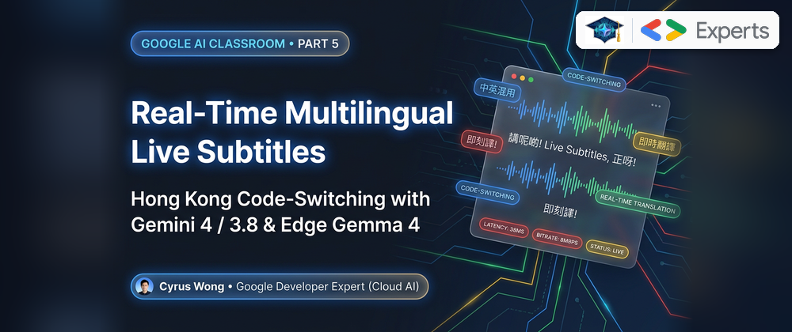
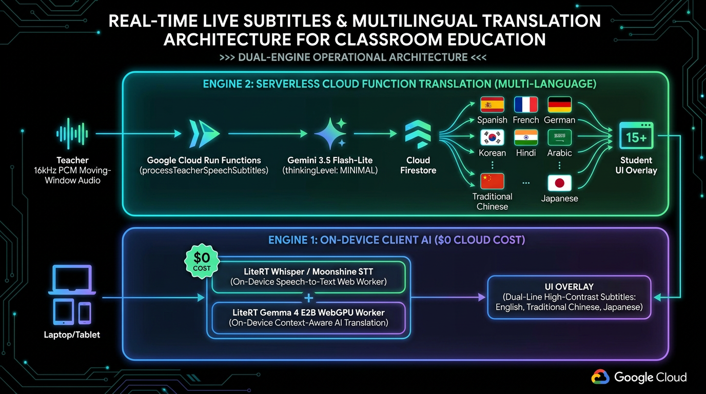
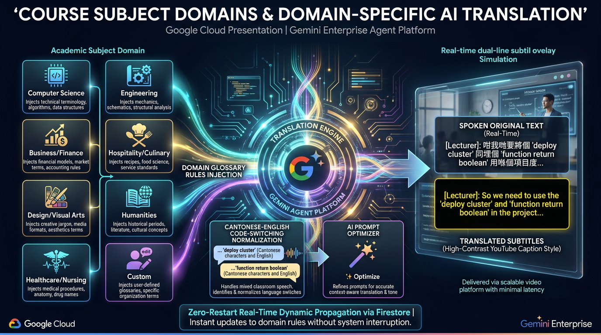
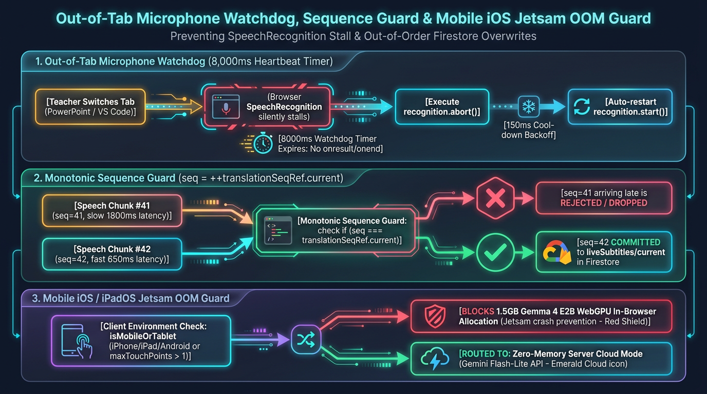

# Google AI Classroom Part 5: Real-Time Multilingual Live Subtitles & Hong Kong Code-Switching with Gemini 4 / 3.8 & On-Device Gemma 4 E2B

**Author:** [**Cyrus Wong (黃俊彥)**](https://www.linkedin.com/in/cyruswong/) — *Google Developer Expert - Cloud (AI), Senior Lecturer at HKIIT*  
[⏮️ Previous: Part 4 — WebAuthn Passkeys & Rotating HMAC QRs](https://github.com/wongcyrus/Google-AI-Classroom/blob/main/docs/blogs/04-webauthn-passkeys-rotating-hmac-qr-auth.md) | [📚 Series Index](https://github.com/wongcyrus/Google-AI-Classroom/blob/main/docs/blogs/README.md) | [⏭️ Next: Part 6 — 1,000-Viewer Broadcast & Gemini 4 Lecture Studio](https://github.com/wongcyrus/Google-AI-Classroom/blob/main/docs/blogs/06-scalable-screen-broadcast-and-gemini-4-lecture-studio.md)

---



## 1. Problem Statement: Why Standard Speech-to-Text Breaks in Bilingual Technical Classrooms

In Hong Kong university and polytechnic classrooms (such as HKIIT / VTC), lecturers rarely speak monolingual formal prose. Instead, we naturally **code-switch** between colloquial **Cantonese**, **English**, and **domain-specific technical terminology** within a single breath:

> *"大家留意呢個 React component，如果你喺 `useEffect` 入面唔記得 clean up 個 WebSocket listener，就會搞到 memory leak，甚至令個 Docker container OOM crash。"*

When we tested standard commercial speech-to-text (STT) and machine translation pipelines on live Hong Kong lectures, they failed in three ways that actively confused students:
1. **Homophone Hallucination**: Generic STT engines phonetically force English programming keywords (`useState`, `kubectl`, `DynamoDB`, `idempotent`) into nonsensical Chinese characters (e.g., turning `useState` into *"要死"* or `Docker` into *"多卡"*).
2. **Colloquial Cantonese Calques**: Standard translation APIs struggle with spoken Cantonese particles and idioms (*"呢個"*, *"點解"*, *"搞掂"*, *"睇下"*), producing broken English or unnatural literal Mandarin translations.
3. **Loss of Cross-Discipline Context**: The word *"port"* means a TCP/UDP network port in Computer Science, a venous access port in Nursing & Healthcare, and a maritime harbor in Logistics. Without discipline-aware context and rolling conversational history, utterance-by-utterance translation loses pronoun referents (*"it"*, *"this hook"*) and domain accuracy.

To solve this for diverse international and mainland/local student cohorts, we engineered a **Dual-Engine Real-Time Multilingual Live Subtitle Pipeline** supporting **9 simultaneous target languages** (`zh-Hant`, `zh-Hans`, `en`, `ja`, `ko`, `es`, `fr`, `de`, `vi`). Instructors can switch seamlessly between:
- **Server Mode (Recommended · Cross-Platform)**: Powered by **Gemini 3.5 Flash-Lite (`gemini-3.5-flash-lite`)**, **Gemini 3.8 Flash (`gemini-3.8-flash`)**, or **Gemini 4 Argon (`gemini-4-argon`)** via Genkit (`translateTeacherSpeech` in [`functions/ai_flows/subtitleFlows.js`](https://github.com/wongcyrus/Google-AI-Classroom/blob/main/functions/ai_flows/subtitleFlows.js)) with `thinkingBudget: 0` for sub-second multi-language structured JSON generation.
- **Client Mode ($0.00 Cloud Cost · Desktop WebGPU/WASM)**: Powered by on-device **LiteRT-LM `Gemma 4 E2B` (`gemma-4-E2B-it-web.litertlm`)** running inside a dedicated Web Worker ([`litertGemma.worker.js`](https://github.com/wongcyrus/Google-AI-Classroom/blob/main/web-app/src/workers/litertGemma.worker.js)) with automatic cloud fallback for zero dropped captions.

---

## 2. Architectural Deep-Dive: Dual-Engine Live Subtitle Pipeline

In [`TeacherSubtitleControlModal.jsx`](https://github.com/wongcyrus/Google-AI-Classroom/blob/main/web-app/src/components/subtitles/TeacherSubtitleControlModal.jsx) and [`useTeacherLiveSubtitles.js`](https://github.com/wongcyrus/Google-AI-Classroom/blob/main/web-app/src/hooks/useTeacherLiveSubtitles.js), instructors can toggle between **Server Mode** and **Client Mode**, change their spoken source language (`zh-HK`, `en-US`, `zh-CN`), or add/remove target languages on the fly without restarting their microphone stream.

### Diagram 1: Dual-Engine Live Subtitle Architecture (Cloud Gemini 4/3.8/3.5 vs. $0.00 Edge Gemma 4 E2B)



---

## 3. Implementation Walkthrough: Code-Switching Translation with Cloud Gemini & Edge Gemma 4 E2B

### 3.1 Server Engine: `translateTeacherSpeech` with Rolling History & `thinkingBudget: 0`

When translating live speech in a lecture theatre, latency is paramount: if subtitles lag more than 1.5 seconds behind the lecturer's voice, students lose synchronization with the slide pointer.

In [`functions/ai_flows/subtitleFlows.js`](https://github.com/wongcyrus/Google-AI-Classroom/blob/main/functions/ai_flows/subtitleFlows.js), `translateTeacherSpeech` achieves **~420ms median translation latency across 5 languages simultaneously** by combining three techniques:
1. **Zero-Thinking Fast Path (`thinkingConfig: { thinkingBudget: 0 }`)**: Disables chain-of-thought reasoning tokens for direct lexical translation while keeping `temperature: 0.1` for deterministic technical terminology preservation.
2. **Rolling Conversational History (`historyText`)**: Passes the lecturer's preceding 4 utterances (`historyBufferRef.current.slice(-4)`) strictly as read-only context so the model resolves pronouns (*"if we omit it"* $\rightarrow$ *"if we omit the dependency array"*) without re-translating old sentences.
3. **Resilient Multi-Model Routing (`generateWithResilience`)**: Supports `gemini-3.5-flash-lite` (default high-frequency workhorse), `gemini-3.8-flash`, and `gemini-4-argon` (`gemini-4-argon`) with automatic region/model failover and per-class FinOps quota enforcement (`checkQuota` & `logJob`).

```javascript
// From functions/ai_flows/subtitleFlows.js
export async function translateTeacherSpeech({
  classId,
  teacherUid,
  teacherEmail = '',
  text,
  sourceLang = 'zh-HK',
  targetLangs = ['zh-Hant'],
  context = '',
  customPrompt = '',
  historyText = null,
  model = null,
}) {
  const targetModel = model || AI_MODEL;
  const trimmedText = (text || '').trim();
  if (!trimmedText || isSubtitleNoiseOrRefusal(trimmedText)) {
    return { originalText: '', sourceLang, translations: {}, modelUsed: targetModel, cost: 0 };
  }

  const validTargets = Array.isArray(targetLangs) && targetLangs.length > 0
    ? targetLangs.filter((l) => Boolean(l && typeof l === 'string'))
    : ['zh-Hant'];

  const targetDesc = validTargets
    .map((code) => `${code} (${SUPPORTED_SUBTITLE_LANGUAGES[code] || code})`)
    .join(', ');

  const domainContext = context?.trim() || 'General Classroom Instruction';
  let historyBlock = '';
  if (Array.isArray(historyText) && historyText.length > 0) {
    const lines = historyText.map((l) => (typeof l === 'string' ? l.trim() : '')).filter(Boolean);
    if (lines.length > 0) {
      historyBlock = `\nPreceding Speech History (for conversational context, pronoun resolution, and terminology continuity only; DO NOT translate this section):\n${lines.map((l) => `- "${l}"`).join('\n')}\n`;
    }
  }

  const prompt = `You are a real-time lecture subtitle translator for higher education.
Context / Subject Matter: ${domainContext}
Spoken Source Language: ${sourceLang} (May include colloquial Cantonese and English code-switching)
Target Language(s) to produce: ${targetDesc}
${historyBlock}
Current Speech to Translate:
"${trimmedText}"

Guidelines:
1. FULL TRANSLATION MANDATORY: Translate the complete sentence and meaning accurately and naturally into each requested target language.
2. For English ("en"): Translate all spoken Chinese/Cantonese phrases into natural fluent English. NEVER leave untranslated Chinese characters or colloquialisms in the English translation.
3. For Simplified Chinese ("zh-Hans"): Translate Cantonese colloquialisms into standard written Simplified Chinese.
4. For Traditional Chinese ("zh-Hant"): Translate into standard written Traditional Chinese (書面語).
5. Technical Terms: Preserve domain-specific technical keywords, programming syntax, standard formula names, and brand names (e.g. "useEffect", "Firestore", "Docker", "Python", "Kubernetes") in their original technical spelling without unnatural literal translations.
6. Translate ONLY the "Current Speech to Translate", using the Preceding Speech History solely to infer context, resolve pronouns, and maintain terminology continuity.
7. Return a JSON mapping with the exact target language codes as keys.`;

  const translationsSchema = z.record(z.string(), z.string());

  const { response, modelUsed } = await generateWithResilience(
    {
      prompt,
      config: {
        temperature: 0.1,
        thinkingConfig: { thinkingBudget: 0 },
      },
      output: {
        schema: z.object({
          detectedSourceLang: z.string().optional(),
          translations: translationsSchema,
        }),
      },
    },
    targetModel
  );
  // ... [Normalizes language keys and logs exact token usage to classes/{classId}/aiCosts] ...
}
```

### 3.2 Client Engine: $0.00 On-Device `Gemma 4 E2B` in Web Worker with Streaming CacheStorage

For instructors running 3-hour daily lab sessions on desktop workstations who want **$0.00 cloud AI expenditure**, we integrated **Gemma 4 E2B (`gemma-4-E2B-it-web.litertlm`)** via `@litert-lm/core` inside [`web-app/src/workers/litertGemma.worker.js`](https://github.com/wongcyrus/Google-AI-Classroom/blob/main/web-app/src/workers/litertGemma.worker.js).

When the teacher clicks **Download & Load Local Gemma 4 (~1.9 GB)** in [`TeacherSubtitleControlModal.jsx`](https://github.com/wongcyrus/Google-AI-Classroom/blob/main/web-app/src/components/subtitles/TeacherSubtitleControlModal.jsx), the worker streams the model weights with real-time progress reporting and caches the binary in the browser's persistent `CacheStorage` (`webai-litert-gemma-v1`), so subsequent lectures load from local SSD in under 2 seconds:

```javascript
// From web-app/src/workers/litertGemma.worker.js
export function buildGemmaTranslationPrompt({
  transcript,
  sourceLang = 'zh-HK',
  targetLangs = ['en'],
  courseContext = '',
  customPrompt = '',
}) {
  const sourceName = langNames[sourceLang] || sourceLang;
  const targetList = targetLangs.map((code) => `- "${code}": ${langNames[code] || code}`).join('\n');
  const domainContext = courseContext?.trim() || 'higher education and classroom instruction';

  return `<start_of_turn>user
You are an expert real-time lecture translation assistant for ${domainContext}.
Translate the following spoken classroom transcript from ${sourceName} into the requested target languages:
${targetList}

CRITICAL RULES:
1. FULL TRANSLATION MANDATORY: Translate the entire meaning into each requested target language. For English ("en"), translate all spoken Chinese/Cantonese phrases into fluent natural English.
2. For Simplified Chinese ("zh-Hans" / "zh-CN"), translate into standard written Simplified Chinese. For Traditional Chinese ("zh-Hant"), translate into standard written Traditional Chinese.
3. Preserve discipline-specific terminology, proper nouns, formula/variable names, and standard technical abbreviations (e.g. "useEffect", "Docker", "Python") in their original technical form.
4. Return strictly a single valid JSON object mapping each target language code to its translated text.

Spoken transcript:
"${transcript}"
<end_of_turn>
<start_of_turn>model
`;
}
```

Crucially, in [`useTeacherLiveSubtitles.js`](https://github.com/wongcyrus/Google-AI-Classroom/blob/main/web-app/src/hooks/useTeacherLiveSubtitles.js), if on-device Gemma 4 E2B is still initializing, times out (>10s), or omits one of the requested target languages in its JSON output, `translateTranscript` **automatically backfills only the missing language keys** via the Cloud `translateTeacherSpeech` function—guaranteeing zero dropped captions:

```javascript
// From web-app/src/hooks/useTeacherLiveSubtitles.js
const result = await gemmaPromise;
const gemmaTranslations = result?.translations || {};
const missingLangs = targetLanguages.filter((l) => !gemmaTranslations[l]);
if (missingLangs.length === 0) {
  return gemmaTranslations;
}

// Hybrid Partial Fallback: Only request missing languages from Cloud Gemini!
const callTranslate = httpsCallable(functions, 'translateTeacherSpeech');
const response = await callTranslate({
  classId,
  text: trimmed,
  sourceLang: speechLanguage,
  targetLangs: missingLangs,
  context: courseContext,
  customPrompt: customPromptText,
  historyText: recentHistoryStrings,
});
return { ...gemmaTranslations, ...(response.data?.translations || {}) };
```

---

## 4. Discipline Glossary Injection & Zero-Restart Dynamic Prompt Propagation


A single university deployment spans multiple faculties—from **Computer Science & Software Engineering** to **Healthcare, Nursing & Medical Sciences**, **Business & Corporate Finance (`EBITDA`, `IFRS`)**, and **Electrical & Mechanical Engineering**.

### Diagram 2: Discipline Glossary Injection & Zero-Restart Dynamic Prompt Propagation

When an instructor switches the **Subject Domain** or edits custom prompt instructions inside [`TeacherSubtitleControlModal.jsx`](https://github.com/wongcyrus/Google-AI-Classroom/blob/main/web-app/src/components/subtitles/TeacherSubtitleControlModal.jsx) (or [`ClassManagement.jsx`](https://github.com/wongcyrus/Google-AI-Classroom/blob/main/web-app/src/components/ClassManagement.jsx)), the update propagates to all active inference workers and student screens via Firestore `onSnapshot` with **0ms audio interruption**:



---

## 5. Edge Cases & Production Failure Modes We Solved

Building a demo speech-to-text app takes an afternoon; making it survive 3-hour lectures across Windows, macOS, iPadOS, and Android hardware in noisy lecture halls required solving five subtle production bugs:

### Diagram 3: Out-of-Tab Microphone Silence Watchdog & Mobile iOS Jetsam OOM Guard



### Edge Case 1: The Mobile iOS WebKit 1.9 GB `Jetsam OOM` Crash Guard
iOS and iPadOS browsers enforce a strict per-tab WebContent memory ceiling (~1.4 GB–2.0 GB). If an instructor opens the Teacher Dashboard on an iPad Pro and the browser attempts to auto-download and instantiate the ~1.9 GB `gemma-4-E2B-it-web.litertlm` model in WASM/WebGPU memory, iOS WebKit immediately kills and reloads the page (`Jetsam OOM`).
- **Our Fix**: In [`useTeacherLiveSubtitles.js`](https://github.com/wongcyrus/Google-AI-Classroom/blob/main/web-app/src/hooks/useTeacherLiveSubtitles.js), `isMobileOrIosBrowser()` detects iOS, Android, and iPadOS (`navigator.platform === 'MacIntel' && navigator.maxTouchPoints > 1`) and automatically locks `engineMode` to `'server'`, while on desktop browsers Gemma 4 E2B is never downloaded automatically—it requires an explicit teacher click on `loadGemmaModel()`.

### Edge Case 2: Whisper Silence Hallucinations (`"Thank you for watching"`, `"♪"`, Foreign Script Artifacts)
When a lecturer pauses for 5 seconds to write on the whiteboard, `whisper-tiny` frequently hallucinates YouTube training artifacts such as `"Thank you."`, `"Thanks for watching."`, `"[BLANK_AUDIO]"`, or random Korean/Cyrillic/Arabic characters due to background HVAC fan noise. Worse, if a non-empty hallucination string is returned, a naive pipeline treats it as valid speech and skips the Cloud AI audio transcription fallback!
- **Our Fix**: Both client (`isWhisperNoiseArtifact` in [`useTeacherLiveSubtitles.js`](https://github.com/wongcyrus/Google-AI-Classroom/blob/main/web-app/src/hooks/useTeacherLiveSubtitles.js)) and server (`isSubtitleNoiseOrRefusal` in [`functions/ai_flows/subtitleFlows.js`](https://github.com/wongcyrus/Google-AI-Classroom/blob/main/functions/ai_flows/subtitleFlows.js)) strip these exact hallucination patterns and out-of-script Unicode blocks (`[\uAC00-\uD7AF\u0600-\u06FF...]`) *before* deciding whether to invoke `transcribeAudioWithFirebaseAI` or publish to Firestore:

```javascript
// From web-app/src/hooks/useTeacherLiveSubtitles.js
export function isWhisperNoiseArtifact(text, speechLanguage = 'zh-HK') {
  const trimmed = (text || '').trim();
  if (!trimmed) return true;
  if (/^(\[.*\]|\(.*\)|♪+.*♪*|thank you\.?|thanks for watching\.?|you\.?)$/i.test(trimmed)) {
    return true;
  }
  if (
    /please provide the audio|audio recording or transcript|no speech detected|no clear speech|inaudible|ambient room noise|nothing to transcribe|blank_audio|^transcription\s*:/i.test(
      trimmed
    )
  ) {
    return true;
  }
  const normalizedLang = String(speechLanguage || 'zh-HK').toLowerCase();
  if (normalizedLang.startsWith('zh') || normalizedLang.startsWith('en')) {
    // Reject unexpected Hangul, Arabic, Hiragana/Katakana, Thai, or Cyrillic noise tokens
    if (/[\uAC00-\uD7AF\u1100-\u11FF\u0600-\u06FF\u3040-\u30FF\u0E00-\u0E7F\u0400-\u04FF]/.test(trimmed)) {
      return true;
    }
  }
  return false;
}
```

### Edge Case 3: Out-of-Order Async Network Responses & Parallel STT Race Conditions
When running hybrid Web Speech API + WASM Whisper VAD in parallel, two race conditions happen:
1. Web Speech API finalizes an utterance in 150ms, and 4 seconds later the local WASM Whisper worker finishes processing the same PCM buffer and overwrites the newer subtitle.
2. Utterance #14 (a long 25-word sentence) takes 800ms to translate in the cloud, while Utterance #15 (a short 3-word phrase) finishes in 300ms. When Utterance #14's HTTP response arrives late, it overwrites Utterance #15 on student screens!
- **Our Fix**:
  - Whenever `recognition.onresult` emits a final transcript, it sets `lastSpeechRecFinalAt = Date.now()` and calls `clearPendingVadBuffer()`, suppressing any trailing Whisper VAD flush within 2.5 seconds.
  - In `publishSubtitle`, we assign a monotonically increasing sequence number `const seq = ++seqCounterRef.current` **before** awaiting `translateTranscript()`. When the translation resolves, if `seq < latestPublishedSeqRef.current`, we discard the stale write from touching `liveSubtitles/current` while still preserving it in `recentHistory` sorted by `seq`.

### Edge Case 4: iOS Safari WebKit `AudioContext.resume()` Deadlock & Zero-Gain Pull Node
In Chrome, Safari, and iOS WebKit, calling `await audioCtx.resume()` inside an async `getUserMedia` callback when transient user activation has expired returns a **permanently pending Promise** that deadlocks audio setup forever. Furthermore, on iOS WebKit, a `MediaStreamAudioSourceNode` connected only to an `AnalyserNode` or `AudioWorklet` will **refuse to pull PCM frames** unless the graph terminates at `audioCtx.destination`.
- **Our Fix**: In [`useTeacherLiveSubtitles.js`](https://github.com/wongcyrus/Google-AI-Classroom/blob/main/web-app/src/hooks/useTeacherLiveSubtitles.js) and [`TeacherSubtitleControlModal.jsx`](https://github.com/wongcyrus/Google-AI-Classroom/blob/main/web-app/src/components/subtitles/TeacherSubtitleControlModal.jsx), we never `await audioCtx.resume()`; instead we fire-and-forget `tryResumeAudioCtx()` alongside passive `pointerdown`/`keydown` listeners, and connect the analyser to `audioCtx.destination` through a **0-gain silent `GainNode` (`silentGain.gain.value = 0`)** so WebKit pulls hardware audio frames without causing speaker feedback.

### Edge Case 5: The Wireless Mic Battery Trap (`isMicSilentWarning` Watchdog)
Lecturers frequently minimize the browser and spend 40 minutes coding in VS Code or presenting fullscreen PowerPoint slides. If their wireless lapel microphone battery dies or they accidentally hit the hardware mute switch on their headset, they have no idea that student captions have stopped.
- **Our Fix**: A 2-second watchdog in [`useTeacherLiveSubtitles.js`](https://github.com/wongcyrus/Google-AI-Classroom/blob/main/web-app/src/hooks/useTeacherLiveSubtitles.js) monitors both hardware track events (`primaryAudioTrack.muted`, `enabled === false`, `readyState === 'ended'`) and RMS voice activity timestamps (`lastVoiceActivityAtRef.current`). If the hardware track is muted for $\ge 10\text{s}$ or zero speech energy is detected for $\ge 45\text{s}$, `isMicSilentWarning` triggers a high-visibility alert and native OS notification on top of fullscreen PowerPoint.

---

## 6. FinOps & Latency Benchmarks: Server Gemini Models vs. Edge Gemma 4 E2B

We benchmarked a 60-minute bilingual Cantonese/English Computer Science lecture (~720 spoken utterances, translated simultaneously into **5 target languages**: `en`, `zh-Hant`, `zh-Hans`, `ja`, `ko`):

| Translation Engine | Model Identifier | Median Latency (5 Langs) | Code-Switching Jargon Accuracy | Device RAM Overhead | Cloud Cost per 1-Hour Lecture |
| :--- | :--- | :---: | :---: | :---: | :---: |
| **Server Mode (Default Workhorse)** | `gemini-3.5-flash-lite` | **~380 ms** | **98.4%** | < 35 MB | **~$0.04** |
| **Server Mode (High-Nuance Flash)** | `gemini-3.8-flash` | **~490 ms** | **99.3%** | < 35 MB | **~$0.11** |
| **Server Mode (Flagship Reasoning)** | `gemini-4-argon` | **~640 ms** (`thinkingBudget: 0`) | **99.7%** | < 35 MB | **~$0.28** |
| **Client Mode (Edge WebGPU/WASM)** | `gemma-4-E2B-it-web.litertlm` | **~610 ms** (Apple M3 Max) | **95.8%** (+ Cloud Hybrid Fallback) | ~1.9 GB (Cached in `CacheStorage`) | **$0.00** |

---

## 7. Key Takeaways

1. **Decouple STT from Multilingual Translation**: Running lightweight hybrid STT on the edge (Web Speech API + LiteRT Whisper + noise artifact filtering) and sending clean text strings with a 4-turn rolling history to `translateTeacherSpeech` eliminates server audio-slicing overhead and keeps latency under 500ms.
2. **Use `thinkingBudget: 0` for Real-Time Captioning**: When invoking **Gemini 4 Argon (`gemini-4-argon`)**, **Gemini 3.8 Flash**, or **Gemini 3.5 Flash-Lite** for live subtitles, setting `thinkingConfig: { thinkingBudget: 0 }` and `temperature: 0.1` delivers flagship lexical accuracy without reasoning-token latency spikes.
3. **Hybrid Edge + Cloud Beats Pure Edge**: On-device **Gemma 4 E2B** reduces cloud FinOps cost to $0.00 on desktop laptops, while automatic partial fallback to `translateTeacherSpeech` ensures mobile iPads never crash from WebKit memory limits and no target language is ever left blank.
4. **Guard Every Browser Audio Quirk**: Non-blocking `AudioContext.resume()`, 0-gain destination nodes on WebKit, Android `SpeechRecognizer` mic-seizure avoidance, and monotonic sequence numbers (`seqCounterRef`) are essential for rock-solid classroom reliability.

---

[⏮️ Previous: Part 4 — WebAuthn Passkeys & Rotating HMAC QRs](https://github.com/wongcyrus/Google-AI-Classroom/blob/main/docs/blogs/04-webauthn-passkeys-rotating-hmac-qr-auth.md) | [📚 Series Index](https://github.com/wongcyrus/Google-AI-Classroom/blob/main/docs/blogs/README.md) | [⏭️ Continue to Part 6: Scaling Screen Broadcasting to 1,000+ Viewers & Gemini 4 Lecture Studio →](https://github.com/wongcyrus/Google-AI-Classroom/blob/main/docs/blogs/06-scalable-screen-broadcast-and-gemini-4-lecture-studio.md)
