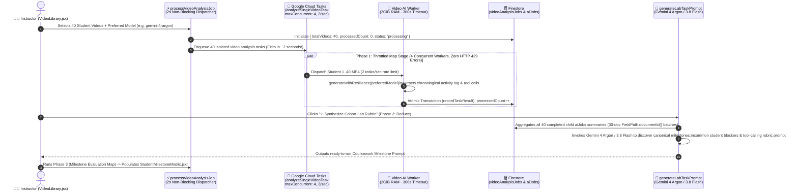
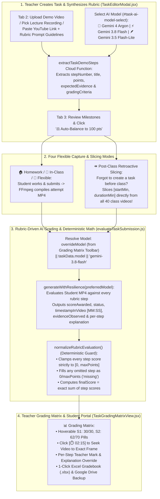

# Part 7: Serverless Map-Reduce-Map Video Intelligence & Rubric-Driven Practical Task Auto-Grading with Gemini 4 Argon

**Author:** **Cyrus Wong (黃俊彥)** — *Google Developer Expert (GCP & AI/ML), Senior Lecturer at HKIIT / VTC Hong Kong*  
[⏮️ Previous: Part 6 — 1,000-Viewer Broadcast & Gemini 4 Lecture Studio](./06-scalable-screen-broadcast-and-gemini-4-lecture-studio.md) | [📚 Series Index](./README.md) | [⏭️ Next: Part 8 — Multimodal Capstone Supervision with Gemini 4](./08-multimodal-capstone-project-supervision-gemini-4.md)

---


## 1. The 80-Hour Lab Grading Bottleneck & The HTTP 429 Quota Wall

In hands-on cloud computing, DevSecOps, and full-stack software engineering courses at the **Hong Kong Institute of Information Technology (HKIIT / VTC)**, students spend 2 to 3 hours building infrastructure in the AWS/GCP Console, writing Terraform modules in VS Code, and debugging container deployments in the terminal. Reviewing a single 40-student cohort's 2-hour screen recordings manually requires **80 hours of instructor time per lab**.

However, when our engineering team first attempted to automate post-class video grading by firing 40 concurrent multimodal video analysis calls against the Gemini API at the end of a lab session, two hard distributed systems walls appeared immediately:

1. **The Serverless Execution Timeout Wall (`540s`)**: Even a 2nd-Gen Cloud Run-backed Cloud Function caps synchronous execution at 540 seconds (9 minutes). Sequentially evaluating 40 multi-megabyte lab recordings inside a single monolithic worker inevitably times out mid-cohort, leaving half the class ungraded and corrupting aggregate progress counters.
2. **Vertex AI & Gemini API HTTP `429 RESOURCE_EXHAUSTED` Spikes**: Sending 40 uncompressed 30-FPS screen recordings simultaneously floods regional Tokens-Per-Minute (TPM) and Requests-Per-Minute (RPM) quotas, triggering cascading HTTP `429` rate-limit errors.
3. **LLM Scoring Drift & Hallucinated Arithmetic**: When evaluating multi-step practical exams, raw LLM JSON responses occasionally award `25/20` points on a rubric step, omit a milestone when a student stops early, or miscalculate the sum of individual step scores.

In **Part 7** of our 10-part Google Developer Expert engineering series, we walk through how we solved all three challenges by combining:
- **Cloud Run FFmpeg 1-FPS H.264 Timelapse Compilation** (shrinking a 2-hour lab into a `<20 MB` forensic MP4 and slashing multimodal video token consumption by **90%+**).
- **Google Cloud Tasks Rate-Limited Fan-Out (`maxDispatchesPerSecond: 2`, `maxConcurrentDispatches: 4`)** for zero-timeout, zero-`429` distributed video processing.
- **Two-Stage Map-Reduce-Map Cohort Discovery** (`processVideoAnalysisJob` $\rightarrow$ `analyzeSingleVideoTask` $\rightarrow$ `generateLabTaskPrompt`), enabling teachers to select **🧠 Gemini 4 Argon (`gemini-4-argon`)**, **⚡ Gemini 3.8 Flash (`gemini-3.8-flash`)**, or **🪶 Gemini 3.5 Flash-Lite (`gemini-3.5-flash-lite`)** to automatically discover what milestones a class achieved and synthesize a tool-calling grading rubric.
- **A 4-Tab Practical Task & Deterministic Rubric Grading Engine** (`extractTaskDemoSteps.js`, `evaluateTaskSubmission.js`, `TaskEditorModal.jsx`, and `TaskGradingMatrixView.jsx`) with **Ultrafast Stream-Copy Retroactive Video Slicing (`-c copy`)** and a deterministic mathematical guardrail (`normalizeRubricEvaluation` / `reconcileStepEvaluationsWithRubric`).

---

## 2. Diagram 1: From Periodic Screenshots to Forensic 1-FPS H.264 MP4s (80% Storage & 90% Token Reduction)


Why record a 30-FPS desktop video stream when a student coding in VS Code or configuring a VPC in the browser changes meaningful visual state every 5 to 15 seconds?

Before Gemini ever evaluates a student's work, [`StudentView.jsx`](../../web-app/src/components/StudentView.jsx) and our high-memory Cloud Run worker [`processVideoJob.js`](../../functions/media_processing/processVideoJob.js) (`2 vCPU, 8 GiB RAM, 540s timeout`) transform periodic screenshots into a razor-sharp, tamper-evident **1-FPS H.264 MP4 timelapse** that is **80% smaller** than continuous screen recordings:

```mermaid
flowchart LR
    subgraph BrowserScale ["1. Adaptive Client Geometric Scaling (StudentView.jsx)"]
        RAW["Desktop Screen + Webcam Frame\nMax Width: 1920px (1080p)"]
        MATH["Single-Pass Geometric Downscale if > maxImageSize:\nscale = sqrt(maxImageSize / blob.size) * 0.9"]
        GCS_IMG["Cloud Storage\nscreenshots/{classId}/{uid}/"]
        RAW --> MATH --> GCS_IMG
    end

    subgraph CloudRunFFmpeg ["2. High-Memory Cloud Run Worker (processVideoJob.js · 2 vCPU, 8GiB RAM)"]
        BATCH["Memory-Bounded Batching\nBATCH_SIZE = 15 frames per pass\n(Zero Container OOM)"]
        SHARP["Sharp 40px SVG Security Overlay\nStamps UTC/HKT Timestamp, Class ID, Student Email,\n[SCREEN]/[WEBCAM] & Even Dimensions (w%2==0)"]
        FFMPEG["FFmpeg H.264 Timelapse Encoder:\n-preset fast -crf 30 -tune stillimage -movflags +faststart\n+ Zero-Trust customMetadata: { isExam: 'true' }"]
        GCS_IMG --> BATCH --> SHARP --> FFMPEG
    end

    subgraph OutputMP4 ["3. Compact Forensic MP4 Artifact & Task Slicer"]
        MP4["videos/{classId}/{videoId}.mp4\n• 2-Hour Lab Session < 20 MB!\n• 90% Lower Gemini Video Token Footprint"]
        SLICE["slicePendingTaskSubmissions()\nUltrafast FFmpeg Stream Copy (-c copy)\ninto attempt_N.mp4 + Auto-Triggers AI Grading!"]
        FFMPEG --> MP4 --> SLICE
    end
```



### Engineering Highlights of the Cloud Run FFmpeg Pipeline
1. **Single-Pass Client Geometric Scaling**: On 4K Retina displays, raw canvas captures can exceed `3 MB`. Instead of an expensive multi-pass compression loop in the browser, [`StudentView.jsx`](../../web-app/src/components/StudentView.jsx) computes a single-pass geometric scaling ratio:
   $$\text{scale} = \sqrt{\frac{\text{maxImageSize}}{\text{blob.size}}} \times 0.9$$
   This guarantees every uploaded frame stays well beneath the `2 MB` [`storage.rules`](../../storage.rules) threshold while preserving crisp terminal text legibility at up to `1920px` (1080p).
2. **Memory-Bounded Sharp SVG Watermarking (`BATCH_SIZE = 15`)**: Inside [`processVideoJob.js`](../../functions/media_processing/processVideoJob.js), downloading and compositing 720 high-resolution frames concurrently via `Promise.all()` would spike heap memory and crash the container. We process frames in chunks of `BATCH_SIZE = 15`, using `sharp` to burn a **40px forensic SVG banner** onto every frame (`YYYY-MM-DD HH:mm:ss | Class ID | Student Email | [SCREEN]/[WEBCAM]`) and rounding dimensions to even integers (`w - (w % 2)`) required by the H.264 `yuv420p` planar chroma format.
3. **Why Burn-In Timestamps Matter for Gemini 4**: Because the compiled MP4 plays back at 1 frame per second (where 1 second of video equals 15 seconds of real classroom time), a naive LLM looking only at the MP4 container's playback clock would miscalculate how long a student spent on a task by a factor of $15\times$. Burning the real wall-clock timestamp directly into every frame allows **Gemini 4 Argon (`gemini-4-argon`)** and **Gemini 3.8 Flash (`gemini-3.8-flash`)** to read the exact on-screen clock via optical character recognition!

---

## 3. Diagram 2: Two-Stage Map-Reduce-Map Cohort Video Discovery with Cloud Tasks & Gemini 4 Argon

What happens when an instructor runs an open-ended hands-on cloud lab—where students explore AWS/GCP services at their own pace—and wants AI to:
1. Watch all 40 student timelapse videos without hitting rate limits (**Phase 1: Map**),
2. Discover the common coursework milestones, point weights, and technical blockers encountered across the entire cohort (**Phase 2: Reduce**), and
3. Re-evaluate every student against that newly synthesized rubric to populate a live **Coursework Milestone Matrix** (**Phase 3: Second Map**)?

In [`functions/ai_flows/index.mjs`](../../functions/ai_flows/index.mjs), [`generateLabTaskPrompt.js`](../../functions/ai_flows/generateLabTaskPrompt.js), [`VideoLibrary.jsx`](../../web-app/src/components/VideoLibrary.jsx), and [`VideoAnalysisJobs.jsx`](../../web-app/src/components/VideoAnalysisJobs.jsx), we built a **Serverless Map-Reduce-Map Pipeline** where teachers can select **`gemini-4-argon`**, **`gemini-3.8-flash`**, or **`gemini-3.5-flash-lite`** at both the Map and Reduce stages:



### Production Code 1: The Reduce Stage — Synthesizing a Cohort Grading Rubric from 40 Student Videos (`generateLabTaskPrompt.js`)

Let's examine [`functions/ai_flows/generateLabTaskPrompt.js`](../../functions/ai_flows/generateLabTaskPrompt.js). When Phase 1 (the exploratory Map pass) finishes, each student's raw activity observation is stored in `aiJobs/{jobId}`. Because Firestore's `in` query operator accepts at most 30 document IDs per query, `generateLabTaskPrompt` fetches the completed child jobs in 30-document chunks, compiles them into a cohort-wide activity corpus, and invokes `generateWithResilience` using the teacher's chosen model (such as **`gemini-4-argon`** or **`gemini-3.8-flash`**):

```javascript
// Source: functions/ai_flows/generateLabTaskPrompt.js
export const generateLabTaskPrompt = onCall(
  {
    region: FUNCTION_REGION,
    cors: CORS_ORIGINS,
    timeoutSeconds: 120,
    memory: '1GiB',
  },
  async (request) => {
    if (!request.auth) {
      throw new HttpsError('unauthenticated', 'The function must be called while authenticated.');
    }

    const { jobId, model } = request.data || {};
    const masterJobRef = db.collection('videoAnalysisJobs').doc(jobId);
    const jobDoc = await masterJobRef.get();
    const jobData = jobDoc.data();
    const classId = jobData.classId || 'unknown_class';
    const aiJobIds = jobData.aiJobIds || [];

    let completedJobs = [];

    // Fetch child aiJobs via 30-document batched FieldPath.documentId() queries
    if (aiJobIds.length > 0) {
      for (let i = 0; i < aiJobIds.length; i += 30) {
        const batchIds = aiJobIds.slice(i, i + 30);
        const querySnapshot = await db
          .collection('aiJobs')
          .where(FieldPath.documentId(), 'in', batchIds)
          .get();

        querySnapshot.forEach((doc) => {
          const data = doc.data();
          if (data.status === 'completed' && data.result && typeof data.result === 'string' && data.result.trim()) {
            completedJobs.push(data);
          }
        });
      }
    }

    // Compile observations across all students in the cohort
    const compiledObservations = completedJobs
      .map((job, idx) => {
        const studentIdentifier = job.studentEmail || job.studentUid || `Student ${idx + 1}`;
        return `### Student ${idx + 1}: ${studentIdentifier}\n${job.result.trim()}`;
      })
      .join('\n\n---\n\n');

    const preferredModel = model || 'gemini-3.8-flash';
    const { response, modelUsed } = await generateWithResilience(
      {
        prompt: [{ text: metaPrompt }],
        config: { temperature: 0.2 },
      },
      preferredModel
    );

    const usage = response?.usage || response?.usageMetadata || {};
    const cost = calculateCost(usage, modelUsed || preferredModel);
    await logJob({
      classId,
      jobType: 'generateLabTaskPrompt',
      status: 'completed',
      promptText: metaPrompt,
      mediaPaths: [],
      usage: {
        inputTokens: usage.inputTokens ?? usage.promptTokenCount ?? 0,
        outputTokens: usage.outputTokens ?? usage.candidatesTokenCount ?? 0,
      },
      cost,
      modelUsed: modelUsed || preferredModel,
      result: generatedPrompt.trim().substring(0, 300),
      masterJobId: jobId,
    });

    return {
      generatedPrompt: generatedPrompt.trim(),
      modelUsed,
      summaryCount: completedJobs.length,
      classId,
      jobId,
    };
  }
);
```

When the teacher runs **Phase 3 (the Milestone Evaluation Map)** using that synthesized prompt, each Cloud Tasks worker invokes Genkit tools (`recordActualWorkingTime`, `recordTaskDuration`, and `recordLessonSummary`) that populate [`StudentMilestoneMatrix.jsx`](../../web-app/src/components/StudentMilestoneMatrix.jsx)—giving the lecturer a color-coded cohort progress matrix showing exactly how many minutes each student spent on Task 1, Task 2, and Task 3, and where they got stuck!

---

## 4. Diagram 3: 4-Tab Practical Tasks, Retroactive Post-Class Slicing & Deterministic Rubric Reconciliation

While Map-Reduce-Map excels at exploratory cohort discovery, graded practical assignments and lab tests (`📋 Tasks & Homework` tab) require a strict, reproducible rubric where every student is graded against an identical point breakdown, with timestamped visual proof and full teacher override authority.

To support this, we engineered a **4-Tab Practical Task & Rubric Grading System** across [`TaskEditorModal.jsx`](../../web-app/src/components/tasks/TaskEditorModal.jsx), [`TaskGradingMatrixView.jsx`](../../web-app/src/components/tasks/TaskGradingMatrixView.jsx), [`extractTaskDemoSteps.js`](../../functions/ai_flows/extractTaskDemoSteps.js), and [`evaluateTaskSubmission.js`](../../functions/ai_flows/evaluateTaskSubmission.js).

Teachers have **two independent AI model selection control points** supporting **🧠 Gemini 4 Argon (`gemini-4-argon`)**, **⚡ Gemini 3.8 Flash (`gemini-3.8-flash`)**, and **🪶 Gemini 3.5 Flash-Lite (`gemini-3.5-flash-lite`)**:
1. **Task Editor Modal (`#task-ai-model-select` in [`TaskEditorModal.jsx`](../../web-app/src/components/tasks/TaskEditorModal.jsx))**: Chooses the default AI model stored on `classes/{classId}/tasks/{taskId}.model` and used by `extractTaskDemoSteps` when watching a teacher's reference demonstration video to synthesize the step-by-step rubric.
2. **Grading Matrix Toolbar (`Grading AI Model` selector in [`TaskGradingMatrixView.jsx`](../../web-app/src/components/tasks/TaskGradingMatrixView.jsx))**: Allows the teacher to override the evaluation model on the fly when running single-student re-evaluations (`handleTriggerEvaluate`) or batch cohort grading (`handleBatchEvaluatePending` via `batchEvaluateTaskSubmissions`). For example, a teacher can grade formative practice attempts with `gemini-3.5-flash-lite` and switch the toolbar selector to **`gemini-4-argon`** for final high-stakes practical exam grading!



---

## 5. Deep Dive into the Production Code: Rubric Extraction, Zero-Race Stream-Copy Slicing & Deterministic Score Reconciliation

### Production Code 2: Multimodal Reference Video Rubric Synthesis (`extractTaskDemoSteps.js`)

Instead of writing complex JSON rubrics by hand, an instructor can upload a 3-minute demonstration video of the solution (or pick an existing **Teacher Lecture Recording** or paste a **YouTube URL**) in Tab 2 of [`TaskEditorModal.jsx`](../../web-app/src/components/tasks/TaskEditorModal.jsx) and click **✨ Extract Steps & Rubric with AI**.

In [`functions/ai_flows/extractTaskDemoSteps.js`](../../functions/ai_flows/extractTaskDemoSteps.js), `handleExtractTaskDemoSteps` passes the video URI alongside any teacher marking notes to `generateWithResilience(generateConfig, preferredModel)` and enforces a strict JSON schema containing `stepNumber`, `title`, `description`, `expectedEvidence`, `gradingCriteria`, and `points`:

```javascript
// Source: functions/ai_flows/extractTaskDemoSteps.js
export const handleExtractTaskDemoSteps = async ({
  classId,
  demoVideoPath,
  promptGuidelines,
  promptText,
  maxScore = 100,
  model,
}) => {
  const storage = getStorage();
  const bucketName = storage.bucket().name;

  const isYouTube = demoVideoPath
    ? /(?:youtu\.be\/|youtube\.com\/(?:embed\/|v\/|watch\?v=|watch\?.+&v=|live\/))([a-zA-Z0-9_-]{11})/i.test(demoVideoPath)
    : false;
  let resolvedVideoUri = null;
  if (demoVideoPath) {
    if (isYouTube || demoVideoPath.startsWith('http://') || demoVideoPath.startsWith('https://')) {
      resolvedVideoUri = demoVideoPath;
    } else if (demoVideoPath.startsWith('gs://')) {
      resolvedVideoUri = demoVideoPath;
    } else {
      resolvedVideoUri = `gs://${bucketName}/${demoVideoPath.replace(/^\/+/, '')}`;
    }
  }

  const preferredModel = model || 'gemini-3.8-flash';
  const promptParts = [{ text: metaPrompt }];
  if (resolvedVideoUri) {
    promptParts.push({ media: { url: resolvedVideoUri, contentType: 'video/mp4' } });
  }
  const generateConfig = {
    prompt: promptParts,
    config: {
      temperature: 0.2,
      responseMimeType: 'application/json',
    },
  };

  const { response, modelUsed } = await generateWithResilience(generateConfig, preferredModel);
  const parsed = JSON.parse(cleanJsonFence(response.text || ''));

  if (Array.isArray(parsed?.steps)) {
    parsed.steps = parsed.steps.map((s, idx) => ({
      stepNumber: Number(s.stepNumber) || idx + 1,
      title: s.title || `Milestone ${idx + 1}`,
      description: s.description || '',
      expectedEvidence: s.expectedEvidence || '',
      gradingCriteria: s.gradingCriteria || '',
      points: Number(s.points ?? s.weight ?? 20),
    }));
  }

  return { ...parsed, modelUsed, cost: calculateCost(response?.usage, modelUsed || preferredModel) };
};
```

---

### Production Code 3: Eliminating the Post-Lesson Screenshot Deletion Race Condition with Ultrafast Stream-Copy Slicing (`slicePendingTaskSubmissions`)

A subtle race condition occurs during **In-Class Practical Tasks**:
1. At the end of a scheduled lesson, `processVideoJob.js` compiles all raw screenshots from `screenshots/{classId}/{studentUid}/` into the master class timelapse video (`videos/{classId}/{videoId}.mp4`), and then **deletes the raw screenshots** to save 80% of Cloud Storage costs.
2. What if a student clicked **Submit Task** right as class ended, or what if a teacher realized *after* class that they forgot to create a task beforehand and wants to **retroactively slice minutes `30:00` to `75:00`** from all 40 students' compiled class videos?

In [`functions/media_processing/processVideoJob.js`](../../functions/media_processing/processVideoJob.js), `slicePendingTaskSubmissions` solves both problems simultaneously. Instead of re-downloading raw screenshots, it maps the task's `[taskStartMs, taskEndMs]` window (or tagged `activeTaskId` frame indices) to exact 1-FPS video offsets (`startSec`, `durSec`) and slices `attempt_${attemptNumber}.mp4` directly out of the compiled class MP4 using **FFmpeg lossless stream-copying (`-c copy`)** in less than 0.5 seconds!

```javascript
// Source: functions/media_processing/processVideoJob.js
export async function slicePendingTaskSubmissions({
  classId,
  studentUid,
  studentEmail,
  classStartTime,
  captureInterval = 15,
  outputVideoPath,
  screenshots = [],
  db,
  bucket,
  retry,
}) {
  // Identify exact 1-FPS start frame index and duration from tagged screenshots or timestamp math
  let firstIndex = screenshots.findIndex((s) =>
    (s.activeTaskId && s.activeTaskId === taskId) || (!isNaN(toMs(s.timestamp)) && toMs(s.timestamp) >= taskStartMs)
  );
  // ... (calculates startSec and durSec)

  const taskClipPath = path.join(os.tmpdir(), `${taskJobDoc.id}_clip.mp4`);
  await new Promise((resolve, reject) => {
    ffmpeg(outputVideoPath)
      .setStartTime(startSec)
      .setDuration(durSec)
      .outputOptions([
        '-c', 'copy',
        '-avoid_negative_ts', 'make_zero',
        '-movflags', '+faststart'
      ])
      .output(taskClipPath)
      .on('end', resolve)
      .on('error', () => {
        // Automatic fallback to ultrafast libx264 re-encode if keyframe boundary requires it
        ffmpeg(outputVideoPath)
          .setStartTime(startSec)
          .setDuration(durSec)
          .outputOptions(['-c:v', 'libx264', '-pix_fmt', 'yuv420p', '-preset', 'ultrafast', '-crf', '28', '-movflags', '+faststart'])
          .output(taskClipPath)
          .on('end', resolve)
          .on('error', reject)
          .run();
      })
      .run();
  });

  const destinationPath = `classes/${classId}/tasks/${taskId}/submissions/${studentUid}/attempt_${attemptNumber}.mp4`;
  await retry(() => bucket.upload(taskClipPath, { destination: destinationPath, /* metadata */ }));
}
```

And if a teacher uses **⏪ Post-Class Retroactive Slicing** inside [`TaskGradingMatrixView.jsx`](../../web-app/src/components/tasks/TaskGradingMatrixView.jsx), our `sliceClassVideosForTask` Cloud Function ([`functions/media_processing/sliceClassVideosForTask.js`](../../functions/media_processing/sliceClassVideosForTask.js)) slices the specified `[startOffsetMinutes, durationMinutes]` window across all 40 class videos in parallel and immediately pipelines the sliced clips into the Gemini grading queue!

---

### Production Code 4: Deterministic Rubric Reconciliation & Mathematical Guardrails (`evaluateTaskSubmission.js`)

Even frontier models like **Gemini 4 Argon (`gemini-4-argon`)** are probabilistic token generators—we should **never** trust raw LLM arithmetic for official academic gradebooks.

In [`functions/ai_flows/evaluateTaskSubmission.js`](../../functions/ai_flows/evaluateTaskSubmission.js) (mirrored on the frontend by `reconcileStepEvaluationsWithRubric` in [`TaskGradingMatrixView.jsx`](../../web-app/src/components/tasks/TaskGradingMatrixView.jsx)), `normalizeRubricEvaluation` acts as a deterministic post-processing barrier between Gemini's JSON output and Firestore:
1. **1-to-1 Step Alignment**: It iterates over the authoritative `effectiveSteps` array from the task definition, matching AI step results by `stepNumber`, case-insensitive `title`, or positional index.
2. **Strict `[0, maxPoints]` Clamping**: Every step's `scoreAwarded` is clamped via `Math.max(0, Math.min(maxPoints, ...))` so the AI can never award negative points or exceed a step's point ceiling.
3. **Zero-Defaulting Omitted Steps**: If a student stopped halfway through the lab and the LLM omitted Steps 4 and 5 from its JSON array, `normalizeRubricEvaluation` deterministically populates Steps 4 and 5 with `scoreAwarded: 0`, `status: 'missing'`, and explicit feedback (`No evidence of "${stepTitle}" was observed in the submitted screen recording.`).
4. **Exact Bottom-Up Summation & Multi-Attempt Scoring Strategy**: `finalScore` is computed strictly as the sum of reconciled `scoreAwarded` values across all steps, and the student's root submission document automatically updates `bestScore`, `latestScore`, `averageScore`, and `effectiveScore` based on the task's configured scoring strategy (`highest`, `latest`, or `average`).

```javascript
// Source: functions/ai_flows/evaluateTaskSubmission.js
export const normalizeRubricEvaluation = (rawEvaluation = {}, effectiveSteps = [], maxScore = 100) => {
  const normalizedMaxScore = Number(maxScore) || 100;
  const rawSteps = Array.isArray(rawEvaluation.stepResults)
    ? rawEvaluation.stepResults
    : Array.isArray(rawEvaluation.rubricScores)
    ? rawEvaluation.rubricScores
    : [];

  let reconciledSteps = [];

  if (Array.isArray(effectiveSteps) && effectiveSteps.length > 0) {
    const defaultStepPoints = Math.round(normalizedMaxScore / effectiveSteps.length);
    reconciledSteps = effectiveSteps.map((rubricStep, idx) => {
      const stepNum = Number(rubricStep.stepNumber ?? idx + 1);
      const maxPoints = Number(rubricStep.points ?? rubricStep.weight ?? defaultStepPoints) || 0;
      const stepTitle = rubricStep.title || rubricStep.criterion || `Step ${stepNum}`;

      const matched =
        rawSteps.find((s) => Number(s?.stepNumber) === stepNum) ||
        rawSteps.find(
          (s) =>
            s?.title &&
            stepTitle &&
            String(s.title).trim().toLowerCase() === String(stepTitle).trim().toLowerCase()
        ) ||
        rawSteps[idx] ||
        null;

      if (matched) {
        const rawScore = Number(
          matched.scoreAwarded ?? matched.score ?? (matched.status === 'completed' ? maxPoints : 0)
        );
        // Strictly clamp scoreAwarded to [0, maxPoints]
        const scoreAwarded = Math.max(
          0,
          Math.min(maxPoints, Number.isFinite(rawScore) ? Math.round(rawScore * 100) / 100 : 0)
        );
        const status =
          matched.status ||
          (scoreAwarded >= maxPoints && maxPoints > 0 ? 'completed' : scoreAwarded > 0 ? 'partial' : 'missing');

        return {
          stepNumber: stepNum,
          title: stepTitle,
          maxPoints,
          scoreAwarded,
          status,
          timestampInVideo: matched.timestampInVideo || matched.timestamp || null,
          evidenceObserved: matched.evidenceObserved || matched.evidence || '',
          feedback:
            matched.feedback ||
            matched.rationale ||
            matched.explanation ||
            (status === 'completed'
              ? `Completed all requirements for ${stepTitle}.`
              : `Incomplete or missing requirements for ${stepTitle}.`),
          expectedEvidence: rubricStep.expectedEvidence || '',
          gradingCriteria: rubricStep.gradingCriteria || '',
        };
      }

      // Deterministic fallback if the AI omitted a rubric step
      return {
        stepNumber: stepNum,
        title: stepTitle,
        maxPoints,
        scoreAwarded: 0,
        status: 'missing',
        timestampInVideo: null,
        evidenceObserved: 'Not observed in submission recording.',
        feedback: `No evidence of "${stepTitle}" was observed in the submitted screen recording.`,
        expectedEvidence: rubricStep.expectedEvidence || '',
        gradingCriteria: rubricStep.gradingCriteria || '',
      };
    });
  }

  // Exact bottom-up summation of clamped step scores
  const sum = reconciledSteps.reduce((acc, s) => acc + (Number(s.scoreAwarded) || 0), 0);
  const computedFinalScore = Math.max(0, Math.min(normalizedMaxScore, Math.round(sum * 100) / 100));

  return {
    ...rawEvaluation,
    finalScore: computedFinalScore,
    maxScore: normalizedMaxScore,
    completionPercentage: Math.round((computedFinalScore / normalizedMaxScore) * 100),
    stepResults: reconciledSteps,
  };
};
```

---

## 6. Architectural Comparison: Choosing the Right Gemini Model for Video Intelligence & Rubric Grading

Because instructors can select the AI model per job in [`VideoLibrary.jsx`](../../web-app/src/components/VideoLibrary.jsx), [`TaskEditorModal.jsx`](../../web-app/src/components/tasks/TaskEditorModal.jsx) (`#task-ai-model-select`), and [`TaskGradingMatrixView.jsx`](../../web-app/src/components/tasks/TaskGradingMatrixView.jsx) (`Grading AI Model`), here is how our lecturers allocate models across different assessment workloads:

| Assessment Workload | Recommended Model | Why It Excels | Typical Cost per 40-Student Cohort |
| :--- | :--- | :--- | :--- |
| **Daily Formative Lab Practice & Self-Check Attempts** | **🪶 Gemini 3.5 Flash-Lite (`gemini-3.5-flash-lite`)** | Ultra-fast feedback within 10–15 seconds after submission; lowest token cost (`$0.30 / $2.50` per 1M tokens). | **~$0.06 USD** (40 videos) |
| **Standard Weekly Coursework & Map-Reduce Cohort Discovery** | **⚡ Gemini 3.8 Flash (`gemini-3.8-flash`)** | Balanced multimodal OCR accuracy on dense terminal logs and IDE split-panes (`$0.75 / $3.75` per 1M tokens). | **~$0.15 USD** (40 videos) |
| **High-Stakes Practical Exams & Complex Multi-Step Rubric Synthesis** | **🧠 Gemini 4 Argon (`gemini-4-argon`)** | Frontier visual reasoning across subtle code diffs, architecture diagrams, and multi-terminal debugging (`$2.00 / $10.00` per 1M tokens). | **~$0.42 USD** (40 videos) |

In [`TaskGradingMatrixView.jsx`](../../web-app/src/components/tasks/TaskGradingMatrixView.jsx), teachers see every student's per-step pill breakdown (`S1: 30/30`, `S2: 62/70`) directly in the matrix table, can click any `[⏱️ 02:15]` badge to seek the HTML5 video player to the exact frame where Gemini observed the evidence, override any individual step score or explanation with full audit trails (`isTeacherEdited: true`), and export a multi-sheet **Excel Gradebook (`.xlsx`)** or **Google Drive Archive** with one click.

---

## What's Next in Part 8?

In **Part 8**, we move from individual lab screen recordings to **face-to-face engineering capstone project consultations**—showing how we turned the project supervisor's smartphone into a **Streamlined Single-Device Multimodal Supervision Studio** (continuous voice + zero-pause `0.1s` photo snap + auto-sliced `720p` mobile demo video) backed by self-healing Google Sheets weekly log sync, pre-meeting fake-log AI auditing, and a **Two-Stage `gemini-3.5-transcribe-preview` + `gemini-4-argon` Cross-Examination Pipeline**.

---

[⏮️ Previous: Part 6 — 1,000-Viewer Broadcast & Gemini 4 Lecture Studio](./06-scalable-screen-broadcast-and-gemini-4-lecture-studio.md) | [📚 Series Index](./README.md) | [⏭️ Continue to Part 8: Multimodal AI Capstone Project Supervision with Gemini 4 →](./08-multimodal-capstone-project-supervision-gemini-4.md)
