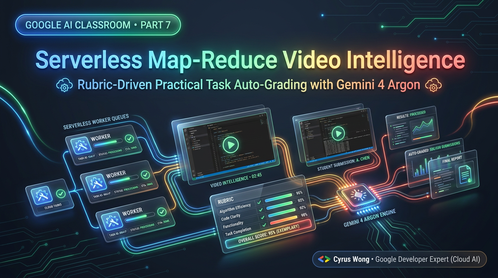
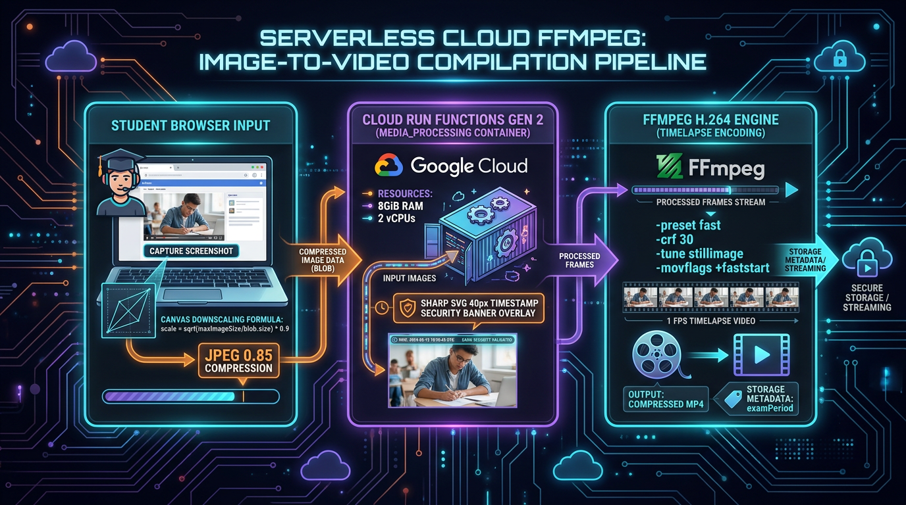
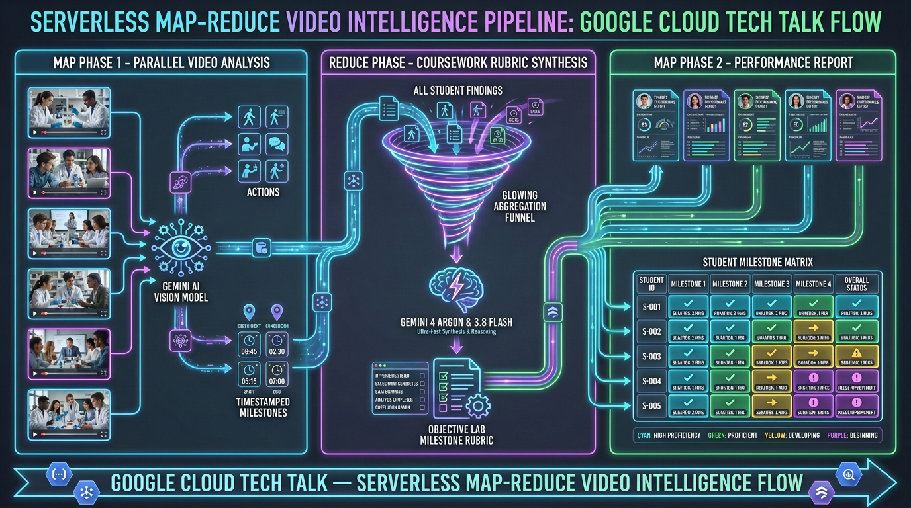
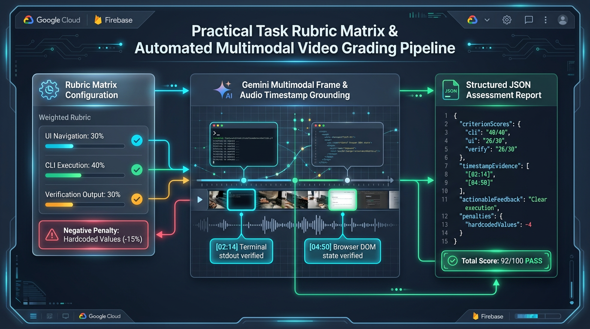

# Google AI Classroom Part 7: Serverless Map-Reduce-Map Video Intelligence & Rubric-Driven Practical Task Auto-Grading with Gemini 4 Argon

**Author:** [**Cyrus Wong (黃俊彥)**](https://www.linkedin.com/in/cyruswong/) — *Google Developer Expert - Cloud (AI), Senior Lecturer at HKIIT*

---



## 1. The 80-Hour Lab Grading Bottleneck & The HTTP 429 Quota Wall

In hands-on cloud computing, DevSecOps, and full-stack software engineering courses, students spend 2 to 3 hours building infrastructure in the AWS/GCP Console, writing Terraform modules in VS Code, and debugging container deployments in the terminal. Reviewing a single 40-student cohort's 2-hour screen recordings manually requires **80 hours of instructor time per lab**.

However, when our engineering team first attempted to automate post-class video grading by firing 40 concurrent multimodal video analysis calls against the Gemini API at the end of a lab session, two hard distributed systems walls appeared immediately:

1. **The Serverless Execution Timeout Wall (`540s`)**: Even a 2nd-Gen Cloud Run-backed Cloud Function caps synchronous execution at 540 seconds (9 minutes). Sequentially evaluating 40 multi-megabyte lab recordings inside a single monolithic worker inevitably times out mid-cohort, leaving half the class ungraded and corrupting aggregate progress counters.
2. **Gemini API HTTP `429 RESOURCE_EXHAUSTED` Rate-Limit Spikes**: Sending 40 uncompressed 30-FPS screen recordings simultaneously floods regional Tokens-Per-Minute (TPM) and Requests-Per-Minute (RPM) quotas, triggering cascading HTTP `429` rate-limit errors.
3. **LLM Scoring Drift & Hallucinated Arithmetic**: When evaluating multi-step practical exams, raw LLM JSON responses occasionally award `25/20` points on a rubric step, omit a milestone when a student stops early, or miscalculate the sum of individual step scores.

In **Part 7** of our 10-part Google Developer Expert engineering series, we walk through how we solved all three challenges by combining:
- **Cloud Run FFmpeg 1-FPS H.264 Timelapse Compilation** (shrinking a 2-hour lab into a `<20 MB` forensic MP4 and slashing multimodal video token consumption by **90%+**).
- **Google Cloud Tasks Rate-Limited Fan-Out (`maxDispatchesPerSecond: 2`, `maxConcurrentDispatches: 4`)** for zero-timeout, zero-`429` distributed video processing.
- **Two-Stage Map-Reduce-Map Cohort Discovery** (`processVideoAnalysisJob` $\rightarrow$ `analyzeSingleVideoTask` $\rightarrow$ `generateLabTaskPrompt`), enabling teachers to select **🧠 Gemini 4 Argon (`gemini-4-argon`)**, **⚡ Gemini 3.8 Flash (`gemini-3.8-flash`)**, or **🪶 Gemini 3.5 Flash-Lite (`gemini-3.5-flash-lite`)** to automatically discover what milestones a class achieved and synthesize a tool-calling grading rubric.
- **A 4-Tab Practical Task & Deterministic Rubric Grading Engine** (`extractTaskDemoSteps.js`, `evaluateTaskSubmission.js`, `TaskEditorModal.jsx`, and `TaskGradingMatrixView.jsx`) with **Ultrafast Stream-Copy Retroactive Video Slicing (`-c copy`)** and a deterministic mathematical guardrail (`normalizeRubricEvaluation` / `reconcileStepEvaluationsWithRubric`).

---

## 2. Diagram 1: From Periodic Screenshots to Forensic 1-FPS H.264 MP4s (80% Storage & 90% Token Reduction)

Why record a 30-FPS desktop video stream when a student coding in VS Code or configuring a VPC in the browser changes meaningful visual state every 5 to 15 seconds?

Before Gemini ever evaluates a student's work, [`StudentView.jsx`](https://github.com/wongcyrus/Google-AI-Classroom/blob/main/web-app/src/components/StudentView.jsx) and our high-memory Cloud Run worker [`processVideoJob.js`](https://github.com/wongcyrus/Google-AI-Classroom/blob/main/functions/media_processing/processVideoJob.js) (`2 vCPU, 8 GiB RAM, 540s timeout`) transform periodic screenshots into a razor-sharp, tamper-evident **1-FPS H.264 MP4 timelapse** that is **80% smaller** than continuous screen recordings:



### Engineering Highlights of the Cloud Run FFmpeg Pipeline
1. **Single-Pass Client Geometric Scaling**: On 4K Retina displays, raw canvas captures can exceed `3 MB`. Instead of an expensive multi-pass compression loop in the browser, [`StudentView.jsx`](https://github.com/wongcyrus/Google-AI-Classroom/blob/main/web-app/src/components/StudentView.jsx) computes a single-pass geometric scaling ratio:
   $$\text{scale} = \sqrt{\frac{\text{maxImageSize}}{\text{blob.size}}} \times 0.9$$
   This guarantees every uploaded frame stays well beneath the `2 MB` [`storage.rules`](https://github.com/wongcyrus/Google-AI-Classroom/blob/main/storage.rules) threshold while preserving crisp terminal text legibility at up to `1920px` (1080p).
2. **Memory-Bounded Sharp SVG Watermarking (`BATCH_SIZE = 15`)**: Inside [`processVideoJob.js`](https://github.com/wongcyrus/Google-AI-Classroom/blob/main/functions/media_processing/processVideoJob.js), downloading and compositing 720 high-resolution frames concurrently via `Promise.all()` would spike heap memory and crash the container. We process frames in chunks of `BATCH_SIZE = 15`, using `sharp` to burn a **40px forensic SVG banner** onto every frame (`YYYY-MM-DD HH:mm:ss | Class ID | Student Email | [SCREEN]/[WEBCAM]`) and rounding dimensions to even integers (`w - (w % 2)`) required by the H.264 `yuv420p` planar chroma format.
3. **Why Burn-In Timestamps Matter for Gemini 4**: Because the compiled MP4 plays back at 1 frame per second (where 1 second of video equals 15 seconds of real classroom time), a naive LLM looking only at the MP4 container's playback clock would miscalculate how long a student spent on a task by a factor of $15\times$. Burning the real wall-clock timestamp directly into every frame allows **Gemini 4 Argon (`gemini-4-argon`)** and **Gemini 3.8 Flash (`gemini-3.8-flash`)** to read the exact on-screen clock via optical character recognition!

---

## 3. Diagram 2: Two-Stage Map-Reduce-Map Cohort Video Discovery with Cloud Tasks & Gemini 4 Argon

What happens when an instructor runs an open-ended hands-on cloud lab—where students explore AWS/GCP services at their own pace—and wants AI to:
1. Watch all 40 student timelapse videos without hitting rate limits (**Phase 1: Map**),
2. Discover the common coursework milestones, point weights, and technical blockers encountered across the entire cohort (**Phase 2: Reduce**), and
3. Re-evaluate every student against that newly synthesized rubric to populate a live **Coursework Milestone Matrix** (**Phase 3: Second Map**)?

In [`functions/ai_flows/index.mjs`](https://github.com/wongcyrus/Google-AI-Classroom/blob/main/functions/ai_flows/index.mjs), [`generateLabTaskPrompt.js`](https://github.com/wongcyrus/Google-AI-Classroom/blob/main/functions/ai_flows/generateLabTaskPrompt.js), [`VideoLibrary.jsx`](https://github.com/wongcyrus/Google-AI-Classroom/blob/main/web-app/src/components/VideoLibrary.jsx), and [`VideoAnalysisJobs.jsx`](https://github.com/wongcyrus/Google-AI-Classroom/blob/main/web-app/src/components/VideoAnalysisJobs.jsx), we built a **Serverless Map-Reduce-Map Pipeline** where teachers can select **`gemini-4-argon`**, **`gemini-3.8-flash`**, or **`gemini-3.5-flash-lite`** at both the Map and Reduce stages:



### Production Code 1: The Reduce Stage — Synthesizing a Cohort Grading Rubric from 40 Student Videos (`generateLabTaskPrompt.js`)

Let's examine [`functions/ai_flows/generateLabTaskPrompt.js`](https://github.com/wongcyrus/Google-AI-Classroom/blob/main/functions/ai_flows/generateLabTaskPrompt.js). When Phase 1 (the exploratory Map pass) finishes, each student's raw activity observation is stored in `aiJobs/{jobId}`. Because Firestore's `in` query operator accepts at most 30 document IDs per query, `generateLabTaskPrompt` fetches the completed child jobs in 30-document chunks, compiles them into a cohort-wide activity corpus, and invokes `generateWithResilience` using the teacher's chosen model (such as **`gemini-4-argon`** or **`gemini-3.8-flash`**):

```javascript
// Source: functions/ai_flows/generateLabTaskPrompt.js
export const generateLabTaskPrompt = onCall(
  {
    region: FUNCTION_REGION,
    cors: CORS_ORIGINS,
    timeoutSeconds: 120,
    memory: '1GiB',
  },
  async (request) => {
    if (!request.auth) {
      throw new HttpsError('unauthenticated', 'The function must be called while authenticated.');
    }

    const { jobId, model } = request.data || {};
    const masterJobRef = db.collection('videoAnalysisJobs').doc(jobId);
    const jobDoc = await masterJobRef.get();
    const jobData = jobDoc.data();
    const classId = jobData.classId || 'unknown_class';
    const aiJobIds = jobData.aiJobIds || [];

    let completedJobs = [];

    // Fetch child aiJobs via 30-document batched FieldPath.documentId() queries
    if (aiJobIds.length > 0) {
      for (let i = 0; i < aiJobIds.length; i += 30) {
        const batchIds = aiJobIds.slice(i, i + 30);
        const querySnapshot = await db
          .collection('aiJobs')
          .where(FieldPath.documentId(), 'in', batchIds)
          .get();

        querySnapshot.forEach((doc) => {
          const data = doc.data();
          if (data.status === 'completed' && data.result && typeof data.result === 'string' && data.result.trim()) {
            completedJobs.push(data);
          }
        });
      }
    }

    // Compile observations across all students in the cohort
    const compiledObservations = completedJobs
      .map((job, idx) => {
        const studentIdentifier = job.studentEmail || job.studentUid || `Student ${idx + 1}`;
        return `### Student ${idx + 1}: ${studentIdentifier}\n${job.result.trim()}`;
      })
      .join('\n\n---\n\n');

    const preferredModel = model || 'gemini-3.8-flash';
    const { response, modelUsed } = await generateWithResilience(
      {
        prompt: [{ text: metaPrompt }],
        config: { temperature: 0.2 },
      },
      preferredModel
    );

    const usage = response?.usage || response?.usageMetadata || {};
    const cost = calculateCost(usage, modelUsed || preferredModel);
    await logJob({
      classId,
      jobType: 'generateLabTaskPrompt',
      status: 'completed',
      promptText: metaPrompt,
      mediaPaths: [],
      usage: {
        inputTokens: usage.inputTokens ?? usage.promptTokenCount ?? 0,
        outputTokens: usage.outputTokens ?? usage.candidatesTokenCount ?? 0,
      },
      cost,
      modelUsed: modelUsed || preferredModel,
      result: generatedPrompt.trim().substring(0, 300),
      masterJobId: jobId,
    });

    return {
      generatedPrompt: generatedPrompt.trim(),
      modelUsed,
      summaryCount: completedJobs.length,
      classId,
      jobId,
    };
  }
);
```

### The 3 Prompts Powering the Map-Reduce-Map Video Pipeline

To make this architecture concrete and reproducible, here are the exact prompts executed at each stage of the **Map-Reduce-Map** workflow:

#### 1. Phase 1 (Exploratory Map Prompt) — Unsupervised Activity Discovery (`Summarize Student's Work.md`)
In Phase 1, the lecturer does not need to write a lab rubric in advance. Each Cloud Tasks worker (`analyzeSingleVideoTask` $\rightarrow$ `analyzeSingleVideoFlow` in [`functions/ai_flows/analysisFlows.js`](https://github.com/wongcyrus/Google-AI-Classroom/blob/main/functions/ai_flows/analysisFlows.js)) wraps the exploratory template ([`admin/prompts/videos/Summarize Student's Work.md`](https://github.com/wongcyrus/Google-AI-Classroom/blob/main/admin/prompts/videos/Summarize%20Student's%20Work.md)) with the class's time-lapse capture interval (`captureInterval = 15s`) and dispatches it in parallel across all 40 student videos:

```markdown
# Summarize Student's Activity

**You are an AI teaching assistant. Your task is to summarize the activity of each student based on their video.**

## Video Context
* The video is a fast-forwarded time-lapse of screen captures, not a real-time recording (compiled at 1 frame per second from screenshots captured roughly every {{captureInterval}} seconds).
* Each frame includes a burned-in timestamp (date and time). All calculations of duration (e.g., for attendance, concentration time) **MUST** be based on these in-frame timestamps.
* **Do not use the video's playback length for any time-based calculations.**

## Attendance & Engagement Analysis
* Compare the timeframe of the student's activity (derived from the in-frame timestamps) with the scheduled lesson time ({{startTime}} to {{endTime}}) to estimate attendance. Note any late starts, early leaves, or gaps in screen sharing.
* Based on the student's on-screen activity and focus, estimate the total "concentration minutes" during the observed period using the in-frame timestamps, and call the `recordActualWorkingTime` tool.

## Analysis Guidelines
* Identify the main tasks, cloud consoles, CLI commands, and code files the student is working on throughout the video.
* Describe the student's pace, milestones achieved, and any test scores or verification outputs visible on screen.
* Note any periods of inactivity, error messages, or technical struggle.

## Actions
* Call `recordActualWorkingTime` to record your estimate of the student's concentration minutes.
* Call `recordLessonSummary` to record a concise, informative summary of their activity, progress, and blockers.
* Provide the exact same summary as your final text response.
```

#### 2. Phase 2 (Reduce Meta-Prompt) — Synthesizing a Cohort Rubric from 40 Observations (`Two-Stage Map-Reduce Lab Rubric Synthesizer.md`)
Once the Phase 1 Map workers finish, clicking **✨ Generate Lab Task Prompt** in [`VideoAnalysisJobs.jsx`](https://github.com/wongcyrus/Google-AI-Classroom/blob/main/web-app/src/components/VideoAnalysisJobs.jsx) invokes `generateLabTaskPrompt.js`, which injects all 40 student summaries into `{{compiledObservations}}` inside [`admin/prompts/videos/Two-Stage Map-Reduce Lab Rubric Synthesizer.md`](https://github.com/wongcyrus/Google-AI-Classroom/blob/main/admin/prompts/videos/Two-Stage%20Map-Reduce%20Lab%20Rubric%20Synthesizer.md):

```markdown
You are an expert Computer Science university curriculum designer and AI prompt engineer for classroom invigilation and automated lab assessment.

Below are student activity observations collected from an initial video analysis across a class session (Class ID: "{{classId}}"):

=== BEGIN OBSERVED STUDENT ACTIVITIES ===
{{compiledObservations}}
=== END OBSERVED STUDENT ACTIVITIES ===

Based on these actual classroom observations, analyze the student activities and generate an optimized, comprehensive, ready-to-use Markdown task prompt for a high-precision second-pass evaluation of this lab.

The generated prompt MUST strictly follow this Markdown structure:

# [Descriptive Lab Title Based on Discovered Coursework]

**You are an AI teaching assistant evaluating student screen recording time-lapses for [Lab Topic/Subject].**

## Video Timing Rules
* The video is a fast-forward time-lapse with on-screen timestamps.
* All duration, attendance, and task timing calculations **MUST** be derived from the in-frame date/time stamps, NOT the video playback length.

## Coursework Tasks to Evaluate
[Break down the lab into 3-5 clearly numbered, specific tasks discovered from the student observations. Include specific platforms (e.g. AWS, Azure, Cloud Shell, VS Code), repositories, scripts, resource names, and milestones].

## Milestones, Scores & Rubrics
[Detail any test numbers, scoring points (e.g., 10 pts, 20 pts), or completion verifications discovered from the observations].

## Known Blockers & Technical Obstacles to Watch For
[List the common technical errors, blockers, or pitfalls students encountered, such as backend errors, incorrect regions, or setup issues].

## Required Tool Actions
1. **Working Time**: Call 'recordActualWorkingTime' with the total estimated active concentration minutes (clamped to lesson duration).
2. **Task Durations**: For each identified task above, call 'recordTaskDuration' with studentUid, classId, taskName, and estimated durationMinutes spent on that task.
3. **Student Summary**: Call 'recordLessonSummary' with a structured bulleted summary of their progress across each task, points earned, blockers encountered, and engagement verdict.
4. **Final Response**: Output the exact same structured summary text provided to 'recordLessonSummary'.

Return ONLY the clean Markdown prompt text. Do not wrap in markdown code fence blocks.
```

#### 3. Phase 3 (Second-Map Evaluation Prompt) — Real Production Prompt Synthesized from a 37-Student Linux OS Lab (`itp3901-ab`)
Here is an actual production Markdown prompt synthesized by Phase 2 (`generateLabTaskPrompt`) from 37 student timelapse videos in **ITP3901 Operating Systems Fundamentals (Lab 6: Linux Process Management & Job Control)**, which the lecturer reviews in the modal and dispatches back to Cloud Tasks (`analyzeSingleVideoTask`) for the **Second Map** pass:

```markdown
# ITP3901 Operating Systems Fundamentals - Lab 6: Linux Process Management & Job Control

**You are an AI teaching assistant evaluating student screen recording time-lapses for ITP3901 Operating Systems Fundamentals: Lab 6 (Linux Process Management and Job Control in Fedora VirtualBox/Bash).**

## Video Timing Rules
* The video is a fast-forward time-lapse with on-screen timestamps.
* All duration, attendance, and task timing calculations **MUST** be derived from the in-frame date/time stamps, NOT the video playback length.

## Coursework Tasks to Evaluate
1. **VM Environment Setup & Root Shell Access**: Downloading the Fedora virtual appliance (`Fedora_for_OSF.zip`) from Moodle or the intranet class repository (`172.30.82.64/65:8080`), extracting the compressed disk image (`.vdi`, `.vbox`), registering and launching the virtual machine in Oracle VM VirtualBox (or pivoting to the web-based Linux shell if local virtualization fails), and authenticating into the root shell prompt (`root@fedora:~#`).
2. **Process Scripting & Job Control Operations (`process.sh`)**: Authoring the infinite loop testing script `process.sh` using the `vi`/`vim` text editor (`#!/bin/bash`, `echo "process.sh: It is running"`, `while true; do date; sleep 10; done`), setting execution permissions via `chmod 755 process.sh` (or `chmod +x`), executing in the foreground (`./process.sh`), suspending via `Ctrl+Z`, inspecting active jobs using `jobs`, toggling between states using `fg` and `bg %1`, and launching background processes with output suppression (`./process.sh > /dev/null &`).
3. **Process Hierarchy Inspection & Signal Termination (`ps`, `pstree`, `kill`)**: Examining system process status using `ps`, `ps -ef | more`, `ps -l`, and `pstree`; identifying process attributes including Process IDs (PID), Parent Process IDs (PPID), system root processes (PID 1 `systemd`, PID 2 `kthreadd`), and daemon processes detached from controlling terminals (`TTY = ?`); and terminating processes via job specifications (`kill %1`) or PID-targeted signals (`kill <PID>`, `kill -9 <PID>`).
4. **Interactive Monitoring & Priority Scheduling (`top`, `nice`, `renice`)**: Launching interactive process monitoring via `top` to record dynamic system health (total/running/sleeping tasks, CPU load, physical RAM, and swap usage); understanding nice value boundaries (-20 highest priority to 19 lowest priority; default 0); executing commands with altered initial priorities using `nice` (e.g., `nice -10 ./process.sh > /dev/null &`); dynamically altering running process priorities using `renice` (e.g., `renice 5 <PID>`); and verifying priority adjustments via `ps -el | grep process.sh` or `top`.
5. **Worksheet Documentation & Academic Integrity**: Recording observed terminal outputs, commands, and theoretical answers into the assignment worksheet (`Lab 6 - Process Management ans template.txt` / Moodle submission form) covering questions Q1 through Q32+, ensuring recorded values match live runtime metrics rather than uncalibrated answers copied from external generative AI chatbots.

## Milestones, Scores & Rubrics
* **Milestone 1: Virtual Machine Environment Deployment (20 pts)**
  * **20 pts**: Successfully unpacks, imports, and boots Fedora Linux in Oracle VirtualBox (or accesses the web terminal), establishing an active root command prompt (`root@fedora:~#`).
  * **10 pts**: Experiences extraction or VM configuration issues, requiring significant troubleshooting or restarting before achieving an operational shell.
  * **0 pts**: Unable to launch, boot, or access a functional Linux terminal environment.
* **Milestone 2: Script Construction & Job Control Workflow (25 pts)**
  * **25 pts**: Correctly writes `process.sh` in `vi` without syntax errors, sets permissions (`chmod 755`), and demonstrates `Ctrl+Z` suspension, `jobs` listing, `fg`/`bg` toggling, and clean execution with `> /dev/null &`.
  * **15 pts**: Script created with minor syntax typos (e.g., `while ture`, `sleep` typos) or incomplete job control state transitions.
  * **0 pts**: Fails to create or execute the shell script.
* **Milestone 3: Process Inspection & Signal Termination (25 pts)**
  * **25 pts**: Correctly queries process status with `ps -ef` / `ps -l` / `pstree`, accurately identifies PID/PPID/TTY parameters, and successfully terminates target background jobs/PIDs using `kill` or `kill -9`.
  * **15 pts**: Runs basic `ps` but struggles to differentiate between child sleep PIDs, script PIDs, and grep PIDs, or makes multiple syntax errors with `kill` targets.
  * **0 pts**: No process inspection or signal termination attempted.
* **Milestone 4: Resource Monitoring & Priority Management (20 pts)**
  * **20 pts**: Successfully navigates `top`, extracts accurate system task/memory metrics, executes `nice` and `renice` commands with valid priority offsets, and verifies nice (`NI`) and priority (`PRI`) shifts via `ps -el`.
  * **10 pts**: Runs `top` or priority tools with partial understanding, inverted nice scales, or unverified priority commands.
  * **0 pts**: No dynamic monitoring or priority management commands executed.
* **Milestone 5: Lab Worksheet Completion & Verification (10 pts)**
  * **10 pts**: All questions in the answer template systematically completed using live terminal data and prepared for Moodle submission.
  * **5 pts**: Partial template completion, or answers copied from external AI tools without corresponding terminal execution.
  * **0 pts**: Answer template left blank or unsubmitted.

## Known Blockers & Technical Obstacles to Watch For
* **Archive Extraction & VM Boot Latency**: Long decompression times for `Fedora_for_OSF.zip` (~4.3 GB), insufficient disk space, or VirtualBox display black screens/freezes requiring guest restarts.
* **Vi/Vim Modal Confusion**: Typing commands while in Normal/Command mode (resulting in Vim errors like `E20: Mark not set`, `E32: No file name`, or `E37`), or typing editor commands directly into the Bash prompt (e.g., `bash: :wq: command not found`).
* **Execution Path & Permission Errors**: Omitting the relative path `./` when invoking the script (resulting in `bash: process.sh: command not found`), or attempting execution prior to applying `chmod 755` (`bash: ./process.sh: Permission denied`).
* **Terminal Output Flooding**: Executing `./process.sh &` without stdout redirection, causing continuous `date` and string outputs to clutter the console and disrupt subsequent command inputs.
* **Job ID vs. PID Misuse**: Omitting the percent symbol `%` when killing or resuming shell jobs (e.g., running `kill 1` instead of `kill %1`, which targets `systemd`), or passing literal template angle brackets (e.g., `bg %<job_num>`).
* **Renice Target Failures**: Issuing `renice` against an already terminated or non-existent PID, resulting in `failed to get priority for <PID>: No such process`.
* **VM Sleep/Lockout**: Virtual machine screen locking after periods of inactivity, requiring re-login as `Super User`.
* **AI Over-Reliance**: Copying generic or static answers from conversational AI tools (e.g., ChatGPT, DeepSeek, Gemini, Doubao) rather than recording dynamic live metrics from `top` and `ps`.

## Required Tool Actions
1. **Working Time**: Call 'recordActualWorkingTime' with the total estimated active concentration minutes (clamped to lesson duration).
2. **Task Durations**: For each identified task above, call 'recordTaskDuration' with studentUid, classId, taskName, and estimated durationMinutes spent on that task.
3. **Student Summary**: Call 'recordLessonSummary' with a structured bulleted summary of their progress across each task, points earned, blockers encountered, and engagement verdict.
4. **Final Response**: Output the exact same structured summary text provided to 'recordLessonSummary'.
```

### Distributed Systems Safeguards in `analyzeSingleVideoTask.js` & `VideoAnalysisJobs.jsx`

Running two passes across 37–40 student videos exposed three subtle distributed systems edge cases that we hardened in production:

1. **Video-Path Idempotency on Cloud Tasks Retries (`completedVideoPaths`)**:
   If a Cloud Tasks worker finishes writing a child `aiJobs` document right as an HTTP layer timeout occurs, Cloud Tasks retries the task (`maxAttempts: 2`), which could otherwise create a second `aiJob` with a new document ID and inflate `processedCount` (e.g. `40` sub-jobs for `37` unique student videos). In [`analyzeSingleVideoTask.js`](https://github.com/wongcyrus/Google-AI-Classroom/blob/main/functions/ai_flows/analyzeSingleVideoTask.js), `recordTaskResult` tracks `completedVideoPaths` inside the Firestore transaction and clamps `processedCount` and `successCount` to `totalVideos`, ensuring each student's video is counted at most once.
2. **480s Soft Deadline Inside a 540s Cloud Run Worker (`SOFT_TIMEOUT_MS = 480_000`)**:
   If a large 16+ MB video evaluation hits Cloud Run's hard container timeout externally, the Node process is terminated before `catch (err)` can call `recordTaskResult`, leaving the master job stuck at `36 / 37` (`status: 'processing'`). By setting `timeoutSeconds: 540` on `analyzeSingleVideoTask` and wrapping `analyzeSingleVideoFlow` in a `480_000` ms `Promise.race` soft timeout, any hung inference rejects cleanly inside `try/catch` and records into `failedVideos` so the master job always reaches a terminal state.
3. **Real-Time `onSnapshot` Progress & Synthesized `Processing (N)` Sub-Job Rows**:
   Because child `aiJobs` documents are only written after a video finishes, filtering `aiJobs.filter(j => j.status === 'processing')` on the frontend previously always showed `Processing (0)` while tasks were queued in Cloud Tasks. [`VideoAnalysisJobs.jsx`](https://github.com/wongcyrus/Google-AI-Classroom/blob/main/web-app/src/components/VideoAnalysisJobs.jsx) now attaches real-time `onSnapshot` listeners to active `videoAnalysisJobs` documents, deduplicates `aiJobs` by normalized `videoPath`, and synthesizes live `status: 'processing'` rows for every remaining student video in `job.videos`—so teachers see `Processing (26)` count down to `0` in real time.

When the teacher runs **Phase 3 (the Milestone Evaluation Map)** using that synthesized prompt, each Cloud Tasks worker invokes Genkit tools (`recordActualWorkingTime`, `recordTaskDuration`, and `recordLessonSummary`) that populate [`VideoAnalysisJobs.jsx`](https://github.com/wongcyrus/Google-AI-Classroom/blob/main/web-app/src/components/VideoAnalysisJobs.jsx) and [`TaskGradingMatrixView.jsx`](https://github.com/wongcyrus/Google-AI-Classroom/blob/main/web-app/src/components/tasks/TaskGradingMatrixView.jsx)—giving the lecturer a color-coded cohort progress matrix showing exactly how many minutes each student spent on each milestone and where they got stuck!

---

## 4. Diagram 3: 4-Tab Practical Tasks, Retroactive Post-Class Slicing & Deterministic Rubric Reconciliation

While Map-Reduce-Map excels at exploratory cohort discovery, graded practical assignments and lab tests (`📋 Tasks & Homework` tab) require a strict, reproducible rubric where every student is graded against an identical point breakdown, with timestamped visual proof and full teacher override authority.

To support this, we engineered a **4-Tab Practical Task & Rubric Grading System** across [`TaskEditorModal.jsx`](https://github.com/wongcyrus/Google-AI-Classroom/blob/main/web-app/src/components/tasks/TaskEditorModal.jsx), [`TaskGradingMatrixView.jsx`](https://github.com/wongcyrus/Google-AI-Classroom/blob/main/web-app/src/components/tasks/TaskGradingMatrixView.jsx), [`extractTaskDemoSteps.js`](https://github.com/wongcyrus/Google-AI-Classroom/blob/main/functions/ai_flows/extractTaskDemoSteps.js), and [`evaluateTaskSubmission.js`](https://github.com/wongcyrus/Google-AI-Classroom/blob/main/functions/ai_flows/evaluateTaskSubmission.js).

Teachers have **two independent AI model selection control points** supporting **🧠 Gemini 4 Argon (`gemini-4-argon`)**, **⚡ Gemini 3.8 Flash (`gemini-3.8-flash`)**, and **🪶 Gemini 3.5 Flash-Lite (`gemini-3.5-flash-lite`)**:
1. **Task Editor Modal (`#task-ai-model-select` in [`TaskEditorModal.jsx`](https://github.com/wongcyrus/Google-AI-Classroom/blob/main/web-app/src/components/tasks/TaskEditorModal.jsx))**: Chooses the default AI model stored on `classes/{classId}/tasks/{taskId}.model` and used by `extractTaskDemoSteps` when watching a teacher's reference demonstration video to synthesize the step-by-step rubric.
2. **Grading Matrix Toolbar (`Grading AI Model` selector in [`TaskGradingMatrixView.jsx`](https://github.com/wongcyrus/Google-AI-Classroom/blob/main/web-app/src/components/tasks/TaskGradingMatrixView.jsx))**: Allows the teacher to override the evaluation model on the fly when running single-student re-evaluations (`handleTriggerEvaluate`) or batch cohort grading (`handleBatchEvaluatePending` via `batchEvaluateTaskSubmissions`). For example, a teacher can grade formative practice attempts with `gemini-3.5-flash-lite` and switch the toolbar selector to **`gemini-4-argon`** for final high-stakes practical exam grading!



---

## 5. Deep Dive into the Production Code: Rubric Extraction, Zero-Race Stream-Copy Slicing & Deterministic Score Reconciliation

### Production Code 2: Multimodal Reference Video Rubric Synthesis (`extractTaskDemoSteps.js`)

Instead of writing complex JSON rubrics by hand, an instructor can upload a 3-minute demonstration video of the solution (or pick an existing **Teacher Lecture Recording** or paste a **YouTube URL**) in Tab 2 of [`TaskEditorModal.jsx`](https://github.com/wongcyrus/Google-AI-Classroom/blob/main/web-app/src/components/tasks/TaskEditorModal.jsx) and click **✨ Extract Steps & Rubric with AI**.

In [`functions/ai_flows/extractTaskDemoSteps.js`](https://github.com/wongcyrus/Google-AI-Classroom/blob/main/functions/ai_flows/extractTaskDemoSteps.js), `handleExtractTaskDemoSteps` passes the video URI alongside any teacher marking notes to `generateWithResilience(generateConfig, preferredModel)` and enforces a strict JSON schema containing `stepNumber`, `title`, `description`, `expectedEvidence`, `gradingCriteria`, and `points`:

```javascript
// Source: functions/ai_flows/extractTaskDemoSteps.js
export const handleExtractTaskDemoSteps = async ({
  classId,
  demoVideoPath,
  promptGuidelines,
  promptText,
  maxScore = 100,
  model,
}) => {
  const storage = getStorage();
  const bucketName = storage.bucket().name;

  const isYouTube = demoVideoPath
    ? /(?:youtu\.be\/|youtube\.com\/(?:embed\/|v\/|watch\?v=|watch\?.+&v=|live\/))([a-zA-Z0-9_-]{11})/i.test(demoVideoPath)
    : false;
  let resolvedVideoUri = null;
  if (demoVideoPath) {
    if (isYouTube || demoVideoPath.startsWith('http://') || demoVideoPath.startsWith('https://')) {
      resolvedVideoUri = demoVideoPath;
    } else if (demoVideoPath.startsWith('gs://')) {
      resolvedVideoUri = demoVideoPath;
    } else {
      resolvedVideoUri = `gs://${bucketName}/${demoVideoPath.replace(/^\/+/, '')}`;
    }
  }

  const preferredModel = model || 'gemini-3.8-flash';
  const promptParts = [{ text: metaPrompt }];
  if (resolvedVideoUri) {
    promptParts.push({ media: { url: resolvedVideoUri, contentType: 'video/mp4' } });
  }
  const generateConfig = {
    prompt: promptParts,
    config: {
      temperature: 0.2,
      responseMimeType: 'application/json',
    },
  };

  const { response, modelUsed } = await generateWithResilience(generateConfig, preferredModel);
  const parsed = JSON.parse(cleanJsonFence(response.text || ''));

  if (Array.isArray(parsed?.steps)) {
    parsed.steps = parsed.steps.map((s, idx) => ({
      stepNumber: Number(s.stepNumber) || idx + 1,
      title: s.title || `Milestone ${idx + 1}`,
      description: s.description || '',
      expectedEvidence: s.expectedEvidence || '',
      gradingCriteria: s.gradingCriteria || '',
      points: Number(s.points ?? s.weight ?? 20),
    }));
  }

  return { ...parsed, modelUsed, cost: calculateCost(response?.usage, modelUsed || preferredModel) };
};
```

Here is the `metaPrompt` inside [`extractTaskDemoSteps.js`](https://github.com/wongcyrus/Google-AI-Classroom/blob/main/functions/ai_flows/extractTaskDemoSteps.js) (backed by [`admin/prompts/rubrics/Practical Task Demo Step Extractor.md`](https://github.com/wongcyrus/Google-AI-Classroom/blob/main/admin/prompts/rubrics/Practical%20Task%20Demo%20Step%20Extractor.md)) that extracts a chronological JSON rubric from a teacher's demo video:

```markdown
You are an expert technical educator and curriculum designer creating a structured grading rubric for a hands-on practical assignment or lab test.
Analyze the visual actions, commands, code editor steps, browser verifications, and results shown in the demonstration video.

Extract a structured, chronological step-by-step assessment rubric (between 3 and 8 distinct milestones).
For each milestone:
1. Provide a concise, clear title.
2. Describe the specific action or requirement (e.g. terminal command, file created, setting configured).
3. Specify the expected visual proof/evidence that an AI evaluator should search for in a student's screen recording (e.g. terminal output text, open ports, browser UI, green test checks).
4. Provide explicit marking / partial-credit criteria (how full marks vs. partial marks vs. 0 marks should be awarded).
5. Assign a point weight (total across all steps must equal 100 points).

You MUST respond strictly with valid JSON conforming to this schema:
{
  "title": "A concise, descriptive title for this practical task",
  "description": "A clear 2-3 sentence overview of what the student is required to reproduce",
  "suggestedMaxScore": 100,
  "steps": [
    {
      "stepNumber": 1,
      "title": "Short Step Title",
      "description": "Specific action performed by the student",
      "expectedEvidence": "Specific visual evidence, keywords, or UI elements on screen",
      "gradingCriteria": "Full marks if completed and verified; partial marks if configured with minor syntax errors",
      "points": 20
    }
  ]
}
```

---

### Production Code 3: Eliminating the Post-Lesson Screenshot Deletion Race Condition with Ultrafast Stream-Copy Slicing (`slicePendingTaskSubmissions`)

A subtle race condition occurs during **In-Class Practical Tasks**:
1. At the end of a scheduled lesson, `processVideoJob.js` compiles all raw screenshots from `screenshots/{classId}/{studentUid}/` into the master class timelapse video (`videos/{classId}/{videoId}.mp4`), and then **deletes the raw screenshots** to save 80% of Cloud Storage costs.
2. What if a student clicked **Submit Task** right as class ended, or what if a teacher realized *after* class that they forgot to create a task beforehand and wants to **retroactively slice minutes `30:00` to `75:00`** from all 40 students' compiled class videos?

In [`functions/media_processing/processVideoJob.js`](https://github.com/wongcyrus/Google-AI-Classroom/blob/main/functions/media_processing/processVideoJob.js), `slicePendingTaskSubmissions` solves both problems simultaneously. Instead of re-downloading raw screenshots, it maps the task's `[taskStartMs, taskEndMs]` window (or tagged `activeTaskId` frame indices) to exact 1-FPS video offsets (`startSec`, `durSec`) and slices `attempt_${attemptNumber}.mp4` directly out of the compiled class MP4 using **FFmpeg lossless stream-copying (`-c copy`)** in less than 0.5 seconds!

```javascript
// Source: functions/media_processing/processVideoJob.js
export async function slicePendingTaskSubmissions({
  classId,
  studentUid,
  studentEmail,
  classStartTime,
  captureInterval = 15,
  outputVideoPath,
  screenshots = [],
  db,
  bucket,
  retry,
}) {
  // Identify exact 1-FPS start frame index and duration from tagged screenshots or timestamp math
  let firstIndex = screenshots.findIndex((s) =>
    (s.activeTaskId && s.activeTaskId === taskId) || (!isNaN(toMs(s.timestamp)) && toMs(s.timestamp) >= taskStartMs)
  );
  // ... (calculates startSec and durSec)

  const taskClipPath = path.join(os.tmpdir(), `${taskJobDoc.id}_clip.mp4`);
  await new Promise((resolve, reject) => {
    ffmpeg(outputVideoPath)
      .setStartTime(startSec)
      .setDuration(durSec)
      .outputOptions([
        '-c', 'copy',
        '-avoid_negative_ts', 'make_zero',
        '-movflags', '+faststart'
      ])
      .output(taskClipPath)
      .on('end', resolve)
      .on('error', () => {
        // Automatic fallback to ultrafast libx264 re-encode if keyframe boundary requires it
        ffmpeg(outputVideoPath)
          .setStartTime(startSec)
          .setDuration(durSec)
          .outputOptions(['-c:v', 'libx264', '-pix_fmt', 'yuv420p', '-preset', 'ultrafast', '-crf', '28', '-movflags', '+faststart'])
          .output(taskClipPath)
          .on('end', resolve)
          .on('error', reject)
          .run();
      })
      .run();
  });

  const destinationPath = `classes/${classId}/tasks/${taskId}/submissions/${studentUid}/attempt_${attemptNumber}.mp4`;
  await retry(() => bucket.upload(taskClipPath, { destination: destinationPath, /* metadata */ }));
}
```

And if a teacher uses **⏪ Post-Class Retroactive Slicing** inside [`TaskGradingMatrixView.jsx`](https://github.com/wongcyrus/Google-AI-Classroom/blob/main/web-app/src/components/tasks/TaskGradingMatrixView.jsx), our retroactive slicing Cloud Function ([`functions/media_processing/extractRetroactiveTaskSubmissions.js`](https://github.com/wongcyrus/Google-AI-Classroom/blob/main/functions/media_processing/extractRetroactiveTaskSubmissions.js)) slices the specified `[startOffsetMinutes, durationMinutes]` window across all 40 class videos in parallel and immediately pipelines the sliced clips into the Gemini grading queue!

---

### Production Code 4: Deterministic Rubric Reconciliation & Mathematical Guardrails (`evaluateTaskSubmission.js`)

Even frontier models like **Gemini 4 Argon (`gemini-4-argon`)** are probabilistic token generators—we should **never** trust raw LLM arithmetic for official academic gradebooks.

In [`functions/ai_flows/evaluateTaskSubmission.js`](https://github.com/wongcyrus/Google-AI-Classroom/blob/main/functions/ai_flows/evaluateTaskSubmission.js) (mirrored on the frontend by `reconcileStepEvaluationsWithRubric` in [`TaskGradingMatrixView.jsx`](https://github.com/wongcyrus/Google-AI-Classroom/blob/main/web-app/src/components/tasks/TaskGradingMatrixView.jsx)), `normalizeRubricEvaluation` acts as a deterministic post-processing barrier between Gemini's JSON output and Firestore:
1. **1-to-1 Step Alignment**: It iterates over the authoritative `effectiveSteps` array from the task definition, matching AI step results by `stepNumber`, case-insensitive `title`, or positional index.
2. **Strict `[0, maxPoints]` Clamping**: Every step's `scoreAwarded` is clamped via `Math.max(0, Math.min(maxPoints, ...))` so the AI can never award negative points or exceed a step's point ceiling.
3. **Zero-Defaulting Omitted Steps**: If a student stopped halfway through the lab and the LLM omitted Steps 4 and 5 from its JSON array, `normalizeRubricEvaluation` deterministically populates Steps 4 and 5 with `scoreAwarded: 0`, `status: 'missing'`, and explicit feedback (`No evidence of "${stepTitle}" was observed in the submitted screen recording.`).
4. **Exact Bottom-Up Summation & Multi-Attempt Scoring Strategy**: `finalScore` is computed strictly as the sum of reconciled `scoreAwarded` values across all steps, and the student's root submission document automatically updates `bestScore`, `latestScore`, `averageScore`, and `effectiveScore` based on the task's configured scoring strategy (`highest`, `latest`, or `average`).

First, here is the strict rubric-driven evaluation prompt dispatched by [`evaluateTaskSubmission.js`](https://github.com/wongcyrus/Google-AI-Classroom/blob/main/functions/ai_flows/evaluateTaskSubmission.js):

```markdown
You are an expert technical invigilator and automated practical exam evaluator.
Evaluate the student's continuous screen recording time-lapse video strictly against the following practical assignment rubric.

=== ASSIGNMENT DETAILS ===
Title: "{{taskData.title}}"
Overview: "{{taskData.description}}"
Total Possible Score: {{maxScore}} points

=== REQUIRED RUBRIC MILESTONES (STRICT MARK BREAKDOWN) ===
{{effectiveStepsJson}}

=== INSTRUCTIONS FOR RUBRIC-DRIVEN EVALUATION ===
1. Watch the student's screen actions chronologically from start to finish.
2. You MUST evaluate EVERY SINGLE milestone listed in REQUIRED RUBRIC MILESTONES above in exact order:
   - Determine whether the step was "completed", "partial", "error", or "missing".
   - Record the approximate "mm:ss" timestamp ("timestampInVideo") where the step was attempted or completed (or null if missing).
   - Describe the concrete visual proof observed on the student's screen ("evidenceObserved", e.g., terminal command output, code written, browser state, or what was missing).
   - Award marks ("scoreAwarded") strictly between 0 and the step's allocated "points" ("maxPoints") based on the step's "expectedEvidence" and "gradingCriteria".
   - Provide a clear, detailed per-step explanation ("feedback") for the student and teacher explaining WHY those exact marks were awarded or deducted according to the rubric.
3. Highlight 2-3 specific technical strengths demonstrated by this student in the video.
4. Highlight any errors, warnings, configuration oversights, or suspicious anomalies (e.g. abrupt paste of whole codebase, unhandled exceptions).
5. Calculate "finalScore" as the exact sum of "scoreAwarded" across all rubric steps (out of {{maxScore}}).
```

And here is how `normalizeRubricEvaluation` deterministically reconciles Gemini's JSON response against the task rubric:

```javascript
// Source: functions/ai_flows/evaluateTaskSubmission.js
export const normalizeRubricEvaluation = (rawEvaluation = {}, effectiveSteps = [], maxScore = 100) => {
  const normalizedMaxScore = Number(maxScore) || 100;
  const rawSteps = Array.isArray(rawEvaluation.stepResults)
    ? rawEvaluation.stepResults
    : Array.isArray(rawEvaluation.rubricScores)
    ? rawEvaluation.rubricScores
    : [];

  let reconciledSteps = [];

  if (Array.isArray(effectiveSteps) && effectiveSteps.length > 0) {
    const defaultStepPoints = Math.round(normalizedMaxScore / effectiveSteps.length);
    reconciledSteps = effectiveSteps.map((rubricStep, idx) => {
      const stepNum = Number(rubricStep.stepNumber ?? idx + 1);
      const maxPoints = Number(rubricStep.points ?? rubricStep.weight ?? defaultStepPoints) || 0;
      const stepTitle = rubricStep.title || rubricStep.criterion || `Step ${stepNum}`;

      const matched =
        rawSteps.find((s) => Number(s?.stepNumber) === stepNum) ||
        rawSteps.find(
          (s) =>
            s?.title &&
            stepTitle &&
            String(s.title).trim().toLowerCase() === String(stepTitle).trim().toLowerCase()
        ) ||
        rawSteps[idx] ||
        null;

      if (matched) {
        const rawScore = Number(
          matched.scoreAwarded ?? matched.score ?? (matched.status === 'completed' ? maxPoints : 0)
        );
        // Strictly clamp scoreAwarded to [0, maxPoints]
        const scoreAwarded = Math.max(
          0,
          Math.min(maxPoints, Number.isFinite(rawScore) ? Math.round(rawScore * 100) / 100 : 0)
        );
        const status =
          matched.status ||
          (scoreAwarded >= maxPoints && maxPoints > 0 ? 'completed' : scoreAwarded > 0 ? 'partial' : 'missing');

        return {
          stepNumber: stepNum,
          title: stepTitle,
          maxPoints,
          scoreAwarded,
          status,
          timestampInVideo: matched.timestampInVideo || matched.timestamp || null,
          evidenceObserved: matched.evidenceObserved || matched.evidence || '',
          feedback:
            matched.feedback ||
            matched.rationale ||
            matched.explanation ||
            (status === 'completed'
              ? `Completed all requirements for ${stepTitle}.`
              : `Incomplete or missing requirements for ${stepTitle}.`),
          expectedEvidence: rubricStep.expectedEvidence || '',
          gradingCriteria: rubricStep.gradingCriteria || '',
        };
      }

      // Deterministic fallback if the AI omitted a rubric step
      return {
        stepNumber: stepNum,
        title: stepTitle,
        maxPoints,
        scoreAwarded: 0,
        status: 'missing',
        timestampInVideo: null,
        evidenceObserved: 'Not observed in submission recording.',
        feedback: `No evidence of "${stepTitle}" was observed in the submitted screen recording.`,
        expectedEvidence: rubricStep.expectedEvidence || '',
        gradingCriteria: rubricStep.gradingCriteria || '',
      };
    });
  }

  // Exact bottom-up summation of clamped step scores
  const sum = reconciledSteps.reduce((acc, s) => acc + (Number(s.scoreAwarded) || 0), 0);
  const computedFinalScore = Math.max(0, Math.min(normalizedMaxScore, Math.round(sum * 100) / 100));

  return {
    ...rawEvaluation,
    finalScore: computedFinalScore,
    maxScore: normalizedMaxScore,
    completionPercentage: Math.round((computedFinalScore / normalizedMaxScore) * 100),
    stepResults: reconciledSteps,
  };
};
```

---

## 6. Architectural Comparison: Choosing the Right Gemini Model for Video Intelligence & Rubric Grading

Because instructors can select the AI model per job in [`VideoLibrary.jsx`](https://github.com/wongcyrus/Google-AI-Classroom/blob/main/web-app/src/components/VideoLibrary.jsx), [`TaskEditorModal.jsx`](https://github.com/wongcyrus/Google-AI-Classroom/blob/main/web-app/src/components/tasks/TaskEditorModal.jsx) (`#task-ai-model-select`), and [`TaskGradingMatrixView.jsx`](https://github.com/wongcyrus/Google-AI-Classroom/blob/main/web-app/src/components/tasks/TaskGradingMatrixView.jsx) (`Grading AI Model`), here is how our lecturers allocate models across different assessment workloads:

| Assessment Workload | Recommended Model | Why It Excels | Configured Rate in `cost.js` (Input / Output per 1M Tokens) |
| :--- | :--- | :--- | :--- |
| **Daily Formative Lab Practice & Self-Check Attempts** | **🪶 Gemini 3.5 Flash-Lite (`gemini-3.5-flash-lite`)** | Fast feedback after submission; lowest token rate for high-frequency self-checks. | **`$0.30 / $2.50`** |
| **Standard Weekly Coursework & Map-Reduce Cohort Discovery** | **⚡ Gemini 3.8 Flash (`gemini-3.8-flash`)** | Balanced multimodal OCR on dense terminal logs and IDE split-panes. | **`$0.75 / $3.75`** |
| **High-Stakes Practical Exams & Complex Multi-Step Rubric Synthesis** | **🧠 Gemini 4 Argon (`gemini-4-argon`)** | Frontier visual reasoning across code diffs, architecture diagrams, and multi-terminal debugging. | **`$2.00 / $10.00`** |

In [`TaskGradingMatrixView.jsx`](https://github.com/wongcyrus/Google-AI-Classroom/blob/main/web-app/src/components/tasks/TaskGradingMatrixView.jsx), teachers see every student's per-step pill breakdown (`S1: 30/30`, `S2: 62/70`) directly in the matrix table, can click any `[⏱️ 02:15]` badge to seek the HTML5 video player to the exact frame where Gemini observed the evidence, override any individual step score or explanation with full audit trails (`isTeacherEdited: true`), and export a multi-sheet **Excel Gradebook (`.xlsx`)** or **Google Drive Archive** with one click.

---

## What's Next in Part 8?

In **Part 8**, we move from individual lab screen recordings to **face-to-face engineering capstone project consultations**—showing how we turned the project supervisor's smartphone into a **Streamlined Single-Device Multimodal Supervision Studio** (continuous voice + zero-pause `0.1s` photo snap + auto-sliced `720p` mobile demo video) backed by self-healing Google Sheets weekly log sync, pre-meeting fake-log AI auditing, and a **Two-Stage `gemini-3.5-transcribe-preview` + `gemini-4-argon` Cross-Examination Pipeline**.
