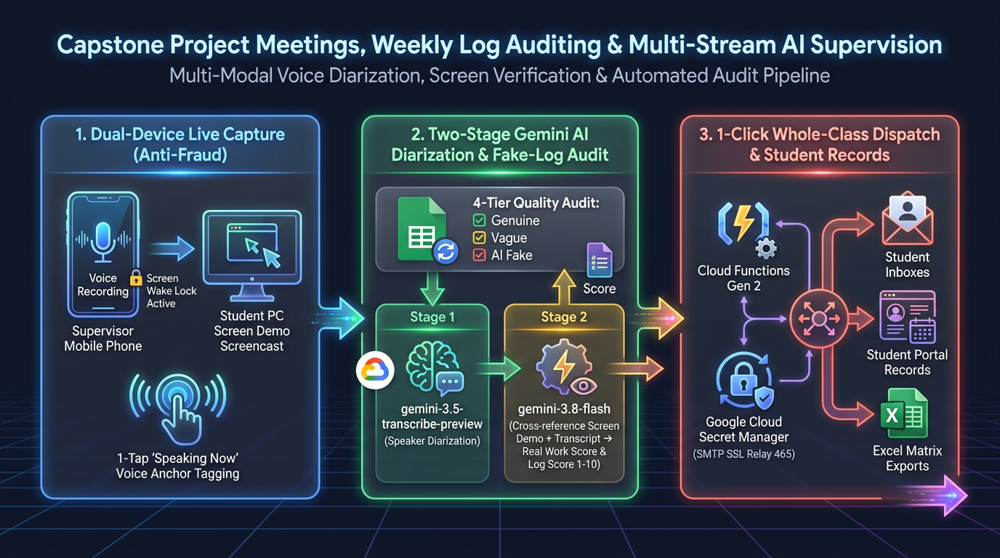

# Part 8: Multimodal AI Capstone Project Supervision — Streamlined Mobile 720p Demo Studio, 2-Stage Diarization & Fake-Log Auditing with Gemini 4

**Author:** [**Cyrus Wong (黃俊彥)**](https://www.linkedin.com/in/cyruswong/) — *Google Developer Expert - Cloud (AI), Senior Lecturer at HKIIT*  
[⏮️ Previous: Part 7 — Gemini 4 Map-Reduce Video & Rubric Grading](https://github.com/wongcyrus/Google-AI-Classroom/blob/main/docs/blogs/07-serverless-map-reduce-video-and-gemini-4-rubric-grading.md) | [📚 Series Index](https://github.com/wongcyrus/Google-AI-Classroom/blob/main/docs/blogs/README.md) | [⏭️ Next: Part 9 — Gamified Bingo & Zero-Trust Exam Mode](https://github.com/wongcyrus/Google-AI-Classroom/blob/main/docs/blogs/09-gamified-bingo-active-presence-and-zero-trust-exam-mode.md)

---



## 1. The Capstone Supervision Bottleneck: ChatGPT Logbooks, Free-Riders & Multi-Device Consultation Friction

Supervising 15 final-year engineering capstone project groups (60+ students) across a 16-week semester is one of the most rewarding yet administratively exhausting responsibilities in higher education. In our Software Engineering and Cloud Computing Higher Diploma programmes at **HKIIT / VTC Hong Kong**, three recurring pain points threatened both pedagogical quality and assessment fairness:

1. **The "ChatGPT Logbook" Epidemic (`suspected_ai_fake`) & 1-Word Filler (`vague_useless`)**: Students are required to submit weekly progress logbooks via Google Forms before their consultation meeting. Some students type one-word filler (`"done"`, `"finish"`, `"thinking"`), while others paste LLM-generated corporate buzzword salads (*"Implemented real-time microservice telemetry, RBAC authentication, and mock AI chatbot"*) right after three consecutive weeks of reporting zero work.
2. **Physical Consultation Friction (Why Desktop Screen-Capture Signaling Failed in Live Meetings)**: During a 15-minute face-to-face group consultation around a lab table, students demonstrate work across their personal laptops, physical IoT breadboards, mobile apps, and paper architecture sketches. Originally, we experimented with cross-device Firestore signaling to trigger browser screen sharing on the student's PC. In practice, waiting for a student to open the web app, authenticate, and select a display surface mid-meeting wasted 3 to 4 minutes of a 15-minute consultation—and couldn't capture mobile hardware or whiteboard diagrams at all!
3. **Multilingual Speaker Attribution in Noisy Labs**: When 4 project teammates and a supervisor debate system architecture around a single table—code-switching rapidly between conversational Cantonese, Mandarin, and English technical terms (`React`, `Firestore`, `Docker`, `Cloud Run`, `PR`)—a single-pass LLM prompt cannot reliably separate *who* actually answered the technical challenge questions from *who* sat silently and free-rode on their teammates' work.

In **Part 8** of our Google Developer Expert series, we dive deep into the architecture of the **Capstone Project Supervision & Weekly Log AI Pipeline** ([`ProjectMeetingsView.jsx`](https://github.com/wongcyrus/Google-AI-Classroom/blob/main/web-app/src/components/meetings/ProjectMeetingsView.jsx) and [`projectMeetingFlows.js`](https://github.com/wongcyrus/Google-AI-Classroom/blob/main/functions/ai_flows/projectMeetingFlows.js)), showing how we engineered:
- **A Self-Healing On-Demand Google Sheets Logbook Sync** with **Hamming Distance = 1 Student ID Typo Healing** and holiday-aware academic week calculation.
- **A Pre-Meeting Fake-Log AI Auditor (`prepareProjectMeetingLogQuestions`)** that cross-examines each student's current weekly log against their prior weeks' history and generates pointed live code-walkthrough challenge questions.
- **A Streamlined Single-Device Teacher Mobile Supervision Studio** on the supervisor's smartphone: combining **🎙️ Continuous Voice Recording** (+ 1-tap `🗣️ Speaking Now` student voice anchors), **📸 Zero-Pause `0.1s` Photo Snaps (`1280px` JPEG)**, and **📹 Auto-Sliced `720p` (`1280×720`) Mobile Camera Demo Videos** that completely eliminate student PC screen-capture friction.
- **A Two-Stage Multimodal Cross-Examination Pipeline (`analyzeProjectMeeting`)**: pairing **Stage 1 Acoustic Speaker Diarization (`gemini-3.5-transcribe-preview` with automatic `gemini-3.8-flash` low-volume & long-clip truncation recovery)** with **Stage 2 Multimodal Verification (`gemini-4-argon` / `gemini-3.8-flash`)** and **1-Click Secret Manager SMTP HTML Report Dispatch (`batchEmailProjectMeetingReports`)**.

---

## 2. Diagram 1: Self-Healing Google Sheets Sync & Pre-Meeting Fake-Log AI Auditor

Before the weekly consultation begins, the supervisor clicks **🔄 Sync Weekly Logs** inside [`ProjectMeetingsView.jsx`](https://github.com/wongcyrus/Google-AI-Classroom/blob/main/web-app/src/components/meetings/ProjectMeetingsView.jsx). Rather than running wasteful background cron jobs every 5 minutes, the platform performs an on-demand incremental delta sync against the class's linked Google Form spreadsheet (`Form Responses 2`), fetching only newly appended rows (`startRow = lastSyncedRowCount + 1`).


### Why Hamming Distance = 1 Student ID Healing Saved Hours of Manual Fixes
On mobile Google Forms, students frequently mistype a single digit of their 9-digit VTC Student ID (e.g., typing `250105349` instead of `250105348`) or submit from a personal `@gmail.com` address. A strict string equality check drops those logs as orphaned records.

Our ingestion resolver compares any unmatched 9-digit numeric ID against the enrolled class roster (`projectGroups`). If **exactly one** enrolled student in the class has a 9-digit ID of identical length with **Hamming distance $= 1$** (differing by exactly 1 character position), or if the normalized student name uniquely matches an enrolled group member, the sync engine automatically heals the typo, links the log to the student's group and academic week, and flags the healed record in the UI!

### Production Code 1: Pre-Meeting Fake-Log Detection & Live Code-Walkthrough Challenge Generator (`handlePrepareProjectLogQuestions`)

Once the weekly logs are synced into `classes/{classId}/projectMeetings/{meetingId}`, the supervisor clicks **🔍 Audit Logs & Prepare Questions** (or runs **⚡ Smart Batch AI Mode 1** across all groups for Week $W$). Let's look at [`handlePrepareProjectLogQuestions`](https://github.com/wongcyrus/Google-AI-Classroom/blob/main/functions/ai_flows/projectMeetingFlows.js) in [`functions/ai_flows/projectMeetingFlows.js`](https://github.com/wongcyrus/Google-AI-Classroom/blob/main/functions/ai_flows/projectMeetingFlows.js), which feeds each student's Week $W$ log *plus* their multi-week historical log trajectory into **Gemini 4 Argon (`gemini-4-argon`)** or **Gemini 3.8 Flash (`gemini-3.8-flash`)**:

```javascript
// Source: functions/ai_flows/projectMeetingFlows.js
export async function handlePrepareProjectLogQuestions({
  classId,
  meetingId,
  groupId,
  groupName,
  projectTopic,
  weekNumber = 1,
  weeklyLogs = [],
  preferredModel,
  auth,
}) {
  const reasoningModel = preferredModel || DEFAULT_LECTURE_AI_MODEL || 'gemini-3.8-flash';

  const logsFormatted = weeklyLogs
    .map((l, idx) => {
      const priorSummary = Array.isArray(l.priorHistory) && l.priorHistory.length > 0
        ? l.priorHistory
            .map(
              (p) =>
                `  * Week ${p.weekNumber}: Doing=${p.isDoingSomething ? 'Yes' : 'No'} | WorkDone="${p.workDone || p.inactiveReason || ''}" | Plan="${p.nextPlan || ''}"`
            )
            .join('\n')
        : '  * No prior weekly logs submitted.';
      return `### Student ${idx + 1}: ${l.studentName || l.name || 'Student'} (ID: ${l.studentId || 'N/A'}, Email: ${l.email || 'N/A'})
- Week ${weekNumber} Submitted: ${l.submitted === false ? 'NO LOG SUBMITTED THIS WEEK' : 'Yes'}
- "I am doing something this week": ${l.isDoingSomething ? 'Yes' : 'No'}
- "Work done & findings since last recording": "${l.workDone || ''}"
- "Part of last plan not yet finished": "${l.unfinished || ''}"
- "Plan of work before next recording": "${l.nextPlan || ''}"
- Prior Weeks Log History (for Continuity & Sudden-Jump Fake Detection):
${priorSummary}`;
    })
    .join('\n\n');

  // ... (Constructs prompt instructing Gemini to classify each log into
  // "genuine" | "vague_useless" | "suspected_ai_fake" | "inactive"
  // and generate 2-3 live code-walkthrough challengeQuestions)

  const { response, modelUsed } = await generateWithResilience(
    {
      prompt: [{ text: prompt }],
      config: {
        temperature: 0.2,
        maxOutputTokens: 16384,
        responseMimeType: 'application/json',
      },
    },
    reasoningModel
  );
  // Persists preMeetingLogAudit[] onto classes/{classId}/projectMeetings/{meetingId}
}
```

When a student submits a suspected ChatGPT log claiming they built an entire Flask RBAC backend in one week after writing `"done"` in Weeks 6 and 7, Gemini flags the badge as **`🟠 Suspected AI / Fake (4/10)`** right on the supervisor's smartphone card and prepares 3 targeted verification questions:
> 1. *"Open your Flask route file right now and walk us through how the Doctor/Patient role-based access control decorator is implemented in code."*
> 2. *"Which database tables back your real-time dashboard, and can you trigger a live state update on screen right now?"*
> 3. *"What was the hardest bug you hit while connecting the React frontend to Flask this week?"*

---

## 3. Diagram 2: Streamlined Single-Device Teacher Mobile Supervision Studio (Voice + `0.1s` Photo Snap + Auto-Sliced `720p` Demo Video)

When the group sits down for their weekly consultation, the supervisor opens the meeting card on their smartphone or tablet.

To make live supervision effortless with **one thumb**, we eliminated cross-device student PC screen-capture signaling completely and consolidated all multimodal capture into a **Streamlined Single-Device Teacher Mobile Supervision Studio** in [`ProjectMeetingsView.jsx`](https://github.com/wongcyrus/Google-AI-Classroom/blob/main/web-app/src/components/meetings/ProjectMeetingsView.jsx):

1. **🎙️ Continuous Voice Consultation (`audio/webm` / `audio/mp4`)**: Protected by the browser Screen Wake Lock API (`navigator.wakeLock.request('screen')`) so the mobile browser never sleeps mid-consultation. As each student speaks or answers a challenge question, the supervisor taps their **`🗣️ Speaking Now`** pill, stamping `{ studentUid, name, email, timeSeconds, timestamp, clipIndex }` into `voiceAnchors[]`.
2. **📸 Zero-Pause Instant Photo Snap (`0.1s`, `1280px` JPEG @ `0.85` quality)**: When a student sketches an ER diagram on paper, shows an IoT microcontroller circuit, or points to a stack trace on their laptop, tapping **`📸 Snap Photo`** captures a crisp `1280px` image and uploads it to `projectMeetings/{classId}/{groupId}/{meetingId}/` **in `0.1` seconds without pausing or interrupting the ongoing voice recording!**
3. **📹 Auto-Sliced `720p` Mobile Camera Demo Video (`1280×720` @ `~1.5 Mbps`)**: When a student demonstrates their working software or hardware prototype on their laptop or phone, the supervisor simply taps **`📹 Record Demo Video (720p)`** and points their smartphone camera at the student's demo:
   - The studio **automatically finalizes and uploads `Voice Part N`** in the background.
   - It activates the mobile rear/front camera at **`720p` (`1280×720`, `~1.5 Mbps` bitrate)**—sharp enough for Gemini 4 Argon to read laptop UI states and terminal output, yet compact enough (`~11 MB/min`) to upload in seconds over campus Wi-Fi.
   - The instant the supervisor taps **`⏹️ Stop Demo`**, the studio uploads the `720p` demo clip (`type: 'mobile_camera'`) and **automatically resumes `Voice Part N+1`** so not a single second of verbal feedback is lost!


### Atomic Stale Analysis Invalidation When Moving Clips Across Groups or Weeks
During back-to-back consultations with 10 project groups, a supervisor occasionally records Group 3's voice clip or demo video while Group 2's card is still open. In [`ProjectMeetingsView.jsx`](https://github.com/wongcyrus/Google-AI-Classroom/blob/main/web-app/src/components/meetings/ProjectMeetingsView.jsx), we built a **1-Click Clip Reassignment Modal (`➡️ Move Clip to Another Meeting / Week`)**.

Whenever a voice clip, 720p demo video, or photo is moved from Meeting $A$ to Meeting $B$ (or deleted after an AI report was already generated), a single atomic Firestore `writeBatch()` moves the media metadata, shifts any associated `voiceAnchors`, and **automatically purges stale AI report fields** (`executiveSummary`, `keyInsights`, `attendanceRecord`, `studentContributions`, `actionItems`, `rawDiarizedTranscript`) on both meetings using `deleteField()` while setting `needsReanalysis: true`. This guarantees a supervisor can never accidentally email a stale AI report after modifying a meeting's evidence!

---

## 4. Diagram 3: Two-Stage Multimodal Diarization & Gemini 4 Argon Cross-Examination (`analyzeProjectMeeting`)

Once the consultation concludes, the supervisor selects **🧠 Gemini 4 Argon (`gemini-4-argon`)** or **⚡ Gemini 3.8 Flash (`gemini-3.8-flash`)** directly in the meeting toolbar (or triggers **Smart Batch AI Mode 1 Queuing**, which sequentially processes all ready meetings in Week $W$ and skips already-analyzed meetings unless `needsReanalysis === true`).

Why split `analyzeProjectMeeting` into **two distinct AI stages** instead of feeding raw audio, video, photos, and logs into a single prompt?
- **Stage 1 (`gemini-3.5-transcribe-preview` with `gemini-3.8-flash` Resilience Fallbacks)** is dedicated 100% to **verbatim multilingual acoustic speaker diarization** across every audio clip and 720p demo video, shifting timestamps cumulatively (`offsetTranscriptTimestamps`) across `Voice Part 1`, `Demo 1`, and `Voice Part 2`.
- **Stage 2 (`gemini-4-argon` or `gemini-3.8-flash`)** receives the complete diarized transcript, the supervisor's 1-tap `voiceAnchors[]`, the `720p` mobile demo videos (`screenClips[]`), the whiteboard/hardware photos (`photos[]`), the students' written weekly logs (`weeklyLogs[]`), and last week's assigned action items (`priorWeekContext`) to perform a rigorous **Multimodal Cross-Examination**:


---

## 5. Deep Dive into the Production Code: Long-Clip Truncation Recovery & Deterministic Roster Reconciliation

### Production Code 2: Stage 1 Acoustic Diarization with Automatic Low-Volume & Long-Clip Truncation Recovery (`projectMeetingFlows.js`)

During real classroom testing with 25-minute capstone consultations, we discovered two edge cases with dedicated speech-to-text preview models (`gemini-3.5-transcribe-preview`):
1. **Low-Volume / Quiet Clips**: If students sit far from the supervisor's phone in a quiet room, dedicated STT filters occasionally classify soft speech as background noise and return an empty string.
2. **Mid-Meeting Silence Pause Truncation (`isLongClipTranscriptTruncated`)**: If a group pauses speaking for 20 seconds at minute `08:00` while compiling code on a laptop during a 20-minute recording (`>= 360s`), `gemini-3.5-transcribe-preview` can prematurely emit an end-of-sequence token, truncating the second half of the consultation!

In [`functions/ai_flows/projectMeetingFlows.js`](https://github.com/wongcyrus/Google-AI-Classroom/blob/main/functions/ai_flows/projectMeetingFlows.js), we built two automatic self-healing guards (`isLongClipTranscriptTruncated` and `offsetTranscriptTimestamps`) that detect both anomalies and seamlessly recover the full verbatim Cantonese/English diarization using multimodal `gemini-3.8-flash` (`thinkingBudget: 0`):

```javascript
// Source: functions/ai_flows/projectMeetingFlows.js

/**
 * Shifts [MM:SS] timestamps in a diarized transcript by offsetSeconds for multi-clip meetings.
 */
export function offsetTranscriptTimestamps(transcriptText, offsetSeconds = 0) {
  if (!transcriptText || !offsetSeconds || offsetSeconds <= 0) {
    return transcriptText || '';
  }
  return String(transcriptText).replace(/\[(\d{1,2}:\d{2}(?::\d{2})?)\]/g, (_match, ts) => {
    const secs = parseTimestampToSeconds(ts) + Math.floor(offsetSeconds);
    return `[${formatSecondsToMmSs(secs)}]`;
  });
}

/**
 * Detects whether `gemini-3.5-transcribe-preview` prematurely stopped (e.g. due to a 15s silence pause
 * or unary audio token ceiling) on a long meeting clip (>= 360s / 6+ minutes).
 */
export function isLongClipTranscriptTruncated(transcriptText, durationSeconds = 0) {
  const dur = Number(durationSeconds) || 0;
  if (dur < 360) return false;
  const clean = String(transcriptText || '').trim();
  if (clean.length < 120) return true;
  const matches = [...clean.matchAll(/\[(\d{1,2}:\d{2}(?::\d{2})?)\]/g)];
  if (matches.length === 0) return false;
  let maxTsSecs = 0;
  for (const m of matches) {
    const secs = parseTimestampToSeconds(m[1]);
    if (secs > maxTsSecs) maxTsSecs = secs;
  }
  return maxTsSecs > 0 && maxTsSecs < dur * 0.45;
}
```

When `isLongClipTranscriptTruncated(clipText, clipDurationSecs)` returns `true`, Stage 1 automatically re-invokes `generateWithResilience` with an explicit full-duration boundary instruction (`"IMPORTANT: This meeting recording is 22:15 long. Do NOT stop early on pauses; transcribe the entire recording from [00:00] through [22:15]."`), ensuring 100% of the consultation dialogue reaches Stage 2!

---

### Production Code 3: Stage 2 Deterministic Roster Reconciliation (`reconcileMeetingRosterResults`)

In Stage 2, **Gemini 4 Argon (`gemini-4-argon`)** or **Gemini 3.8 Flash (`gemini-3.8-flash`)** cross-examines the diarized transcript, the `720p` mobile demo videos, the snapped photos, and the students' written weekly logs. It evaluates whether a student's live demo and spoken answers **verified** or **contradicted** their written log (`genuine_verified`, `contradicted_in_meeting`, `suspected_ai_fake`, `vague_useless`, `inactive`) and assigns two separate marks out of 10:
- **`logQualityScore` (`/10`)**: Quality, specificity, and honesty of the written weekly logbook.
- **`realWorkScore` (`/10`)**: Verified engineering progress demonstrated live via the `720p` demo video, photos, and technical Q&A.

However, what if a 4-member group has a silent free-rider who never spoke a word during the meeting, causing the LLM to omit them from its output array? Or what if the supervisor manually tapped **`🗣️ Speaking Now`** for a student whose voice was too soft for the microphone?

In [`functions/ai_flows/projectMeetingFlows.js`](https://github.com/wongcyrus/Google-AI-Classroom/blob/main/functions/ai_flows/projectMeetingFlows.js), `reconcileMeetingRosterResults` deterministically reconciles the AI's JSON output against the authoritative `groupData.members` roster:

```javascript
// Source: functions/ai_flows/projectMeetingFlows.js
export function reconcileMeetingRosterResults({
  members = [],
  existingAttendance = [],
  aiAttendance = [],
  aiContributions = [],
  voiceAnchors = [],
  screenClips = [],
}) {
  // Maps existing manual overrides, AI attendance, and AI contributions by email/uid/name
  // ...
  const attendanceRecord = normalizedMembers.map((member) => {
    const email = (member.email || '').toLowerCase().trim();
    const uid = member.uid || email;
    const name = member.name || member.studentName || email;
    const existing = existingByKey.get(email) || existingByKey.get(uid.toLowerCase());
    const aiAtt = aiAttByKey.get(email) || aiAttByKey.get(uid.toLowerCase()) || aiAttByKey.get(name.toLowerCase()) || null;

    // Match 1-tap supervisor 'Speaking Now' voice anchors & demo clips for this student
    const studentAnchors = (Array.isArray(voiceAnchors) ? voiceAnchors : []).filter(
      (a) => (a.email && a.email.toLowerCase().trim() === email) || (a.studentUid && a.studentUid === uid)
    );
    const studentScreens = (Array.isArray(screenClips) ? screenClips : []).filter(
      (s) => (s.studentEmail && s.studentEmail.toLowerCase().trim() === email) || (s.studentUid && s.studentUid === uid)
    );

    const hasAnchorOrScreen = studentAnchors.length > 0 || studentScreens.length > 0;
    let status = aiAtt?.status || (hasAnchorOrScreen ? 'present' : 'absent');
    if (hasAnchorOrScreen && status === 'absent') {
      status = 'present'; // Supervisor voice anchor or demo clip overrides false-negative absence
    }

    let teacherVerified = false;
    if (existing && existing.teacherVerified) {
      status = existing.status || status; // Honor explicit teacher attendance badge override
      teacherVerified = true;
    } else if (studentAnchors.length > 0) {
      teacherVerified = true;
    }

    return {
      uid,
      email,
      name,
      role: member.role || 'Member',
      status,
      detectedByAi: Boolean(aiAtt?.status === 'present' || aiAtt?.status === 'late' || hasAnchorOrScreen),
      teacherVerified,
      speakingContribution: aiAtt?.speakingContribution || (hasAnchorOrScreen ? 'high' : status === 'present' ? 'moderate' : 'none'),
      evidence: aiAtt?.evidence || (status === 'present' ? 'Detected in meeting discussion.' : 'No spoken turn or demo detected.'),
    };
  });

  // Also normalizes studentContributions[], clamping logQualityScore & realWorkScore to [0, 10]
  return { attendanceRecord, studentContributions };
}
```

---

## 6. 1-Click Class-Wide HTML Email Dispatch & Longitudinal Student Portfolios

Once the supervisor reviews the generated report (or edits any score/feedback inline), clicking **`📧 Email All Week W Reports`** invokes `batchEmailProjectMeetingReports` in [`functions/ai_flows/projectMeetingFlows.js`](https://github.com/wongcyrus/Google-AI-Classroom/blob/main/functions/ai_flows/projectMeetingFlows.js).

Using SMTP credentials mounted strictly at runtime from **Google Cloud Secret Manager (`SMTP_PASSWORD`)**, the function formats a responsive, badge-styled HTML supervision report containing:
- An optional highlighted **👨‍🏫 Supervisor Note**,
- The **Executive Summary & Key Architectural Decisions**,
- The **Attendance & Speaking Contribution Table**,
- Each student's **Written Weekly Log vs. Live Verified Evaluation (`Log Quality /10`, `Real Work /10`, `Status Badge`, `Work Completed`, `Next Week Action Items`, and `Challenge Questions`)**,
- Dispatches the email simultaneously to all group members (`To`) and the supervisor (`Cc`), and writes an immutable `emailDispatch` audit timestamp onto the Firestore meeting document.

At any point during the semester, clicking **`🎓 Student Profiles & History`** opens the longitudinal **Student Project Portfolio View**, charting each student's attendance rate, average `Log Quality` vs. `Real Work` scores across Weeks 1–16, and flags chronic free-riders before final capstone grading!

---

## What's Next in Part 9?

In **Part 9**, we turn to live classroom engagement and formal assessment security—exploring how we engineered **Gamified "Classroom Bingo" Active Presence Verification** (backed by a **Gemini 4 Argon Question Bank Studio** and a **Non-Punitive Two-Strike Google Cloud Tasks State Machine**) alongside **Zero-Trust Exam Mode Lockdown** and **Court-Ready Microsoft Word (`.docx`) Incident Dossiers**.

---

[⏮️ Previous: Part 7 — Gemini 4 Map-Reduce Video & Rubric Grading](https://github.com/wongcyrus/Google-AI-Classroom/blob/main/docs/blogs/07-serverless-map-reduce-video-and-gemini-4-rubric-grading.md) | [📚 Series Index](https://github.com/wongcyrus/Google-AI-Classroom/blob/main/docs/blogs/README.md) | [⏭️ Continue to Part 9: Gamified Bingo Active Presence & Zero-Trust Exam Mode →](https://github.com/wongcyrus/Google-AI-Classroom/blob/main/docs/blogs/09-gamified-bingo-active-presence-and-zero-trust-exam-mode.md)
