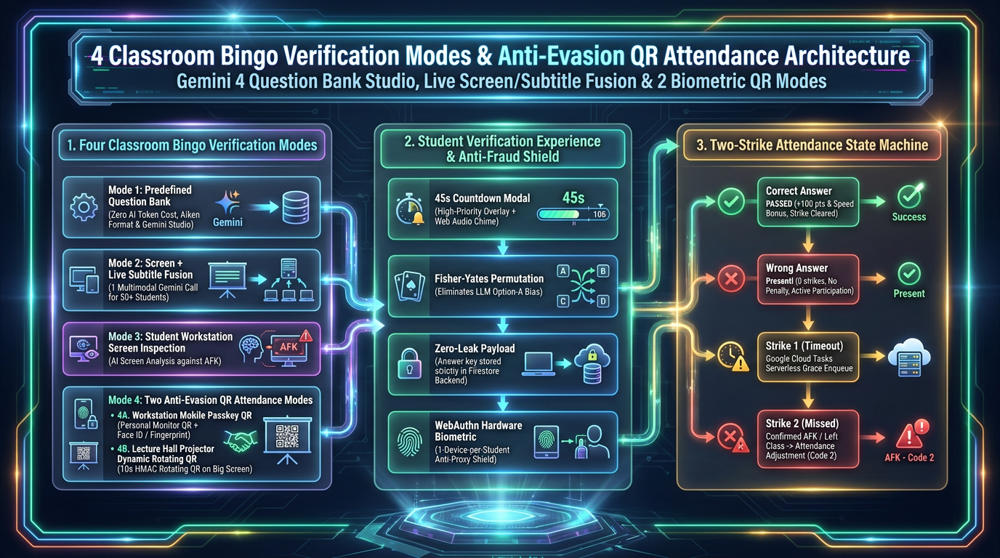
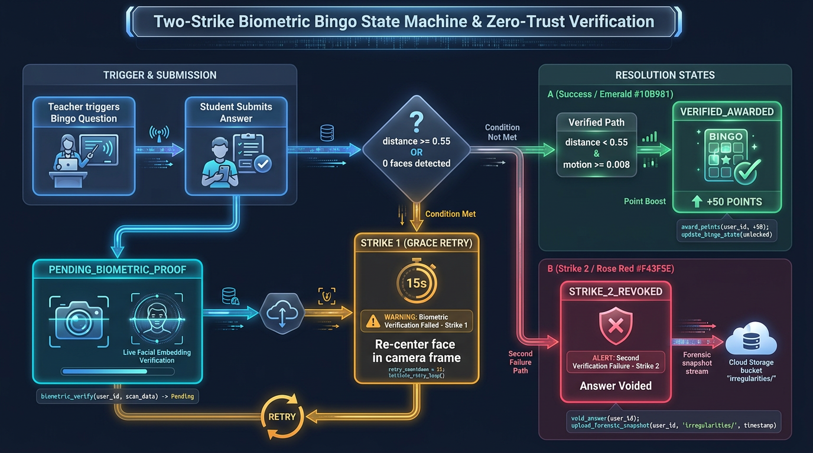
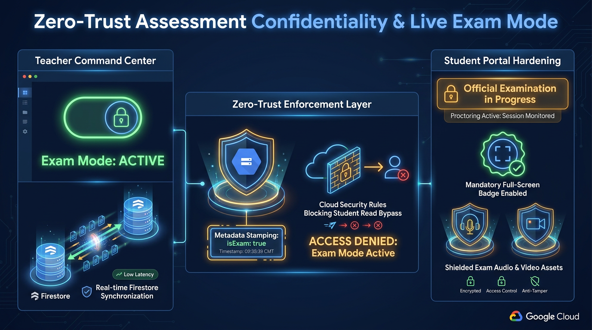

# Google AI Classroom Part 9: Gamified "Bingo" Active Presence Verification & Zero-Trust Proctored Exam Mode on Google Cloud

**Author:** [**Cyrus Wong (黃俊彥)**](https://www.linkedin.com/in/cyruswong/) — *Google Developer Expert - Cloud (AI), Senior Lecturer at HKIIT*

---


## 1. Problem Statement: Defeating "Fake Video Playback", Proxy Classmates & Static Screen Decoys

In a 3-hour coding lab or a 100-student hybrid lecture, passive screen-share telemetry has two classic blind spots:
1. **The Static Screen Decoy (AFK)**: A student opens VS Code or a lecture slide deck, starts screen sharing, and walks away from their workstation for 45 minutes while their screen capture continues uploading identical frames.
2. **The "Give Password to a Classmate + Play a Pre-Recorded Video" Proxy Lab Exploit**: Even worse, an absent student gives their account password to a friend sitting in the computer lab. That friend logs into the absent student's account on an adjacent lab PC, **starts screen sharing, and plays a pre-recorded coding video in full-screen** so the screen-capture feed looks like someone is typing code! When a standard web-based Bingo quiz pops up on that second monitor, the classmate tries to click an answer on their friend's behalf—unless the Bingo challenge requires **Mobile Passkey Biometric Verification (`mobile_passkey` / `lecture_passkey_qr`)**, which forces a hardware Face ID / fingerprint signature from the absent student's own `1-Phone = 1-Student` bound smartphone (as detailed in [Part 4](./04-webauthn-passkeys-rotating-hmac-qr-auth.md))!

Conversely, during a formal **proctored test or examination**, full-screen monitor capture, webcam/microphone investigation, and tamper-evident evidence retention must be strictly enforced.

Solving both modes effectively requires addressing three operational challenges:
1. **Formative Teaching vs. High-Stakes Proctored Exams**: During ordinary lectures and labs, instructors want lightweight, interactive comprehension checks that keep students engaged in learning; during formal tests and exams, invigilators require strict full-monitor capture (`displaySurface === 'monitor'`), continuous webcam/audio investigation, and write-once Cloud Storage locks.
2. **Distinguishing Honest Learning Mistakes from Absence**: If an instructor sends a pop quiz during a lecture and docks attendance marks when a student selects the wrong answer, students are penalized for struggling with new technical material even though they were sitting attentively at their desks!
3. **Eliminating Idle Polling Bills**: Running a Cloud Scheduler cron job every 60 seconds to scan pending attendance timers across 50 classes burns tens of thousands of idle Firestore reads per month.

In **Part 9** of our Google Developer Expert series, we detail how we engineered two complementary classroom integrity systems:
- **Gamified "Classroom Bingo" Active Presence Verification** ([`BingoModal.jsx`](https://github.com/wongcyrus/Google-AI-Classroom/blob/main/web-app/src/components/BingoModal.jsx), [`BingoQuestionBankModal.jsx`](https://github.com/wongcyrus/Google-AI-Classroom/blob/main/web-app/src/components/BingoQuestionBankModal.jsx), [`BingoResultsView.jsx`](https://github.com/wongcyrus/Google-AI-Classroom/blob/main/web-app/src/components/BingoResultsView.jsx), [`LectureQrBingoModal.jsx`](https://github.com/wongcyrus/Google-AI-Classroom/blob/main/web-app/src/components/monitor/LectureQrBingoModal.jsx), and [`bingoFlows.js`](https://github.com/wongcyrus/Google-AI-Classroom/blob/main/functions/ai_flows/bingoFlows.js)) featuring **3 FinOps-Tiered Verification Modes**, a **Gemini 4 Argon (`gemini-4-argon`) Question Bank AI Studio**, Fisher-Yates positional bias elimination, and an event-driven **Non-Punitive Two-Strike State Machine** powered by **Google Cloud Tasks (`dispatchBingoRetryTask`)**.
- **Zero-Trust Exam Mode Lockdown & Court-Ready Forensic Dossiers** ([`ExamReadinessWizard.jsx`](https://github.com/wongcyrus/Google-AI-Classroom/blob/main/web-app/src/components/ExamReadinessWizard.jsx), [`storage.rules`](https://github.com/wongcyrus/Google-AI-Classroom/blob/main/storage.rules), [`getStudentVideoPlaybackUrl.js`](https://github.com/wongcyrus/Google-AI-Classroom/blob/main/functions/media_processing/getStudentVideoPlaybackUrl.js), and [`processReportJob.js`](https://github.com/wongcyrus/Google-AI-Classroom/blob/main/functions/media_processing/processReportJob.js)), enforcing full-monitor capture (`displaySurface === 'monitor'`), write-once Cloud Storage metadata locks (`isExam == 'true'`), Student Portal confidentiality shielding during exam windows, and 1-click export of formal **Microsoft Word (`.docx`) & RFC 4180 CSV Incident Dossiers**.

---

## 2. Diagram 1: Three FinOps-Optimized Bingo Verification Modes & The Gemini 4 Question Bank Studio

When a lecturer triggers a Classroom Bingo round (either manually with one click, via a **Staggered Jitter Queue** that challenges random subsets of students every few minutes so neighbours cannot shout out "Option B!", or via **Auto-Bingo** during live screen broadcasts), `resolveBingoQuestion` in [`functions/ai_flows/bingoFlows.js`](https://github.com/wongcyrus/Google-AI-Classroom/blob/main/functions/ai_flows/bingoFlows.js) supports three FinOps-optimized question generation modes—plus hardware WebAuthn passkey QR modes (`mobile_passkey` and `lecture_passkey_qr`):



### Engineering Highlights of the Bingo Question Engine
1. **Universal Model Agency in the Question Bank Studio (`BingoQuestionBankModal.jsx`)**: Before class, teachers can open [`BingoQuestionBankModal.jsx`](https://github.com/wongcyrus/Google-AI-Classroom/blob/main/web-app/src/components/BingoQuestionBankModal.jsx), type a lesson topic (or customize the system prompt), and select **🧠 Gemini 4 Argon (`gemini-4-argon`)**, **⚡ Gemini 3.8 Flash (`gemini-3.8-flash`)**, or **🪶 Gemini 3.5 Flash-Lite (`gemini-3.5-flash-lite`)** to generate 1 to 15 multiple-choice questions at once—or bulk-import existing quizzes in standard **Moodle Aiken text format**.
2. **Eliminating LLM Positional Bias (`shuffleOptionsAndCorrectIndex`)**: When generating 4-option multiple-choice questions, LLMs exhibit a strong statistical bias toward placing the correct answer at index `0` (Option A) or index `1` (Option B). Every question generated by `generateBingoQuestionBank` or `resolveBingoQuestion` passes through a deterministic **Fisher-Yates permutation (`shuffleOptionsAndCorrectIndex`)** that randomizes option order and updates `correctIndex` accordingly.
3. **Multimodal Teacher Screen + 5-Minute Live Subtitle Fusion (`Mode 2`)**: In `teacher_screen` mode, `resolveBingoQuestion` makes **a single multimodal Gemini call for the entire 50-student class** (`~$0.00015 USD` total cohort cost!). Even better, it fuses the teacher's live broadcast frame (`classes/{classId}/screenBroadcast/liveFrame`) with the last 5 minutes of the teacher's spoken commentary (`classes/{classId}/liveSubtitles/current`) and injects an **Anti-Duplication Rule** containing the last 5 asked questions (`isDuplicateQuestion` with $80\%$ lexical Jaccard similarity rejection) so Gemini never repeats the same question while the teacher stays on a single slide!
4. **Zero-Leak Client Payload Sanitization**: A savvy computer science student will immediately open Chrome DevTools (`Network` / `Firestore` tab) when a quiz pops up. In [`bingoFlows.js`](https://github.com/wongcyrus/Google-AI-Classroom/blob/main/functions/ai_flows/bingoFlows.js), `correctIndex` is written **exclusively** to `classes/{classId}/bingoRecords/{bingoId}` (which students are blocked from reading in `firestore.rules`). The payload pushed to `studentProperties/{studentUid}.activeBingo` contains only `question`, `options`, and `expiresAtMillis`—making client-side answer inspection impossible.

### Production Code 1: Genkit Structured Schema Generation & Fisher-Yates Positional De-Biasing (`bingoFlows.js`)

Let's inspect `generateBingoQuestionBank` and `shuffleOptionsAndCorrectIndex` in [`functions/ai_flows/bingoFlows.js`](https://github.com/wongcyrus/Google-AI-Classroom/blob/main/functions/ai_flows/bingoFlows.js):

```javascript
// Source: functions/ai_flows/bingoFlows.js
export async function generateBingoQuestionBank({ topic, count = 5, customPrompt = null, classId = null, model = null }) {
  const targetModel = model || AI_MODEL;
  const safeCount = Math.min(Math.max(Number(count) || 5, 1), 15);
  const prompt = customPrompt
    ? customPrompt.replace(/\{\{topic\}\}/g, topic || '').replace(/\{\{count\}\}/g, String(safeCount))
    : `You are a computer science instructor preparing quick-check multiple choice questions for a lab/lecture.
Topic / Lesson Material: "${topic}".
Generate exactly ${safeCount} multiple-choice questions testing immediate comprehension.
Each question MUST have exactly 4 options and a correctIndex (0, 1, 2, or 3).`;

  const { response, modelUsed } = await generateWithResilience({
    prompt,
    output: {
      schema: z.object({
        questions: z.array(
          z.object({
            question: z.string().describe('The question prompt'),
            options: z.array(z.string()).length(4).describe('4 multiple choice options'),
            correctIndex: z.number().min(0).max(3).describe('Index of the correct option (0-3)'),
          })
        ),
      }),
    },
  }, targetModel);

  const shuffledQuestions = response.output.questions.map((q) => {
    const { options, correctIndex } = shuffleOptionsAndCorrectIndex(q.options, q.correctIndex);
    return { ...q, options, correctIndex };
  });

  return { questions: shuffledQuestions };
}

export function shuffleOptionsAndCorrectIndex(options, correctIndex) {
  const safeCorrectIndex = (typeof correctIndex === 'number' && correctIndex >= 0 && correctIndex < options.length)
    ? correctIndex
    : 0;
  const items = options.map((opt, idx) => ({ text: opt, isCorrect: idx === safeCorrectIndex }));

  // Unbiased Fisher-Yates shuffle eliminates LLM Option-A bias
  for (let i = items.length - 1; i > 0; i--) {
    const j = Math.floor(Math.random() * (i + 1));
    [items[i], items[j]] = [items[j], items[i]];
  }

  return {
    options: items.map((item) => item.text),
    correctIndex: items.findIndex((item) => item.isCorrect),
  };
}
```

### The 3 Prompts Powering Gamified Classroom Bingo (`bingoFlows.js`)

Here are the exact prompts executed across the three AI-powered Bingo modes in [`functions/ai_flows/bingoFlows.js`](https://github.com/wongcyrus/Google-AI-Classroom/blob/main/functions/ai_flows/bingoFlows.js) and [`admin/prompts/images/`](https://github.com/wongcyrus/Google-AI-Classroom/tree/main/admin/prompts/images):

#### 1. Question Bank Studio Prompt (`Bingo Question Bank Generator.md` / `generateBingoQuestionBank`)
Used when a teacher opens [`BingoQuestionBankModal.jsx`](https://github.com/wongcyrus/Google-AI-Classroom/blob/main/web-app/src/components/BingoQuestionBankModal.jsx) and generates a reusable bank of 1–15 multiple-choice questions with **`gemini-4-argon`**, **`gemini-3.8-flash`**, or **`gemini-3.5-flash-lite`**:

```markdown
# Bingo Question Bank Generator

You are an instructor preparing quick-check multiple choice questions for a classroom lab or lecture.

Topic / Lesson Material: "{{topic}}".

## Rules & Requirements
1. Generate exactly {{count}} multiple-choice questions testing immediate comprehension.
2. Each question MUST have exactly 4 options and a `correctIndex` (0, 1, 2, or 3).
3. Keep questions concise, practical, and unambiguous.
4. Directly test core principles, code patterns, or command usage from the stated topic.
```

#### 2. Mode 2 Prompt — 1-to-Many Teacher Broadcast Screen + 5-Minute Live Subtitle Fusion + Anti-Duplication Rule (`resolveBingoQuestion`)
When the lecturer triggers a **`teacher_screen`** Bingo check during a live broadcast, `resolveBingoQuestion` combines the current `classes/{classId}/screenBroadcast/liveFrame` image, the last 5 minutes of `classes/{classId}/liveSubtitles/current` spoken commentary, and the last 5 asked questions from `classes/{classId}/bingoRecords` into a single multimodal call for the entire cohort:

```markdown
You are an invigilator verifying student attention during a live lecture/explanation.
Analyze the instructor's shared screen image alongside their recent spoken commentary/captions:
Recent Instructor Spoken Commentary: "{{captionContext}}"

Formulate a 4-option multiple-choice question testing whether a student was actively following the instructor's lecture explanation.
The question can reference what the instructor just explained verbally, key details visible on the shared screen, or the connection between them.
ONE option MUST be the true detail from the screen or verbal explanation.
THREE options MUST be plausible but incorrect distractors.
Respond with JSON matching the schema:
{
  "question": "Which file was the instructor editing?",
  "options": ["main.py", "test.js", "app.py", "utils.go"],
  "correctIndex": 0,
  "observedEvidence": "main.py is open in VS Code with Python code displayed"
}

CRITICAL ANTI-DUPLICATION RULE:
The instructor may be holding or explaining the same slide/window. The following questions were ALREADY recently asked to students:
1. "{{recentQuestion1}}"
2. "{{recentQuestion2}}"
3. "{{recentQuestion3}}"

You MUST NOT repeat or rephrase any of the above questions.
You MUST choose a completely DIFFERENT detail, spoken concept, code line, toolbar item, question angle, or UI element that was NOT covered above.
```

#### 3. Mode 3 Prompt — Personalized Student Lab Screen Presence Verification (`Bingo Student Screen Presence Question Generator.md`)
Used during hands-on computer labs when each student is working at their own pace on their own workstation:

```markdown
# Bingo Student Screen Presence Question Generator

You are a classroom invigilator checking student presence in a computer lab.
Analyze this student's computer screen screenshot.

## Rules & Requirements
1. Formulate a 4-option multiple-choice question testing immediate awareness of their screen state (e.g., active editor file, command in terminal, running app, or lab guide step).
2. ONE option MUST be the true visible detail on the student's screen.
3. THREE options MUST be plausible distractors.
4. Respond with valid JSON matching the schema:
{
  "question": "What task or window is currently active on your screen?",
  "options": ["Running test suite in terminal", "Reading documentation in browser", "Editing config file", "Debugging breakpoint"],
  "correctIndex": 0,
  "observedEvidence": "Terminal running pytest is in the foreground"
}
```

---

## 3. Diagram 2: The Non-Punitive Two-Strike State Machine with Google Cloud Tasks & 3-Color Attendance Heatmap

What happens after the high-priority [`BingoModal.jsx`](https://github.com/wongcyrus/Google-AI-Classroom/blob/main/web-app/src/components/BingoModal.jsx) (`z-index: 2147483647`, accompanied by an optional Web Audio API chime) appears on the student's screen with a 45-second countdown timer?

Our **Two-Strike State Machine** (`submitBingoResponse`, `enqueueBingoRetryTask`, and `handleDispatchBingoRetry` in [`functions/ai_flows/bingoFlows.js`](https://github.com/wongcyrus/Google-AI-Classroom/blob/main/functions/ai_flows/bingoFlows.js)) strictly decouples **academic comprehension** from **physical desk presence**:

- **Case 1 — Correct Answer (`passed`)**: The student earns base points (`100 pts`), a speed bonus (up to `+50 pts` scaled by remaining time ratio), and a top-3 podium rank bonus (`+50 / +30 / +20 pts`). Any prior strike is cleared (`strikeNumber = 0`).
- **Case 2 — Wrong Answer (`failed_incorrect`)**: Because the student actively clicked an option within the 45-second window, **physical presence at the workstation is 100% verified!** The student receives instant visual feedback on the correct answer, **zero strikes are triggered, and zero attendance minutes are deducted.**
- **Case 3 — Strike 1 Timeout (`missed_timeout` on `strikeNumber === 1`)**: What if the student stepped away to the washroom for 2 minutes? Instead of docking attendance on a single missed check, `submitBingoResponse` sets `pendingRetryBingo: true` and enqueues a delayed task in **Google Cloud Tasks** (`locations/asia-east2/functions/dispatchBingoRetryTask`) scheduled for `retryDelayMinutes` later (configurable 1–15 minutes, default 3 minutes, **$0.00 idle polling cost**).
- **Case 4 — Strike 2 Consecutive Timeout (`missed_timeout` on `strikeNumber >= 2`)**: When the Cloud Task wakes up after 3 minutes, it performs pre-flight idempotency checks (verifying the class is still active and the teacher hasn't cancelled the session) and dispatches a personal **Strike 2 Follow-Up Challenge**. If the student responds to Strike 2 (even with a wrong answer!), presence is recovered. Only if the student **misses both Strike 1 and Strike 2 consecutively** does the backend calculate the elapsed unverified minutes ($\Delta t = t_{\text{Strike 2}} - t_{\text{Strike 1}}$) and write an `attendanceAdjustments` deduction record!



### Production Code 2: Event-Driven Two-Strike Cloud Tasks Scheduling & Elapsed AFK Deduction (`bingoFlows.js`)

Here is the exact Two-Strike state transition and deterministic Cloud Task deduplication logic inside [`functions/ai_flows/bingoFlows.js`](https://github.com/wongcyrus/Google-AI-Classroom/blob/main/functions/ai_flows/bingoFlows.js):

```javascript
// Source: functions/ai_flows/bingoFlows.js
  // 3. Handle Two-Strike Attendance Protocol & Irregularities
  if (result === 'passed') {
    updatePayload.strikeNumber = 0;
    updatePayload.pendingRetryBingo = false;
  } else if (result === 'failed_incorrect') {
    // Student was present at desk, answered wrong. Do NOT dock attendance.
    updatePayload.lastInattentiveAt = FieldValue.serverTimestamp();
  } else if (result === 'missed_timeout') {
    const currentStrike = Number(record.strikeNumber) || 1;

    if (currentStrike === 1) {
      // Strike 1: Schedule follow-up retry in configured delayMinutes (default: 3 mins)
      updatePayload.pendingRetryBingo = true;
      updatePayload.retryBingoScheduledAtMillis = Date.now() + (retryDelaySeconds * 1000);
      updatePayload.priorMissedBingoId = bingoId;
      updatePayload.retryDelayMinutes = retryDelayMinutes;

      // Enqueue to Google Cloud Tasks for serverless event-driven execution ($0 idle polling)
      await enqueueBingoRetryTask({
        classId,
        studentUid,
        priorBingoId: bingoId,
        delaySeconds: retryDelaySeconds,
      });
    } else if (currentStrike >= 2) {
      // Strike 2 Confirmed Absence! Calculate elapsed unverified window (t_Strike2 - t_Strike1)
      updatePayload.pendingRetryBingo = false;
      const priorBingoId = record.priorBingoId;
      let startMillis = record.issuedAtMillis - (retryDelaySeconds * 1000);

      if (priorBingoId) {
        const priorDoc = await db.doc(`classes/${classId}/bingoRecords/${priorBingoId}`).get();
        if (priorDoc.exists && priorDoc.data()?.issuedAtMillis) {
          startMillis = priorDoc.data().issuedAtMillis;
        }
      }

      const endMillis = Date.now();
      const deductedMinutes = Math.max(1, Math.round((endMillis - startMillis) / 60000));

      // Record attendance adjustment (renders as Red Bitmask Code 2 in AttendanceView.jsx)
      await db.collection(`classes/${classId}/attendanceAdjustments`).add({
        classId,
        studentUid,
        startTime: new Date(startMillis),
        endTime: new Date(endMillis),
        startMillis,
        endMillis,
        deductedMinutes,
        voidedMinutesCount: deductedMinutes,
        reason: `Missed 2 consecutive Bingo checks (AFK/Decoy)`,
        strike1BingoId: priorBingoId || 'strike_1',
        strike2BingoId: bingoId,
        createdAt: FieldValue.serverTimestamp(),
      });
    }
  }
```

In [`AttendanceView.jsx`](https://github.com/wongcyrus/Google-AI-Classroom/blob/main/web-app/src/components/AttendanceView.jsx), every minute of a lesson is encoded as a **5-State Minute Bitmask (`0`–`4`)**:
- `1` / `3` / `4` (**🟢 Green**): Verified Active Presence (Screen Shared / Passkey Verified / Teacher Override).
- `2` (**🔴 Red**): Voided AFK Window (`attendanceAdjustments` from 2 consecutive missed Bingo checks, showing exact tooltip timestamps and a **1-Click Teacher Excuse / Restore (`excused: true`)** button).
- `0` (**⚪ Grey**): Offline / Disconnected.

---

## 4. Diagram 3: Zero-Trust Exam Mode Lockdown & Court-Ready `.docx` Forensic Dossiers

While Classroom Bingo keeps daily lectures and labs lively and non-punitive, formal practical examinations require **Zero-Trust Assessment Security**. When a class enters a scheduled `examPeriods` window (or `lessonType === 'exam'`), four defense-in-depth layers activate automatically across the client browser, Cloud Run FFmpeg, Cloud Storage Security Rules, and our Signed URL Broker:



---

## 5. Deep Dive into the Zero-Trust Exam Code: Storage Metadata Locks, Signed URL Shielding & `.docx` Dossiers

### Production Code 3: Write-Once Exam Metadata Locks in Cloud Storage (`storage.rules`) & Signed URL Broker (`getStudentVideoPlaybackUrl.js`)

During a practical exam, students must not be able to delete uploaded screenshots/videos or replay their own exam recording afterward to leak exam paper questions to another class section.

We enforce this at two independent boundaries:
1. **Direct Cloud Storage Rules (`storage.rules`)**: Students have `write`-only access to `screenshots/` and `irregularities/` (under `2 MB` / `5 MB` size limits), zero `delete` permissions, and `videos/{classId}/{videoId}` explicitly denies student reads whenever `resource.metadata.isExam == 'true'`:

```protobuf
// Source: storage.rules
    match /videos/{classId}/{videoId} {
      // Allow authenticated teachers to read any video in a class.
      // Students can only read non-exam videos that belong to them.
      allow read: if request.auth != null && (
        request.auth.token.role == 'teacher' ||
        (
          resource.metadata != null &&
          'studentUid' in resource.metadata &&
          resource.metadata.studentUid == request.auth.uid &&
          (!('isExam' in resource.metadata) || resource.metadata.isExam != 'true')
        )
      );
      allow delete: if request.auth != null && request.auth.token.role == 'teacher';
    }
```

2. **Server-Side Signed URL Broker (`getStudentVideoPlaybackUrl.js`)**: Even if a video was compiled before an instructor retroactively added an `examPeriods` range to the class settings, [`evaluateStudentRecordingsAccess`](https://github.com/wongcyrus/Google-AI-Classroom/blob/main/functions/media_processing/getStudentVideoPlaybackUrl.js) checks both the `jobData.isExam` flag and `isTimestampInExamPeriods(jobData.startTime, examPeriods, timeZone)`:

```javascript
// Source: functions/media_processing/getStudentVideoPlaybackUrl.js
export function evaluateStudentRecordingsAccess({
  examPeriods = [],
  policy = 'always_enabled',
  releaseDate = null,
  jobData = {},
  timeZone = 'Asia/Hong_Kong',
}) {
  // Recordings for exam/test periods or stamped as exam are strictly confidential and not shared
  const isExam = Boolean(
    jobData.isExam ||
    jobData.lessonType === 'exam' ||
    isTimestampInExamPeriods(jobData.startTime, examPeriods, timeZone) ||
    isTimestampInExamPeriods(jobData.createdAt, examPeriods, timeZone)
  );

  if (isExam) {
    return {
      allowed: false,
      reason: 'Screen recordings for exam or test periods are confidential and not shared with students to protect assessment questions.',
    };
  }
  // Also enforces 'disabled' and 'delayed_release' policies
  return { allowed: true };
}
```

---

### Production Code 4: Court-Ready Microsoft Word (`.docx`) & RFC 4180 CSV Forensic Dossier Compiler (`processReportJob.js`)

When an academic integrity board reviews a suspected exam irregularity, raw JSON logs in a database are difficult for non-technical committee members to inspect.

When an instructor clicks **📄 Export Formal Dossier (.docx)** in [`IncidentDossierExportModal.jsx`](https://github.com/wongcyrus/Google-AI-Classroom/blob/main/web-app/src/components/IncidentDossierExportModal.jsx) (accessed via [`IrregularitiesView.jsx`](https://github.com/wongcyrus/Google-AI-Classroom/blob/main/web-app/src/components/IrregularitiesView.jsx)), [`processReportJob.js`](https://github.com/wongcyrus/Google-AI-Classroom/blob/main/functions/media_processing/processReportJob.js) (`1 vCPU, 2 GiB RAM, 540s timeout`) queries all time-scoped `irregularities`, `audio` transcripts (from Edge Whisper + Gemini verification), and `screenshots` for the class, classifies each student's risk level (`HIGH RISK`, `MODERATE RISK`, `NORMAL / CLEAN`), and uses the `docx` and `csv-stringify` libraries to compile a downloadable **Microsoft Word (`.docx`) Incident Dossier** complete with embedded `ImageRun` evidence snapshots, 3D head-pose/gaze telemetry tables, and verbatim speech transcripts:

```javascript
// Source: functions/media_processing/processReportJob.js
export const processReportJob = onDocumentCreated(
  {
    document: 'reportJobs/{jobId}',
    region: FUNCTION_REGION,
    cpu: 1,
    memory: '2GiB',
    timeoutSeconds: 540,
  },
  async (event) => {
    // ... Fetches classData, studentProperties, time-scoped irregularities, audioTranscripts & screenshots
    const studentReports = targetStudentIds.map((uid) => {
      const student = studentMap[uid] || { id: uid };
      const studentIrregs = irregularities.filter((ir) => ir.studentUid === uid || ir.userId === uid);
      const studentAudios = audioTranscripts.filter((a) => a.studentUid === uid);
      const studentScreens = screenshots.filter((s) => s.studentUid === uid);

      const highSeverityCount = studentIrregs.filter((i) => i.severity === 'high' || i.type === 'multiple_faces').length;
      const totalIncidents = studentIrregs.length;
      const riskLevel = highSeverityCount > 2 ? 'HIGH RISK' : totalIncidents > 3 ? 'MODERATE RISK' : 'NORMAL / CLEAN';

      return { student, irregularities: studentIrregs, audios: studentAudios, screenshots: studentScreens, totalIncidents, highSeverityCount, riskLevel };
    });

    // Compiles structured Microsoft Word (.docx) with embedded ImageRun evidence & RFC 4180 CSV
    // Uploads to reports/{classId}/{jobId}/ and updates reportJobs/{jobId} with signed download URLs
  }
);
```

### The 3 Zero-Trust Exam Mode Invigilation Prompts Feeding the `.docx` Dossier

During a proctored exam, whenever the Tier-1 Browser Edge Investigator or teacher-triggered cloud sweeps escalate a visual or acoustic anomaly, these three prompts in [`admin/prompts/`](https://github.com/wongcyrus/Google-AI-Classroom/tree/main/admin/prompts) evaluate the evidence and invoke Genkit tools (`recordIrregularity`, `recordAudioIrregularity`, `recordAudioAudit`) to populate the `.docx` forensic dossier:

#### 1. Screen Irregularity & Tool-Calling Invigilator (`admin/prompts/images/AI invigilator.md`)
```markdown
**You are an AI invigilator. Your task is to analyze a student's screen, take appropriate action using tools, and then report the actions you took in a final text summary.**

## Guidelines
* **Minor Distraction:** Briefly looking away, non-exam apps visible but not in use.
* **Significant Distraction:** Actively using another app, phone use, talking to someone, unauthorized communication or AI tools during an exam.

## Action & Response Protocol
1. **Analyze the screen.**
2. **If there are no issues, your final answer MUST be the exact text:** "All students are focused and on track."
3. **If there is an issue:**
   * First, call all necessary tools in parallel. You **MUST** call `sendMessageToStudent` and `sendMessageToTeacher`. If the issue is a **Significant Distraction**, you **MUST ALSO** call `recordIrregularity`.
   * Then, as your final answer, you **MUST** provide a detailed summary of the issue and the actions you took.

## Output Guidelines
* When referring to a student in any output, you **MUST** use the format 'email (uid)'.
```

#### 2. Cloud Fallback Face & Gaze Invigilator (`admin/prompts/images/Cloud Fallback Face & Gaze Invigilator.md`)
```markdown
# Cloud Fallback Face & Gaze Invigilator

Analyze this classroom invigilation webcam photo of student {{studentEmail}} (UID: {{studentUid}}, class: {{classId}}).
Determine the student's face presence and gaze orientation.

## Detection Rules
1. Is there a human face present? If no face is visible, status is 'no_face'.
2. Are multiple faces present? If more than 1 person is in frame, status is 'multiple_faces'.
3. Is the student looking forward/centered at their computer screen? If their head or gaze is turned significantly away (left, right, looking at another device, looking away from exam), status is 'looking_away'.
4. If the student is sitting normally facing their screen/work, status is 'normal'.

## Output Format
Respond ONLY with valid JSON in this exact structure:
{
  "faceStatus": "normal" | "looking_away" | "no_face" | "multiple_faces",
  "confidence": 0.95,
  "reason": "Brief explanation"
}
```

#### 3. Live Rolling Audio Collusion & Whisper Invigilator (`admin/prompts/audios/AI Voice Invigilator (Live Rolling Audio).md`)
```markdown
# AI Voice Invigilator (Live Rolling Audio)

You are an expert AI Classroom Invigilator analyzing a live student audio stream during an examination.

## Context
- Class ID: {{classId}}
- Student UID: {{studentUid}}
- Student Email: {{studentEmail}}
- Audio Duration: Rolling 20–45s window

## Audio Transcript
"""
{{transcript}}
"""

## Instructions
1. Analyze the transcript for unauthorized speech, exam collusion, question recitation, answer trading, or whispering to external parties/devices.
2. If multi-speaker discussion, unauthorized talking, or answer recitation is detected:
   - Call the `recordAudioIrregularity` tool with `title`, `message`, `riskLevel` ('low' | 'medium' | 'high'), `speakerCount`, and `transcriptSnippet`.
3. Call the `recordAudioAudit` tool with `verdict` ('clean_exam' | 'suspicious_collaboration' | 'whisper_detected' | 'background_noise' | 'inconclusive'), `speakerCount`, `summary`, and `transcript`.
```

---

## What's Next in Part 10?

We have now explored the entire pedagogical and multimodal AI stack—from Browser Edge AI (`Gemma 4 E2B`, `MediaPipe`, `LiteRT Whisper`) to Cloud Broadcasts, Gemini 4 Argon Video Grading, Capstone Mobile Supervision, and Zero-Trust Exams.

In **Part 10 (our Series Finale)**, we look under the hood at **Day-2 Institutional Operations**: how we govern AI and storage budgets using **Live Google Cloud Billing SKU Sync (`syncGeminiPricing`)**, **9-Category Event-Driven Storage Quota Enforcement (`storageQuota.js`)**, **4-Stage Zero-Orphan Cascading Class Purge (`onClassDocDeleted`)**, and **1-Command Terraform Infrastructure-as-Code (`./setup-new-project.sh`)**.
