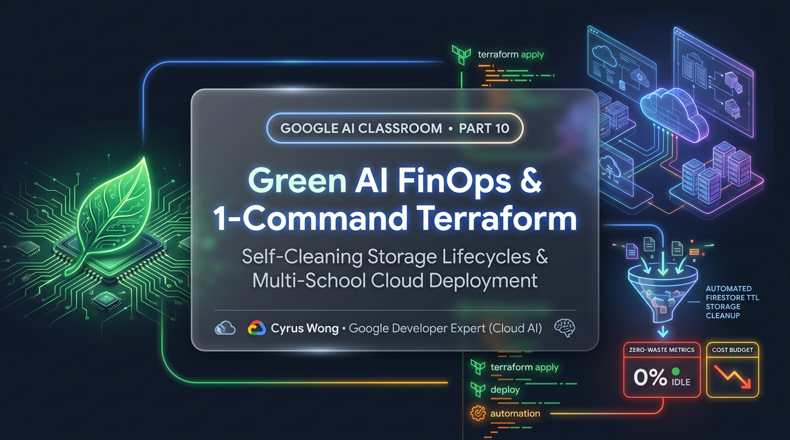
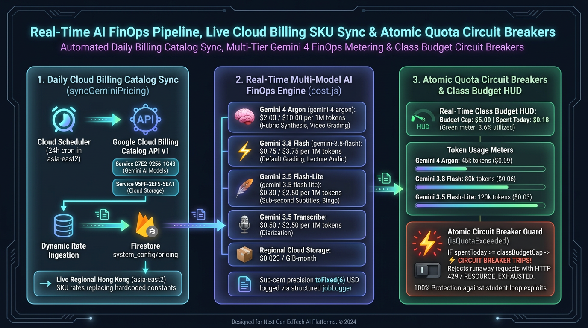
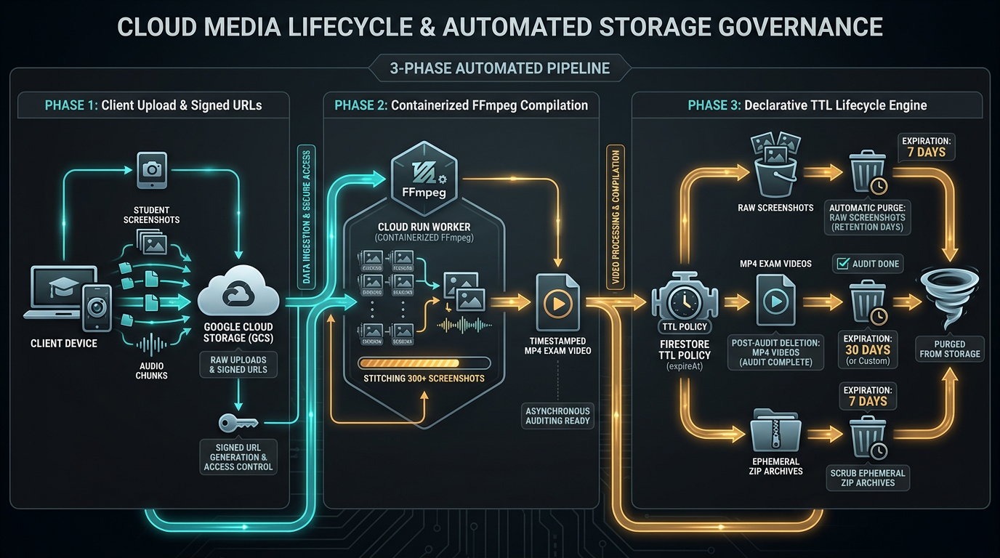

# Google AI Classroom Part 10: Green AI FinOps, Self-Cleaning Storage Lifecycles & 1-Command Terraform IaC for Multi-School Deployment

**Author:** [**Cyrus Wong (黃俊彥)**](https://www.linkedin.com/in/cyruswong/) — *Google Developer Expert - Cloud (AI), Senior Lecturer at HKIIT*

---



## 1. The Three Pillars of Institutional Day-2 Production Readiness

Building a flashy AI classroom demo for a hackathon takes a weekend; operating a production AI platform for **teaching, learning, student performance evaluation, and proctored examinations** across an academic department with dozens of lecturers, thousands of students, and strict public-institution budget governance requires three **Day-2 Engineering Guarantees**:

1. **Granular FinOps & Atomic Quota Circuit Breakers**: Department administrators must see exact, itemized USD spending down to the sixth decimal place across **🧠 Gemini 4 Argon (`gemini-4-argon`)**, **⚡ Gemini 3.8 Flash (`gemini-3.8-flash`)**, **🪶 Gemini 3.5 Flash-Lite (`gemini-3.5-flash-lite`)**, and **🎙️ Gemini 3.5 Transcribe (`gemini-3.5-transcribe-preview`)**, combined with real-time Cloud Storage byte tracking across **9 distinct media categories** and automated circuit breakers that halt runaway spending before a single class can exceed its budget.
2. **Self-Cleaning Storage Lifecycles & Zero-Orphan Cascading Purge**: Over a semester of recorded lectures, practical task grading videos, capstone demos, and proctored exam evidence, classes generate thousands of media files. Student screenshots, lab videos, voice consultations, and exam clips must expire automatically via configurable TTL policies after grading and exam appeals conclude—and deleting a class at the end of an academic year must purge **100% of associated Cloud Storage blobs and 20+ Firestore subcollections/collections** with zero orphaned records.
3. **1-Command Reproducible Terraform Infrastructure-as-Code (`./setup-new-project.sh`) & Continuous Verification**: Any university, polytechnic, or Google Developer community worldwide must be able to provision a fresh Google Cloud project—enabling all 27 APIs, Firestore Native databases, Cloud Storage buckets, Identity Platform (GCIP), and a 24/7 Demo Sandbox—with a single terminal command, guarded by automated unit, security rules, and Playwright E2E test suites.

In **Part 10 (the finale of our 10-part Google Developer Expert series)**, we walk through the exact production code and infrastructure patterns that deliver all three guarantees.

---

## 2. Diagram 1: Real-Time AI FinOps Pipeline, Live Cloud Billing SKU Sync & Atomic Quota Circuit Breakers

In [`scheduledTasks.js`](https://github.com/wongcyrus/Google-AI-Classroom/blob/main/functions/scheduled_tasks/scheduledTasks.js), [`cost.js`](https://github.com/wongcyrus/Google-AI-Classroom/blob/main/functions/ai_flows/cost.js), [`jobLogger.js`](https://github.com/wongcyrus/Google-AI-Classroom/blob/main/functions/ai_flows/jobLogger.js), [`useCloudPricing.js`](https://github.com/wongcyrus/Google-AI-Classroom/blob/main/web-app/src/hooks/useCloudPricing.js), and [`aiCostAggregator.js`](https://github.com/wongcyrus/Google-AI-Classroom/blob/main/web-app/src/utils/aiCostAggregator.js), every AI invocation and storage event is metered in real time against live Google Cloud Billing Catalog SKU rates:



### Production Code 1: Live Google Cloud Billing Catalog SKU Sync (`syncGeminiPricing`) & Multi-Stage Cost Engine (`cost.js`)

Hardcoding cloud pricing constants in frontend code inevitably drifts as new model tiers launch or regional storage SKU rates change. Every 24 hours, `syncGeminiPricing` in [`functions/scheduled_tasks/scheduledTasks.js`](https://github.com/wongcyrus/Google-AI-Classroom/blob/main/functions/scheduled_tasks/scheduledTasks.js) queries the official **Google Cloud Billing Catalog API v1** for both the Gemini / Cloud AI service (`C7E2-9256-1C43`) and Regional Standard Cloud Storage in Hong Kong (`95FF-2EF5-5EA1`, `asia-east2`), writing the authoritative rate table into `system_config/pricing`:

```javascript
// Source: functions/scheduled_tasks/scheduledTasks.js
export const syncGeminiPricing = onSchedule({
  schedule: 'every 24 hours',
  memory: '256MB',
  region: FUNCTION_REGION,
}, async () => {
  const VERTEX_SERVICE_ID = 'C7E2-9256-1C43';
  const STORAGE_SERVICE_ID = '95FF-2EF5-5EA1';
  const pricingData = {
    'gemini-4-argon': { input: 2.00, output: 10.00 },
    'gemini-3.5-flash-lite': { input: 0.30, output: 2.50 },
    'gemini-3.8-flash': { input: 0.75, output: 3.75 },
    'gemini-3.7-pro': { input: 3.00, output: 15.00 },
    'gemini-3.5-transcribe-preview': { input: 0.50, output: 2.50 },
    'cloud-storage': {
      unit: 'GiB/month',
      ratePerGibMonth: 0.023,
      region: 'asia-east2',
      currency: 'USD',
      description: 'Standard Storage Hong Kong (Baseline)',
    },
    lastSyncedAt: new Date().toISOString(),
    source: 'catalog_sync_or_baseline',
  };

  // Queries https://cloudbilling.googleapis.com/v1/services/{SERVICE_ID}/skus
  // Extracts live nanos/units tieredRates for asia-east2 & updates system_config/pricing
  await db.collection('system_config').doc('pricing').set(pricingData, { merge: true });
});
```

On the AI execution plane, [`functions/ai_flows/cost.js`](https://github.com/wongcyrus/Google-AI-Classroom/blob/main/functions/ai_flows/cost.js) maintains a 12-hour warm memory cache of `system_config/pricing`, normalizes token usage metadata across Genkit (`inputTokens`/`outputTokens`), the Google GenAI SDK (`promptTokenCount`/`candidatesTokenCount`), and composite two-stage pipelines (`gemini-3.5-transcribe-preview + gemini-4-argon`), and computes exact sub-cent USD cost (`Number((inputCost + outputCost).toFixed(6))`):

```javascript
// Source: functions/ai_flows/cost.js
export const MODEL_PRICING = {
  'gemini-4-argon': { input: 2.00, output: 10.00 },
  'gemini-3.5-flash-lite': { input: 0.30, output: 2.50 },
  'gemini-3.8-flash': { input: 0.75, output: 3.75 },
  'gemini-3.7-flash': { input: 0.75, output: 3.75 },
  'gemini-3.7-pro': { input: 3.00, output: 15.00 },
  'gemini-3.5-transcribe': { input: 0.50, output: 2.50 },
  'gemini-3.5-transcribe-preview': { input: 0.50, output: 2.50 },
};

export function calculateCost(usageMetadata, model = DEFAULT_MODEL) {
  if (!usageMetadata || typeof usageMetadata !== 'object') return 0;
  const pricing = getModelPricing(model);
  const promptTokens = Math.max(
    0,
    Number(usageMetadata.promptTokenCount ?? usageMetadata.inputTokens ?? usageMetadata.promptTokens ?? 0)
  );
  const candidatesTokens = Math.max(
    0,
    Number(usageMetadata.candidatesTokenCount ?? usageMetadata.outputTokens ?? usageMetadata.completionTokens ?? 0)
  );
  const inputCost = (promptTokens / 1_000_000) * (pricing?.input ?? MODEL_PRICING[DEFAULT_MODEL].input);
  const outputCost = (candidatesTokens / 1_000_000) * (pricing?.output ?? MODEL_PRICING[DEFAULT_MODEL].output);
  return Number((inputCost + outputCost).toFixed(6)) || 0;
}
```

In [`AiCostReportView.jsx`](https://github.com/wongcyrus/Google-AI-Classroom/blob/main/web-app/src/components/AiCostReportView.jsx), lecturers and system administrators can inspect itemized AI token costs alongside an interactive **1–12 Month Cloud Storage Holding Period Slider**, viewing exact storage & AI costs across 18 categories—including **`👥 Project Meeting Audio, Demos & Photos`** (`voiceClipsCount`, `demoClipsCount`, `photosCount`) and **`📋 Task Rubric & Submissions`**.

---

## 3. Diagram 2: 9-Category Event-Driven Storage Quota & 4-Stage Cascading Class Purge (`onClassDocDeleted`)

How do we prevent a class from uploading unlimited gigabytes of video, and how do we guarantee zero orphaned files when a class is deleted?

### Production Code 2: 9-Category Event-Driven Cloud Storage Quota Metering & Self-Healing Non-Negative Drift Guard (`storageQuota.js`)

Every time a file is finalized or deleted in our Google Cloud Storage bucket, [`updateStorageUsageOnUpload`](https://github.com/wongcyrus/Google-AI-Classroom/blob/main/functions/storage_triggers/storageQuota.js) and [`updateStorageUsageOnDelete`](https://github.com/wongcyrus/Google-AI-Classroom/blob/main/functions/storage_triggers/storageQuota.js) in [`functions/storage_triggers/storageQuota.js`](https://github.com/wongcyrus/Google-AI-Classroom/blob/main/functions/storage_triggers/storageQuota.js) classify the blob path into **one of 9 granular storage categories** via `getStorageCategoryAndClass(filePath)`:

| Storage Path Prefix | Firestore Metadata Counter (`classes/{id}/metadata/storage`) | Classroom Asset Category |
| :--- | :--- | :--- |
| `screenshots/{classId}/...` | `storageUsageScreenShots` | Raw periodic screen & webcam JPEGs (auto-purged after MP4 compilation) |
| `videos/{classId}/...` | `storageUsageVideos` | Compiled 1-FPS H.264 student session timelapse MP4s |
| `recordings/{classId}/...` & `subtitles/{classId}/...` | `storageUsageRecordings` | Teacher lecture recordings, normalized M4A audio & `.vtt`/`.srt` subtitles |
| `audio/{classId}/...` | `storageUsageAudio` | Student acoustic anomaly snippets & session audio chunks |
| `irregularities/{classId}/...` | `storageUsageIrregularities` | High-severity proctoring incident snapshots |
| `zips/{classId}/...` | `storageUsageZips` | Bulk evidence archive `.zip` exports (24-hour auto-TTL) |
| `classes/{classId}/tasks/...`, `tasks/...`, `submissions/...` | `storageUsageTasks` | Practical task reference demo videos & sliced student attempt MP4s |
| `reports/{classId}/...` | `storageUsageReports` | Court-ready `.docx` & `.csv` forensic incident dossiers |
| `projectMeetings/{classId}/...` | `storageUsageProjectMeetings` | Capstone consultation voice clips, `720p` mobile camera demo videos & `0.1s` photos |

If an uploaded file pushes `storageUsage` above the class's configured `storageQuota`, `updateStorageUsageOnUpload` **immediately deletes the offending blob from Cloud Storage** and atomically reverts the counter via `FieldValue.increment(-fileSize)`! Furthermore, `updateStorageUsageOnDelete` includes a **Self-Healing Non-Negative Drift Guard** so out-of-order deletion events can never drive any category counter below `0`:

```javascript
// Source: functions/storage_triggers/storageQuota.js
export function getStorageCategoryAndClass(filePath) {
  if (!filePath || typeof filePath !== 'string') return null;
  const parts = filePath.split('/');
  if (parts.length < 3) return null;
  if (parts[0] === 'classes') return { classId: parts[1], usageField: 'storageUsageTasks' };

  const classId = parts[1];
  const map = {
    screenshots: 'storageUsageScreenShots',
    videos: 'storageUsageVideos',
    recordings: 'storageUsageRecordings',
    subtitles: 'storageUsageRecordings',
    audio: 'storageUsageAudio',
    irregularities: 'storageUsageIrregularities',
    zips: 'storageUsageZips',
    tasks: 'storageUsageTasks',
    submissions: 'storageUsageTasks',
    reports: 'storageUsageReports',
    projectMeetings: 'storageUsageProjectMeetings',
  };
  return map[parts[0]] ? { classId, usageField: map[parts[0]] } : null;
}
```

And if a lecturer or system administrator ever wants to verify that Firestore's event-driven byte counters match the physical bytes stored in the Google Cloud Storage bucket after a bulk manual archive purge, clicking **🔄 Audit & Recalculate Storage** invokes `recalculateStorageUsage` in [`functions/storage_triggers/storageQuota.js`](https://github.com/wongcyrus/Google-AI-Classroom/blob/main/functions/storage_triggers/storageQuota.js), scanning every physical prefix in parallel and stamping `lastAuditedAt`:

```javascript
// Source: functions/storage_triggers/storageQuota.js
export async function recalculateStorageUsageInternal(classId) {
  const bucket = adminStorage.bucket();
  const categories = [
    { prefix: `screenshots/${classId}/`, field: 'storageUsageScreenShots' },
    { prefix: `videos/${classId}/`, field: 'storageUsageVideos' },
    { prefix: `zips/${classId}/`, field: 'storageUsageZips' },
    { prefix: `audio/${classId}/`, field: 'storageUsageAudio' },
    { prefix: `recordings/${classId}/`, field: 'storageUsageRecordings' },
    { prefix: `subtitles/${classId}/`, field: 'storageUsageRecordings' },
    { prefix: `irregularities/${classId}/`, field: 'storageUsageIrregularities' },
    { prefix: `classes/${classId}/tasks/`, field: 'storageUsageTasks' },
    { prefix: `tasks/${classId}/`, field: 'storageUsageTasks' },
    { prefix: `submissions/${classId}/`, field: 'storageUsageTasks' },
    { prefix: `reports/${classId}/`, field: 'storageUsageReports' },
  ];

  const results = {
    storageUsageScreenShots: 0, storageUsageVideos: 0, storageUsageZips: 0,
    storageUsageAudio: 0, storageUsageRecordings: 0, storageUsageIrregularities: 0,
    storageUsageTasks: 0, storageUsageReports: 0, storageUsage: 0,
  };

  for (const cat of categories) {
    const [files] = await bucket.getFiles({ prefix: cat.prefix });
    let catTotal = 0;
    for (const file of files) {
      const sz = parseInt(file.metadata?.size, 10);
      if (!isNaN(sz) && sz > 0) catTotal += sz;
    }
    results[cat.field] = (results[cat.field] || 0) + catTotal;
    results.storageUsage += catTotal;
  }

  await db.doc(`classes/${classId}/metadata/storage`).set(
    { ...results, lastAuditedAt: FieldValue.serverTimestamp() },
    { merge: true }
  );
  await db.doc(`classes/${classId}`).set({ storageUsage: results.storageUsage }, { merge: true });
  return results;
}
```

---

### Production Code 3: The 4-Stage Zero-Orphan Cascading Class Purge (`onClassDocDeleted` in `cleanupTriggers.js`)

In Firestore, deleting a parent document (`classes/{classId}`) does **not** automatically delete its subcollections, top-level job documents referencing `classId`, or physical files in Cloud Storage.

To guarantee **100% Zero-Orphan Cleanup** when a teacher deletes a class at the end of a semester, [`onClassDocDeleted`](https://github.com/wongcyrus/Google-AI-Classroom/blob/main/functions/storage_triggers/cleanupTriggers.js) in [`functions/storage_triggers/cleanupTriggers.js`](https://github.com/wongcyrus/Google-AI-Classroom/blob/main/functions/storage_triggers/cleanupTriggers.js) executes a comprehensive **4-Stage Cascading Purge**:



Here is the production implementation from [`functions/storage_triggers/cleanupTriggers.js`](https://github.com/wongcyrus/Google-AI-Classroom/blob/main/functions/storage_triggers/cleanupTriggers.js), using 500-document chunked batch commits (`deleteCollectionByClassId` and `deleteSubcollectionByPath`) to respect Firestore's 500-operation batch ceiling:

```javascript
// Source: functions/storage_triggers/cleanupTriggers.js
export const onClassDocDeleted = onDocumentDeleted({
  document: 'classes/{classId}',
  region: FUNCTION_REGION,
  timeoutSeconds: 540,
  memory: '512MiB',
}, async (event) => {
  const classId = event.params.classId;
  const bucket = storage.bucket();

  // Stage 1: Purge all 13 Cloud Storage prefixes (including projectMeetings & taskDemos)
  const prefixes = [
    `screenshots/${classId}/`, `videos/${classId}/`, `zips/${classId}/`,
    `audio/${classId}/`, `recordings/${classId}/`, `subtitles/${classId}/`,
    `irregularities/${classId}/`, `classes/${classId}/`, `tasks/${classId}/`,
    `submissions/${classId}/`, `reports/${classId}/`, `taskDemos/${classId}/`,
    `projectMeetings/${classId}/`
  ];
  for (const prefix of prefixes) {
    await bucket.deleteFiles({ prefix, force: true }).catch(() => {});
  }

  // Stage 2: Purge top-level collections matching classId in 500-doc batches
  const collectionsToClean = [
    'screenshots', 'audio', 'videoJobs', 'zipJobs', 'videoAnalysisJobs',
    'irregularities', 'progress', 'propertyUploadJobs',
    'lectureMergeJobs', 'lectureSubtitleJobs', 'aiJobs'
  ];
  for (const col of collectionsToClean) {
    await deleteCollectionByClassId(col, classId);
  }

  // Stage 3: Purge all 20+ nested subcollections in 500-doc batches
  const subcollectionsToPurge = [
    'projectMeetings', 'projectGroups', 'projectStudentProfiles',
    'activeMeetingCaptures', 'lectureRecordings', 'bingoSessions',
    'status', 'lessons', 'bingoRecords', 'attendanceAdjustments',
    'studentProperties', 'classProperties', 'passkeyBypassRequests',
    'screenBroadcastViewers', 'messages', 'audio_audits', 'irregularities', 'questionBank'
  ];
  for (const subcol of subcollectionsToPurge) {
    await deleteSubcollectionByPath(`classes/${classId}/${subcol}`);
  }

  // Stage 4: Unlink classId from teacherProfiles & studentProfiles
  await removeClassFromProfiles('teacherProfiles', classId);
  await removeClassFromProfiles('studentProfiles', classId);
});
```

---

## 4. Diagram 3: 1-Command Zero-Click Terraform Onboarding & Multi-Layer Automated Verification Pyramid

To empower any university, school, or Google Developer Group (GDG) to deploy their own sovereign instance of the Google AI Classroom without clicking through dozens of Cloud Console wizards, [`setup-new-project.sh`](https://github.com/wongcyrus/Google-AI-Classroom/blob/main/setup-new-project.sh), [`terraform/`](https://github.com/wongcyrus/Google-AI-Classroom/tree/main/terraform), and [`deploy.sh`](https://github.com/wongcyrus/Google-AI-Classroom/blob/main/deploy.sh) automate the entire provisioning and verification lifecycle:


### How `./setup-new-project.sh` Eliminates Manual Cloud Console Clicks
Running `./setup-new-project.sh my-school-ai-2026 01ABCD-23EFGH-45IJKL` executes an end-to-end automated pipeline:
1. **Project Creation & Billing Link**: Creates the GCP project (if not already present) and attaches the billing account.
2. **Terraform State & 27 APIs**: Runs `terraform init && terraform apply` inside [`terraform/`](https://github.com/wongcyrus/Google-AI-Classroom/tree/main/terraform), enabling Compute, Cloud Run, Cloud Functions Gen 2, Cloud Build, Artifact Registry, Eventarc, Cloud Tasks, Cloud Scheduler, Secret Manager, Google Cloud AI / Firebase AI Logic (`aiplatform.googleapis.com` & `firebasevertexai.googleapis.com`), Cloud Billing Catalog, Firestore Native, Firebase Storage, and Identity Platform (GCIP).
3. **Cross-Codebase Config Synchronization (`sync-config.sh`)**: Automatically extracts the newly generated Firebase Web App SDK credentials and writes them into `web-app/.env` and `functions/config.js`, then runs `./sync-config.sh` to propagate identical region, CORS, and model constants across all **7 isolated Cloud Functions codebases** (`ai_flows`, `media_processing`, `lecture_processing`, `scheduled_tasks`, `storage_triggers`, `ClassFunctions`, and `user_management`).
4. **Zero-Cold-Start 24/7 Demo Sandbox Seeding (`seed-demo-data.mjs`)**: Pre-populates the `IT114115-Demo` class with realistic student telemetry, pre-compiled H.264 lab videos, bilingual `.vtt` lecture recordings, and all **13 Default AI System Prompts** so teachers can test every Gemini 4 Argon studio within 60 seconds of deployment!

---

## 5. Summary of the 10-Part Google AI Classroom Series

Across this 10-part architectural deep dive, we have shared every layer of the **Google AI Classroom** platform for teaching, learning, student performance evaluation, and proctored assessments:

| Part | Architectural Focus | Key Google AI & Cloud Technologies |
| :--- | :--- | :--- |
| **[Google AI Classroom Part 1](https://dev.to/gde/google-ai-classroom-part-1-solving-the-25-per-exam-problem-architecting-a-sub-002student-fjc)** ([GitHub](https://github.com/wongcyrus/Google-AI-Classroom/blob/main/docs/blogs/01-serverless-ai-classroom-architecture.md)) | Solving the $25-Per-Exam Problem: Serverless Architecture | Gemini 4 Argon, Gemma 4 E2B, Firebase Gen 2 |
| **[Google AI Classroom Part 2](https://dev.to/gde/google-ai-classroom-part-2-zero-egress-browser-edge-ai-investigator-running-gemma-4-e2b-2k6a)** ([GitHub](https://github.com/wongcyrus/Google-AI-Classroom/blob/main/docs/blogs/02-browser-edge-ai-gemma-4-mediapipe-whisper.md)) | Zero-Egress Browser Edge AI Investigator (Gemma 4 E2B, MediaPipe, Whisper) | WebGPU Gemma 4 E2B, MediaPipe 3D Mesh, LiteRT Whisper |
| **[Google AI Classroom Part 3](https://dev.to/gde/google-ai-classroom-part-3-multimodal-orchestration-right-sizing-gemini-4-argon-gemini-38-538b)** ([GitHub](https://github.com/wongcyrus/Google-AI-Classroom/blob/main/docs/blogs/03-gemini-4-argon-genkit-multimodal-resilience.md)) | Frontier Multimodal Orchestration with Gemini 4 & Genkit | `gemini-4-argon`, `3.8-flash`, `3.5-lite`, Google Genkit |
| **[Google AI Classroom Part 4](https://dev.to/gde/google-ai-classroom-part-4-defeating-proxy-attendance-lab-keyloggers-with-webauthn-passkeys-2gc0)** ([GitHub](https://github.com/wongcyrus/Google-AI-Classroom/blob/main/docs/blogs/04-webauthn-passkeys-rotating-hmac-qr-auth.md)) | WebAuthn Passkeys, Rotating HMAC QRs & GCIP Blocking | FIDO2 WebAuthn, GCIP Blocking Hooks, 15s HMAC QR |
| **[Google AI Classroom Part 5](https://dev.to/gde/google-ai-classroom-part-5-real-time-multilingual-live-subtitles-hong-kong-code-switching-with-11ap)** ([GitHub](https://github.com/wongcyrus/Google-AI-Classroom/blob/main/docs/blogs/05-realtime-live-subtitles-code-switching-gemini-4-gemma-4.md)) | Real-Time Multilingual Live Subtitles & Code-Switching | Gemini 4/3.8, LiteRT Gemma 4 E2B, Audio Worklet |
| **[Google AI Classroom Part 6](https://dev.to/gde/google-ai-classroom-part-6-low-bandwidth-classroom-screen-broadcasting-single-pass-whole-lecture-1k0l)** ([GitHub](https://github.com/wongcyrus/Google-AI-Classroom/blob/main/docs/blogs/06-scalable-screen-broadcast-and-gemini-4-lecture-studio.md)) | Low-Bandwidth Classroom Screen Broadcast & Lecture Recording Studio | Firestore WebP Delta Sync, Gemini 3.5 Transcribe + Gemini 4 |
| **[Google AI Classroom Part 7](https://dev.to/gde/google-ai-classroom-part-7-serverless-map-reduce-map-video-intelligence-rubric-driven-practical-12on)** ([GitHub](https://github.com/wongcyrus/Google-AI-Classroom/blob/main/docs/blogs/07-serverless-map-reduce-video-and-gemini-4-rubric-grading.md)) | Map-Reduce-Map Video Intelligence & Practical Task Grading | Cloud Run FFmpeg, Cloud Tasks, Gemini 4 Rubric Engine |
| **[Google AI Classroom Part 8](https://dev.to/gde/google-ai-classroom-part-8-ai-project-supervision-streamlined-mobile-720p-demo-2-stage-3h98)** ([GitHub](https://github.com/wongcyrus/Google-AI-Classroom/blob/main/docs/blogs/08-multimodal-capstone-project-supervision-gemini-4.md)) | Streamlined Mobile 720p Capstone Supervision & Log Auditing | Single-Device Mobile Studio, 2-Stage Diarization + Gemini 4 |
| **[Google AI Classroom Part 9](https://dev.to/gde/google-ai-classroom-part-9-gamified-bingo-active-presence-verification-zero-trust-proctored-52dg)** ([GitHub](https://github.com/wongcyrus/Google-AI-Classroom/blob/main/docs/blogs/09-gamified-bingo-active-presence-and-zero-trust-exam-mode.md)) | Gamified Bingo Active Presence & Zero-Trust Proctored Exam Mode | Two-Strike Cloud Tasks, `.docx` Dossiers, Storage Rules |
| **[Google AI Classroom Part 10](https://dev.to/cyruswong)** ([GitHub](https://github.com/wongcyrus/Google-AI-Classroom/blob/main/docs/blogs/10-green-ai-finops-storage-lifecycle-and-terraform-iac.md)) | Green AI FinOps, Storage Lifecycles & 1-Command Terraform | Cloud Billing Catalog API, Cascading Purge, Terraform IaC |

By combining **Browser WebGPU Edge AI Investigation (`Gemma 4 E2B`, `MediaPipe 3D Face Mesh`, `LiteRT Whisper`)** with **Frontier Cloud Multimodal Reasoning (`Gemini 4 Argon`, `Gemini 3.8 Flash`, `Gemini 3.5 Flash-Lite`)**, we achieved:
- **Real-Time Proctored Exam Investigation Across 40+ Seats** (catching fleeting 3-second visual and spoken exam irregularities at 60 FPS with synchronized screen, webcam, and audio evidence),
- **Universal Teacher Agency for Teaching & Student Performance** to choose **Gemini 4 (`gemini-4-argon`)** across every live subtitle, screen broadcast, bingo, practical video grading, and capstone supervision studio, and
- **Scale-to-Zero FinOps & Automated Storage Lifecycles** (eliminating idle server billing and orphaned storage via on-device edge inference, atomic AI quota circuit breakers, and cascading class purges).

### Explore the Open-Source Repository
- [🎤 View the 45-Minute Google Cloud Tech Talk Slide Deck (`google-cloud-slides.marp.md`)](https://github.com/wongcyrus/Google-AI-Classroom/blob/main/docs/presentation/google-cloud-slides.marp.md)
- [🏠 Main Repository README & Architecture Documentation Index](https://github.com/wongcyrus/Google-AI-Classroom/blob/main/README.md)
