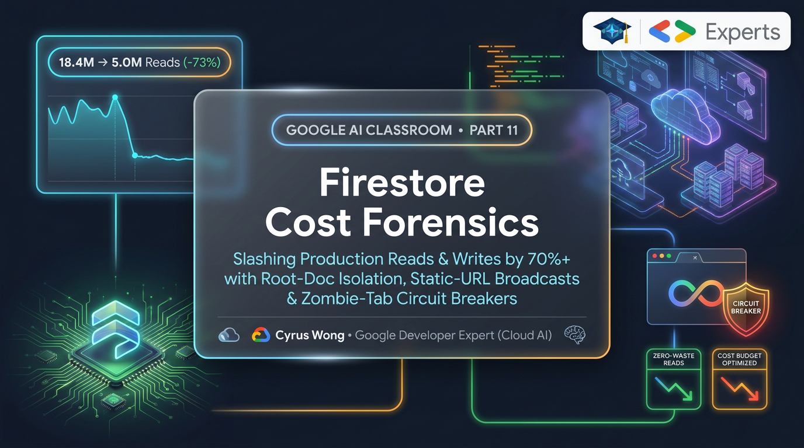
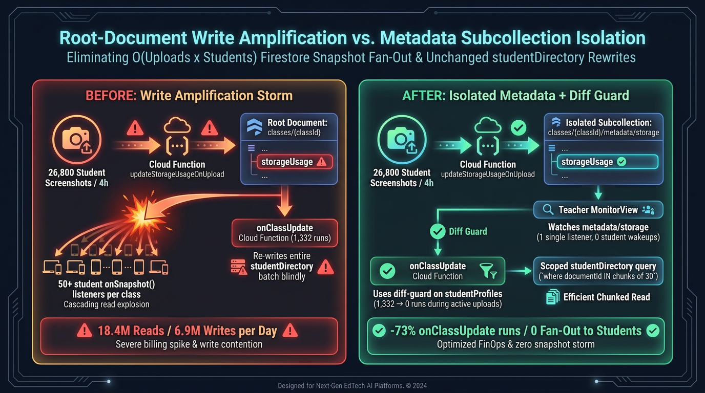
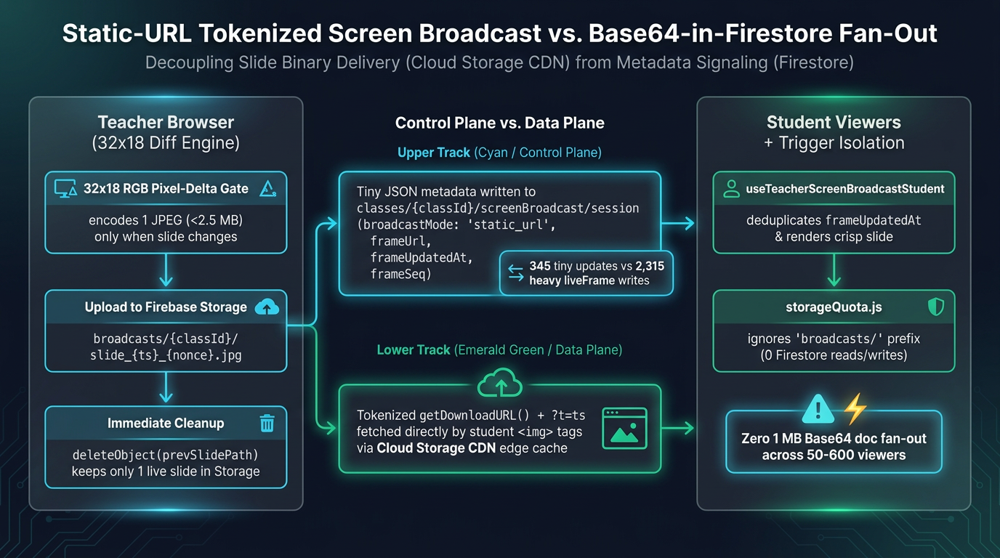
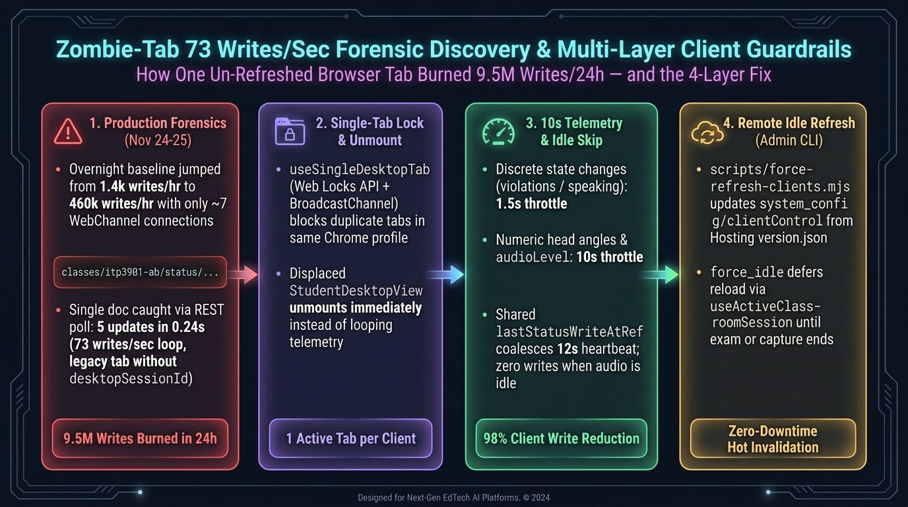

# Google AI Classroom Part 11: Firestore Cost Forensics — Eliminating Write Amplification, Static-URL Screen Broadcast & Tracing a 73 Writes/Sec Zombie Tab

**Author:** [**Cyrus Wong (黃俊彥)**](https://www.linkedin.com/in/cyruswong/) — *Google Developer Expert - Cloud (AI), Senior Lecturer at HKIIT*  
**Platform:** [Google AI Classroom (`it114115-2627.web.app`)](https://it114115-2627.web.app) · **Series:** Engineering Addendum to [Parts 1–10](./README.md)

---



## 1. When Production Telemetry Challenges Your Architecture Assumptions

In [Part 10](./10-green-ai-finops-storage-lifecycle-and-terraform-iac.md), we focused on **AI token FinOps** and **Cloud Storage lifecycle automation**. Yet when we audited our weekly Wednesday lab billing on our live Hong Kong production project (`it114115-2627`), Cloud Firestore operations—not Gemini tokens—were dominating daily database spend during 40+ seat studio sessions.

Using **Google Cloud Monitoring (`firestore.googleapis.com/document/read_ops_count` and `write_ops_count`)**, **Cloud Run function invocation metrics**, and live **Firestore REST API forensics**, we uncovered three distinct cost multipliers—each invisible in local emulators or single-user tests:

1. **Root-Document Write Amplification (`onClassUpdate` Cascade)**: Every student screenshot upload (`~26,800` uploads per afternoon) incremented `storageUsage` directly on `classes/{classId}`, waking up 50+ student `onSnapshot` listeners AND firing `onClassUpdate` thousands of times unnecessarily.
2. **Base64 Slide Streaming & Listener Multiplication**: Legacy screen broadcasting (`screenBroadcast/liveFrame`) pushed up to 1 MB Base64 documents into Firestore `2,315+` times per lecture segment, while duplicated `prompts`, `studentDirectory`, and `notifications` listeners multiplied document reads on every dashboard mount.
3. **The 73 Writes/Sec "Zombie Tab" Discovery**: After shipping **-70% reads and -79% writes** on November 18, a sudden `9.52M writes / 24h` spike on November 24–25 with only **~7 open WebChannel connections** turned out to be **one un-refreshed legacy browser tab** stuck in a displaced-session telemetry loop writing **5 times every 0.24 seconds (~4,400 writes/min)** all night long!

Here is the complete production forensic trail, before/after Cloud Monitoring proof, and every production guardrail we shipped.

---

## 2. The Production Numbers: 30-Day Firestore Trajectory

Querying Google Cloud Monitoring daily buckets (`Asia/Hong_Kong` lecture schedule, where Wednesday is our heaviest full-day lab day) reveals the exact before-and-after impact of isolating trigger amplification (`487dc21`):

| Production Date (HKT) | Workload Context | Firestore Reads | Firestore Writes | Delta vs. Nov 11 Lecture Baseline |
| :--- | :--- | :---: | :---: | :--- |
| **Wed, Nov 4** | Pre-optimization Wednesday studio classes | `18,407,791` | `6,908,635` | `+9.4% reads / +8.0% writes` |
| **Fri, Nov 6** | Normal weekend / non-lecture idle baseline | `286,000` | `258` | Clean baseline |
| **Sat, Nov 7** | Normal weekend / non-lecture idle baseline | `267,000` | `116` | Clean baseline |
| **Wed, Nov 11** | Pre-optimization Wednesday studio baseline | **`16,819,720`** | **`6,395,434`** | **Baseline (`100%`)** |
| **Wed, Nov 18** | **Post-`487dc21` (Storage & trigger isolation)** | **`5,038,050`** | **`1,355,080`** | **`-70.0% reads` / `-78.8% writes`** |
| **Thu, Nov 19** | Post-`487dc21` Thursday studio classes | `5,770,000` | `1,460,000` | `-65.7% reads` / `-77.2% writes` |
| **Sat, Nov 21** | Post-`487dc21` non-lecture weekend day | `368,000` | `1,184` | Low steady idle |
| **Nov 24–25** | **Zombie-Tab Anomaly (`1` stale legacy tab @ 73 writes/sec)** | `24,290,000` | `9,520,000` | Caught via REST forensics -> fixed in `d25d1c3`, `99bbcea`, `d0664cd` |

Comparing the exact **`14:00–18:00 +08`** Wednesday lecture afternoon window on **Cloud Run (`asia-east2`)** between **Nov 18** and **Nov 25** isolates the backend impact cleanly:

| Cloud Run Trigger / Metric (`14:00–18:00 +08`) | Wed Nov 18 | Wed Nov 25 | Reduction & Observation |
| :--- | :---: | :---: | :--- |
| `onclassupdate` invocations | `1,332` | `356` | **`-73.3%`** (`0` invocations from `16:30–17:30` after `15:40` deploy despite **`6,558` uploads!**) |
| `updatestorageusageondelete` invocations | `38,014` | `978` | **`-97.4%`** (Broadcast slide delete is ignored cleanly; batched cleanups stopped churn) |
| `onscreenshotdocdeleted` invocations | `30,734` | `0` | **`-100%`** |
| Screen Broadcast (`itp3901-ab`) writes | `2,315` (`liveFrame` Base64 before `16:25`) | `345` (`static_url` session metadata `16:28–17:17`) | **~`7 writes/min`**, `0` bytes Base64 in Firestore, **`1` active `150 KB` Storage slide** |

---

## 3. Pillar 1: Eliminating Root-Document Write Amplification, Collection Scans & Listener Multiplication



### 3.1 Decoupling `storageUsage` Counters from `classes/{classId}` (`487dc21`)

In our original [`functions/storage_triggers/storageQuota.js`](https://github.com/wongcyrus/Google-AI-Classroom/blob/main/functions/storage_triggers/storageQuota.js), every screenshot, audio clip, and submission upload updated `classes/{classId}/metadata/storage` **and** mirrored `storageUsage: FieldValue.increment(fileSize)` back onto the root `classes/{classId}` document.

Why was that devastating at scale?
1. During a 4-hour studio afternoon with 40+ active desktops uploading periodic evidence, `updateStorageUsageOnUpload` executed **~26,800 writes** directly onto the parent `classes/{classId}` document.
2. Every mutation on `classes/{classId}` pushed a full class document snapshot to every connected student and teacher browser (`50+` `onSnapshot` listeners $\times$ `26,800` mutations = **over 1.3 million redundant snapshot deliveries**).
3. Worse, every single write to `classes/{classId}` fired [`onClassUpdate`](https://github.com/wongcyrus/Google-AI-Classroom/blob/main/functions/auth_triggers/userManagement.js#L226-L325), which iterated over `studentProfiles` and wrote to `studentDirectory`!

We eliminated root-document mirroring in `storageQuota.js` (isolating counters strictly in `classes/{classId}/metadata/storage`) and added both a **fast-path no-op return** and a **field-level diff guard** inside `onClassUpdate` ([`functions/auth_triggers/userManagement.js`](https://github.com/wongcyrus/Google-AI-Classroom/blob/main/functions/auth_triggers/userManagement.js#L250-L293)):

```javascript
// Source: functions/auth_triggers/userManagement.js
// Fast-path early return for status-only updates (e.g. isCapturing, aiUsedQuota, lastAutoBingoAt)
const beforeProfiles = (beforeData.studentProfiles && typeof beforeData.studentProfiles === 'object') ? beforeData.studentProfiles : {};
const afterProfiles = (afterData.studentProfiles && typeof afterData.studentProfiles === 'object') ? afterData.studentProfiles : {};
const needsEmailSanitization = afterExists && JSON.stringify(originalStudentEmails) !== JSON.stringify(cleanedStudentEmails);

if (
  addedStudents.length === 0 &&
  removedStudents.length === 0 &&
  addedTeachers.length === 0 &&
  removedTeachers.length === 0 &&
  !needsEmailSanitization &&
  (!afterExists || JSON.stringify(beforeProfiles) === JSON.stringify(afterProfiles))
) {
  return null;
}
```

Combined with checking `schedule.timeSlots` **before** fetching `classes/{classId}/screenBroadcast/session` inside [`handlePostLessonMediaConsolidation`](https://github.com/wongcyrus/Google-AI-Classroom/blob/main/functions/scheduled_tasks/scheduledTasks.js#L320-L356), Cloud Run invocations for `onclassupdate` plunged **`-73.3%`** (`1,332` -> `356`) and hit **literally zero (`0`)** between `16:30` and `17:30` while processing `6,558` file uploads!

### 3.2 Replacing Full-Collection `studentDirectory` Scans with Scoped `documentId() in [...]` Chunks (`3520de8`)

Teacher dashboards (`MonitorView`, `BingoResultsView`, `PerformanceAnalyticsView`, `VideoAnalysisJobs`) previously executed `getDocs(collection(db, 'studentDirectory'))` to enrich student display names—scanning the **entire department directory** on every view open or class change.

We introduced [`fetchStudentDirectoryByEmails`](https://github.com/wongcyrus/Google-AI-Classroom/blob/main/web-app/src/utils/studentDirectoryUtils.js#L28-L84), which slices strictly the enrolled class roster into 30-email `documentId() in chunk` batches and caches results in-session:

```javascript
// Source: web-app/src/utils/studentDirectoryUtils.js
const CHUNK_SIZE = 30;
const chunks = [];
for (let i = 0; i < normalized.length; i += CHUNK_SIZE) {
  chunks.push(normalized.slice(i, i + CHUNK_SIZE));
}

const dirCol = collection(db, 'studentDirectory');
const snaps = await Promise.all(
  chunks.map((chunk) => getDocs(query(dirCol, where(documentId(), 'in', chunk))))
);
```

And in [`useNotifications.js`](https://github.com/wongcyrus/Google-AI-Classroom/blob/main/web-app/src/hooks/useNotifications.js), we added `limit(25)` and stabilized dependencies to `[user?.email]` instead of the mutable `user` object reference.

### 3.3 Reference-Counted Listener Deduplication (`sharedFirestoreListeners.js` & `sharedPromptsStore.js`)

Multiple mounted components frequently needed the same Firestore data simultaneously—for example, `MonitorView`, `TaskManager`, `AudioPrompts`, `VideoPrompts`, and `TranslationPrompts` each opened 3 `prompts` queries (`public`, `owned`, `sharedWith`), while multiple widgets subscribed to `classes/{classId}/studentProperties/{uid}` or `system_config/loginPolicy`.

We collapsed those duplicate subscriptions at the transport layer with two reference-counted registries:
- [`subscribeDocShared`](https://github.com/wongcyrus/Google-AI-Classroom/blob/main/web-app/src/utils/sharedFirestoreListeners.js#L44-L149): WeakMap-keyed by `(db, canonicalPath)`. Opens **1** `onSnapshot` regardless of component count and replays `lastSnapshot` synchronously to late-mounting consumers.
- [`subscribeSharedPrompts`](https://github.com/wongcyrus/Google-AI-Classroom/blob/main/web-app/src/hooks/sharedPromptsStore.js#L37-L134): Consolidates `3 × N` prompt listeners into **3** shared listeners per `(db, uid)`.

---

## 4. Pillar 2: Decoupling Screen Broadcast Data Plane from Firestore (`static_url` Mode, `56426e5` & `e2bf32d`)



In [Part 6](./06-scalable-screen-broadcast-and-gemini-4-lecture-studio.md), we eliminated `O(N)` WebRTC peer mesh bottlenecks by fanning out compressed frames over Firestore (`classes/{classId}/screenBroadcast/liveFrame`). While resilient, Base64-in-Firestore had two hidden scalability limits:

1. **1 MiB Firestore Document Ceiling**: Sharp 1080p/2K code screenshots had to be aggressively downscaled/re-compressed so Base64 strings stayed under 1 MiB.
2. **Bandwidth × Firestore Write Cost**: During our Nov 25 test class (`itp3901-ab`) before the `16:25` cutover, legacy `liveFrame` accumulated **`2,315` heavy document writes**, forcing Firestore clients to re-download raw Base64 blobs over WebChannel.

In commits `56426e5` and `e2bf32d`, we upgraded [`useTeacherScreenBroadcast.js`](https://github.com/wongcyrus/Google-AI-Classroom/blob/main/web-app/src/hooks/useTeacherScreenBroadcast.js) and [`useTeacherScreenBroadcastStudent.js`](https://github.com/wongcyrus/Google-AI-Classroom/blob/main/web-app/src/hooks/useTeacherScreenBroadcastStudent.js) to **`broadcastMode: 'static_url'`**—cleanly separating the **Control Plane** (tiny Firestore metadata) from the **Data Plane** (tokenized Cloud Storage CDN downloads):

1. **32×18 RGB Pixel Diff Gate**: Identical frames skip capture and upload completely.
2. **Ephemeral Randomized Slide Upload (`storage.rules`)**: When pixels change, [`useTeacherScreenBroadcast.js`](https://github.com/wongcyrus/Google-AI-Classroom/blob/main/web-app/src/hooks/useTeacherScreenBroadcast.js#L730-L801) encodes a crisp JPEG blob (`1080p` default, up to `2.5 MB`—free from Firestore's 1 MB limit), uploads it to `broadcasts/{classId}/slide_{ts}_{nonce}.jpg`, resolves a Firebase Storage **download token URL** appended with `?t=${frameUpdatedAt}`, writes only tiny metadata (`frameUrl`, `frameUpdatedAt`, `width`, `height`) to `classes/{classId}/screenBroadcast/session`, and **immediately deletes `prevSlidePath`** (`deleteObject`):

```javascript
// Source: web-app/src/hooks/useTeacherScreenBroadcast.js
const sessionPublishDocRef = doc(db, `classes/${classId}/screenBroadcast/session`);
await Promise.race([
  setDoc(sessionPublishDocRef, {
    isBroadcasting: true,
    broadcastMode: BROADCAST_MODES.STATIC_URL,
    resolution: currentRes,
    frameUrl: versionedUrl,
    frameStoragePath,
    frameUpdatedAt,
    frameSeq: seq,
    width: targetWidth,
    height: targetHeight,
    lastActiveAt: serverTimestamp(),
  }, { merge: true }),
  timeoutPromise,
]);

currentSlideStoragePathRef.current = frameStoragePath;

// Expire the previous slide immediately after publishing the replacement URL/token
if (prevSlidePath && prevSlidePath !== frameStoragePath && storage) {
  Promise.resolve(deleteObject(ref(storage, prevSlidePath)))
    .then(() => uploadedSlidePathsRef.current.delete(prevSlidePath))
    .catch(() => {});
}
```

3. **Zero Quota-Trigger Overhead**: Because `getStorageCategoryAndClass()` in [`storageQuota.js`](https://github.com/wongcyrus/Google-AI-Classroom/blob/main/functions/storage_triggers/storageQuota.js#L28-L60) returns `null` for `broadcasts/...`, ephemeral slide churn produces **0 Firestore quota reads/writes**.
4. **Secure Token Access & Auto-Updating Students**: [`storage.rules`](https://github.com/wongcyrus/Google-AI-Classroom/blob/main/storage.rules#L223-L232) restricts bucket list/write/delete on `broadcasts/{classId}/**` strictly to `isTeacherInClass(classId)`, while students and zero-auth `/live/:classId` spectators render the unguessable tokenized URL directly inside `` guarded by `frameUpdatedAt` cache-bust deduplication (`useTeacherScreenBroadcastStudent.js`).

> **Live Production Verification (`itp3901-ab`, Nov 25 `16:28–17:17 +08`)**: During 49 minutes of active classroom broadcasting, Firestore logged just **`345`** tiny session metadata updates (`~7 writes/min`), `updateStorageUsageOnUpload` logged **zero** Firestore quota operations for slides, and Cloud Storage held **exactly 1** active slide object (`150 KB`) at session end!

---

## 5. Pillar 3: The Midnight Forensic Mystery — Catching a 73 Writes/Sec Zombie Tab



### 5.1 Why Were Writes Still 460,000/Hour at 3:00 AM?

After our Nov 18 backend reduction (`5.0M reads / 1.35M writes`), we noticed an alarming spike on Nov 24–25: **`24.29M` reads and `9.52M` writes in 24 hours**. Even more baffling, between **01:00 AM and 08:00 AM HKT**—when zero classes were running and Firestore had only **~7 active WebChannel connections**—writes plateaued relentlessly at **`410,000–467,000 writes/hour`** (compared to our normal `~1.4k writes/day` idle baseline).

A backend bug could not explain ~450k/hr client-side document writes at 3 AM. So we polled the `classes/itp3901-ab/status` subcollection directly via the Firestore REST API over a 240ms window—and caught the culprit red-handed:

- **Target Document**: `classes/itp3901-ab/status/<studentUid>`
- **Observed Update Rate**: **5 distinct `updateTime` timestamps within `0.24 seconds`** (~`73 writes/sec`, or `~4,400 writes/min`)!
- **Document Fingerprint**: Zero `desktopSessionId` field + stale `lastAudioHeartbeat` dating back to **`2026-11-10`**!

When the student finally navigated out of `itp3901-ab` at **`18:28:15 +08`**, `itp3901-ab` dropped immediately to zero writes—only for that exact same un-refreshed browser tab to begin writing at **`~48k writes / 15 min`** inside the student's next class document (`classes/<nextClassId>/status/<studentUid>`)!

Why did one forgotten Chrome tab loop at 73 writes/second? Two interacting React bugs in the pre-Nov 25 client bundle:
1. **Displaced-Session Feedback Loop**: When a student opened a second tab, the displaced legacy tab called `stopAllStreams()` which wrote `updateCaptureStatus([])` back to Firestore inside the `onSnapshot` handler while keeping telemetry `useEffect` hooks mounted and re-triggering on mutable state (`audioLevel`, `myProperties`, `user`).
2. **Continuous Noise / Unthrottled Writes**: Background microphone noise triggered continuous `audioLevel` updates, writing to Firestore even when audio capture was idle or muted (`effectiveVoiceAiMode !== 'disabled'`).

### 5.2 The Four-Layer Client Circuit Breaker

To make a runaway loop mathematically impossible—even across multiple tabs, stale deployments, or idle microphones—we built four interlocking guardrails:

#### Layer 1: Stop Displaced Tabs & Separate Discrete vs. 10s Continuous Telemetry (`d25d1c3`, `3520de8`)
In [`StudentView.jsx`](https://github.com/wongcyrus/Google-AI-Classroom/blob/main/web-app/src/components/StudentView.jsx#L1374-L1523):
- Added `isSessionDisplacedRef` + `{ skipFirestoreUpdate: true }` on displaced stream shutdown so evicted tabs never overwrite active sibling sessions.
- Guarded audio telemetry strictly behind `if (isAudioRecording)`—**zero writes** when audio is idle/disabled.
- Split telemetry throttling into **two speeds** using a shared `lastStatusWriteAtRef` that also coalesces the 12-second presence heartbeat:

```javascript
// Source: web-app/src/components/StudentView.jsx
const discreteKey = JSON.stringify([
  isWebcamSharing,
  faceStatus,
  clientAiStatus,
  activeViolation ? `${activeViolation.type || ''}:${activeViolation.message || ''}` : null,
  isAudioRecording,
  isSpeaking,
]);
const hasDiscreteChange = discreteKey !== lastDiscreteTelemetryRef.current;

const now = Date.now();
const timeSinceLast = now - lastTelemetrySyncRef.current;
const THROTTLE_MS = hasDiscreteChange ? 1500 : 10000;
```

#### Layer 2: Same-Browser Single-Tab Web Lock & Immediate Unmount (`d0664cd`)
Even better than suppressing writes in a displaced tab is **never letting two desktop sessions run concurrently in the same browser profile** and **unmounting `<StudentDesktopView />` completely** upon displacement. [`useSingleDesktopTab`](https://github.com/wongcyrus/Google-AI-Classroom/blob/main/web-app/src/hooks/useSingleDesktopTab.js#L38-L247) coordinates `navigator.locks` (Web Locks API) + `BroadcastChannel` scoped strictly to desktop `uid` (allowing mobile companion tabs alongside 1 desktop tab), while `StudentView.jsx` tears down the entire `<StudentDesktopView />` subtree whenever `tabLockStatus === 'duplicate' || tabLockStatus === 'yielded' || isRemoteDisplaced`.

#### Layer 3: Admin CLI Remote Idle Refresh (`99bbcea`, `e2bf32d`, `b8e3d47`)
**Key Production Lesson**: Deploying fixed code to Firebase Hosting does *nothing* to a browser tab that a student opened two weeks ago and never pressed `F5` on!
To remotely retire outdated client bundles **without ever interrupting an active exam or live capture**, we added:
1. Build-time version stamping in [`web-app/vite.config.js`](https://github.com/wongcyrus/Google-AI-Classroom/blob/main/web-app/vite.config.js#L32-L48), emitting `dist/version.json` (`{ buildTimestamp }`) and injecting `__APP_BUILD_TIMESTAMP__`.
2. Global listener in [`web-app/src/App.jsx`](https://github.com/wongcyrus/Google-AI-Classroom/blob/main/web-app/src/App.jsx#L66-L159) subscribing to `system_config/clientControl.forceReloadBefore`.
3. Session-safe deferral via [`useActiveClassroomSession`](https://github.com/wongcyrus/Google-AI-Classroom/blob/main/web-app/src/utils/clientSessionGuard.js#L16-L46): in `--mode=force_idle`, active exams, webcam sharing, broadcasts, or audio captures defer `window.location.reload()` until the exact moment the session transitions back to idle:

```bash
# Queries live Hosting version.json and instructs idle legacy tabs to self-reload
node scripts/force-refresh-clients.mjs --env=prod
```

*(Note: Any pre-Nov 25 zombie tab predating the `clientControl` listener still has to be closed or refreshed once on the user's machine; every client on modern builds now self-heals automatically on future deployments.)*

---

## 6. Key FinOps Takeaways for Serverless Firebase Architectures

1. **Never treat a high-traffic root document like an append counter.** Move high-frequency metrics (`storageUsage`, `aiUsedQuota`) into dedicated `metadata/*` documents so 50+ UI `onSnapshot` listeners and `onDocumentWritten` triggers don't wake up on every file upload.
2. **Firestore is a Control Plane, not a binary stream.** Serving screen-share slides via randomized Cloud Storage tokens (`static_url` in `screenBroadcast/session`) removes 1 MB doc bottlenecks, cuts lecture writes drastically, and scales CDN reads horizontally to hundreds of students.
3. **Always guard client telemetry with discrete-vs-continuous throttles + a Remote Kill/Refresh Switch.** When a single stale tab can generate `4.4k writes/min` (`>6M/day`), `vite.config.js` build stamps + `system_config/clientControl` idle-safe reloading (`scripts/force-refresh-clients.mjs`) are essential Day-2 FinOps infrastructure—not optional polish.

---

### Explore the Series & Codebase
- [📚 Complete Google AI Classroom Technical Blog Index (Parts 1–10 + Addendum)](https://github.com/wongcyrus/Google-AI-Classroom/blob/main/docs/blogs/README.md)
- [🔍 Admin Operations & Remote Client Refresh Manual (`docs/user-manual-admin.md`)](https://github.com/wongcyrus/Google-AI-Classroom/blob/main/docs/user-manual-admin.md)
- [🏠 Main Repository & Recent Cost-Reduction Changelog (`docs/recent-changes.md`)](https://github.com/wongcyrus/Google-AI-Classroom/blob/main/docs/recent-changes.md)
