# 📝 Google Developer Expert (GDE) 10-Part Technical Blog Series
### Architecting the Sub-$0.02/Student Serverless AI Classroom with Gemini 4 Argon (`gemini-4-argon`), Gemma 4 E2B, Google Genkit & Firebase

**Author:** **Cyrus Wong (黃俊彥)** — *Google Developer Expert (Google Cloud Platform & AI/ML), Senior Lecturer at Hong Kong Institute of Information Technology (HKIIT), Vocational Training Council (VTC) Hong Kong*  
**Live Production Platform:** [https://it114115-2627.web.app](https://it114115-2627.web.app)  
**Presentation Deck & Script:** [Google Cloud Tech Talk Slide Deck (`google-cloud-slides.marp.md`)](../presentation/google-cloud-slides.marp.md) | [Interactive HTML Slides](../presentation/google-cloud-slides.html) | [Speaker Notes & Delivery Script](../presentation/speaker-notes-and-script.md)

---

## 🌟 Series Executive Summary & Narrative Arc

Modern universities, polytechnics, and vocational institutions face the **Classroom & Assessment Trilemma**:
1. **Academic Integrity & Authentic Supervision**: In the era of AI copilots, educators must verify what students actually build on their screens during practical labs and cross-examine weekly capstone project logs against live hardware/software demonstrations.
2. **Student Biometric Privacy (GDPR / Hong Kong PDPO)**: Legacy surveillance proctoring tools install invasive OS kernel drivers and stream continuous webcam/microphone feeds to cloud servers—violating student trust and data-protection regulations.
3. **Institutional Cloud FinOps Sustainability**: Commercial SaaS proctoring charges **$15.00 to $25.00 USD per student per exam** ($750–$1,250 per 50-student class). Public education requires a **99.8% cost reduction (<$0.02 USD per student-hour, $0.00 idle cost during school holidays)**.

This **10-part Google Developer Expert (GDE) technical blog series** provides an end-to-end engineering blueprint—complete with **30+ Mermaid architectural, sequence, and state diagrams ($\ge 3$ diagrams in every single blog post)**, real production code deep-dives from this repository, and empirical FinOps benchmarks—demonstrating how we combined **Browser Edge AI (`LiteRT-LM Gemma 4 E2B`, `MediaPipe 468-pt 3D Face Mesh`, `LiteRT Whisper`)** with **Frontier Cloud Multimodal Reasoning (`Gemini 4 Argon`, `Gemini 3.8 Flash`, `Gemini 3.5 Flash-Lite`, `Gemini 3.5 Transcribe`, `Google Genkit`)** across **7 isolated Cloud Functions Gen 2 / Cloud Run micro-codebases** in `asia-east2` (Hong Kong).

```mermaid
flowchart LR
    B1["Part 1:\n4-Tier Serverless\nArchitecture"] --> B2["Part 2:\nBrowser Edge AI\nGemma 4 E2B & MediaPipe"]
    B2 --> B3["Part 3:\nGemini 4 Argon &\nGenkit Resilience"]
    B3 --> B4["Part 4:\nWebAuthn Passkeys &\nRotating HMAC QRs"]
    B4 --> B5["Part 5:\nLive Subtitles &\nCode-Switching"]
    B5 --> B6["Part 6:\n1,000-Viewer Broadcast\n& YouTube Studio"]
    B6 --> B7["Part 7:\nGemini 4 Map-Reduce\nVideo & Rubric Grading"]
    B7 --> B8["Part 8:\nMobile 720p Capstone\nSupervision Studio"]
    B8 --> B9["Part 9:\nBingo Active Presence\n& Zero-Trust Exam Mode"]
    B9 --> B10["Part 10:\nGreen AI FinOps, TTL\n& 1-Command Terraform"]
```

---

## 📚 Complete 10-Part Series Directory ($\ge 3$ Diagrams Per Post)

| Part | Blog Post & Engineering Deep-Dive | Primary Google Cloud & Edge AI Stack | Architectural Diagrams ($\ge 3$ / Post) |
| :--- | :--- | :--- | :--- |
| **Part 1** | [**Solving the $25-Per-Exam Problem: Architecting a Sub-$0.02/Student Serverless AI Classroom with Gemini 4 & Firebase**](./01-serverless-ai-classroom-architecture.md) | Gemini 4 Argon (`gemini-4-argon`), Gemma 4 E2B, Cloud Functions Gen 2 (7 Codebases), Firestore Single-Stream Channel | 1. 4-Tier Hybrid Edge-to-Cloud Architecture 2. 7-Codebase Domain Isolation Topology 3. Firestore Single-Stream $O(1)$ Read Sequence |
| **Part 2** | [**Zero-Egress Browser Edge AI: Running Gemma 4 E2B, MediaPipe 3D Face Mesh & LiteRT Whisper in Web Workers**](./02-browser-edge-ai-gemma-4-mediapipe-whisper.md) | LiteRT-LM WebGPU (`gemma-4-E2B-it-web.litertlm`), `@mediapipe/tasks-vision`, LiteRT Whisper, `CacheStorage` | 1. Zero-Copy Transferable `ImageBitmap` Worker Pipeline 2. 3-Second Biometric Debounce State Machine 3. Whisper $\to$ Gemma 4 Intent & DeepFreeze Hot-Swap Sequence |
| **Part 3** | [**Frontier Multimodal Orchestration: Right-Sizing Gemini 4 Argon (`gemini-4-argon`), Gemini 3.8 Flash & On-Device Gemma 4 E2B with Google Genkit**](./03-gemini-4-argon-genkit-multimodal-resilience.md) | `gemini-4-argon`, `gemini-3.8-flash`, `gemini-3.5-flash-lite`, `gemini-3.5-transcribe-preview`, Google Genkit (`generateWithResilience`) | 1. 5-Model Edge-to-Cloud Right-Sizing Matrix 2. `generateWithResilience` Gemini 4 Parameter Sanitization & Failover Sequence 3. 3-Tier Prompt Governance & `✨ Optimize` Meta-Prompt Flow |
| **Part 4** | [**Defeating Proxy Attendance & Lab Keyloggers with WebAuthn Passkeys, Rotating HMAC QRs & GCIP Blocking Functions**](./04-webauthn-passkeys-rotating-hmac-qr-auth.md) | GCIP Blocking Functions (`beforeUserCreated`, `checkipaddress`), FIDO2 WebAuthn (`@simplewebauthn/server`), HMAC-SHA256 | 1. 4-Tier Hybrid Role Resolution & CIDR Gate 2. 1-Phone Hardware Lock & 15s Rotating HMAC QR Sequence 3. Keylogger-Proof Shared Lab PC QR Login & 3-Tier Recovery |
| **Part 5** | [**Real-Time Multilingual Live Subtitles & Hong Kong Code-Switching with Gemini 4 / 3.8 & On-Device Gemma 4 E2B**](./05-realtime-live-subtitles-code-switching-gemini-4-gemma-4.md) | `gemini-4-argon` / `3.8-flash` / `3.5-flash-lite` (`translateTeacherSpeech`), LiteRT `Gemma 4 E2B` (`litertGemma.worker.js`), Web Audio API | 1. Dual-Engine Server Gemini vs. $0.00 Client Gemma 4 Architecture 2. 8-Discipline Glossary & Rolling Context 9-Language Fan-Out Sequence 3. Out-of-Tab Mic Watchdog & Mobile iOS Jetsam OOM Guard State Machine |
| **Part 6** | [**Scaling Classroom Screen Broadcasting to 1,000+ Viewers & Single-Pass Whole-Lecture Subtitles with Gemini 4 Argon**](./06-scalable-screen-broadcast-and-gemini-4-lecture-studio.md) | 32×18 Canvas RGB Pixel Diffing, Zero-Auth Public PIN Mode, Cloud Run FFmpeg, `gemini-4-argon` Single-Pass Audio CC | 1. 1,000-Viewer Zero-Auth PIN Broadcast Topology 2. 1-Min Rolling Ingestion & 5-Point FFmpeg Safety Gate 3. Single-Pass Audio-Only Gemini 4 CC, Zero-Duration Guard & YouTube Package Sequence |
| **Part 7** | [**Serverless Map-Reduce-Map Video Intelligence & Rubric-Driven Practical Task Auto-Grading with Gemini 4 Argon**](./07-serverless-map-reduce-video-and-gemini-4-rubric-grading.md) | `gemini-4-argon`, `gemini-3.8-flash`, Cloud Tasks (`maxDispatchesPerSecond: 2`), Sharp + FFmpeg, Deterministic Rubric Reconciliation | 1. Adaptive Client Scaling & Sharp/FFmpeg Forensic 1-FPS MP4 Pipeline 2. Two-Stage Map-Reduce-Map Cohort Video Discovery Sequence 3. 4-Tab Rubric Synthesis, Retroactive Slicing & Deterministic Reconciliation Flow |
| **Part 8** | [**Multimodal AI Capstone Project Supervision: Streamlined Mobile 720p Demo Studio, 2-Stage Diarization & Fake-Log Auditing with Gemini 4**](./08-multimodal-capstone-project-supervision-gemini-4.md) | `gemini-4-argon`, `gemini-3.8-flash`, `gemini-3.5-transcribe-preview`, Mobile 720p MediaRecorder, Zero-Pause Photo Snap, SMTP Relay | 1. Self-Healing Google Sheets Sync (Hamming Distance = 1) & Fake-Log Auditor 2. Streamlined Mobile Supervision Studio State Machine (Voice + 0.1s Photo + 720p Demo) 3. Two-Stage Diarization, Gemini 4 Cross-Examination & 1-Click SMTP Dispatch Sequence |
| **Part 9** | [**Gamified "Bingo" Active Presence Verification & Zero-Trust Exam Mode on Google Cloud**](./09-gamified-bingo-active-presence-and-zero-trust-exam-mode.md) | Google Cloud Tasks (`dispatchBingoRetryTask`), `gemini-4-argon` / `3.8-flash` / `3.5-flash-lite`, Storage `isExam` Rules, `.docx` Dossiers | 1. 3 FinOps Bingo Modes & Gemini 4 Question Bank AI Studio 2. Non-Punitive Two-Strike Attendance State Machine & 3-Color Heatmap 3. Zero-Trust Exam Mode Lockdown & `.docx` Forensic Dossier Sequence |
| **Part 10** | [**Green AI FinOps, Self-Cleaning Storage Lifecycles & 1-Command Terraform IaC for Multi-School Deployment**](./10-green-ai-finops-storage-lifecycle-and-terraform-iac.md) | Cloud Billing Catalog API (`syncGeminiPricing`), Firestore Native TTL, Cascading `onClassDocDeleted`, Terraform IaC, 2,575+ Test Pyramid | 1. Real-Time FinOps Metering & Atomic Quota Circuit Breaker 2. 9-Category Storage Quota & 4-Stage Cascading Class Purge (`onClassDocDeleted`) 3. 1-Command Zero-Click Terraform Provisioning & 4-Level Verification Pyramid |

---

## 🧠 The Gemini 4 & Gemma 4 Constellation Reference Matrix

| Model Identifier | Execution Tier | Context Window | Pricing (Input / Output per 1M) | Primary Classroom Workflows |
| :--- | :--- | :--- | :--- | :--- |
| **`gemini-4-argon`** | Cloud (Vertex / Genkit `asia-east2`) | **1,000,000 Shared** | **$2.00 / $10.00** | Complex Practical Task Rubric Synthesis (`extractTaskDemoSteps`), Multi-Step Code Video Grading (`evaluateTaskSubmission`), Cohort Map-Reduce Rubric Discovery (`generateLabTaskPrompt`), Stage-2 Capstone Demo vs. Weekly Log Cross-Examination (`analyzeProjectMeeting`), Prompt Studio Meta-Optimizer (`optimizePromptFlow`), Whole-Lecture Audio Subtitles (`processLectureSubtitles`), Bingo Question Bank Studio (`generateQuestionBankAi`). |
| **`gemini-3.8-flash`** | Cloud (Vertex / Genkit `asia-east2`) | **1,000,000** | **$0.50 / $3.00** | Default Practical Task Video Grading, Single-Pass 9-Hour Opus Lecture Subtitles & YouTube Chapters, Pre-Meeting Weekly Log Authenticity Auditor (`prepareProjectMeetingLogQuestions`), Stage-1 Low-Volume Multimodal STT Fallback. |
| **`gemini-3.5-flash-lite`** | Cloud (Vertex / Genkit `asia-east2`) | **1,000,000** | **$0.25 / $1.50** | Sub-Second 9-Language Live Subtitles (`translateTeacherSpeech`), 1-to-Many Teacher Broadcast Screen Bingo Checks (`resolveBingoQuestion`), Hybrid Cloud Face/Gaze Fallback (`analyzeFaceFallbackFlow`), Ultimate Resilience Fallback Target. |
| **`gemini-3.5-transcribe-preview`** | Cloud (Vertex / Genkit `asia-east2`) | Audio Specialized | **$0.25 / $1.50** | Stage-1 Multi-Speaker Acoustic Diarization (`[MM:SS] Speaker 1..N`) for Capstone Project Consultations and Classroom Discussion Summaries. |
| **`gemma-4-E2B-it-web.litertlm`** | Browser Edge (`WebGPU / WASM Worker`) | On-Device Local | **$0.00 / $0.00** | Continuous On-Device Exam Speech Intent Proctoring (`COLLUSION_EXAM` vs. `BENIGN`) and $0.00 Client-Mode Multilingual Live Subtitles (`litertGemma.worker.js`). |

---

## 🗺️ Recommended Reading Tracks by Role

- **🏗️ Cloud Architects & Backend Engineers**: Start with [**Part 1 (4-Tier Serverless Architecture)**](./01-serverless-ai-classroom-architecture.md) $\to$ [**Part 3 (Gemini 4 Argon & Genkit Resilience)**](./03-gemini-4-argon-genkit-multimodal-resilience.md) $\to$ [**Part 7 (Map-Reduce Video & Rubric Grading)**](./07-serverless-map-reduce-video-and-gemini-4-rubric-grading.md) $\to$ [**Part 10 (Green AI FinOps & Terraform IaC)**](./10-green-ai-finops-storage-lifecycle-and-terraform-iac.md).
- **🧠 AI/ML & Prompt Engineers**: Start with [**Part 3 (5-Model Matrix & Meta-Prompt Optimizer)**](./03-gemini-4-argon-genkit-multimodal-resilience.md) $\to$ [**Part 5 (Code-Switching Live Subtitles)**](./05-realtime-live-subtitles-code-switching-gemini-4-gemma-4.md) $\to$ [**Part 7 (Deterministic Rubric Reconciliation)**](./07-serverless-map-reduce-video-and-gemini-4-rubric-grading.md) $\to$ [**Part 8 (2-Stage Capstone Diarization & Fake-Log Auditing)**](./08-multimodal-capstone-project-supervision-gemini-4.md).
- **⚡ Frontend, WebGPU & Media Engineers**: Start with [**Part 2 (Gemma 4 E2B & MediaPipe Web Workers)**](./02-browser-edge-ai-gemma-4-mediapipe-whisper.md) $\to$ [**Part 6 (32×18 Pixel-Delta Broadcast & 5-Point FFmpeg Gate)**](./06-scalable-screen-broadcast-and-gemini-4-lecture-studio.md) $\to$ [**Part 8 (Mobile 720p Demo & Zero-Pause Photo Studio)**](./08-multimodal-capstone-project-supervision-gemini-4.md).
- **🔐 Security & Identity Engineers**: Start with [**Part 4 (WebAuthn Passkeys, Rotating HMAC QRs & GCIP Blocking Hooks)**](./04-webauthn-passkeys-rotating-hmac-qr-auth.md) $\to$ [**Part 9 (Zero-Trust Exam Mode & `.docx` Forensic Dossiers)**](./09-gamified-bingo-active-presence-and-zero-trust-exam-mode.md).

---

[← Back to Main Repository README](../../README.md)
