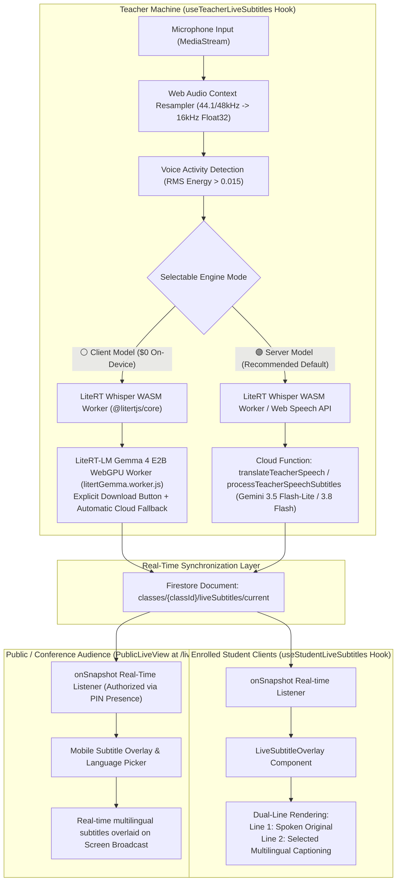
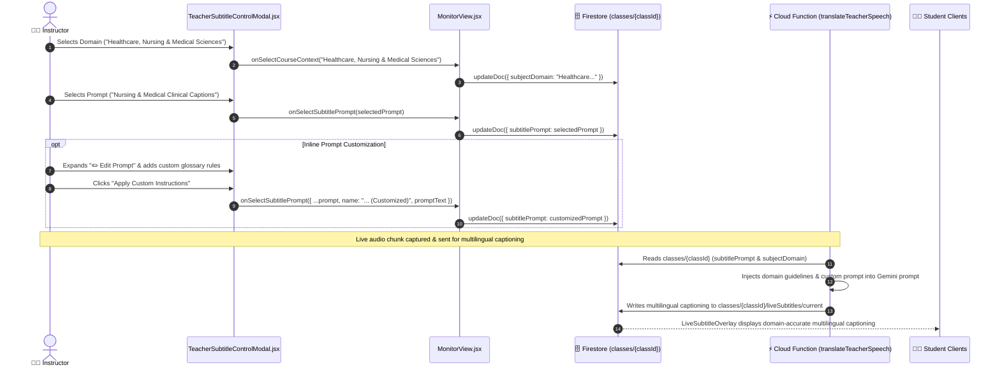
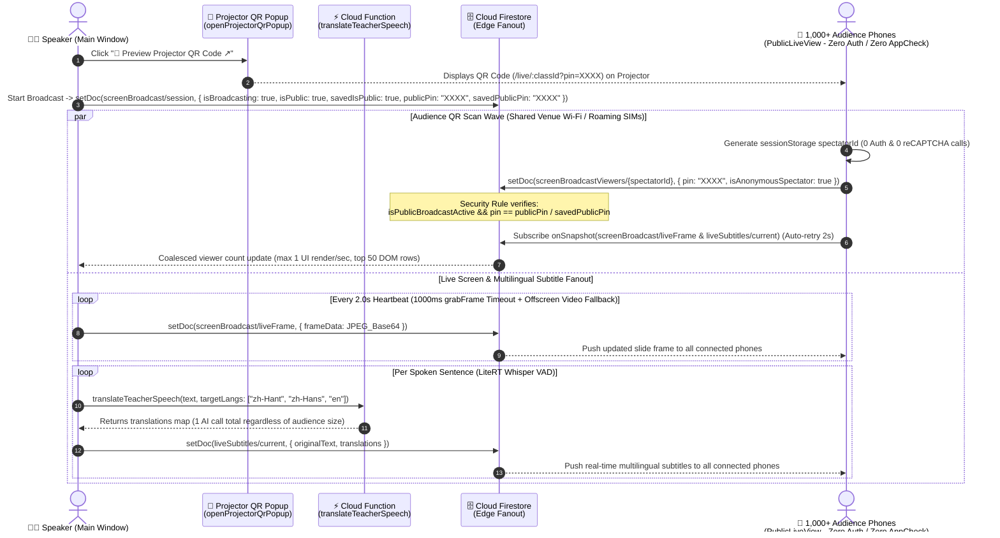

# Live Subtitles & Multilingual Captions Feature

## 1. Overview & Problem Statement

In computer science higher education environments (such as vocational and university degree programs in Hong Kong), lectures are predominantly delivered in **Cantonese with intensive English technical code-switching** (e.g., *"今日我哋會用 `useState` 同埋 `useEffect` 去整一個 real-time component，跟住 push 上 `Docker` container"*).

This creates two distinct technical challenges:
1. **Multilingual Inclusivity**: International and non-Cantonese speaking students struggle to comprehend spoken colloquial Cantonese mixed with programming terminology.
2. **Technical Vocabulary Integrity**: Generic speech recognition tools and standard subtitle engines frequently misinterpret programming terms into literal spoken words (e.g., generating subtitles for `Docker` into "碼頭工人", `git commit` into "提交禮物", or `useState` into "使用州").

The **Live Subtitle & Multilingual Captioning** feature provides real-time, bi-line subtitles (original spoken lecture + caption text) directly inside the teacher's screen broadcast and student viewers, offering **two selectable operational architectures** tailored for universal cloud precision (**Server Model**) or $0 on-device WebGPU inference (**Client Model**).

> [!NOTE]
> **Two Distinct Subtitle Pipelines in the Platform**:
> - **Live In-Class Subtitles (This Document)**: Operates in real-time (<1.5s latency) processing **sentence-by-sentence streaming segments** via VAD / LiteRT Whisper / Web Speech API + Server Gemini 3.5 Flash-Lite or Client LiteRT Gemma 4 E2B to render visual overlays on active student screens.
> - **Recorded Lecture Subtitles & YouTube CC**: Operates post-lecture processing the **entire whole-class voice recording (`lecture_audio.webm`) as a single multimodal file** via **Gemini 4 Argon**, **Gemini 3.8 Flash**, or **Gemini 3.5 Flash-Lite** for holistic context, technical code-switching retention, and YouTube chapter generation. For full technical details and architectural comparisons, see [Teacher Lecture Recording & YouTube CC Workflow](file:///home/developer/Documents/Gemini-AI-Classroom-Assistant/docs/teacher-lecture-recording-and-youtube-workflow.md#33-whole-class-holistic-audio-ingestion-vs-live-segment-by-segment-streaming).

---

## 2. System Architecture & Dual-Engine Operational Modes



### Feature & Architecture Comparison Matrix

| Dimension | 🟣 Mode 1: Server Model (Default) | ⚪ Mode 2: Client Model (On-Device) |
| :--- | :--- | :--- |
| **Speech Recognition Engine** | On-device LiteRT Whisper (`litertWhisper.worker.js`) + Web Speech API | On-device LiteRT Whisper (`litertWhisper.worker.js`) + Web Speech API |
| **Multilingual Captioning Engine** | Cloud Function (`translateTeacherSpeech` - Gemini 3.5 Flash-Lite / 3.8 Flash) | On-device LiteRT-LM Gemma 4 E2B WebGPU (`litertGemma.worker.js`) with transparent cloud fallback |
| **Streaming Latency** | ~800ms - 1.5s (Sentence-level at pause) | ~1s - 2s (Local WebGPU generation) |
| **Cloud Cost & Quota** | ~$0.01 per lecture (Pay-per-sentence prompt tokens) | **$0.00 (Zero cloud translation API cost once loaded)** |
| **Model Loading Behavior** | Zero download required (0 MB) | **Explicit user-triggered download button (`⬇️ Download & Load Gemma 4 (~1.9 GB)`)**; never auto-downloads |
| **Mobile / iOS Protection** | 100% compatible on Desktop & Mobile (iOS Chrome/Safari) | Automatically uses cloud fallback on mobile/iOS to prevent 1.5GB WebKit tab OOM refreshes |
| **Term Retention** | **Exceptional** (strict JSON schema & discipline system prompt) | **Good** (structured JSON prompt instruction) |
| **Target Languages** | 7 languages (`en`, `zh-Hant`, `zh-Hans`, `ja`, `ko`, `es`, `fr`) | 7 languages (`en`, `zh-Hant`, `zh-Hans`, `ja`, `ko`, `es`, `fr`) |

---

## 3. Audio Ingestion & Processing Pipeline

### 3.1 Audio Capture via Modern AudioWorklet (`attachAudioProcessor`)
Modern browsers capture microphone input at 44.1 kHz or 48.0 kHz. The LiteRT Whisper model requires **16.0 kHz 1-channel mono PCM audio**.

Historically, web audio processing relied on `ScriptProcessorNode`, which ran on the main UI thread and triggered Chrome deprecation warnings (`[Deprecation] The ScriptProcessorNode is deprecated. Use AudioWorkletNode instead`). 

The platform utilizes a dedicated AudioWorklet pipeline via [`attachAudioProcessor()`](file:///home/developer/Documents/Gemini-AI-Classroom-Assistant/web-app/src/utils/audioWorkletHelper.js):
- **Worker Thread Isolation**: Audio chunks are downsampled dynamically inside an inline `AudioWorkletProcessor` Blob URL running entirely off the main thread, preventing UI frame drops.
- **Echo & Feedback Prevention**: The processor output connects to a zero-gain `GainNode` (`muteNode.gain.value = 0`) before routing to `audioCtx.destination`, ensuring zero microphone feedback or echo.
- **Graceful Fallback**: If `audioWorklet` is unsupported (e.g., automated test runners or legacy browsers), it seamlessly falls back to `ScriptProcessorNode`.

```javascript
export function downsamplePcmTo16k(inputData, inputSampleRate, targetSampleRate = 16000) {
  if (inputSampleRate === targetSampleRate) return inputData;
  const sampleRatio = inputSampleRate / targetSampleRate;
  const newLength = Math.round(inputData.length / sampleRatio);
  const result = new Float32Array(newLength);
  let offsetResult = 0;
  let offsetInput = 0;
  while (offsetResult < result.length) {
    const nextOffsetInput = Math.round((offsetResult + 1) * sampleRatio);
    let accum = 0;
    let count = 0;
    for (let i = offsetInput; i < nextOffsetInput && i < inputData.length; i++) {
      accum += inputData[i];
      count++;
    }
    result[offsetResult] = count > 0 ? accum / count : 0;
    offsetResult++;
    offsetInput = nextOffsetInput;
  }
  return result;
}
```

### 3.2 Voice Activity Detection (VAD) & Energy Calculation
To prevent transmitting continuous background noise or silence:
- **Root Mean Square (RMS)** is calculated across every audio block:
  $$\text{RMS} = \sqrt{\frac{1}{N} \sum_{i=1}^{N} x_i^2}$$
- An RMS threshold of `rms > 0.015` identifies active voice chunks. A trailing silence timer of `700ms` triggers sentence finalization and dispatches accumulated PCM buffers to the worker.
- For live microphone level bars in the setup wizard and modal, time-domain waveform deviation (`getByteTimeDomainData`) is combined with frequency bins (`getByteFrequencyData`) and explicit `audioCtx.resume()` to guarantee responsive volume meters across desktop and mobile browsers.

---

## 4. Operational Modes In-Depth

### 4.1 Mode 1: Server Model (Universal Compatibility & High Precision — Default)
- **Speech Recognition**: Uses on-device LiteRT Whisper (`openai/whisper-tiny`, supporting Cantonese `zh-HK`, Mandarin `zh-CN`, English `en-US`, and Japanese `ja` in a single multilingual model) or native browser `SpeechRecognition`, with `transcribeAudioWithFirebaseAI` fallback.
- **Multilingual Captioning**: Completed sentences are sent to Cloud Function `translateTeacherSpeech` / `processTeacherSpeechSubtitles` via Firebase `httpsCallable`.
- **Backend Model**: Powered by **Gemini 3.5 Flash-Lite / 3.8 Flash** using structured system instructions that enforce preservation of domain keywords based on the configured classroom discipline:
  ```text
  You are an expert technical subtitle engine specialized in classroom education.
  Course Subject Domain: {courseContext || "General Studies"}
  System multilingual captioning Instructions: {customPrompt || "Preserve domain keywords and code terms without alteration."}
  Generate subtitles for the spoken phrase into the specified target languages.
  Return ONLY a JSON object: {"subtitles": {"en": "...", "zh-Hant": "..."}}
  ```
- **Quota Protection**: Verifies teacher authorization and validates that the classroom's monthly AI allowance has not been exhausted before dispatching the request.

### 4.2 Mode 2: Client Model ($0 Cost, On-Device LiteRT Gemma 4 E2B + Automatic Cloud Fallback)
- **Speech Recognition**: Executes the Whisper-tiny quantized TFLite model inside a dedicated Web Worker (`litertWhisper.worker.js`) via Google's LiteRT Web engine (`@litertjs/core`).
- **On-Device Multilingual Captioning**: Uses **LiteRT-LM Gemma 4 E2B** (`gemma-4-E2B-it-web.litertlm`, ~1.9 GB) executing via WebGPU inside `litertGemma.worker.js`.
- **Explicit User-Triggered Download & Mobile Memory Guard**:
  - Selecting **Client Model** never automatically downloads the 1.9 GB Gemma 4 model on mount or mode switch. This prevents unexpected bandwidth spikes and eliminates iOS Chrome/Safari Jetsam Out-Of-Memory (OOM) page refreshes.
  - On desktop browsers with WebGPU and $\ge 4\text{ GB}$ RAM, the teacher or student explicitly clicks **`⬇️ Download & Load Gemma 4 (~1.9 GB)`** (or **`⚡ Load Cached Gemma 4 Model`** once cached in `CacheStorage`).
  - While the local model is unloaded, downloading, or running on mobile/iOS devices, `useTeacherLiveSubtitles` transparently routes translations through the **Server Model** (`translateTeacherSpeech`) so live subtitles work immediately with zero downtime.

---

## 5. Firestore Real-Time Delivery Schema

All live subtitles are coordinated through a single designated document per classroom:

**Document Path**: `classes/{classId}/liveSubtitles/current`

```typescript
interface LiveSubtitleDocument {
  // Whether the live subtitle stream is active
  active: boolean;

  // Active engine mode: 'client' | 'server'
  engineMode: 'client' | 'server';

  // Spoken lecture original transcript (e.g. Cantonese)
  original: string;

  // Map of multilingual subtitle strings keyed by language code
  subtitles: {
    en?: string;
    'zh-Hant'?: string;
    'zh-Hans'?: string;
    ja?: string;
    ko?: string;
    es?: string;
    fr?: string;
  };

  // Whether the current subtitle is finalized (turn complete) or streaming
  isFinal: boolean;

  // Source language code (default 'zh-HK')
  speechLanguage: string;

  // Selected target multilingual captioning languages
  targetLanguages: string[];

  // Server timestamp of the update
  updatedAt: FieldValue;

  // Rolling buffer of the last 5 finalized turns for UI context
  history: Array<{
    original: string;
    subtitles: Record<string, string>;
    timestamp: number;
  }>;
}
```

### Student Client Subscription Model
The custom hook `useStudentLiveSubtitles(classId, preferredLanguage)` establishes a single `onSnapshot` listener on `classes/{classId}/liveSubtitles/current`:
1. When `active === false`, the subtitle display unmounts cleanly, incurring 0 re-renders.
2. When `active === true`, the hook extracts the user's preferred language from the `subtitles` map with intelligent fallback (`preferredLanguage -> classDefault -> 'en'`).
3. Updates the dual-line state with sub-second responsiveness without polling.

---

---

## 6. Course Subject Domain & Custom Subtitle AI Prompts

### 6.1 Multi-Discipline Domain Support
Unlike traditional proctoring or transcription tools that assume all computer-assisted classrooms are teaching Computer Science or Information Technology, the platform provides institutional flexibility across non-IT academic disciplines.

In **Class Management ➔ Section 8: Live Subtitles, Captions & Subject Domain**, teachers configure:
- **Course Subject / Discipline Domain Preset**:
  - 💻 **Computer Science & Software Development**: Preserves variable names, code keywords (`useState`, `Docker`, `SQL`, `git commit`), and syntax structures.
  - 💼 **Business, Finance & Accounting**: Preserves financial acronyms (`EBITDA`, `GAAP`, `IFRS`, `ROI`), stock tickers, and economic terminology.
  - 🎨 **Design, Media & Visual Arts**: Preserves typography, color space (`CMYK`, `RGB`), rendering, and UI/UX conventions.
  - 🏥 **Healthcare, Nursing & Medical Sciences**: Preserves clinical pharmacology, anatomical nomenclature, dosage formats, and triage classifications.
  - ⚙️ **Engineering & Construction**: Preserves mechanical specs, tolerance units, CAD terminologies, and safety codes.
  - 🍳 **Hospitality, Culinary & Tourism**: Preserves culinary terms, HACCP standards, hotel PMS codes, and viticulture terminology.
  - 📚 **Languages, Humanities & Social Sciences**: Preserves sociological constructs, historical references, and linguistic dialects.
  - 🎓 **General Studies & Interdisciplinary**: Balanced general academic glossary.
  - ✏️ **Custom Subject Domain...**: Allows typing any arbitrary specialized discipline (e.g. *Aeronautical Avionics* or *Biochemical Genetics*).

### 6.2 Custom Subtitle AI Prompts (`applyTo: 'Live Subtitles & Multilingual Captions'`)
Instructors can author bespoke multilingual captioning instructions in **Prompt Management** (`PromptForm.jsx`), checking the **"Live Subtitles & Multilingual Captions"** category:
- **Tone & Style Customization**: Formal academic multilingual captioning vs conversational student-friendly explanations.
- **Dialect Code-Switching Guidance**: Rules for generating subtitles for mixed Cantonese/English lecture speech into clean Traditional/Simplified Chinese and English.
- **Glossary Overrides**: Explicit definitions for institutional terms, course-specific abbreviations, or localized exam references.

### 6.3 Firestore Storage & Real-Time Sync
These settings are saved directly in the classroom document:
```typescript
// classes/{classId}
{
  subjectDomain: "Healthcare, Nursing & Medical Sciences",
  customSubjectDomain: "",
  subtitlePrompt: {
    id: "prompt-med-123",
    name: "Clinical Pharmacology subtitle engine",
    promptText: "Preserve clinical pharmacology nomenclature and standard hospital dosage codes..."
  }
}
```
- **Real-Time Dynamic Propagation**: `MonitorView.jsx` maintains an `onSnapshot` listener on `classes/{selectedClass}`. If an instructor or co-teacher modifies the subtitle prompt or discipline in Class Management, active live subtitle sessions (`useTeacherLiveSubtitles`) immediately incorporate the new instructions into streaming requests without restarting the broadcast.

### 6.3 First-Class Integration in Prompt Library & Management
Subtitle Prompts are elevated as a first-class citizen alongside images, videos, and voice prompts:
- **Repository-Level Markdown Templates**: Pre-seeded in `admin/prompts/subtitles/` (matching the system rule that all prompts, including client-side Gemma and Gemini Live, must be in the library):
  - `On-Device Gemma Multilingual Lecture Subtitles.md` (On-device Gemma 4 E2B Web Worker real-time multi-target multilingual captioning)
  - `Gemini Live Multimodal Lecture Subtitles.md` (Bidirectional streaming WebSocket multilingual captioning tokens)
  - `Cloud Gemini Batch Subtitle subtitle engine.md` (High-precision Batch Multilingual Subtitling via Cloud Functions)
  - `Bilingual Lecture & Technical Terminology Subtitle subtitle engine.md`
  - `Cantonese-English Code-Switching Lecture Subtitles.md`
  - `Healthcare & Medical Sciences Clinical Lecture Subtitles.md`
  - `Business & Financial Accounting Lecture Subtitles.md`
  - `Engineering & Applied Sciences Lecture Subtitles.md`
- **Dedicated "Subtitle Prompts" Tab**: Added to Prompt Management (`PromptList.jsx` / `PromptForm.jsx`) under `category: 'subtitles'`, with application types `Live Subtitles & Multilingual Captions (Real-Time Spoken Lecture)`, `Cantonese-English Code-Switching`, and `Technical Discipline Glossary Preservation`.
- **Specialized Subtitle Prompt AI Optimizer**: Built-in Gemini prompt optimizer (`subtitleOptimizerPrompt`) specifically trained to craft dual-line subtitle generation instructions, technical jargon retention guidelines, and code-switching normalization rules.
- **Unified Prompt Hook & Selector**: `useAudioPrompts` and `useSubtitlePrompts` ensure Subtitle Prompts are selectable directly inside Class Management's modal selector (`AudioPromptSelector.jsx`) for seamless attachment to classes.

---

## 7. Frontend Presentation Components

### 7.1 `TeacherSubtitleControlModal.jsx`
- Provides the teacher with full control over the subtitle broadcast.
- **📚 Course Subject Domain & Subtitle AI Prompt Card**: Prominently displays the active discipline domain, assigned custom prompt badge, and an italicized preview of the prompt instructions.
- **UI Contrast Hardening & Scoping**:
  - Completely isolated from global sidebar styles (`.control-section`) using dedicated `.teacher-subtitle-section` and `.teacher-subtitle-modal-*` namespaces, eliminating white-text-on-white-background visual regressions.
  - Explicit `<option>` dropdown styling (`background-color: #0f172a !important; color: #f8fafc !important;`) ensuring perfect readability across Chromium/GTK/Windows native dropdown popups.
- **Microphone Selection & Real-Time Audio Level Meter**: Lists available audio input devices and displays dynamic volume bars (green/yellow/red) computed from time-domain and frequency-domain waveform deviation.
- **Engine Selection Cards**:
  - 🟣 **Server Model (Recommended · 100% Reliable)**: Cloud Function `translateTeacherSpeech` / `processTeacherSpeechSubtitles` (Gemini 3.5 Flash-Lite / 3.8 Flash · ~$0.01/lecture).
  - ⚪ **Client Model (LiteRT.js + Gemma 4 · On-Device)**: LiteRT Whisper + LiteRT-LM Gemma 4 E2B (`$0` cloud cost once loaded, with explicit **`⬇️ Download & Load Gemma 4 (~1.9 GB)`** button and automatic cloud fallback).
- Multi-language selection chips (`English`, `繁體中文`, `简体中文`, `日本語`, `한국어`, `Español`, `Français`).
- Live preview ticker displaying real-time dual-line subtitles (`🗣️ Speech (STT)` + `🌐 Translation`) as the teacher speaks.

### 7.2 `LiveSubtitleOverlay.jsx`
- Renders the dual-line subtitle bar inside `StudentView` and `TeacherScreenViewerModal`:
  - **Top Line (Original Spoken)**: Rendered in muted grey (`#94a3b8`) indicating the teacher's exact speech with highlighted technical keywords.
  - **Bottom Line (Multilingual Output)**: Rendered in high-contrast crisp text (`#38bdf8` or `#ffffff`) with active font sizing.
- **High-Contrast Dark Theme (`rgba(15, 23, 42, 0.95)`)**: Enhanced text shadows and button styling isolation preventing global theme bleeds.
- **Docked Mode**: Seamlessly docked beneath the screen broadcast video stream without obscuring presentation slides or code editors.
- **Floating HUD Mode**: Draggable and resizable floating window with backdrop blur (`backdrop-filter: blur(12px)`), opacity controls, and custom positioning.

---

## 8. Security, Student Isolation, Quota & Mobile Memory Safeguards

### 8.1 Student Isolation & Access Control
1. **Instructor-Only Broadcast Control**:
   - `TeacherSubtitleControlModal.jsx` and `useTeacherLiveSubtitles.js` are exclusively mounted within `MonitorView.jsx` behind role-checked teacher routes.
2. **Read-Only Student Subtitle Consumer**:
   - `StudentView.jsx` mounts `useStudentLiveSubtitles.js`, which operates as a read-only listener (`onSnapshot`) on `classes/{classId}/liveSubtitles/current` (with optional on-demand local Gemma 4 E2B translation in [`useLocalGemmaTranslator.js`](file:///home/developer/Documents/Gemini-AI-Classroom-Assistant/web-app/src/hooks/useLocalGemmaTranslator.js) if the student explicitly clicks the download button on a desktop browser).
3. **Firestore Security Rule Hardening**:
   - `firestore.rules` enforces that only verified instructors can write to the subtitle channel:
     ```javascript
     match /liveSubtitles/{docId} {
       allow read: if isTeacher() || isStudentInClass(classId);
       allow write: if isTeacher();
     }
     ```
4. **Classroom Budget Guardrails & Automatic Lifecycle Cleanup**:
   - `processTeacherSpeechSubtitles` checks the classroom's monthly AI allowance in Firestore (`classes/{classId}/aiUsage`).
   - When the teacher stops screen broadcasting or unmounts the control modal, `useTeacherLiveSubtitles` automatically sets `{ active: false }` in Firestore, terminates Web Audio Contexts, and closes Whisper Web Workers to eliminate memory leaks.

### 8.2 Defense-in-Depth On-Device Gemma 4 & Mobile Memory Protection
1. **Explicit User-Triggered Download (No Auto-Download on Mount)**:
   - The Gemma 4 E2B WebGPU model binary (`gemma-4-E2B-it-web.litertlm`) is ~1.5–1.9 GB. Auto-downloading or compiling this weight buffer on mobile browsers (such as iOS Chrome or iOS Safari, where WebKit enforces a strict ~1.5 GB per-tab Jetsam memory ceiling) causes the mobile OS to forcibly reload the page.
   - Therefore, both [`useTeacherLiveSubtitles.js`](file:///home/developer/Documents/Gemini-AI-Classroom-Assistant/web-app/src/hooks/useTeacherLiveSubtitles.js) and [`useLocalGemmaTranslator.js`](file:///home/developer/Documents/Gemini-AI-Classroom-Assistant/web-app/src/hooks/useLocalGemmaTranslator.js) strictly require an explicit user click (`loadClientGemmaModel()` / `startDownload()`) before downloading or initializing Gemma 4 in WebGPU.
2. **Pre-Flight Capability Verification (`precheckGemmaViability`)**:
   - Detects `navigator.gpu` (hardware WebGPU acceleration), checks mobile/iOS User-Agent & `navigator.deviceMemory`, and queries `navigator.storage.estimate()` to ensure $\ge 2.5\text{ GB}$ of unreserved storage quota exists before initiating downloads.
3. **Transparent Server Fallback**:
   - Whenever the Client Model is selected but Gemma 4 is not yet downloaded, is currently downloading, or is running on a mobile/iOS device, live subtitles automatically fall back to the Server Model (`translateTeacherSpeech` via Gemini 3.5 Flash-Lite) so captions continue uninterrupted.

---

## 9. Teacher Prompt & Discipline Domain Configuration

To prevent technical misinterpretations across diverse vocational and university faculties (e.g. Healthcare, Business, Engineering, Culinary Arts), teachers can configure both the **Academic Subject Domain** and the **Subtitle AI System Prompt** directly in the UI.

### 9.1 Runtime Control Modal Architecture (`TeacherSubtitleControlModal.jsx`)

Instructors can modify multilingual captioning behavior on the fly without stopping the live audio broadcast:



### 9.2 Domain Context & Glossaries
The platform supports 8 academic disciplines plus custom definitions:
1. `Computer Science & Software Development`: Preserves programming keywords, API names, CLI commands, and libraries in English.
2. `Business, Finance & Accounting`: Preserves financial metrics (e.g., EBITDA, ROI, NPV, balance sheet entries).
3. `Design, Media & Visual Arts`: Preserves design nomenclature (e.g., kerning, rasterize, wireframe, Figma).
4. `Healthcare, Nursing & Medical Sciences`: Preserves clinical terminology, drug names, and diagnostic acronyms (e.g., triage, ICU, ECG, catheter).
5. `Engineering & Construction`: Preserves CAD, structural engineering, and electronic circuit terminology.
6. `Hospitality, Culinary & Tourism`: Preserves culinary methods, French kitchen terms, and hospitality metrics.
7. `Languages, Humanities & Social Sciences`: Prioritizes stylistic nuance and idiomatic expression.
8. `General Studies & Interdisciplinary`: Balanced default vocabulary preservation.
9. `Custom Subject Domain`: Freeform discipline specified by the instructor.

### 9.3 Centralized Prompt Library Integration
- Subtitle Prompts are cataloged in Firestore (`prompts` collection) with `category: 'subtitles'` and `applyTo: 'Live Subtitles & Multilingual Captions'`.
- The hook [`useAudioPrompts.js`](file:///home/developer/Documents/Gemini-AI-Classroom-Assistant/web-app/src/hooks/useAudioPrompts.js) queries prompts filtered by `Live Subtitles & Multilingual Captions` and makes them available in the dropdown.
- Instructors can reset customized prompts back to the library default at any time using **`↺ Reset to Library Original`**.

### 9.4 Public Presentation Spectator Subtitles, Standalone Projector QR Popup & Large-Show Scalability
When the speaker activates **Public Presentation Mode** during a screen broadcast:
- **Pre-Session Link Sharing, Rehearsal-Safe Waiting Room & Cross-Device Firestore DB PIN Sync**:
  - Enabling Public Presentation Mode immediately invokes [`configurePublicAccess`](file:///home/developer/Documents/Gemini-AI-Classroom-Assistant/web-app/src/hooks/useTeacherScreenBroadcast.js#L161-L186), which persists `isPublic: true`, `savedIsPublic: true`, `publicPin`, and `savedPublicPin` in Firestore (`classes/{classId}/screenBroadcast/session`) before the broadcast even starts.
  - Because [`useTeacherScreenBroadcast.js`](file:///home/developer/Documents/Gemini-AI-Classroom-Assistant/web-app/src/hooks/useTeacherScreenBroadcast.js#L119-L159) subscribes to `classes/{classId}/screenBroadcast/session` on mount, speakers can generate and share `/live/:classId?pin=XXXX` from one computer (e.g., office laptop) and later sign in on a different stage/podium computer at the venue with the exact same PIN and Public Mode toggle hydrated from Firestore DB.
  - Early attendees who open the link before the speaker clicks Start Broadcast—or while the speaker briefly stops a rehearsal or switches windows—stay connected in a live **Waiting Room** (`"Waiting for Speaker to Start..."`) backed by `savedIsPublic` and `savedPublicPin` in [`firestore.rules`](file:///home/developer/Documents/Gemini-AI-Classroom-Assistant/firestore.rules#L38-L46), automatically transitioning into the live stream as soon as `isBroadcasting` flips to `true`.
- Clicking **`📱 Preview Projector QR Code ↗`** (in Step 2 setup) or **`📱 Projector QR ↗`** (in the live Broadcast Studio or top `ClassView` header) launches [`openProjectorQrPopup`](file:///home/developer/Documents/Gemini-AI-Classroom-Assistant/web-app/src/components/broadcast/PresentationQrModal.jsx#L19-L295) in a standalone `580×760` browser popup window so the speaker can keep the QR code visible on the projector while continuing setup and running the session.
- Public spectators scanning the session QR code or navigating to `/live/:classId?pin=XXXX` receive the live screen and subtitle stream via [`PublicLiveView.jsx`](file:///home/developer/Documents/Gemini-AI-Classroom-Assistant/web-app/src/components/public/PublicLiveView.jsx).
- **Zero-Auth & Zero-AppCheck High-Scale Fanout Architecture (1,000+ Conference Viewers on Shared Wi-Fi / Roaming SIMs)**:
  - Spectators generate a lightweight client-side spectator ID (`sessionStorage` `public_spectator_uid`) with **zero Firebase Auth (`signInAnonymously`) calls** and **zero Cloud Function blocking trigger invocations**, completely avoiding Firebase Auth's 100 sign-ups/IP/hour rate limit on shared conference venue Wi-Fi.
  - [`firebase-config.js`](file:///home/developer/Documents/Gemini-AI-Classroom-Assistant/web-app/src/firebase-config.js#L39-L44) skips `initializeAppCheck` (`ReCaptchaEnterpriseProvider`) on `/live/:classId` routes so attendees on WeChat/in-app browsers, Mainland China roaming SIMs, or high-density NAT Wi-Fi connect to Firestore in `<100ms` without waiting on `www.google.com/recaptcha/enterprise.js` or hitting App Check token exchange rate limits.
  - [`firestore.rules`](file:///home/developer/Documents/Gemini-AI-Classroom-Assistant/firestore.rules#L107-L135) evaluates `isPublicBroadcastActive(classId)` first on `screenBroadcast/{docId}` and `liveSubtitles/{docId}`, while enforcing the 4-digit `publicPin` / `savedPublicPin` check when spectators register in `screenBroadcastViewers/{spectatorId}`.
  - [`useTeacherScreenBroadcast.js`](file:///home/developer/Documents/Gemini-AI-Classroom-Assistant/web-app/src/hooks/useTeacherScreenBroadcast.js#L450-L530) guarantees a continuous `2s` frame heartbeat, wraps `ImageCapture.grabFrame()` in a `1000ms` timeout (falling back to offscreen `<video>` frame capture when the teacher's browser tab is in the background) plus a `5000ms` concurrency watchdog so desktop capture never deadlocks, updates `lastDiffDataRef` only after `setDoc(liveFrameDocRef, ...)` succeeds, and coalesces `screenBroadcastViewers` snapshot bursts to at most 1 UI update/sec.
  - Both [`PublicLiveView.jsx`](file:///home/developer/Documents/Gemini-AI-Classroom-Assistant/web-app/src/components/public/PublicLiveView.jsx#L111-L202) and [`useTeacherScreenBroadcastStudent.js`](file:///home/developer/Documents/Gemini-AI-Classroom-Assistant/web-app/src/hooks/useTeacherScreenBroadcastStudent.js#L52-L162) automatically re-subscribe (`2000ms` retry) if any `onSnapshot` listener encounters a transient network or permission blip.
- Default target broadcast languages include **Traditional Chinese (`zh-Hant`)**, **Simplified Chinese (`zh-Hans`)**, and **English (`en`)**, and audience members can pick their preferred captioning language (`en`, `zh-Hant`, `zh-Hans`, `ja`, `ko`, `es`, `fr`, `de`, `vi`) from the floating toolbar on their mobile device.



---

## 10. File Structure & Reference Map

| Component / Utility | File Path | Responsibility |
| :--- | :--- | :--- |
| **Public Audience Spectator** | [`web-app/src/components/public/PublicLiveView.jsx`](file:///home/developer/Documents/Gemini-AI-Classroom-Assistant/web-app/src/components/public/PublicLiveView.jsx) | Zero-auth mobile spectator UI for large conference audiences with Firestore rule PIN verification, screen zoom, and live multilingual subtitles. |
| **Presentation QR Popup & Modal** | [`web-app/src/components/broadcast/PresentationQrModal.jsx`](file:///home/developer/Documents/Gemini-AI-Classroom-Assistant/web-app/src/components/broadcast/PresentationQrModal.jsx) | Standalone popup window (`openProjectorQrPopup`) and fallback modal displaying high-contrast QR code, live-synced 4-digit PIN, and fullscreen toggle. |
| **Gemma LiteRT Loader** | [`web-app/src/utils/gemmaLiteRTLoader.js`](file:///home/developer/Documents/Gemini-AI-Classroom-Assistant/web-app/src/utils/gemmaLiteRTLoader.js) | Pre-flight viability check (`precheckGemmaViability`), CacheStorage model download manager. |
| **Gemma Web Worker** | [`web-app/src/workers/litertGemma.worker.js`](file:///home/developer/Documents/Gemini-AI-Classroom-Assistant/web-app/src/workers/litertGemma.worker.js) | LiteRT WebGPU execution worker for exam proctoring and real-time multilingual captioning. |
| **Local Gemma Translator Hook** | [`web-app/src/hooks/useLocalGemmaTranslator.js`](file:///home/developer/Documents/Gemini-AI-Classroom-Assistant/web-app/src/hooks/useLocalGemmaTranslator.js) | Student-side on-demand local Gemma 4 E2B subtitle translator with explicit download button and mobile memory protection. |
| **Teacher Subtitle Hook** | [`web-app/src/hooks/useTeacherLiveSubtitles.js`](file:///home/developer/Documents/Gemini-AI-Classroom-Assistant/web-app/src/hooks/useTeacherLiveSubtitles.js) | Audio capture, VAD, Dual-Engine routing (Server Gemini vs. Client Gemma 4), and Firestore sync. |
| **Student Subtitle Hook** | [`web-app/src/hooks/useStudentLiveSubtitles.js`](file:///home/developer/Documents/Gemini-AI-Classroom-Assistant/web-app/src/hooks/useStudentLiveSubtitles.js) | Real-time Firestore subscriber, language fallback resolution. |
| **Teacher Control Modal** | [`web-app/src/components/subtitles/TeacherSubtitleControlModal.jsx`](file:///home/developer/Documents/Gemini-AI-Classroom-Assistant/web-app/src/components/subtitles/TeacherSubtitleControlModal.jsx) | Modal UI with engine mode selector, explicit Gemma 4 download button, domain selector, subtitle prompt picker, and inline editor. |
| **Student Subtitle HUD** | [`web-app/src/components/subtitles/LiveSubtitleOverlay.jsx`](file:///home/developer/Documents/Gemini-AI-Classroom-Assistant/web-app/src/components/subtitles/LiveSubtitleOverlay.jsx) | Dual-line docked and floating HUD overlay rendering. |
| **Backend Subtitle Flow** | [`functions/ai_flows/subtitleFlows.js`](file:///home/developer/Documents/Gemini-AI-Classroom-Assistant/functions/ai_flows/subtitleFlows.js) | Callable Cloud Functions (`translateTeacherSpeech` / `processTeacherSpeechSubtitles`) for Gemini 3.5 Flash-Lite / 3.8 Flash subtitling. |
| **Whisper Web Worker** | [`web-app/src/workers/litertWhisper.worker.js`](file:///home/developer/Documents/Gemini-AI-Classroom-Assistant/web-app/src/workers/litertWhisper.worker.js) | Background LiteRT Whisper WebGPU/WASM speech worker. |
| **Architecture Guide** | [`docs/teacher-ai-prompt-configuration-guide.md`](file:///home/developer/Documents/Gemini-AI-Classroom-Assistant/docs/teacher-ai-prompt-configuration-guide.md) | Comprehensive technical architecture and trace-down for all teacher-configured prompts. |


