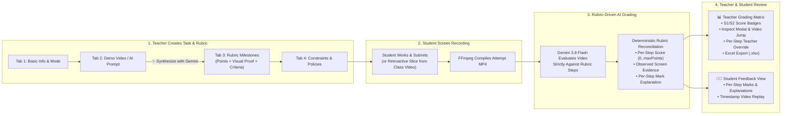

# 📖 Step-by-Step User Guide: Classroom Assistant & Rubric-Driven Practical Task Grading

> **Who is this guide for?**
> This guide is written for **Teachers**, **Teaching Assistants (TAs)**, and **Students** who want a clear, practical, step-by-step walkthrough of how to use the **Google AI Classroom Assistant**—especially how to create, complete, and grade **Practical Tasks & Lab Exams** with **Rubric-Driven Mark Breakdowns and Per-Student Explanations**.

---

## 🧭 Table of Contents

1. [Part 1: 5-Minute Classroom Quick-Start (Daily Workflow)](#part-1-5-minute-classroom-quick-start-daily-workflow)
   - [1.1 For Teachers: Running a Live Class Session](#11-for-teachers-running-a-live-class-session)
   - [1.2 For Students: Joining a Live Class Session](#12-for-students-joining-a-live-class-session)
2. [Part 2: Teacher Guide — Practical Tasks & Rubric-Driven AI Grading](#part-2-teacher-guide--practical-tasks--rubric-driven-ai-grading)
   - [2.1 Which Task Mode Should I Choose?](#21-which-task-mode-should-i-choose)
   - [2.2 Step-by-Step: Creating a Practical Task (4-Tab Wizard)](#22-step-by-step-creating-a-practical-task-4-tab-wizard)
   - [2.3 How Automated Video Compilation & AI Rubric Grading Works](#23-how-automated-video-compilation--ai-rubric-grading-works)
   - [2.4 Step-by-Step: Using the Grading Matrix & Inspecting Rubric Breakdowns](#24-step-by-step-using-the-grading-matrix--inspecting-rubric-breakdowns)
   - [2.5 Overriding Per-Step Rubric Marks & Explanations](#25-overriding-per-step-rubric-marks--explanations)
   - [2.6 Post-Class Retroactive Slicing (Grading a Past Class)](#26-post-class-retroactive-slicing-grading-a-past-class)
   - [2.7 Exporting Grades to Excel & Backing Up Task Videos to Google Drive](#27-exporting-grades-to-excel--backing-up-task-videos-to-google-drive)
3. [Part 3: Student Guide — Completing Tasks & Viewing Your Rubric Breakdown](#part-3-student-guide--completing-tasks--viewing-your-rubric-breakdown)
   - [3.1 Where to Find Your Assigned Tasks](#31-where-to-find-your-assigned-tasks)
   - [3.2 Completing & Submitting a Task Attempt](#32-completing--submitting-a-task-attempt)
   - [3.3 Reading Your Rubric Mark Breakdown & Step Explanations](#33-reading-your-rubric-mark-breakdown--step-explanations)
4. [Part 4: Frequently Asked Questions & Troubleshooting](#part-4-frequently-asked-questions--troubleshooting)

---

## Part 1: 5-Minute Classroom Quick-Start (Daily Workflow)

### 1.1 For Teachers: Running a Live Class Session

1. **Sign In**: Open the web app in **Google Chrome** and sign in with your instructor account (or click **`📱 Scan QR Code`** to sign in using your paired mobile passkey).
2. **Create or Open Your Class**:
   - On the **Class Management** dashboard, click **`+ Create New Class`** (pick a 1-click template: **🏛️ Lecture**, **💻 Lab**, or **🖥️🎧 Lecture in Lab**) or click **`Open Class`** on an existing class card.
3. **Monitor Live Student Screens (`🖥️ Live Monitor` Tab)**:
   - As students join, their live desktop screen (and webcam/audio status) appears in the real-time grid.
   - Use the top quick-filter pills (`🖥️ No Screen`, `📷 No Webcam`, `🎙️ No Mic`) to spot students who haven't shared their screen yet.
   - Click any student card to **Peek** at full resolution, talk via **2-Way Audio Intercom**, or view AI activity insights.
4. **Broadcast Your Screen & Live Subtitles (Optional)**:
   - Click **`🖥️ Broadcast Screen`** to stream your demonstration to all student browsers.
   - Click **`🌐 Live Subtitles`** to provide real-time multilingual captions (English, Traditional Chinese, Simplified Chinese, Japanese, etc.) as you speak.
   - Click **`⏺️ Record Lecture`** to record your demonstration (which can later be used to auto-generate task rubrics or published to YouTube/Drive).
5. **Verify Attendance (`🎯 Bingo` / `📱 QR Attendance`)**:
   - Click **`📱 QR Attendance`** to project a rotating QR code for 1-tap smartphone passkey check-in, or dispatch a **`🎯 Bingo Challenge`** to verify active student presence.
6. **End of Class**:
   - When the scheduled session ends (or when you click **`🎬 Combine Session Videos`**), the backend automatically compiles each student's screenshots into an MP4 time-lapse screencast, freezes the attendance bitmask, and slices any in-class practical task submissions.

---

### 1.2 For Students: Joining a Live Class Session

1. **Open Google Chrome on Your Desktop/Laptop**:
   - Log in with your student email (or scan the desktop login QR code with your paired smartphone).
2. **Complete the 3-Step Readiness Wizard**:
   - **Step 1 (AI Engine & Consent)**: Read the session notice and click **`I Understand & Agree`**.
   - **Step 2 (Entire Screen Share)**: Click **`🖥️ Share Entire Screen`**. In the Chrome popup, select the **`Entire Screen`** tab (do **not** pick a single window or browser tab), select your monitor, and click **Share**.
   - **Step 3 (Webcam / Microphone, if required by your class)**: Select your camera and microphone and click **`🚀 Enter Classroom`**.
3. **During Class**:
   - Keep the classroom tab open in the background while you work in VS Code, terminal, browser, or lab tools.
   - Watch the live banner at the top of your screen for **Teacher Broadcasts**, **Multilingual Live Subtitles**, **Bingo Attendance Checks**, and **Practical Tasks**.

---

## Part 2: Teacher Guide — Practical Tasks & Rubric-Driven AI Grading

The **Practical Tasks & Homework** system (`📋 Tasks & Homework` tab inside your Class View) lets you assign hands-on coding or lab exercises, record what students actually do on their screens, and have **Gemini 3.8 Flash** grade every student step-by-step against your rubric—giving each student a **mark breakdown** and **clear explanation** for every rubric milestone.

---

### 2.1 Which Task Mode Should I Choose?

When creating a task, you can choose from **4 Schedule Modes** depending on how your class is run:

| Mode | Best Used When... | How Student Video is Captured & Compiled |
| :--- | :--- | :--- |
| **`🏠 Homework (24/7 Self-Paced)`** | Students complete the lab at home or after class at their own pace before a deadline. | Students open **`📋 My Records` $\to$ `⚡ Tasks & AI Progress`**, click **`🚀 Start Task`**, share their screen, and click **`✅ Finish & Submit`**. Their video compiles **immediately** on submit and triggers AI grading right away. |
| **`🏫 In-Class Task`** | Students complete the exercise live during a scheduled class session while already sharing their screen. | Students click **`🚀 Start Task`** on the live class banner and **`✅ Finish & Submit`** when done. Zero extra upload bandwidth is used during class—when the class video compiles at the end of the lesson, the system automatically slices the exact `[startedAt, finishedAt]` clip and grades it. |
| **`🔄 Flexible (In-Class + Homework)`** | Students start during class and can retry or finish at home before the deadline. | Compiles immediately when submitted outside class, or slices from the class video if submitted during an active class without separate task screenshots. |
| **`⏪ Post-Class (Retroactive Slicing)`** | **You didn't create a task before class** (or students forgot to click Start/Submit), and you want to grade what everyone did between e.g. Minute 20 and Minute 50 of a past class! | Slices the specified time window (`Relative Lesson Offset` or `Clock Time Window`) directly from every student's completed class recording and queues AI rubric grading for the entire class in one click. |

---

### 2.2 Step-by-Step: Creating a Practical Task (4-Tab Wizard)

Open your class, click the **`📋 Tasks & Homework`** tab in the top navigation bar, and click **`+ Create Practical Task`**.

#### Step 1: `1. Basic Info` Tab
1. **Task Title**: Enter a clear title (e.g., *Lab 4: Dockerizing a Node.js API*).
2. **Task Instructions & Overview**: Write what students need to accomplish.
3. **Max Total Score**: Set the total mark (default `100`).
4. **Schedule Mode**: Pick `🏠 Homework`, `🏫 In-Class Task`, `🔄 Flexible`, or `⏪ Post-Class (Retroactive)`.
   - *If you choose `🏫 In-Class` or `🔄 Flexible`*: Optionally link it to a scheduled lesson slot.
   - *If you choose `⏪ Post-Class (Retroactive)`*: Select the **Class Session Date**, choose **Relative Lesson Offset** (e.g., Start Minute `15`, Duration `30` mins) or **Clock Time Window**, and keep **`⚡ Automatically extract clips & run AI grading immediately upon saving`** checked if you want instant extraction.
5. Click **`Next Step →`** at the bottom right.

#### Step 2: `2. Demo Video & AI` Tab (Synthesizing Your Rubric)
You don't have to type rubric steps by hand! You can give Gemini a **Reference Demonstration Video**, an **AI Prompt**, or **both**:
1. **Option A — Provide a Reference Demo Video (Optional)**:
   - **Select from Class Recordings**: Pick one of your recorded lecture demos from the dropdown, **OR**
   - **Upload Demo Video File**: Click **`📤 Upload Video`** to upload an `.mp4`, `.mov`, or `.webm` walkthrough, **OR**
   - **Public YouTube Link**: Paste a YouTube tutorial URL (`https://www.youtube.com/watch?v=...`).
2. **Option B — Select or Write AI Rubric Prompt Guidelines**:
   - **Select Rubric Prompt from AI Prompts Library**: Choose a curated rubric template (or leave on *Manual / Custom Guidelines Only*).
   - **Additional Task-Specific Instructions / Guidelines**: Describe how marks should be broken down (e.g., *"Break into 4 milestones worth 25 marks each. Require terminal verification of `docker ps` and `curl localhost:3000`."*).
3. Click **`✨ Synthesize Rubric Milestones with Gemini`**:
   - Gemini 3.8 Flash analyzes your demo video and/or prompt instructions and automatically generates structured rubric milestones with point weights, expected visual proof, and partial-credit marking criteria.
   - Once the green success banner appears, click **`📋 View & Edit Extracted Milestones (Tab 3) →`**.

#### Step 3: `3. Rubric Milestones` Tab (Fine-Tuning Mark Breakdown & Criteria)
This tab defines the **exact rubric** that Gemini (and teachers) will use to award marks and write explanations for each student:
1. Review each milestone card:
   - **Milestone Title**: Name of the step (e.g., *Step 1: Create Dockerfile*).
   - **Points**: Maximum marks allocated to this step (e.g., `30`).
   - **Action Description**: What the student is expected to do.
   - **🔍 Expected Visual Proof for AI**: What Gemini should look for on the student's screen (e.g., *Terminal displaying `Server listening on port 5000`*).
   - **⚖️ Marking / Partial Credit Criteria**: Specific rules for full vs. partial marks (e.g., *Full 30 marks if container builds and runs; 15 marks if Dockerfile is written but port mapping fails*).
2. **Auto-Balance Points**:
   - Look at the top bar: `Total Rubric Points: X / 100`.
   - If your step points do not add up to your `Max Score`, click **`⚖️ Auto-Balance to 100 pts`** to proportionally distribute the points so they sum to the exact total score!
3. You can also click **`+ Add Milestone`** to add extra steps or **`🗑️`** to remove a step.
4. Click **`Next Step →`**.

#### Step 4: `4. Constraints & Policies` Tab
1. **Timing & Duration**:
   - **Time Limit (Minutes)**: How long the student timer runs once they start (e.g., `45` mins).
   - **Auto-submit attempt when timer expires**: Automatically saves and submits the student's work when time runs out.
   - **Submission Deadline**: Optional cutoff date/time and **Late Submission Policy** (`Allow with Late Flag` vs. `Strictly Close`).
2. **Attempts & Scoring**:
   - **Max Attempts Allowed**: `1 Attempt (Exam Style)`, `2`, `3`, `5`, or `Unlimited`.
   - **Scoring Strategy**: `Keep Highest Score`, `Keep Latest Attempt`, or `Average All Attempts`.
   - **Retry Cooldown**: Optional wait time between attempts.
3. **Proctoring & Feedback Release**:
   - **Required Media Channels**: `Screen Share Only` or `Screen Share + Webcam`.
   - **Feedback Release Policy**:
     - `Immediate (As soon as Gemini finishes grading)` — Best for self-paced homework and formative labs.
     - `After Task Deadline Passes` — Best when you want all students to finish before seeing rubric solutions.
     - `Manual Release by Teacher Only` — Keeps grades hidden until you review/override them in the Grading Matrix.
4. Click **`🚀 Publish Task`** (or **`💾 Update Task`**).

---

### 2.3 How Automated Video Compilation & AI Rubric Grading Works

Once a student submits (or once clips are sliced):
1. **Video Compilation**: The student's screen frames for that attempt are compiled into an `.mp4` time-lapse video stored in Cloud Storage.
2. **Rubric-Driven Gemini Evaluation (`evaluateTaskSubmission`)**:
   - Gemini 3.8 Flash watches the student's `.mp4` recording chronologically alongside your **Required Rubric Milestones**, **Expected Visual Proof**, **Marking Criteria**, and **Custom Prompt Guidelines**.
   - For **every single step** in your rubric, Gemini outputs:
     - **`scoreAwarded` / `maxPoints`** (strictly clamped to the step's allocated points)
     - **`status`** (`completed`, `partial`, `error`, or `missing`)
     - **`timestampInVideo`** (`MM:SS` where the student performed the step)
     - **`evidenceObserved`** (what was actually seen on the student's screen, e.g. terminal output or code)
     - **`feedback`** (a clear, student-specific explanation of why marks were awarded or deducted)
3. **Deterministic Reconciliation**:
   - Even if the AI model omits a step or miscalculates a sum, the backend deterministically reconciles every rubric step, clamps step scores to `[0, maxPoints]`, marks any unattempted step as `0 / maxPoints (missing)` with an explicit explanation, and calculates `finalScore` as the exact sum of step scores.

---

### 2.4 Step-by-Step: Using the Grading Matrix & Inspecting Rubric Breakdowns

1. Go to **`📋 Tasks & Homework`** and click **`📊 Grading Matrix`** on any task card.
2. **Understand the Grading Matrix Table**:
   - **Status Column**:
     - `⏳ In Progress`: Student is currently working on the task.
     - `⚙️ Awaiting Class Video...` / `Compiling Video...`: Waiting for the MP4 clip to finish compiling.
     - `🎬 Ready to Grade`: Video is compiled and ready for AI grading (click **`🤖 Grade`** on the row, or **`🤖 Grade All Pending`** at the top).
     - `🤖 Evaluating...`: Gemini is actively grading the video.
     - `✅ Evaluated`: Graded!
   - **Rubric Breakdown & Explanation Column**:
     - Shows the step completion bar (e.g. `2/2`) **plus individual step mark pills** (`S1: 30/30`, `S2: 62/70`) color-coded green (full marks), amber (partial), or red (0/missing).
     - Hover your mouse over any `S1`, `S2` badge to read the step title, score, and explanation right in the table!
3. **Inspecting a Student's Detailed Rubric Breakdown (`Inspect 🔍`)**:
   - Click **`Inspect 🔍`** in the **Actions** column for any evaluated student.
   - Inside the **Submission Detail Modal**, you will see:
     - **AI Assessment Summary**: High-level summary of the student's performance.
     - **✨ Observed Strengths & ⚠️ Deviations / Errors**: Specific technical strengths and any errors or anomalies spotted in the recording.
     - **Rubric Milestones Evaluation**: Every rubric step listed in order with:
       - **`{scoreAwarded} / {maxPoints} pts`** (e.g., `62 / 70 pts`)
       - **Clickable Timestamp (`⏱️ 02:15`)**: Click the timestamp badge to open the student's attempt video and **jump directly to that exact second** in the video!
       - **Rubric Requirement / Expected Proof / Marking Criteria**
       - **Observed Evidence**: What Gemini saw on the student's screen.
       - **Explanation**: Detailed explanation of why those marks were awarded or deducted.

---

### 2.5 Overriding Per-Step Rubric Marks & Explanations

Teachers have **two ways** to adjust grades and explanations (and saving an override automatically releases feedback to that student):

1. **Detailed Per-Step Rubric Override (Recommended — inside `Inspect 🔍` Modal)**:
   - Open **`Inspect 🔍`** for a student and click **`✏️ Edit Rubric Marks & Explanations`**.
   - Adjust the **Step Marks** (`0` to `maxPoints`) and **Step Explanation / Feedback Override** for any individual rubric step.
   - Add an optional **Overall Instructor Comment / Summary Rationale**.
   - Click **`💾 Save Rubric Breakdown & Score`**.
   - The system automatically sums your updated step marks into the student's final score and updates both the teacher matrix and the student's feedback view!
2. **Quick Inline Total Score Override (in the Matrix Table)**:
   - Hover over a student's score in the **Score** column and click the **`✎`** icon.
   - Enter a new total score and optional **Teacher comment / rationale**, then click **`✓`**.

---

### 2.6 Post-Class Retroactive Slicing (Grading a Past Class)

Did you conduct a live lab demonstration in class today without creating a task beforehand? You can still grade every student's work automatically:
1. Create a task (or open an existing task's **`📊 Grading Matrix`**) and click **`✂️ Retroactive Slicing`** in the top toolbar (or click **`✂️ Slice`** on an individual student row).
2. Pick the **Class Session Date**.
3. Choose how to slice the class recordings:
   - **Relative Lesson Offset (Minutes)**: e.g., Start at Minute `20` into class, Duration `30` minutes.
   - **Clock Time Window**: e.g., `2026-10-20 14:20` to `2026-10-20 14:50`.
4. Click **`✂️ Start Slicing & AI Grading`**.
5. The backend slices that exact time window from each student's class video using fast FFmpeg stream-copy and automatically queues Gemini rubric grading for all present students!

---

### 2.7 Exporting Grades to Excel & Backing Up Task Videos to Google Drive

- **Export Gradebook to Excel (`.xlsx`)**:
  - In the **`📊 Grading Matrix`**, click **`📥 Export to Excel (.xlsx)`**.
  - Downloads `Task_{Title}_Grading_Results.xlsx` containing:
    - Student Display Name, Email, Class/Cohort, Programme
    - Submission Status, Attempts, Duration (mins)
    - Effective Score, Max Score, Teacher Override Score, Teacher Remarks, **AI Assessment Summary**, Google Drive Link
    - **For every Rubric Step**: `Step X: {Title}` (`score / maxPoints pts (status)`) **and** `Step X Explanation` (the full per-step explanation!).
- **Backup Student Task Videos to Google Drive**:
  - Click **`☁️ Backup Task Videos (N)`** in the top bar (or **`☁️ Backup`** on a single row) to archive student attempt MP4s into your organized Google Drive hierarchy (`Classroom Archives / {Class} / Tasks / {Task Title}`).

---

## Part 3: Student Guide — Completing Tasks & Viewing Your Rubric Breakdown

### 3.1 Where to Find Your Assigned Tasks

You can start or review your practical tasks from **two places**:

1. **During a Live Class (`StudentView`)**:
   - Look at the **`📋 Practical Tasks & Challenges`** section (or top alert banner) on your classroom dashboard.
   - Each card shows the task mode (`🏫 In-Class`, `🏠 Homework`, `🔄 Flexible`), time limit, number of attempts used, and your current status (`Not Started`, `⏳ In Progress`, `⚙️ Compiling Video...`, `🤖 AI Grading...`, or `✅ Graded: X/100`).
2. **Anytime 24/7 via Student Self-Service Portal (`📋 My Records`)**:
   - Click **`📋 My Records`** in the top-right header (or visit `/student/records`).
   - Select your class from the dropdown and click the **`📋 Tasks & Lab Progress`** tab.
   - You can start **`🏠 Homework`** and **`🔄 Flexible`** tasks here 24/7, even when no live class session is running!

---

### 3.2 Completing & Submitting a Task Attempt

1. Click **`🚀 Start Task`** (or **`▶️ Resume Task`** / **`🔄 Retry Task`**) on the task card.
2. **Pre-Flight Check**:
   - Review the **Task Instructions**, **Time Limit**, **Attempt Counter**, and **Rubric Milestones** (including the points allocated to each step).
   - Click **`🚀 Start Task Challenge (Share Screen)`**.
   - *Note*: If you are already sharing your screen in a live class, your existing screen stream is linked automatically without asking you to pick your screen again! If you are working on homework from `My Records`, select **`Entire Screen`** in the Chrome prompt.
3. **Working in the Active Task Workspace**:
   - A live **Countdown Timer** runs at the top of the modal (turning amber at `< 5 mins` and pulsing red at `< 1 min`).
   - Keep the workspace open (you can minimize or switch to VS Code, terminal, browser, etc. while working).
   - Follow the **Rubric Milestones Checklist** on the left so you know exactly what visual proof Gemini will look for on your screen.
4. **Submitting Your Attempt**:
   - When you finish all steps, return to the workspace modal and click **`✅ Finish & Submit`**.
   - **What happens next?**
     - **For Homework / Flexible Tasks (Outside Live Class)**: Your recorded screen frames are immediately compiled into an MP4 video (`⚙️ Compiling Video...`) and graded by Gemini (`🤖 AI Grading...`) within ~1–2 minutes.
     - **For In-Class Tasks (During Live Class)**: Your start and finish timestamps are saved (`⏳ Submitted (Awaiting Class Video)`). As soon as the class session video finishes compiling at the end of the lesson, your task clip is automatically sliced and graded by Gemini!

---

### 3.3 Reading Your Rubric Mark Breakdown & Step Explanations

Once your task status shows **`✅ Graded`** (and feedback is released according to your teacher's policy):

1. Click **`📊 View Feedback`** (in Live Class view) or **`⭐ View Score & Feedback`** (in `My Records` $\to$ `Tasks & Lab Progress`).
2. Your **Rubric Feedback Report** displays:
   - **Your Grade Pill**: Your total score out of `Max Score` and percentage (e.g., `92 / 100 (92%)`).
   - **✨ AI Assessment Verdict**: Overall summary of your submission.
   - **👨‍🏫 Instructor Note**: Any custom comments or score adjustments from your teacher.
   - **🎬 Attempt Video Player**: Watch your own compiled submission video right in the browser.
   - **🎯 Rubric Mark Breakdown & Step Explanations**:
     - Every rubric milestone is listed with its exact mark breakdown: **`{scoreAwarded} / {maxPoints} pts`** (e.g. `30 / 30 pts` or `18 / 30 pts`) and status badge (`completed`, `partial`, `missing`).
     - **Rubric Criterion / Expected Proof / Marking Criteria**: Reminds you what the step required.
     - **Observed on Screen**: What Gemini observed on your screen (e.g., terminal output, code written, or what was missing).
     - **Mark Explanation**: A clear explanation of why you received full, partial, or zero marks for that step.
     - **`⏱️ Jump to MM:SS` Button**: Click the timestamp button on any step to seek your video player directly to the moment you worked on that milestone!
   - **🌟 Strengths Demonstrated & 💡 Constructive Feedback**: Bullet points highlighting what you did well and how to improve.

---

## Part 4: Frequently Asked Questions & Troubleshooting

### Q1: Why is the "Synthesize Rubric Milestones with Gemini" button disabled in Tab 2?
**A:** Make sure you have **either** selected/uploaded a reference demo video (or YouTube link) **or** selected a rubric prompt / typed custom guidelines in Tab 2. Any one of these enables the **`✨ Synthesize Rubric Milestones with Gemini`** button.

### Q2: My rubric step points add up to 85 instead of 100. Will that break grading?
**A:** In Tab 3 (`3. Rubric Milestones`), you will see a warning `(⚠️ Suggested points do not sum to 100)` next to a **`⚖️ Auto-Balance to 100 pts`** button. Click **`⚖️ Auto-Balance to 100 pts`** and the editor will automatically scale your step points so they sum to the exact `Max Score`.

### Q3: Why does an In-Class task submission say `Awaiting Class Video...` instead of grading immediately?
**A:** During a live class, students are already streaming screenshots for the main class recording. To avoid doubling network bandwidth in the computer lab, **In-Class** tasks record the student's `[startedAt, finishedAt]` timestamps and slice the clip from the main class video when the lesson ends (or when the teacher clicks **`🎬 Combine Session Videos`**). If you want students' videos to compile and grade the instant they click Submit, set the task's Schedule Mode to **`🏠 Homework`** or **`🔄 Flexible`**.

### Q4: A student's evaluation failed or got stuck. How do I re-run it?
**A:** Open **`📊 Grading Matrix`** for the task:
- If the student's status is `🎬 Ready to Grade`, click **`🤖 Grade`** on their row (or **`🤖 Grade All Pending`** at the top).
- If the student was already evaluated and you updated the rubric steps, click the **`🔄`** (Re-grade) icon next to **`Inspect 🔍`** on their row.
- If the student's video clip is missing, click **`✂️ Slice`** on their row to slice their attempt from their class recording.

### Q5: Why does a student see "🔒 Feedback Pending Release"?
**A:** In Tab 4 (`4. Constraints & Policies`), the task's **Feedback Release Policy** is set to either `After Task Deadline Passes` or `Manual Release by Teacher Only`. Once the deadline passes—or as soon as the teacher saves a score/feedback override for that student in the Grading Matrix—the full rubric mark breakdown unlocks automatically.

---

[← Back to Main README](../README.md#documentation-index)
