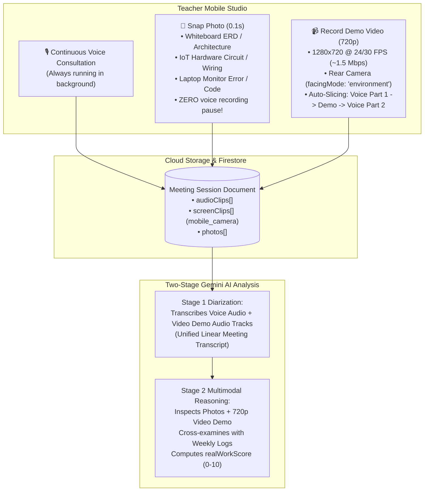
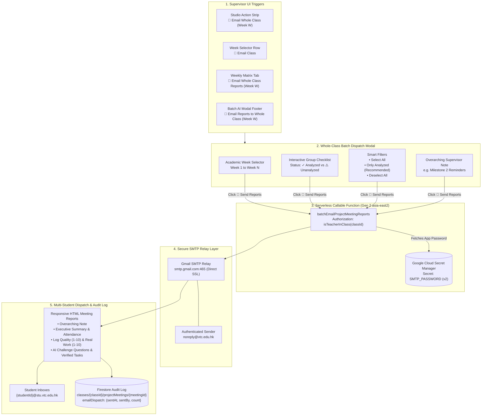

# 📖 Step-by-Step User Guide: Project Group Meetings, Weekly Log Auditing & Individual Student Contribution Profiles

> **Who is this guide for?**  
> This guide provides a complete, step-by-step operational manual for **Main Supervisors**, **Co-Supervisors**, and **Students** on how to run weekly project consultations, ingest and audit **Public Weekly Log Google Sheets**, challenge **vague or AI-generated fake logs**, record **20+ minute live meetings** (Teacher Mobile Voice, 720p Video Demo & Photos), and grade **Individual Student Contribution Profiles**.

---

## 🧭 Table of Contents

1. [End-to-End Weekly Supervision Workflow](#1-end-to-end-weekly-supervision-workflow)
2. [Part 1: One-Time Class Setup (Schedule, Google Sheet & Groups)](#part-1-one-time-class-setup-schedule-google-sheet--groups)
   - [1.1 Set Your Class Schedule (Defines Week 1 Monday → Week N)](#11-set-your-class-schedule-defines-week-1-monday--week-n)
   - [1.2 Connect Your Class's Public Weekly Log Google Sheet](#12-connect-your-classs-public-weekly-log-google-sheet)
   - [1.3 Bootstrap Project Groups & `@stu.vtc.edu.hk` Student Roster](#13-bootstrap-project-groups--stuvtceduhk-student-roster)
3. [Part 2: Before-Class Preparation (On-Demand Sync & AI Challenge Questions)](#part-2-before-class-preparation-on-demand-sync--ai-challenge-questions)
   - [2.1 Run On-Demand Incremental Log Sync Before Class](#21-run-on-demand-incremental-log-sync-before-class)
   - [2.2 Inspect Individual Student Contribution Profiles & Log Quality Grades](#22-inspect-individual-student-contribution-profiles--log-quality-grades)
   - [2.3 Generate Pre-Meeting AI Challenge Questions](#23-generate-pre-meeting-ai-challenge-questions)
4. [Part 3: During the Meeting — Live Recording Studio (Teacher Mobile Voice, 720p Video Demo & Photos)](#part-3-during-the-meeting--live-recording-studio-teacher-mobile-voice-720p-video-demo--photos)
   - [3.1 For Supervisors (Mobile Phone or Tablet)](#31-for-supervisors-mobile-phone-or-tablet)
   - [3.2 Mobile Demo Video (720p) & Photo Artifact Capture on Teacher's Phone](#32-mobile-demo-video-720p--photo-artifact-capture-on-teachers-phone)
   - [3.3 Simplified Student Workflow (No PC Screen Capture Needed)](#33-simplified-student-workflow-no-pc-screen-capture-needed)
   - [3.4 For Co-Supervisors (Multiple Meetings in the Same Week)](#34-for-co-supervisors-multiple-meetings-in-the-same-week)
5. [Part 4: After the Meeting — 2-Stage AI Analysis, Weekly Feedback & Excel Exports](#part-4-after-the-meeting--2-stage-ai-analysis-weekly-feedback--excel-exports)
   - [4.1 Run 2-Stage Gemini Analysis (Diarization + Real Work Verification)](#41-run-2-stage-gemini-analysis-diarization--real-work-verification)
   - [4.2 Review & Edit Weekly Feedback, Log Quality Score & Real Work Score](#42-review--edit-weekly-feedback-log-quality-score--real-work-score)
   - [4.3 Export Student Contribution Profiles & Semester Matrix (`.xlsx`)](#43-export-student-contribution-profiles--semester-matrix-xlsx)
   - [4.4 Email Supervision Reports to Students & Multi-Touchpoint Dispatch](#44-email-supervision-reports-to-students--multi-touchpoint-dispatch)
   - [4.5 1-Click Whole-Class Weekly Report Dispatch (All Project Groups)](#45-1-click-whole-class-weekly-report-dispatch-all-project-groups-of-the-week)
   - [4.6 Moving Audio Clips Between Groups & Automatic Analysis Invalidation](#46-moving-audio-clips-between-groups--automatic-analysis-invalidation)
   - [4.7 FinOps Storage Quota & AI Cost Transparency](#47-finops-storage-quota--ai-cost-transparency)
6. [Part 5: Student Portal — "👥 Project Meetings" Tab (`/student/records`)](#part-5-student-portal--project-meetings-tab-studentrecords)
   - [5.1 Accessing Project Group Meeting Records](#51-accessing-project-group-meeting-records)
   - [5.2 Attendance Tracking & "🕒 Late" Status](#52-attendance-tracking--late-status)
   - [5.3 Individual Evaluation Dossier, Scores & Feedback Quotes](#53-individual-evaluation-dossier-scores--feedback-quotes)
   - [5.4 Multi-Stream Audio & Video Demonstration Playback](#54-multi-stream-audio--video-demonstration-playback)
   - [5.5 Google Form Weekly Logs Subview](#55-google-form-weekly-logs-subview)
7. [Part 6: Frequently Asked Questions (Holidays, ID Typos, 20-Min Meetings & Security)](#part-6-frequently-asked-questions-holidays-id-typos-20-min-meetings--security)

---

## 1. End-to-End Weekly Supervision Workflow

```mermaid
flowchart LR
    subgraph Before ["1. Before Class (On-Demand)"]
        A["Students Submit Google Form\n(Weekly Log Sheet)"] --> B["Teacher Clicks\n🔄 Sync & Ingest New Logs"]
        B --> C["Smart Incremental Sync\n• Maps {id}@stu.vtc.edu.hk\n• Heals 1-Digit ID Typos\n• Audits Genuine vs Vague vs AI Fake"]
        C --> D["Click 🤖 AI Prepare Log Questions\n(2–3 Challenge Questions / Student)"]
    end

    subgraph During ["2. During Meeting (Single-Device Teacher Mobile Studio)"]
        D --> E["Supervisor Starts Voice Recording\non Mobile Phone (Wake Lock ON + 🗣️ Voice Anchors)"]
        E --> F["Supervisor Snaps 📸 0.1s Photos &\nRecords 📹 720p Mobile Demo Videos\n(Auto-Slices Voice Part 1 -> Demo -> Part 2)"]
        F --> G["Discuss Log, Demo Real Work &\nAsk AI Challenge Questions (Zero Student PC Setup)"]
    end

    subgraph After ["3. After Meeting (2-Stage AI Grading & Dispatch)"]
        G --> H["Click 🤖 Run 2-Stage AI Analysis\n• Stage 1: Gemini 3.5 Transcribe (Cumulative Offset Shift)\n• Stage 2: Gemini 4 Argon / 3.8 Flash (Native gs:// Media)"]
        H --> I["Verify Attendance, Log Score (1–10),\nReal Work Score (1–10) & Weekly Feedback"]
        I --> J["📧 1-Click Whole-Class SMTP Dispatch\n& 📥 Export Student Profiles (.xlsx)"]
    end
```



---

## Part 1: One-Time Class Setup (Schedule, Google Sheet & Groups)

### 1.1 Set Your Class Schedule (Defines `Week 1` Monday → `Week N`)
The system calculates academic week numbers (`Week 1`, `Week 2`, ..., `Week 16`) directly from your **Class Schedule**:
1. Open your class and go to **`⚙️ Settings`** ([`ClassManagement.jsx`](file:///home/developer/Documents/Gemini-AI-Classroom-Assistant/web-app/src/components/ClassManagement.jsx)).
2. Set your semester **Start Date** (`schedule.startDate`, e.g., `2026-09-01`).
3. The system automatically snaps your class `startDate` to the **Monday (`00:00`)** of that calendar week as **Week 1** ([`resolveSemesterStartMondayFromClass`](file:///home/developer/Documents/Gemini-AI-Classroom-Assistant/web-app/src/utils/projectGroupUtils.js#L896-L928)):
   - Any Google Form weekly log submitted between **Week 1 Monday `00:00`** and **Week 1 Sunday `23:59`** is mapped to **Week 1**.
   - Every dropdown and student timeline card displays exact calendar dates (e.g., `Week 1 (Aug 31 – Sep 6)`, `Week 8 (Oct 19 – Oct 25)`).

### 1.2 Connect Your Class's Public Weekly Log Google Sheet
Each class stores its own Google Sheet link in Firestore (`classes/{classId}.projectLogSheetUrl`)—nothing is hardcoded globally.
1. Make sure your Google Form responses spreadsheet (`Form Responses 2` tab) is shared as **"Anyone with the link can view"**.
   - Expected columns: `Timestamp`, `Group ID`, `Student Name`, `Student ID`, `Supervisor`, `I am doing something this week` (`Yes`/`No`), `Work done & findings since last recording`, `State which part of the last plan not yet finished`, `Plan of work before the next recording`, `Description` (for `"No"` weeks).
2. Open your class and navigate to **`🎬 Recordings & Sessions` $\to$ `👥 Project Group Meetings`** (`/class/:classId?tab=meetings`).
3. In the top **📋 Weekly Log Google Sheet** bar, paste your Google Sheet URL (including `#gid=...` for the specific sheet tab).
4. Click **`🔄 Sync & Ingest New Logs`**:
   - The system converts the URL to a direct CSV export link, saves `projectLogSheetUrl` to your class document, and performs an **Initial Full Historical Backfill** of all rows (`Week 1` → `Current`) into `classes/{classId}/projectStudentProfiles/{email}`—**even if you have 0 recorded weekly meetings**.

### 1.3 Bootstrap Project Groups & `@stu.vtc.edu.hk` Student Roster
Right after your first sync:
1. Click the **`👥 Sync N Groups from Sheet`** button in the Weekly Log bar.
2. This automatically creates/updates your class's **Project Groups** (`A01`, `A02`, `A11`, etc.), assigns supervisors, converts every 8–9 digit VTC Student ID (`990000101`) into a canonical **`{studentId}@stu.vtc.edu.hk`** email (`990000101@stu.vtc.edu.hk`), and merges those student emails and names into your class roster.
3. *(Optional)* You can also click **`👥 Manage / Import Groups`** at the top right to manually edit group topics, roles (`Leader`, `Member`), or import a custom CSV/Excel roster.

---

## Part 2: Before-Class Preparation (On-Demand Sync & AI Challenge Questions)

### 2.1 Run On-Demand Incremental Log Sync Before Class
There is **no background cron job**—you control exactly when logs are pulled:
1. Right before your weekly lab or consultation session, open **`👥 Project Group Meetings`** and click **`🔄 Sync & Ingest New Logs`**.
2. **Smart Incremental Delta Sync**:
   - The system compares the Google Sheet against the profiles already saved in your class (`📥 Saved in Class: N Profiles`).
   - It writes **only** students who submitted new weekly logs since your last sync (`⚡ Incremental Sync: Ingested +X new log(s) across Y student(s)`) and skips unchanged profiles (`0` wasted writes).
   - If you ever want to force a complete rebuild of all student profiles, click **`🔁 Full`**.

### 2.2 Inspect Individual Student Contribution Profiles & Log Quality Grades
Click **`👤 Student Profiles & Log Audit`** in the view switcher (or click any of the summary pills: `🟢 Genuine`, `🔴 Vague/Useless`, `🟠 Suspected AI/Fake`, `⚪ Inactive`):
1. **Left Roster List**:
   - Filter by **Project Group**, **Log Quality Flag**, or search by **Student Name / ID / `@stu.vtc.edu.hk`**.
   - Each card shows the student's **Log Quality Grade (`A` to `F`)**, average log score (`X/10`), active `"Yes"` weeks vs. submitted weeks, and audit flags (`🔴 Vague`, `🟠 Suspected AI`, `✏️ Healed Student ID Typo`).
2. **Right Longitudinal Dossier (`Week 1` → `Current`)**:
   - Shows every active week in reverse chronological order with the **Prior Week's Plan** (`⏪ Prior Week's Plan`) right above **`🛠️ Work Done & Findings`** so you can immediately see whether the student actually followed through on what they promised last week.
   - Automatic **4-Tier Quality Audit**:
     - **`🟢 High-Quality Log (7–10/10)`**: Concrete technical details, specific files/endpoints, and alignment with the prior week's plan.
     - **`🔴 Vague / Useless Log (1–4/10)`**: Lazy 1-word entries like `"done"`, `"thinking"`, `"do website"`, or repeating the exact same phrase every week.
     - **`🟠 Suspected AI / Fake Log (3–5/10)`**: Sudden buzzword-heavy paragraphs after weeks of `"done"`, LLM markdown bullet templates, or claims completely unrelated to last week's plan.
     - **`⚪ Inactive "No" (2/10)`**: Student marked `"No"` work done this week.

### 2.3 Generate Pre-Meeting AI Challenge Questions
1. Switch to **`🎙️ Recording & AI Review`** and select the **📁 Project Group** and **📅 Week #** you are about to meet.
2. In the **📋 Pre-Meeting Weekly Log Briefing** panel (expanded right inside the Recording Studio), review each group member's submitted log for that week.
3. Click **`🤖 AI Prepare Log Questions`**:
   - Gemini 3.8 Flash audits each student's log against their prior week's plan and generates **2–3 pointed technical Challenge Questions** per student.
   - *Example for a Suspected AI/Fake Log*: `"Your log claims you implemented role-based access control and real-time Flask dashboards after writing 'done' for 3 weeks—please open your IDE right now, show the RBAC decorator in your route file, and explain how session tokens are validated."`

---

## Part 3: During the Meeting — Live Recording Studio (Teacher Mobile Voice, 720p Video Demo & Photos)

> [!IMPORTANT]
> **Live Recording Only (No Manual File Uploads)**  
> To prevent students or teachers from uploading unknown, pre-recorded, or fabricated media files, **direct file uploads are disabled** for both teachers and students. All meeting voice recordings, 720p demo videos, and photo artifacts must be captured live during the meeting.

### 3.1 For Supervisors (Mobile Phone or Tablet)
1. Open **`👥 Project Group Meetings`** on your **Mobile Phone** (or desktop/tablet).
   - **20+ Minute Meeting Reliability**: While recording or uploading, the app automatically activates the browser **Screen Wake Lock API** (`navigator.wakeLock`) so your phone screen does not sleep mid-meeting, and enables a `beforeunload` guard to prevent accidental page refreshes.
2. Select:
   - **📁 Project Group**: e.g., `A11`
   - **📅 Week #**: e.g., `Week 8 (Oct 19 – Oct 25)`
   - **👤 Presenting Member (Optional)**: Defaults to `👥 Whole Group / Unassigned`. If a specific student is presenting, selecting them tags them as the active speaker and marks them present without requiring any complex cross-device PC screen setup.
3. Tap **`🔴 Start Meeting Recording`**:
   - The microphone begins recording the room consultation audio.
4. **During the Discussion & Demo**:
   - **1-Tap `"🗣️ Speaking Now"` Voice Anchors**: Whenever a student starts speaking into your shared phone microphone, tap their **`🗣️ [Student Name]`** chip once. This stamps a timestamp anchor (`voiceAnchors[]`) so Gemini knows which voice belongs to which student.
   - **Snap Photos Anytime**: Tap **`📸 Snap Photo`** to capture whiteboard designs, circuit schematics, or screen errors with **zero pause** in voice recording.
   - **Record 720p Video Demos**: Tap **`📹 Record Demo (720p)`** to film live student software or hardware demonstrations. Voice is seamlessly auto-sliced into Part 1 $\to$ Demo $\to$ Part 2!
5. When finished, tap **`⏹️ Stop & Analyze with Gemini`** (or **`💾 Save Part`** if recording multiple segments).
   - If you pause for a break and record another clip for the same group and week, the studio automatically groups all clips into the same meeting session (`🔗 Grouping into A11 — Week 8`).

### 3.2 Mobile Demo Video (720p) & Photo Artifact Capture on Teacher's Phone

Students frequently present deliverables on laptops, mobile phones, or physical IoT breadboards—making student PC screen capture unnecessary and cumbersome.

The supervisor's mobile phone captures all visual evidence directly during the consultation:



1. **Still Photo Artifacts (`📸 Snap Photo`)**:
   - Tap **`📸 Snap Photo`** anytime during the meeting (while voice recording is running or idle).
   - Attribute the photo to a specific member (`👤 Chan Tai Man`) or `👥 Whole Group`, select a category chip (e.g., *Whiteboard / Architecture*, *IoT / Hardware Wiring*), and add an optional caption.
   - The photo is automatically clamped client-side to max `1280px` JPEG at `0.85` quality (~200–350 KB) and uploaded to Cloud Storage.
   - **Continuous Consultation Audio**: Taking a photo runs alongside voice recording with **zero pause or interruption**.
2. **On-Demand Mobile Video Demo (`📹 Record Demo (720p)`)**:
   - Tap **`📹 Record Demo (720p)`** when a student demonstrates software on their screen, IoT hardware, or a mobile app.
   - **Optimized 720p HD Default**: Clamped to `1280x720` at 24/30 FPS and ~1.5 Mbps bitrate. A 2-minute demo is only ~20 MB (fast 5G/Wi-Fi upload, low storage footprint, and battery-friendly).
   - **Auto-Slicing Architecture**: To prevent iOS WebKit/Safari and Android Chrome audio driver lockups, the system automatically slices consultation voice into Part 1, films the demo (capturing synchronized video + speech), and upon saving, **automatically resumes voice recording as Part 2**.
   - **Flip Camera**: Includes a 1-tap `🔄 Flip Camera` button to switch between rear and front cameras.
3. **Backward Compatibility for Legacy Data**:
   - Legacy meeting sessions with voice recordings only (`audioClips` with no `photos` or `screenClips`) or historical student PC screen recordings continue to load, play, and analyze 100% seamlessly.

### 3.3 Simplified Student Workflow (No PC Screen Capture Needed)
1. **Zero Setup for Students**: Students no longer need to log in to the student portal on their laptops, manage screen-sharing permissions, or wait for cross-device triggers during consultations.
2. **Natural Demonstration**: Students simply run their application, show their code, explain their database, or demonstrate their IoT prototype directly in front of the supervisor.
3. **Direct Capture**: The supervisor captures the demonstration via their phone camera (720p video or photo artifacts) in seconds.
4. **Historical Legacy Support**: If a class has historical meetings containing PC screen recordings from earlier in the term, those video clips remain fully accessible in both the Teacher Meeting Inspector and the Student Self-Service Portal.

### 3.4 For Co-Supervisors (Multiple Meetings in the Same Week)
If a group meets with their **Main Supervisor** on Tuesday and a **Co-Supervisor** on Thursday in the same week:
1. The Co-Supervisor simply logs in with their own teacher account, selects the **Group** and **Week #**, and taps **`🔴 Start Meeting Recording`**.
2. Because the system checks `supervisorEmail === currentUserEmail`, the Co-Supervisor's recording **automatically creates a separate meeting entry** (`👨‍🏫 {Co-Supervisor Name}`) for that week—it **never overwrites** the Main Supervisor's meeting.
3. In **Student Contribution Profiles** and the **Weekly Matrix**, both meetings in that week are **automatically aggregated** (combining attendance, verified tasks, and prefixing each supervisor's feedback with `[Supervisor Name]`).

---

## Part 4: After the Meeting — 2-Stage AI Analysis, Weekly Feedback & Excel Exports

### 4.1 Run 2-Stage Gemini Analysis (Diarization + Real Work Verification)
1. Select the completed meeting in the left sidebar, choose your preferred reasoning model (**`gemini-4-argon`** or **`gemini-3.8-flash`**), and click **`🤖 Run 2-Stage AI Analysis`** in the top inspector bar.
2. **How the Zero-FFmpeg 2-Stage Multimodal Pipeline Works**:
   - **Stage 1 (`gemini-3.5-transcribe-preview` with `gemini-3.8-flash` fallback)**: Transcribes each consultation voice clip (`audioClips[]`) and 720p demo video audio track (`screenClips[]`) independently (Cantonese / English / Mandarin code-switching) with acoustic speaker diarization (`[MM:SS] Speaker 1..N`). Instead of running heavy FFmpeg binary concatenation, the backend shifts only the **text transcript timestamps (`[MM:SS]`)** forward by `cumulativeOffsetSec` so all segments form a single chronological timeline (`00:00` $\to$ `20:00+`).
   - **Stage 2 (`gemini-4-argon` / `gemini-3.8-flash`)**: Cross-examines the unified diarized transcript, 1-tap `voiceAnchors[]`, native multi-part Cloud Storage `gs://` URIs for **still photos (`photos[]`, `image/jpeg`)** and **720p mobile camera demo videos (`screenClips[]`, `video/mp4`)**, and each student's submitted **Weekly Log** to output:
     - **Verified Attendance & Speaking Level** (`present` / `late` / `absent`, `high` / `medium` / `low` / `none`, and first-heard timestamp).
     - **Executive Summary, Key Decisions, Blockers & Overall Group Progress** (`on_track`, `at_risk`, `behind`).
     - **Per-Student Evaluation**:
       - **`logQualityScore (1–10)`**: Quality and authenticity of their written weekly log.
       - **`realWorkScore (1–10)`**: Actual technical work verified during the live consultation, 720p mobile camera demo videos, and photo artifacts.
       - **`weeklyFeedback`**: Constructive post-meeting weekly feedback for the student.

### 4.2 Review & Edit Weekly Feedback, Log Quality Score & Real Work Score
In the **🧑‍🎓 Individual Student Contributions, Log Quality & Post-Meeting Weekly Feedback** section of the meeting inspector:
1. **1-Click Attendance Override**: Click **`✅ Present`**, **`🕒 Late`**, or **`❌ Absent`** on any student row to manually verify or override their attendance.
2. **Edit Individual Scores & Weekly Feedback**:
   - Click **`✏️ Edit Work / Feedback`** on any student card to adjust their **Log Quality Score (`1–10`)**, **Real Work Verified (`1–10`)**, completed work items, next-week action items, or **Post-Meeting Weekly Feedback**, then click **`💾 Save`**.
3. **Edit Group Supervisor Feedback**:
   - Click **`✏️ Edit Feedback`** in the **👨‍🏫 Supervisor Feedback & Follow-Up Guidance** box to add or refine group-level guidance.

### 4.3 Export Student Contribution Profiles & Semester Matrix (`.xlsx`)
- **Export Individual Student Contribution Profiles (`.xlsx`)**:
  - In **`👤 Student Profiles & Log Audit`**, click **`📥 Export Student Profiles (.xlsx)`** to download a 2-sheet Excel workbook:
    - **Sheet 1 (`Student Contribution Summary`)**: Student ID, `@stu.vtc.edu.hk` Email, Group, Supervisor, Log Quality Grade, Avg Log Quality Score, Avg Real Work Score, Genuine/Vague/Suspected AI counts, Meeting Attendance %, Verified Tasks count, and Risk Flags.
    - **Sheet 2 (`Weekly Logs & Challenge Audit`)**: Week-by-week log submissions, Prior Week Plan, Work Done, Next Plan, Log Quality Status & Score, Real Work Score, AI Audit Reason, Suggested Challenge Questions, and Post-Meeting Weekly Feedback.
- **Export Group Attendance & Contribution Matrix (`.xlsx`)**:
  - In **`📊 Weekly Matrix & Export`**, click **`📥 Export Full Matrix (.xlsx)`**.
- **Download Markdown Meeting Minutes (`.md`)**:
  - In any meeting dossier, click **`📝 Minutes (.md)`** to download formatted Markdown minutes for that session.

### 4.4 Email Supervision Reports to Students & Multi-Touchpoint Dispatch
Once meeting analysis and feedback are verified, supervisors can dispatch individualized, formatted HTML meeting reports directly to group members with a single click:
1. **Multi-Touchpoint Access**:
   - **Studio Action Strip**: Click **`📧 Email Meeting Report`** right next to the recording button ([`ProjectMeetingsView.jsx`](file:///home/developer/Documents/Gemini-AI-Classroom-Assistant/web-app/src/components/meetings/ProjectMeetingsView.jsx#L2648-L2675)).
   - **Meeting Inspector Header**: Click **`📧 Email Report`** at the top of the dossier.
   - **Section 2 Supervisor Feedback Box**: Click **`📧 Email Report to Students`** directly inside the feedback card.
   - **Inspector Bottom Dispatch Bar**: Click **`📧 Email Report to Group Members`** at the bottom of the inspector dossier.
   - **Weekly Matrix Column Header**: Click **`📧 Email Report`** directly under any `Week W` column header.
2. **Review Recipients & Add Guidance**:
   - All enrolled group members are displayed with checkboxes (defaulted to checked).
   - Supervisors can toggle specific teammates or leave all selected.
3. **Automated Serverless Dispatch via Secure SMTP Relay**:
   - Click **`🚀 Send Email Report (SMTP)`**.
   - Invokes Cloud Function [`emailProjectMeetingReport`](file:///home/developer/Documents/Gemini-AI-Classroom-Assistant/functions/ai_flows/projectMeetingFlows.js), which retrieves the App Password securely from **Google Cloud Secret Manager** (`SMTP_PASSWORD`) and connects to `smtp.gmail.com:465` (SSL) using sender `noreply@vtc.edu.hk`.
   - Each student receives a cleanly formatted, responsive HTML email containing:
     - Meeting metadata: Group ID, Week #, Title, Date, and Host Supervisor.
     - Executive Summary & Key Decisions.
     - Student attendance and speaking participation status.
     - Individualized student breakdown: Log Quality Score (`/10`), Real Work Verified Score (`/10`), Verified Tasks, AI Challenge Questions, and Post-Meeting Weekly Feedback.
     - Action Items for Next Week and highlighted Supervisor Follow-up Notes.
   - The dispatch status and timestamp are automatically persisted to Firestore under `projectMeetings/{meetingId}.emailDispatch` and displayed in the meeting dossier.
4. **1-Click Local Mail Client Fallback (Outlook / Mailto)**:
   - Click **`📨 Open in Mail Client (Outlook / Mailto)`** to launch your local desktop client with all student emails pre-filled, pre-populated subject line, and Markdown meeting minutes.
   - Click **`📋 Copy Text`** to quickly copy the Markdown minutes to the clipboard.

### 4.5 1-Click Whole-Class Weekly Report Dispatch (All Project Groups of the Week)
Instead of emailing reports group-by-group, supervisors can dispatch consultation reports to the **entire class** for a selected academic week in one operation:



1. **Trigger Points**:
   - **Recording Studio**: Click **`📧 Email Whole Class (Week W)`** in the Studio actions bar or **`📧 Email Class`** in the Week # selector row.
   - **Weekly Matrix Tab**: Click **`📧 Email Whole Class Reports (Week W)`** in the Matrix header.
   - **Batch AI Modal Footer**: Click **`📧 Email Reports to Whole Class (Week W)`** immediately after running batch Gemini analysis.
2. **Whole-Class Batch Dispatch Modal Features**:
   - **Week Selector**: Easily switch between academic weeks (`Week 1` $\to$ `Week N`).
   - **Interactive Group Checklist**: Displays all sessions recorded for that week with member counts, topic, AI analyzed status (`✓ Analyzed` vs `⚠️ Unanalyzed`), and prior dispatch timestamps.
   - **Smart Filters**: Click **`Select All`**, **`Only Analyzed`** (recommended to dispatch only finalized reports), or **`Deselect All`**.
   - **Overarching Supervisor Note**: An optional textarea to write a common announcement or reminder for Week $W$ (e.g. *"Reminder: Milestone 2 presentation slides are due next Tuesday by 23:59"*), which is highlighted in green at the top of every dispatched student email.
   - **Real-Time Progress & Fault Tolerance**: Displays a live progress bar (`Sending Reports [3 of 8]... Group A03`) and logs each group's delivery outcome. If one student email fails or bounces, subsequent groups continue dispatching seamlessly.
   - **Whole-Class Fallback Utilities**:
     - **`📋 Copy All Student Emails (Week W)`**: Copies all unique student emails across selected groups to clipboard.
     - **`📨 Open Whole-Class Draft (Mail Client)`**: Launches desktop mail client with all students pre-populated.
   - **Backend Callable Support**: Supported by both client-orchestrated progress and serverless [`batchEmailProjectMeetingReports`](file:///home/developer/Documents/Gemini-AI-Classroom-Assistant/functions/ai_flows/projectMeetingFlows.js).

### 4.6 Moving Audio Clips Between Groups & Automatic Analysis Invalidation
If an audio consultation clip was accidentally recorded under the wrong project group (e.g. recorded under Group A01 instead of Group A04), supervisors can easily transfer it:

```mermaid
flowchart TD
    subgraph Transfer ["1. Audio Clip Transfer"]
        SRC["Source Meeting\ne.g. Group A01 (Week 10)"]
        BTN["Supervisor Clicks ➡️ Move Clip\nSelects Group A04 & Week 10"]
        DEST["Destination Meeting\ne.g. Group A04 (Week 10)"]
        SRC --> BTN --> DEST
    end

    subgraph Invalidation ["2. Atomic Stale Analysis Invalidation (Firestore Batch)"]
        WIPE["Delete Stale Fields via deleteField():\n• analyzedAt, aiModelUsed, aiCost\n• rawDiarizedTranscript, transcriptSegments\n• keyInsights, studentContributions, summary"]
        READY["Reset Document State:\n• status: 'ready'\n• needsReanalysis: true"]
        DEST --> WIPE --> READY
    end

    subgraph Queue ["3. Smart Batch AI Detection (isMeetingPendingAnalysis)"]
        BATCH["Supervisor Runs Batch AI Analysis\nMode 1: 'Run Missing Only'"]
        CHECK{"Meeting State Check:\n1. Unanalyzed with clips? OR\n2. needsReanalysis == true? OR\n3. Stale 'No intelligible speech' with clips?"}
        ENQUEUE["Target Meeting Enqueued\n(Never Skipped)"]
        READY --> BATCH --> CHECK
        CHECK -->|Yes| ENQUEUE
    end

    subgraph Pipeline ["4. Resilient 2-Stage Backend Diarization & Reasoning"]
        SAN["Input Sanitization:\nStorage download URL -> Authenticated gs:// URI"]
        ST1["Stage 1: Speech-to-Text & Diarization\ngemini-3.5-transcribe-preview"]
        FALLBACK{"STT Result Empty\nor Whitespace?"}
        ST1_FB["Multimodal Fallback:\ngemini-3.8-flash Audio Diarization"]
        ST2["Stage 2: Student Attribution & Multimodal Evaluation\ngemini-4-argon / gemini-3.8-flash\n• Unified Diarized Transcript + Voice Anchors\n• Native gs:// Photos + 720p Mobile Demo Videos + Weekly Logs"]
        CLEAN["Finalize & Cleanup:\n• Write Attendance, Scores & Feedback\n• needsReanalysis: FieldValue.delete()"]

        ENQUEUE --> SAN --> ST1 --> FALLBACK
        FALLBACK -->|Yes (Quiet/Accented)| ST1_FB --> ST2
        FALLBACK -->|No (Valid Text)| ST2
        ST2 --> CLEAN
    end
```

1. **Transferring a Voice Clip**:
   - In the Meeting Inspector, expand the audio clips panel.
   - Click **`➡️ Move Clip`** next to the specific audio segment, select the intended destination Group (e.g. `Group A04`) and target week, and confirm.
2. **Automatic Stale Analysis Invalidation**:
   - **Target Meeting Document**: When a clip is moved into an existing meeting (or when moving an entire session), any previous analysis results (such as an empty meeting's *"No intelligible speech detected"* result, previous timestamps, or outdated attendee attribution) are automatically wiped from Firestore (`analyzedAt`, `aiModelUsed`, `rawDiarizedTranscript`, `keyInsights`, `studentContributions`, etc.) and flagged with `needsReanalysis: true`.
   - **Source Meeting Document**: If the moved clip was the only recording in the source meeting, its previous analysis fields are cleanly reset so it does not retain phantom data.
3. **Smart Batch Mode Inclusion**:
   - In the **Batch AI Modal**, **Mode 1 ("Run Missing Only")** utilizes smart detection (`isMeetingPendingAnalysis`) that checks not only unanalyzed meetings, but also sessions with `needsReanalysis: true` or sessions that previously recorded *"No intelligible speech"* where audio clips are now attached.
   - This ensures transferred clips are immediately queued and re-analyzed in Batch Mode rather than being skipped.
4. **Backend Ingestion Resilience**:
   - The Stage 1 diarization pipeline in [`projectMeetingFlows.js`](file:///home/developer/Documents/Gemini-AI-Classroom-Assistant/functions/ai_flows/projectMeetingFlows.js) sanitizes all storage paths (including Firebase Storage download URLs) to resolve proper Google Cloud Storage URIs (`gs://`).
   - If `gemini-3.5-transcribe-preview` returns empty text on short, low-volume, or accented clips, the backend automatically triggers an immediate fallback to multimodal `gemini-3.8-flash` to transcribe and diarize the recording.

### 4.7 FinOps Storage Quota & AI Cost Transparency

Managing project meetings creates three distinct media assets: audio clips, 720p demo videos, and still photo artifacts. The platform provides end-to-end FinOps transparency:

1. **Cloud Storage Quota Tracking (`storageQuota.js`)**:
   - Every file uploaded to `/projectMeetings/{classId}/{groupId}/{meetingId}/...` is tracked by Cloud Storage triggers.
   - It automatically updates the class's dedicated storage metric: `storageUsageProjectMeetings` (in addition to total `storageUsage`).
2. **AI Cost Report View (`AiCostReportView.jsx`)**:
   - Under the Storage Breakdown, **`👥 Project Meeting Audio, Demos & Photos`** displays the exact cumulative bytes and estimated monthly Cloud Storage cost.
   - Project meeting AI invocations (`analyzeProjectMeeting` and `prepareProjectLogQuestions`) are itemized in the AI Cost report with full token usage, model tiering (`gemini-3.5-transcribe-preview` and `gemini-3.8-flash`), input media paths, and media counts (`voiceClipsCount`, `demoClipsCount`, `photosCount`).

---

## Part 5: Student Portal — "👥 Project Meetings" Tab (`/student/records`)

Students have full transparency into their capstone project consultations, attendance records, supervisor evaluations, and submitted weekly logs directly from the Student Portal ([`StudentRecordsView.jsx`](file:///home/developer/Documents/Gemini-AI-Classroom-Assistant/web-app/src/components/StudentRecordsView.jsx)).

### 5.1 Accessing Project Group Meeting Records
1. Log in to the Student Portal (`/student`) with your `@stu.vtc.edu.hk` institutional account.
2. Navigate to **`📋 My Records`** (`/student/records`) and select your class.
3. Click the **`👥 Project Meetings`** tab.
4. If you are enrolled in a project group for that class, you will immediately see your assigned **Group Name**, **Project Topic**, and **Supervisor**.
   - If not yet enrolled, an informational alert guides you to notify your supervisor.

### 5.2 Attendance Tracking & "🕒 Late" Status
Each recorded consultation displays an unambiguous attendance status badge derived from the supervisor's live verification and Gemini Stage 2 diarization:
- **`✅ Present`**: Verified present and actively participating in the consultation.
- **`🕒 Late`**: Student arrived after the scheduled meeting began (stamped with first-heard timestamp or manual supervisor verification).
- **`❌ Absent`**: Student did not attend the weekly consultation.
- **`🤫 Silent Present`**: Present in the room or screen session with minimal spoken contribution.

The top KPI summary displays your cumulative **Project Meeting Attendance Rate (`X%`)** calculated across all held consultations for your group.

### 5.3 Individual Evaluation Dossier, Scores & Feedback Quotes
Selecting any meeting card opens the detailed supervision dossier:
1. **Evaluation Scores**:
   - **`🛠️ Real Work Verified: X / 10`**: Score reflecting concrete technical artifacts, code walkthroughs, or live demos presented during the meeting.
   - **`📝 Log Quality Score: Y / 10`**: Score evaluating the detail, authenticity, and technical substance of your submitted Google Form weekly log.
2. **Supervisor Feedback Quote**:
   - Displayed in a styled quote container highlighting constructive guidance, commendations, or areas requiring focus before the next milestone.
3. **AI Challenge Questions & Verification**:
   - Displays the pointed technical questions prepared for your weekly log and your responses verified during the live consultation.
4. **Verified Completed Tasks**:
   - Bulleted list of milestones and features confirmed by your supervisor during the session.
5. **Next Week Action Items**:
   - Deliverables and tasks assigned for completion before the next consultation.

### 5.4 Multi-Stream Audio & Demonstration Playback
Under the **Meeting Recordings & Demos** panel:
- **Room Audio**: Listen to the supervisor's mobile voice recording clips (`audio/webm` or `audio/mp4`) capturing the consultation discussion.
- **Mobile Video Demos & Screen Clips**: Watch the recorded 720p demonstration videos filmed by your supervisor or historical screencasts of student demonstrations.
- **Photo Artifacts**: Inspect full-resolution photos of whiteboard diagrams, IoT circuits, or error logs captured during the session.

### 5.5 Google Form Weekly Logs Subview
Click the sub-tab **`📋 Weekly Logs (Form Responses 2)`** to review your submitted weekly logs:
- View all submissions chronologically by academic week (`Week 1` $\to$ `Week N`).
- Audit log quality flags (`🟢 Genuine`, `🔴 Vague`, `🟠 Suspected AI`, `⚪ Inactive`).
- Compare your **Prior Week Plan** directly against your **Work Done & Findings** to track personal accountability throughout the semester.

---

## Part 6: Frequently Asked Questions (Holidays, ID Typos, 20-Min Meetings & Security)

| Question | How the System Handles It |
| :--- | :--- |
| **What happens when a weekly meeting or log is skipped for a public holiday?** | The system calculates `missingWeeksCount` and `submissionRatePct` using **Active Weeks Only** (`union(logWeeks, meetingWeeks)`). If Week 5 is a public holiday with 0 logs and 0 meetings, Week 5 is automatically skipped—students are **never** penalized for missing a holiday week. Moreover, Week 6's log automatically verifies continuity against Week 4's plan! |
| **What if a student types their Student ID wrong on the Google Form?** | If a student makes a 1-digit typo (e.g., `99000202` instead of `990000202`), [`isWithinOneDigitTypo`](file:///home/developer/Documents/Gemini-AI-Classroom-Assistant/web-app/src/utils/projectGroupUtils.js#L661-L693) matches their name against the roster/previous submissions, heals the ID to `990000202@stu.vtc.edu.hk` so their profile never splits in two, and flags `✏️ Healed Student ID Typo`. |
| **Can I ingest all historical logs even if I haven't recorded any meetings yet?** | **Yes!** Clicking **`🔄 Sync & Ingest New Logs`** builds and saves all student contribution profiles (`Week 1` → `Current`) into Firestore immediately, even when `meetings.length === 0`. |
| **Will Mobile Voice Mode work reliably for a 20+ minute meeting?** | **Yes.** Voice recording uses Opus audio compression (~15–20 MB for 20 minutes), requests an OS **Screen Wake Lock** so your phone doesn't sleep, warns against accidental tab closure, and uses a **540-second (9-minute) `2GiB` Cloud Function** (`analyzeProjectMeeting`) for 2-stage transcription and analysis. |
| **Why are manual audio/video file uploads disabled?** | To prevent unknown, pre-recorded, or fabricated files from being uploaded by students or teachers, all meeting voice clips, 720p demo videos, and photos must be recorded live inside the studio. |

---

[← Back to Documentation Index](../README.md#documentation-index)
